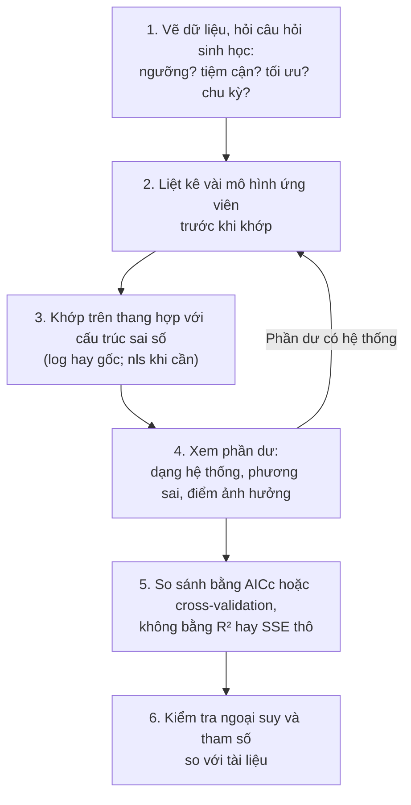

Một đa thức bậc 4 khớp chín điểm thời gian nở của trứng ruồi giấm với R² = 0,9997, nhưng lại dự đoán trứng nở sau gần 180 giờ ở 10 °C, nhiệt độ mà trứng gần như không phát triển. Bài này hướng dẫn cách chọn mô hình hồi quy cho dữ liệu sinh trưởng và phát triển khi R² của gần như mọi ứng viên đều "đẹp": vì sao đa thức bậc cao đánh lừa, dùng AICc và cross-validation thế nào, khi nào nên log-tuyến tính hoá và khi nào nên khớp phi tuyến. Mọi con số đều chạy lại được bằng code Python và R đi kèm.

## 1. Mở đầu: một bảng kết quả "quá đẹp"

Hãy bắt đầu bằng một bộ số liệu nhỏ: thời gian từ khi đẻ đến khi trứng ruồi giấm *Drosophila melanogaster* nở (H, giờ) ở chín mức nhiệt độ từ 16 đến 32 °C. Ở 16 °C trứng cần 56,5 giờ, ở 30 °C chỉ còn 15,5 giờ, rồi ở 32 °C lại tăng lên 19 giờ. Câu hỏi quen thuộc trong bài tập thống kê sinh học là "hãy tìm phương trình hồi quy phù hợp".

Cách làm phổ biến trên Excel là thử vài dạng hàm (tuyến tính, hàm mũ, hypebol, đa thức), tính tổng bình phương sai lệch (SSE, *sum of squared errors*) của từng dạng rồi chọn dạng có SSE nhỏ nhất. Đa thức bậc 4 thắng áp đảo: SSE 0,48, R² = 0,9997, cả năm hệ số có p < 0,05. Đường thẳng có SSE 315, hàm mũ 113, mô hình tổng nhiệt 25,4.

Vấn đề lộ ra khi bạn hỏi hai câu sinh học. Các hệ số của đa thức, như hệ số chặn 1027,5 hay hệ số bậc nhất −153,2, có nghĩa gì? Không có nghĩa gì: chúng chỉ giúp đường cong đi qua các điểm. Và mô hình dự đoán gì ngoài khoảng 16–32 °C? Hình 1 cho thấy đa thức dự đoán 179,7 giờ ở 10 °C, dưới ngưỡng phát triển, và 84,6 giờ ở 38 °C, chỉ do số hạng bậc 4 kéo lên. Mô hình tổng nhiệt hai tham số thì cho thời gian tiến tới vô cùng khi nhiệt độ tiến về ngưỡng, và hai tham số của nó là ngưỡng nhiệt và hằng số nhiệt mà nhà côn trùng học vẫn dùng.


*Hình 1. Bốn mô hình khớp chín điểm thời gian nở của trứng ruồi giấm, vẽ trên khoảng 10–38 °C. Vùng xám là khoảng có dữ liệu. Đường dọc nét chấm gạch là ngưỡng d ước lượng của mô hình tổng nhiệt.*

Bài đi qua bốn tình huống: đa thức bậc cao trên ít điểm (mục 3), trứng *Drosophila* với mô hình tổng nhiệt (mục 4), log-tuyến tính hoá so với hồi quy phi tuyến cho cá vược và vitamin C (mục 5), và đường cong von Bertalanffy (mục 6). Mục 7 gói lại thành quy trình sáu bước dùng được trên Excel lẫn R hoặc Python.

Các bộ số liệu là số liệu luyện tập kiểu giáo trình thống kê sinh học. Nguồn đo gốc của phần lớn chưa xác minh được, vài bộ không ghi đơn vị, và nhiều bộ là giá trị trung bình theo nhóm tuổi hoặc nhóm nhiệt độ. Vì vậy sai số chuẩn và p-value trong bài chỉ để minh hoạ phương pháp.

## 2. Nhắc lại công cụ: hồi quy, R², F và t trong output Excel

### 2.1. Từ tương quan đến hồi quy

Hệ số tương quan Pearson $r$ đo mức độ liên hệ **tuyến tính** giữa hai biến, nằm trong khoảng $[-1; 1]$:

$$r = \frac{\sum (x_i - \bar{x})(y_i - \bar{y})}{\sqrt{\sum (x_i - \bar{x})^2 \sum (y_i - \bar{y})^2}}$$

Với quan hệ phi tuyến, tỷ số tương quan (*correlation ratio*, $\eta \in [0; 1]$) đo mức độ chặt chẽ mà không đòi hỏi dạng đường thẳng. Kiểm định $H_0: \rho = 0$ dùng $t_r = r\sqrt{n-2}/\sqrt{1-r^2}$ với $n - 2$ bậc tự do. Năm điểm với $r = 0{,}871$ cho $t_r = 3{,}07 < t_{0{,}05;\,3} = 3{,}18$. Kết luận đúng là "không đủ bằng chứng để bác bỏ $H_0$", không phải "$H_0$ được chấp nhận": với năm điểm, kiểm định gần như không đủ lực để phát hiện cả một tương quan khá mạnh (xem thêm [bài về chọn kiểm định](/blog/kiem-dinh-gia-thiet-thong-ke-trong-nghien-cuu-sinh-hoc/)).

Hồi quy tuyến tính đơn giả định $y_i = \alpha + \beta x_i + \varepsilon_i$, sai số độc lập, phân phối chuẩn, phương sai $\sigma^2$ không đổi. Bình phương tối thiểu (*least squares*) chọn $\hat\alpha, \hat\beta$ làm nhỏ nhất tổng bình phương phần dư (*residual*) $e_i = y_i - \hat y_i$. Đa thức $y = a + bx + cx^2 + \dots$ thực chất là **hồi quy bội**: thêm các cột $x^2, x^3, \dots$ rồi chạy *Regression* như với nhiều biến độc lập, nên chịu các điều kiện của hồi quy bội, trong đó có điều kiện các biến không cộng tuyến hoàn toàn. Cùng các khái niệm này trong R có ở [bài phân tích dữ liệu nhà ở Boston](/blog/tieu-luan-van-dung-r-phan-tich-du-lieu-nha-o-boston/).

### 2.2. Đọc output *Regression* của Excel

Bảng 1 chú giải các ô quan trọng trong output của *Data → Data Analysis → Regression*.

**Bảng 1.** Các đại lượng chính trong output Regression của Excel

| Ô trong output | Ý nghĩa | Lưu ý khi đọc |
|---|---|---|
| *R Square* | Tỷ lệ biến thiên của Y được mô hình giải thích, $1 - SS_{res}/SS_{tot}$ | Luôn tăng khi thêm biến; không cho biết dạng hàm đúng hay sai |
| *Standard Error* | Độ lệch chuẩn phần dư $s = \sqrt{MS_{Residual}}$, cùng đơn vị với Y | Đây là sai số của dự đoán, không liên quan đến sai số của hệ số tương quan |
| *ANOVA: df Residual* | $n - p - 1$ với $p$ biến độc lập (kể cả $x^2, x^3$…) | Dùng df này cho t tới hạn của từng hệ số |
| *F* | $MS_{Regression}/MS_{Residual}$ | So với F tới hạn $F_{0{,}05;\,p,\,n-p-1}$, hoặc xem *Significance F* |
| *Significance F* | p-value của kiểm định F | < 0,05: ít nhất một hệ số khác 0, tức phương trình có ý nghĩa |
| *Coefficients, Standard Error, t Stat* | Ước lượng, sai số chuẩn và $t = \hat b/s_b$ của từng hệ số | Phụ thuộc cách tham số hoá (mục 3.3) |
| *P-value* | p hai phía của từng hệ số, đã dùng đúng df Residual | Đọc cột này an toàn hơn tự so t Stat với giá trị tra bảng |

Hai điểm cần nhấn mạnh. *F* là một thống kê; con số để so với 0,05 là *Significance F*. Và **bậc tự do của t tới hạn cho từng hệ số là df Residual**; công thức $n - 2$ chỉ đúng cho hồi quy một biến. Với chín điểm và đa thức bậc 4, df Residual = 9 − 4 − 1 = 4, nên $t_{0{,}05;\,4} = 2{,}776$ (Excel: `=T.INV.2T(0,05; 4)`); dùng nhầm df = 7 sẽ cho 2,365 và dễ tuyên bố sai một hệ số "có ý nghĩa". Với bảy điểm và bậc 4, df Residual = 2 và $t_{0{,}05;\,2} = 4{,}303$. Cột *P-value* đã dùng đúng df, nên đọc thẳng cột này là cách tránh nhầm đơn giản nhất.

Quan trọng nhất: R² đo **mức độ khớp**, không đo **tính đúng của dạng hàm**. Bộ tứ của Anscombe (1973) gồm bốn tập 11 điểm có cùng trung bình, phương sai, hệ số tương quan và đường hồi quy, nhưng một tập là đường thẳng có nhiễu, một tập là đường cong, hai tập bị một điểm duy nhất chi phối; chỉ đồ thị dữ liệu và phần dư mới phân biệt được. Với mô hình phi tuyến, mô phỏng của Spiess và Neumeyer (2010) cho thấy R² và R² hiệu chỉnh hầu như luôn ưu tiên mô hình nhiều tham số, còn AICc và BIC tìm ra mô hình đúng tốt hơn nhiều.

## 3. Đa thức bậc cao trên ít điểm

### 3.1. Quá khớp: mô hình học cả nhiễu

Với $n$ điểm, luôn có một đa thức bậc $n - 1$ đi qua mọi điểm với R² = 1, bám theo cả nhiễu đo. Đó là quá khớp (*overfitting*): mô hình mô tả rất tốt mẫu đang có nhưng không lặp lại được trên mẫu mới. Babyak (2004) nhấn mạnh rằng số quan sát đặt giới hạn trên cho độ phức tạp mà dữ liệu hỗ trợ được; vượt quá giới hạn đó, hệ số và kiểm định đi kèm trở nên ảo.

Bốn bộ số liệu minh hoạ điều này. Ba bộ ghi chỉ số cơ thể trung bình theo tuổi (6–17 tuổi) của học sinh nữ: bề dày lớp mỡ dưới da, khối nạc và khối mỡ cơ thể. Bộ thứ tư là độ dài khuẩn ti (mm) của một loài nấm ở bảy mức nhiệt từ 0 đến 32 °C. Đa thức bậc 5 dùng 6 tham số cho 12 điểm; bậc 4 cho khuẩn ti dùng 5 tham số cho 7 điểm, chỉ còn 2 bậc tự do.

### 3.2. Đa cộng tuyến: vì sao "không hệ số nào có ý nghĩa"

Các cột $X, X^2, \dots, X^5$ với $X$ từ 6 đến 17 hay từ 16 đến 32 gần như tỷ lệ với nhau. Với chín mức nhiệt của trứng ruồi giấm, tương quan giữa $T$ và $T^4$ là 0,966, giữa $T^3$ và $T^4$ là 0,997, và số điều kiện (*condition number*) của ma trận thiết kế khoảng $4 \times 10^8$. Đây là đa cộng tuyến (*multicollinearity*): dữ liệu không tách được đóng góp riêng của từng cột, nên sai số chuẩn của hệ số phình to, t nhỏ, p lớn và khoảng tin cậy thường chứa 0.

Vì vậy câu "Significance F < 0,05 nhưng không hệ số nào có p < 0,05, nên phương trình không có ý nghĩa" là cách đọc sai. Kiểm định F hỏi "ít nhất một hệ số có khác 0 không", và câu trả lời là có. Mỗi kiểm định t hỏi "hệ số này có khác 0 không **khi các số hạng khác đã có mặt**"; khi $X^4$, $X^5$ gần trùng thông tin với $X^3$, bỏ riêng từng số hạng hầu như không làm mô hình kém đi. Tổ hợp này là **triệu chứng của mô hình thừa tham số**, và cách xử lý là giảm bậc.

<div class="callout callout-warning">
<p class="callout-title">Đọc đúng tổ hợp F và t</p>

- F có ý nghĩa, mọi t có ý nghĩa: mô hình có thể chấp nhận, nhưng vẫn cần xem phần dư và so với mô hình đơn giản hơn.
- F có ý nghĩa, các t không có ý nghĩa: phương trình **có** ý nghĩa nhưng có quá nhiều số hạng chồng chéo thông tin. Hạ bậc rồi so sánh bằng AICc hoặc cross-validation.
- F không có ý nghĩa: dữ liệu không đủ bằng chứng cho quan hệ dạng này; với ít điểm, điều đó không chứng minh là không có quan hệ.

</div>

### 3.3. p-value của từng hệ số phụ thuộc cách tham số hoá

Bộ bề dày lớp mỡ dưới da cho kết quả ngược lại: với bậc 5 viết theo lũy thừa thô, cả sáu hệ số đều có p < 0,05. Nhưng viết lại bằng đa thức trực giao (*orthogonal polynomials*, `poly(X, 5)` trong R), cùng đường cong, cùng R² và SSE, thì hạng bậc 4 có p = 0,18 và hạng bậc 3 có p = 0,052. Kết luận "hệ số nào có ý nghĩa" đổi theo cách viết phương trình, nên nó không phải tiêu chí chọn bậc. Cần một tiêu chí so sánh **cả mô hình** và có tính đến độ phức tạp.

### 3.4. AICc: phạt độ phức tạp một cách có nguyên tắc

Tiêu chí thông tin Akaike (AIC) cân bằng mức khớp và số tham số: $\mathrm{AIC} = -2\ln\hat{\mathcal L} + 2k$, với $\hat{\mathcal L}$ là likelihood cực đại và $k$ là số tham số ước lượng. Với mẫu nhỏ, AIC phạt chưa đủ; Hurvich và Tsai (1989) đề xuất bản hiệu chỉnh

$$\mathrm{AICc} = \mathrm{AIC} + \frac{2k(k+1)}{n - k - 1}.$$

Với bình phương tối thiểu và sai số chuẩn, $-2\ln\hat{\mathcal L} = n\ln(2\pi\,\mathrm{SSE}/n) + n$, và $k$ là số hệ số hồi quy cộng 1 cho $\sigma^2$. AICc nhỏ hơn được ưu tiên; chỉ hiệu số giữa các mô hình trên **cùng dữ liệu, cùng biến phụ thuộc** mới có nghĩa. Khung chọn mô hình bằng tiêu chí thông tin được Johnson và Omland (2004) tổng quan cho sinh thái học và tiến hoá, và Burnham và Anderson (2002) trình bày đầy đủ. Cách khác là cross-validation (James et al., 2013): khớp trên một phần dữ liệu, đo sai số dự đoán trên phần để riêng; với vài chục điểm, dùng bản *leave-one-out* (LOOCV).

Đoạn code dưới đây tính R², AICc và số hệ số có ý nghĩa cho đa thức bậc 1 đến 5.

```python
import numpy as np
from scipy import stats

def aicc_from_sse(sse, n, k):
    """AICc theo log-likelihood chuẩn; k = số hệ số hồi quy + 1 (phương sai)."""
    aic = n * np.log(2 * np.pi * sse / n) + n + 2 * k
    return aic + 2 * k * (k + 1) / (n - k - 1)

def poly_table(x, y, max_deg=5):
    n = len(x)
    for d in range(1, max_deg + 1):
        X = np.vander(x, d + 1, increasing=True)        # cột 1, x, x^2, ...
        beta, *_ = np.linalg.lstsq(X, y, rcond=None)
        sse = np.sum((y - X @ beta) ** 2)
        df = n - d - 1                                   # df của Residual
        se = np.sqrt(np.diag(sse / df * np.linalg.inv(X.T @ X)))
        p = 2 * stats.t.sf(np.abs(beta / se), df)
        r2 = 1 - sse / np.sum((y - y.mean()) ** 2)
        k = d + 2
        a = aicc_from_sse(sse, n, k) if n - k - 1 > 0 else float("nan")
        print(f"bậc {d}: R2={r2:.4f}  AICc={a:6.1f}  hệ số p<0,05: {np.sum(p < 0.05)}/{d + 1}")

tuoi = np.arange(6, 18, dtype=float)
mo_duoi_da = np.array([2.7, 2.5, 3.2, 3.4, 3.5, 3.8, 4.0, 4.3, 4.9, 5.7, 6.5, 6.9])
poly_table(tuoi, mo_duoi_da)
```

Bảng 2 tổng hợp kết quả cho bốn bộ số liệu.

**Bảng 2.** R², AICc và số hệ số có p < 0,05 (đa thức lũy thừa thô) theo bậc đa thức. In đậm: AICc nhỏ nhất.

| Bậc | Mỡ dưới da (n = 12) | Khối nạc (n = 12) | Khối mỡ (n = 12) | Khuẩn ti (n = 7) |
|---|---|---|---|---|
| 1 | R² 0,928 · AICc 19,2 · 1/2 | R² 0,988 · AICc 38,4 · 2/2 | R² 0,916 · AICc 18,7 · 2/2 | R² 0,532 · **AICc 34,0** · 0/2 |
| 2 | R² 0,982 · **AICc 7,2** · 3/3 | R² 0,988 · AICc 43,0 · 1/3 | R² 0,995 · **AICc −9,5** · 3/3 | R² 0,658 · AICc 45,8 · 0/3 |
| 3 | R² 0,985 · AICc 11,0 · 0/4 | R² 0,995 · **AICc 37,9** · 4/4 | R² 0,995 · AICc −5,0 · 1/4 | R² 0,988 · AICc 64,6 · 3/4 |
| 4 | R² 0,987 · AICc 18,6 · 0/5 | R² 0,997 · AICc 40,9 · 0/5 | R² 0,995 · AICc 3,7 · 0/5 | R² 0,993 · không tính được · 0/5 |
| 5 | R² 0,997 · AICc 15,9 · 6/6 | R² 0,997 · AICc 53,7 · 0/6 | R² 0,997 · AICc 12,8 · 0/6 | R² 1,000 · không tính được · 0/6 |

Ba bộ số liệu theo tuổi cho kết luận rõ. Bề dày lớp mỡ dưới da và khối mỡ chọn bậc 2: đường cong tăng nhanh dần ở tuổi dậy thì. Khối nạc cho bậc 3 và bậc 1 gần như ngang nhau (37,9 và 38,4), nên một đường thẳng, độ dốc khoảng 2,2 đơn vị mỗi năm, mô tả đủ dữ liệu. Bậc 5 có R² cao nhất nhưng AICc thuộc nhóm kém nhất. Hình 2 cho thấy lý do: trong khoảng dữ liệu, bậc 2 và bậc 5 gần như trùng nhau, nhưng chỉ cần kéo ra 12% mỗi phía, bậc 5 đã bẻ cong vô lý, chẳng hạn lớp mỡ dưới da giảm đột ngột sau 17 tuổi.


*Hình 2. Đa thức bậc 2 (xanh) và bậc 5 (đỏ, nét đứt) cho bốn bộ số liệu, kéo dài 12% ra mỗi phía của khoảng dữ liệu.*

Bộ khuẩn ti nhắc rằng AICc không phải trọng tài tuyệt đối. Với bảy điểm, số hạng hiệu chỉnh tăng rất nhanh (bậc 3 có mẫu số $n - k - 1 = 1$, bậc 4 không tính được), nên AICc chọn đường thẳng với R² = 0,53, dù dữ liệu rõ ràng tăng rồi giảm. Vấn đề ở đây là họ hàm: độ dài khuẩn ti theo nhiệt độ là một đường cong hiệu năng nhiệt (*thermal performance curve*) có ngưỡng dưới, điểm tối ưu và ngưỡng trên, và điểm 0 °C với độ dài 0 nhiều khả năng là ngưỡng chứ không nằm trên cùng đường cong trơn. Mô hình có ngưỡng như mô hình Briere (mục 4.4) đúng hơn, nhưng bảy điểm không đủ để so chắc chắn các mô hình ba, bốn tham số.

### 3.5. Khi dữ liệu có chu kỳ: đa thức là dạng hàm sai

Một bộ số liệu khác đếm số loài thực vật ra hoa và mang quả theo tháng ở một vùng núi cao; số loài ra hoa tăng từ 74 (tháng 1) lên 621 (tháng 7) rồi giảm về 95 (tháng 12). Đa thức bậc 5 cho R² = 0,917, nhưng tháng là biến tuần hoàn: tháng 12 nằm cạnh tháng 1 năm sau, còn hai đầu đa thức thì trôi tự do (Hình 3).

Dạng hàm tự nhiên là hồi quy điều hoà (*harmonic regression*) $Y = a + b\sin(2\pi m/12) + c\cos(2\pi m/12)$: ba tham số, tự nối tháng 12 với tháng 1 và cho thẳng thời điểm đỉnh (khoảng đầu tháng 7 với ra hoa, tháng 8 với mang quả). R² thấp hơn (0,849) nhưng AICc là 150,4 so với 171,5 của bậc 5; với số loài mang quả là 123,7 so với 148,5.


*Hình 3. Số loài ra hoa theo tháng: hồi quy điều hoà chu kỳ 12 tháng (3 tham số) và đa thức bậc 5 (6 tham số), kéo dài sang tháng 12 năm trước và tháng 1–2 năm sau.*

Đây còn là số đếm. Hồi quy Poisson với cùng ba số hạng điều hoà cho tỷ số phân tán (*dispersion*) khoảng 7, tức phương sai gấp khoảng bảy lần mức Poisson kỳ vọng, nên bước tiếp theo hợp lý là GLM quasi-Poisson hoặc nhị thức âm; ToolPak không làm được, `glm()` trong R làm trong một dòng.

## 4. Trứng *Drosophila*: mô hình tổng nhiệt so với đa thức

### 4.1. Định luật tổng nhiệt hữu hiệu

Ở côn trùng và nhiều sinh vật biến nhiệt, trong vùng nhiệt độ trung bình, phát triển chỉ xảy ra khi nhiệt độ vượt ngưỡng dưới $d$, và tích của thời gian phát triển $H$ với phần nhiệt vượt ngưỡng là hằng số $k$:

$$H\,(T - d) = k \quad\Longleftrightarrow\quad H = \frac{k}{T - d}.$$

$k$ (độ·giờ hay độ·ngày) là hằng số nhiệt (*thermal constant*). Viết theo tốc độ phát triển, $1/H = T/k - d/k$ là một đường thẳng. Đây là định luật tổng nhiệt hữu hiệu (*law of total effective temperature*), nền tảng của mô hình độ·ngày (*degree-day*) trong dự báo phát triển côn trùng (Ikemoto & Takai, 2000), và cả hai tham số đều có nghĩa sinh học.

### 4.2. Hai cách khớp, và một dấu trừ cần cẩn thận

Cách quen thuộc trên Excel là hồi quy $1/H$ theo $T$, được độ dốc $b = 1/k$ và hệ số chặn $a = -d/k$, rồi đổi ngược $k = 1/b$, $d = -a/b$. Chín điểm cho $k = 359{,}3$ độ·giờ và $d = +8{,}54$ °C. Bước đổi ngược dễ nhầm dấu: $a$ âm nên $d$ dương. Lấy nhầm $d = -8{,}54$ sẽ cho khoảng 14,6 giờ ở 16 °C thay vì gần 48 giờ và SSE lên hàng nghìn, biến một mô hình tốt thành mô hình tệ nhất. Hãy luôn thay tham số vào công thức và so với vài điểm dữ liệu trước khi tính SSE. Đổi ngược đúng, SSE = 103,0.

Cách thứ hai là khớp phi tuyến trực tiếp $H = k/(T-d)$ trên thang gốc (`nls` trong R, `scipy.optimize.curve_fit` trong Python, Solver trong Excel), dùng kết quả tuyến tính hoá làm giá trị khởi đầu (Ritz & Streibig, 2008). Kết quả: $k = 307{,}1$ (SE 18,8), $d = 10{,}54$ °C (SE 0,44), SSE = 25,4.

```python
import numpy as np
from scipy import stats, optimize

T = np.array([16, 18, 20, 22, 24, 26, 28, 30, 32], dtype=float)
H = np.array([56.5, 41, 32.5, 26, 22, 19, 16.5, 15.5, 19])

# Cách 1: tuyến tính hoá, hồi quy 1/H theo T
fit = stats.linregress(T, 1 / H)
k_lin = 1 / fit.slope
d_lin = -fit.intercept * k_lin          # chú ý dấu: d = -(hệ số chặn) * k
sse_lin = np.sum((H - k_lin / (T - d_lin)) ** 2)
print(f"1/H theo T: k = {k_lin:.1f}, d = {d_lin:.2f}, SSE = {sse_lin:.1f}")

# Cách 2: khớp phi tuyến trực tiếp trên H
f = lambda t, k, d: k / (t - d)
(k, d), cov = optimize.curve_fit(f, T, H, p0=[k_lin, d_lin])
se_k, se_d = np.sqrt(np.diag(cov))
print(f"Phi tuyến: k = {k:.1f} (SE {se_k:.1f}), d = {d:.2f} (SE {se_d:.2f}), "
      f"SSE = {np.sum((H - f(T, k, d)) ** 2):.1f}")

# Leave-one-out cross-validation cho hai mô hình
def loocv(predict, x, y):
    err = [y[i] - predict(np.delete(x, i), np.delete(y, i), x[i]) for i in range(len(x))]
    return np.sqrt(np.mean(np.square(err)))

pred_dd = lambda x, y, x0: f(x0, *optimize.curve_fit(f, x, y, p0=[300, 10])[0])
pred_p4 = lambda x, y, x0: np.polyval(np.polyfit(x, y, 4), x0)
for ten, m in [("9 điểm", T > 0), ("bỏ 32 °C", T < 32)]:
    print(ten, "LOOCV RMSE: tổng nhiệt %.2f, bậc 4 %.2f"
          % (loocv(pred_dd, T[m], H[m]), loocv(pred_p4, T[m], H[m])))
```

Hai cách khác nhau vì hồi quy $1/H$ giả định phương sai không đổi **trên thang tốc độ**, nên cân trọng số các điểm khác với khớp trên thang thời gian. Ikemoto và Takai (2000) chỉ ra hồi quy $1/H$ theo $T$ có xu hướng cho ngưỡng thấp hơn và hằng số nhiệt lớn hơn, đúng như ở đây (8,54 °C và 359 so với 10,54 °C và 307). Họ đề xuất hồi quy $H \cdot T$ theo $H$: từ $HT = k + dH$, độ dốc là $d$ và hệ số chặn là $k$; họ cũng bàn việc cả hai biến đều có sai số đo.

### 4.3. So sánh bốn mô hình

Bảng 3 so sánh bốn mô hình trên cùng chín điểm, cùng biến phụ thuộc $H$ trên thang giờ.

**Bảng 3.** So sánh mô hình cho thời gian nở của trứng ruồi giấm (9 điểm, 16–32 °C)

| Mô hình | Số tham số hồi quy | SSE | R² | AICc | LOOCV RMSE (h) |
|---|---|---|---|---|---|
| Tuyến tính $H = a + bT$ | 2 | 315,4 | 0,788 | 68,4 | 8,72 |
| Hàm mũ $H = a e^{bT}$ (khớp phi tuyến) | 2 | 112,9 | 0,924 | 59,1 | 5,54 |
| Đa thức bậc 4 | 5 | 0,48 | 0,9997 | 53,1 | 0,71 |
| Tổng nhiệt $H = k/(T-d)$ (khớp phi tuyến) | 2 | 25,4 | 0,983 | **45,7** | 1,99 |

Theo SSE và R², đa thức bậc 4 thắng tuyệt đối. Theo AICc, mô hình tổng nhiệt hai tham số đứng đầu: SSE giảm từ 25,4 xuống 0,48 không bù được ba tham số thêm trên chín điểm. Theo LOOCV, đa thức lại tốt hơn. Ba tiêu chí bất đồng vì một điểm dữ liệu. Trong R:

```r
T <- c(16, 18, 20, 22, 24, 26, 28, 30, 32)
H <- c(56.5, 41, 32.5, 26, 22, 19, 16.5, 15.5, 19)
aicc <- function(m) { k <- length(coef(m)) + 1; n <- nobs(m)
  AIC(m) + 2 * k * (k + 1) / (n - k - 1) }
m_lin <- lm(H ~ T)
m_p4  <- lm(H ~ poly(T, 4))
m_dd  <- nls(H ~ k / (T - d), start = list(k = 359, d = 8.5))
m_exp <- nls(H ~ a * exp(b * T), start = list(a = 200, b = -0.08))
sapply(list(tuyen_tinh = m_lin, bac4 = m_p4, tong_nhiet = m_dd, mu = m_exp), aicc)
```

### 4.4. Điểm 32 °C: phía bên kia của nhiệt độ tối ưu

Thời gian nở giảm đều đến 15,5 giờ ở 30 °C rồi tăng lên 19 giờ ở 32 °C: dữ liệu đã vượt nhiệt độ tối ưu. Trên đồ thị $1/H$ theo $T$ (Hình 4), tám điểm 16–30 °C nằm gần như hoàn hảo trên một đường thẳng, còn điểm 32 °C rơi xuống dưới.


*Hình 4. Tốc độ phát triển 1/H theo nhiệt độ. Đường thẳng khớp tám điểm từ 16 đến 30 °C cắt trục hoành tại ngưỡng d; điểm 32 °C (hình thoi đỏ) nằm dưới đường thẳng.*

Điều này khớp với thực nghiệm. Kuntz và Eisen (2014) quay time-lapse phôi nhiều loài *Drosophila* ở bảy mức nhiệt 17,5–32,5 °C; với *D. melanogaster*, phát triển phôi kéo dài khoảng 33 giờ ở 17,5 °C, nhanh nhất (khoảng 16 giờ) ở 27,5 °C và chậm lại ở nhiệt độ cao hơn. Định luật tổng nhiệt chỉ mô tả nhánh dưới tối ưu, không "quay đầu" được, nên điểm 32 °C làm nó thua LOOCV. Đa thức bẻ cong theo được, đổi lại là những dự đoán vô lý ngay ngoài khoảng dữ liệu (Hình 1).

Có hai cách xử lý, đều xuất phát từ câu hỏi sinh học. Cách thứ nhất là giới hạn phạm vi: khớp mô hình tổng nhiệt trên tám điểm 16–30 °C, được SSE 0,90, $d = 10{,}86$ °C (SE 0,09), $k = 291{,}5$ độ·giờ (SE 3,8); LOOCV đảo chiều, 0,62 giờ so với 1,12 giờ của đa thức bậc 4. Cách tuyến tính hoá của Ikemoto và Takai cho gần như cùng kết quả ($d = 10{,}93$ °C, $k = 288{,}7$). Cách thứ hai là dùng mô hình mô tả cả nhánh trên: Briere et al. (1999) đề xuất hai mô hình ba và bốn tham số ước lượng được cả ngưỡng dưới lẫn ngưỡng trên, dạng ba tham số là $1/H = aT(T - T_L)\sqrt{T_U - T}$. Nhưng chỉ một điểm trên tối ưu thì không đủ để ước lượng $T_U$; thí nghiệm cần thêm vài mức nhiệt trên 30 °C.

<div class="callout callout-note">
<p class="callout-title">Ngưỡng 10,5–10,9 °C có hợp lý không?</p>

Ngưỡng ước lượng ở đây (10,5–10,9 °C) chưa được đối chiếu với nghiên cứu đo trực tiếp ngưỡng phát triển của trứng *D. melanogaster*, nên chỉ là kết quả minh hoạ. Số liệu luyện tập cho 41 giờ ở 18 °C, dài hơn mức khoảng 33 giờ ở 17,5 °C của Kuntz và Eisen (2014); khác biệt có thể do chủng ruồi, cách xác định thời điểm "nở" và điều kiện đo.

</div>

### 4.5. Ngoại suy: phép thử của tính hợp lý sinh học

Mô hình tốt còn phải hành xử hợp lý ở điều kiện chưa đo. Khi $T$ tiến về $d$, mô hình tổng nhiệt cho $H$ tiến tới vô cùng, đúng với ý nghĩa của ngưỡng; ở 12 °C nó dự đoán khoảng 210 giờ. Đa thức bậc 4 dự đoán 120,7 giờ ở 12 °C, 179,7 giờ ở 10 °C (trứng vẫn nở dưới ngưỡng) và 84,6 giờ ở 38 °C, những con số chỉ phản ánh hình dạng của $T^4$. Ngoại suy luôn rủi ro, nhưng mô hình có tham số sinh học ít nhất cho biết **vì sao** nó dự đoán như vậy và sai ở đâu khi giả định bị vi phạm.

## 5. Log-tuyến tính hoá hay hồi quy phi tuyến

### 5.1. Hai giả định sai số khác nhau

Hàm mũ $Y = ae^{bX}$ và lũy thừa $W = aL^b$ thường được tuyến tính hoá bằng logarit: $\ln Y = \ln a + bX$, $\ln W = \ln a + b\ln L$. Nhưng logarit đổi cả giả định về sai số:

- $\ln W = \ln a + b\ln L + \varepsilon$: sai số cộng trên thang log, tức sai số **nhân** trên thang gốc. Phương sai của $W$ tăng theo giá trị trung bình, cá lớn dao động nhiều hơn cá nhỏ theo tỷ lệ cố định.
- $W = aL^b + \varepsilon$: sai số **cộng**, phương sai không đổi trên thang gốc. Mọi con cá dao động quanh đường cong cùng một biên độ tuyệt đối.

Mô phỏng của Xiao et al. (2011) cho thấy sai số nhân, log-chuẩn thì hồi quy trên thang log tốt hơn, sai số cộng, chuẩn thì hồi quy phi tuyến tốt hơn; họ khuyến nghị chọn theo tính hợp lý sinh học của cấu trúc sai số kết hợp kiểm tra phần dư, không theo thói quen. Lưu ý thêm: R² trên thang log đo biến thiên của $\ln W$, còn R² của mô hình phi tuyến đo biến thiên của $W$, nên không so trực tiếp được; muốn so, đổi dự đoán về cùng thang gốc rồi tính SSE.

### 5.2. Cá vược *Lates calcarifer*: số mũ 2,32 hay 3,06?

Trong quan hệ chiều dài–khối lượng (*length–weight relationship*, LWR) $W = aL^b$ của cá, $b = 3$ là sinh trưởng đồng dạng (*isometric*), $b < 3$ là cá thon dần, $b > 3$ là cá mập dần. Phân tích tổng hợp 3929 LWR của 1773 loài cho thấy $b$ thường nằm trong khoảng 2,5–3,5 (Froese, 2006).

Bộ số liệu ghi chiều dài và khối lượng trung bình theo tuổi (1–9 tuổi) của cá vược nuôi trong đầm nước lợ, chiều dài 56–281, khối lượng 12–420; đơn vị không ghi, giả định hợp lý nhất là mm và g.

```python
import numpy as np
from scipy import stats, optimize

L = np.array([56, 94, 135, 167, 201, 223, 248, 252, 281], dtype=float)
W = np.array([12, 24, 45, 72, 146, 219, 291, 357, 420], dtype=float)

# Cách 1: log-log, sai số nhân
r = stats.linregress(np.log(L), np.log(W))
tc = stats.t.ppf(0.975, len(L) - 2)
a1, b1 = np.exp(r.intercept), r.slope
print(f"log-log: a = {a1:.5f}, b = {b1:.2f} (KTC 95%: {b1 - tc*r.stderr:.2f}–{b1 + tc*r.stderr:.2f})")
print("phần dư thang log:", np.round(np.log(W) - np.log(a1 * L**b1), 2))

# Cách 2: phi tuyến trên thang gốc, sai số cộng
(a2, b2), cov = optimize.curve_fit(lambda l, a, b: a * l**b, L, W, p0=[a1, b1], maxfev=20000)
print(f"phi tuyến: b = {b2:.2f} (SE {np.sqrt(cov[1, 1]):.2f})")
for ten, a, b in [("log-log", a1, b1), ("phi tuyến", a2, b2)]:
    print(ten, "SSE thang gốc =", round(np.sum((W - a * L**b) ** 2)))
```

Log–log cho $a = 0{,}00073$, $b = 2{,}32$ (KTC 95%: 1,88–2,76), R² = 0,957 trên thang log. Khớp phi tuyến cho $b = 3{,}06$ (SE 0,25; KTC 95% xấp xỉ 2,48–3,64). Trên thang gốc, SSE là 2828 so với 14431 của log–log đổi ngược.

Phần dư log–log có dạng chữ U rõ (Hình 5, phải): +0,37 ở cá nhỏ nhất, khoảng −0,35 đến −0,38 ở tuổi 3–4, +0,27 ở tuổi 8. Đó là dấu hiệu sai dạng hàm. Trên thang log, hai con cá nhỏ nhất có trọng số tương đương cá lớn và kéo độ dốc xuống; trên thang gốc, cá lớn chi phối và độ dốc gần 3.


*Hình 5. Cá vược: bên trái, dữ liệu trên thang log–log với đường log–log (b = 2,32) và đường phi tuyến (b = 3,06); bên phải, phần dư của mô hình log–log có dạng chữ U.*

So với tài liệu, $b \approx 3{,}06$ hợp lý hơn. FishBase (truy cập 12/11/2026) cho *L. calcarifer* LWR ước lượng Bayes $a = 0{,}00977$, $b = 3{,}00$ (2,86–3,14), chiều dài toàn thân tính bằng cm (Froese et al., 2014; FishBase, n.d.), còn 2,32 nằm ngoài khoảng 2,5–3,5 thường gặp.

**Bảng 4.** Tham số LWR của cá vược theo hai cách khớp và theo FishBase

| Nguồn | $a$ | $b$ | Khoảng của $b$ | Đơn vị |
|---|---|---|---|---|
| Log–log (bộ số liệu) | 0,00073 | 2,32 | 1,88–2,76 (KTC 95%) | Chưa rõ, giả định mm và g |
| Phi tuyến trên thang gốc (bộ số liệu) | $1{,}4 \times 10^{-5}$ | 3,06 | 2,48–3,64 (KTC 95% xấp xỉ) | Chưa rõ, giả định mm và g |
| FishBase, Bayes | 0,00977 | 3,00 | 2,86–3,14 | cm, g, chiều dài toàn thân |

Hai lưu ý. Hệ số $a$ phụ thuộc đơn vị và loại chiều dài (toàn thân, chạc đuôi, chuẩn), nên chỉ so $a$ khi những thứ đó giống nhau; $b$ thì không phụ thuộc đơn vị. Và ngay cả với giả định mm và g, cá 28,1 cm nặng 420 g, gần gấp đôi khoảng 217 g mà LWR của FishBase dự đoán; có thể đó là chiều dài chuẩn, cá nuôi béo hơn, hoặc đơn vị khác giả định. Với chín giá trị trung bình, không đánh giá được cấu trúc sai số thật; kết luận an toàn là log–log cho phần dư có hệ thống và số mũ lệch xa tài liệu, còn LWR dùng được cần số đo cá thể với đơn vị rõ ràng.

### 5.3. Vitamin C: ba giá trị ở ngưỡng phát hiện

Bộ thứ hai ghi hàm lượng vitamin C (Y) giảm theo một biến X (0,2 đến 9; ý nghĩa của X không được mô tả rõ), từ 254 xuống 5. Log-tuyến tính hoá cho $Y = 264{,}1 \cdot 0{,}608^X$ (R² thang log 0,978); khớp phi tuyến cho $Y = 283{,}7 \cdot 0{,}586^X$. SSE trên thang gốc là 802 so với 162; ở X = 0,2, hai cách dự đoán 239 và 255, giá trị đo là 254.

Nguyên nhân là ba giá trị cuối đều bằng 5, dấu hiệu của ngưỡng phát hiện hoặc làm tròn. Trên thang gốc chúng gần 0 và ít ảnh hưởng; trên thang log chúng thành ba điểm $\ln 5 = 1{,}61$ nằm ngang, kéo đuôi đường thẳng và làm phần đầu đường cong, nơi nhiều thông tin nhất, khớp kém đi. Với giá trị ở ngưỡng phát hiện, hãy ghi rõ, cân nhắc loại khỏi phép khớp hoặc dùng mô hình cho dữ liệu bị kiểm duyệt (*censored data*).

Thông điệp chung: biến đổi logarit là một **quyết định mô hình**, hợp lý khi sai số có tính nhân và không có giá trị bị chặn; khi phần dư trên thang log có hệ thống, khớp phi tuyến trên thang gốc thường đáng tin hơn.

## 6. Đường cong von Bertalanffy qua đồ thị Ford–Walford

### 6.1. Mô hình và ý nghĩa tham số

Mô hình sinh trưởng von Bertalanffy mô tả chiều dài theo tuổi của cá và nhiều động vật khác (von Bertalanffy, 1957):

$$L_t = L_\infty\left(1 - e^{-K(t - t_0)}\right).$$

$L_\infty$ là chiều dài tiệm cận, $K$ (năm⁻¹) cho biết $L_t$ tiến về $L_\infty$ nhanh đến đâu, $t_0$ là "tuổi" lý thuyết khi chiều dài bằng 0, thường là số âm nhỏ. Bộ số liệu ghi chiều dài trung bình ở sáu tuổi: 35, 55, 75, 90, 105 và 115 (đơn vị không ghi).

### 6.2. Đồ thị Ford–Walford

Ford (1933) và Walford (1946) phát triển một mẹo đồ thị để ước lượng tham số sinh trưởng. Với khoảng tuổi 1 năm, mô hình von Bertalanffy cho

$$L_{t+1} = L_\infty(1 - e^{-K}) + e^{-K} L_t = a + s\,L_t,$$

tức $L_{t+1}$ là hàm tuyến tính của $L_t$ với độ dốc $s = e^{-K}$. Đường này cắt đường chéo $y = x$ tại $L_\infty$, nơi cá không dài thêm (Hình 6, trái), nên $K = -\ln s$ và $L_\infty = a/(1 - s)$.

Nếu hồi quy mức tăng $L_{t+1} - L_t = a + bL_t$ thì $s = 1 + b$. Năm cặp số liệu cho $L_{t+1} - L_t = 26{,}17 - 0{,}1412\,L_t$, tức $s = 0{,}8588$, $K = 0{,}152$ năm⁻¹ và $L_\infty = 26{,}17/0{,}1412 = 185{,}3$.

Để tìm $t_0$, hồi quy $\ln(1 - L_t/L_\infty) = K t_0 - K t$ theo $t$ rồi lấy hệ số chặn chia $K$: $t_0 \approx -0{,}34$ năm.

```python
import numpy as np
from scipy import stats, optimize

t = np.arange(1, 7, dtype=float)
L = np.array([35, 55, 75, 90, 105, 115], dtype=float)

# Ford–Walford: L(t+1) = a + s * L(t)
fw = stats.linregress(L[:-1], L[1:])
s, a = fw.slope, fw.intercept
K = -np.log(s)
L_inf = a / (1 - s)
# t0 từ ln(1 - L/L_inf) = K*t0 - K*t
g = stats.linregress(t, np.log(1 - L / L_inf))
t0 = g.intercept / K
print(f"Ford–Walford: s = {s:.4f}, K = {K:.3f}/năm, L_inf = {L_inf:.1f}, t0 = {t0:.2f}")

# Khớp von Bertalanffy trực tiếp
vb = lambda t, Linf, K, t0: Linf * (1 - np.exp(-K * (t - t0)))
p, cov = optimize.curve_fit(vb, t, L, p0=[L_inf, K, t0])
print("Phi tuyến: L_inf, K, t0 =", np.round(p, 3), " SE =", np.round(np.sqrt(np.diag(cov)), 3))
```

### 6.3. Khớp trực tiếp và các giới hạn

Khớp trực tiếp trên sáu điểm, khởi đầu từ kết quả Ford–Walford, cho $L_\infty = 186{,}6$ (SE 14,8), $K = 0{,}152$ (SE 0,021), $t_0 = -0{,}34$ (SE 0,10): gần như trùng Ford–Walford, điều thường gặp với giá trị trung bình ít nhiễu (Hình 6, phải).


*Hình 6. Bên trái: đồ thị Ford–Walford, đường hồi quy cắt đường y = x tại L∞ ≈ 185. Bên phải: đường von Bertalanffy khớp trực tiếp, vùng xám là khoảng tuổi có dữ liệu.*

Ba giới hạn cần nhớ. Chỉ có sáu tuổi và năm cặp. Trong Ford–Walford, cùng một $L_t$ vừa là biến độc lập ở cặp này vừa là biến phụ thuộc ở cặp trước, nên sai số chuẩn và p-value của hồi quy này không đúng giả định; nó tốt để khám phá và tìm giá trị khởi đầu, còn ước lượng chính thức nên từ khớp phi tuyến. Và chiều dài lớn nhất quan sát là 115 trong khi $L_\infty \approx 185$: tham số quan trọng nhất là một **ngoại suy**, SE 14,8 là con số lạc quan. Dự đoán 148 ở tuổi 10 và 178 ở tuổi 20 chỉ đáng tin nếu quần thể thật sự sống lâu như vậy.

Ý tưởng "tuyến tính hoá để lấy giá trị khởi đầu, rồi khớp trực tiếp" cũng là cách Ritz và Streibig (2005) dùng cho phân tích sinh định lượng (*bioassay*) trong R, chẳng hạn khớp thẳng động học Michaelis–Menten thay vì qua đồ thị Lineweaver–Burk; [phần hồi quy phi tuyến trong dự án Virtual Lab](/projects/virtual-lab/tai-lieu-drive-cho-giai-doan-6/) áp dụng đúng cách này.

## 7. Quy trình sáu bước chọn mô hình hồi quy

Bốn tình huống gói lại thành sáu bước; câu hỏi sinh học đi trước, tiêu chí thống kê đi sau.



**Bước 1. Vẽ dữ liệu và đặt câu hỏi sinh học** (Anscombe, 1973): có ngưỡng, tiệm cận, tối ưu hay chu kỳ không? Biến là số đếm, tỷ lệ hay đo liên tục?

**Bước 2. Liệt kê vài mô hình ứng viên có lý do sinh học trước khi khớp**, ưu tiên tham số giải thích được (Johnson & Omland, 2004; Burnham & Anderson, 2002). Thử hàng loạt dạng hàm rồi giữ dạng tốt nhất là quá khớp ở cấp chọn mô hình.

**Bước 3. Khớp trên thang hợp với cấu trúc sai số**: sai số tỷ lệ với trung bình thì cân nhắc thang log, sai số đều thì khớp phi tuyến trên thang gốc (Xiao et al., 2011), dùng tuyến tính hoá để có giá trị khởi đầu (Ritz & Streibig, 2008).

**Bước 4. Xem phần dư** theo biến độc lập và theo giá trị dự đoán: chữ U hay chữ S là sai dạng hàm, hình phễu là phương sai không đều, điểm lệch lớn cần xem xét về sinh học. Phần dư có hệ thống thì quay lại bước 2.

**Bước 5. So sánh bằng AICc hoặc cross-validation** trên cùng dữ liệu, cùng biến phụ thuộc, cùng thang. Dưới khoảng mười điểm, cả hai đều kém ổn định; dùng chúng cạnh lập luận sinh học.

**Bước 6. Kiểm tra ngoại suy và tham số**: vẽ mô hình ra ngoài khoảng dữ liệu một chút và so tham số với tài liệu, như $b$ của LWR với FishBase hay ngưỡng phát triển với nghiên cứu cùng loài.

Bảng 5 cho biết mỗi bước làm được đến đâu trên Excel.

**Bảng 5.** Thực hiện quy trình trên Excel và R

| Bước | Excel | R |
|---|---|---|
| Vẽ dữ liệu | *Insert → Scatter* | `plot()`, `ggplot2` |
| Khớp tuyến tính, đa thức, log | *Data Analysis → Regression* (thêm cột $X^2$, $\ln Y$…) | `lm()` |
| Khớp phi tuyến | Solver: cực tiểu hoá ô chứa SSE theo các ô tham số | `nls()` |
| Phần dư | Tích *Residuals*, *Residual Plots* trong hộp Regression | `plot(residuals(m) ~ fitted(m))` |
| AICc | Tự tính từ *SS Residual* (hộp bên dưới) | `AIC()` + hiệu chỉnh |
| Cross-validation | Thủ công, rất tốn công | Vòng lặp vài dòng |

<div class="callout callout-example">
<p class="callout-title">Tính AICc trên Excel từ output Regression</p>

Lấy SSE từ ô *SS* của dòng *Residual* trong bảng ANOVA, $n$ từ ô *Observations*, và $k$ = số hệ số (kể cả *Intercept*) + 1. Công thức:
`= n*LN(SSE/n) + 2*k + 2*k*(k+1)/(n-k-1)`
Công thức bỏ hằng số $n\ln(2\pi) + n$ so với `AIC()` của R, nên con số khác R nhưng **hiệu số** giữa hai mô hình thì như nhau: với trứng ruồi giấm, Excel cho 20,1 (tổng nhiệt) và 27,6 (bậc 4), chênh 7,4, đúng bằng chênh lệch 45,7 và 53,1 ở Bảng 3. Với Solver, SSE là ô bạn cực tiểu hoá và $k$ là số ô tham số + 1.

</div>

## 8. Kết luận

Bốn tình huống cho cùng một bài học: chọn mô hình hồi quy là quyết định sinh học có thống kê hỗ trợ, không phải cuộc thi R². R² và Significance F cho biết mô hình khớp và quan hệ là có thật, nhưng không cho biết dạng hàm đúng, không phạt độ phức tạp, và không biết gì về ngưỡng nhiệt, chiều dài tiệm cận hay chu kỳ mùa.

Tóm lại: F có ý nghĩa mà các hệ số đa thức không có ý nghĩa nghĩa là mô hình thừa tham số, hãy hạ bậc. t tới hạn của từng hệ số dùng df Residual; đọc thẳng cột P-value là an toàn nhất. So mô hình khác số tham số bằng AICc hoặc cross-validation, không bằng SSE thô. Biến đổi logarit là giả định về sai số, cần phần dư xác nhận. Và khi có mô hình mà tham số mang nghĩa sinh học, như tổng nhiệt hay von Bertalanffy, hãy bắt đầu từ nó: kể cả khi khớp kém đa thức một chút, nó cho những con số đối chiếu được với tài liệu và những dự đoán kiểm chứng được.

Bài tiếp theo chuyển sang [phân tích cơ sở dữ liệu trên Excel](/blog/phan-tich-co-so-du-lieu/): tổ chức bảng số liệu sinh học trước khi đưa vào bất kỳ mô hình nào.

## Tài liệu tham khảo

Anscombe, F. J. (1973). Graphs in statistical analysis. *The American Statistician, 27*(1), 17–21. https://doi.org/10.1080/00031305.1973.10478966

Babyak, M. A. (2004). What you see may not be what you get: A brief, nontechnical introduction to overfitting in regression-type models. *Psychosomatic Medicine, 66*(3), 411–421. https://doi.org/10.1097/01.psy.0000127692.23278.a9

Briere, J.-F., Pracros, P., Le Roux, A.-Y., & Pierre, J.-S. (1999). A novel rate model of temperature-dependent development for arthropods. *Environmental Entomology, 28*(1), 22–29. https://doi.org/10.1093/ee/28.1.22

Burnham, K. P., & Anderson, D. R. (2002). *Model selection and multimodel inference: A practical information-theoretic approach* (2nd ed.). Springer. https://doi.org/10.1007/b97636

FishBase. (n.d.). *Lates calcarifer*, Barramundi: Species summary. Truy cập ngày 12/11/2026, từ https://www.fishbase.se/summary/346

Ford, E. (1933). An account of the herring investigations conducted at Plymouth during the years from 1924 to 1933. *Journal of the Marine Biological Association of the United Kingdom, 19*(1), 305–384. https://doi.org/10.1017/S0025315400055910

Froese, R. (2006). Cube law, condition factor and weight–length relationships: History, meta-analysis and recommendations. *Journal of Applied Ichthyology, 22*(4), 241–253. https://doi.org/10.1111/j.1439-0426.2006.00805.x

Froese, R., Thorson, J. T., & Reyes, R. B., Jr. (2014). A Bayesian approach for estimating length-weight relationships in fishes. *Journal of Applied Ichthyology, 30*(1), 78–85. https://doi.org/10.1111/jai.12299

Hurvich, C. M., & Tsai, C.-L. (1989). Regression and time series model selection in small samples. *Biometrika, 76*(2), 297–307. https://doi.org/10.1093/biomet/76.2.297

Ikemoto, T., & Takai, K. (2000). A new linearized formula for the law of total effective temperature and the evaluation of line-fitting methods with both variables subject to error. *Environmental Entomology, 29*(4), 671–682. https://doi.org/10.1603/0046-225X-29.4.671

James, G., Witten, D., Hastie, T., & Tibshirani, R. (2013). Resampling methods. In *An introduction to statistical learning: With applications in R* (pp. 175–201). Springer. https://doi.org/10.1007/978-1-4614-7138-7_5

Johnson, J. B., & Omland, K. S. (2004). Model selection in ecology and evolution. *Trends in Ecology & Evolution, 19*(2), 101–108. https://doi.org/10.1016/j.tree.2003.10.013

Kuntz, S. G., & Eisen, M. B. (2014). *Drosophila* embryogenesis scales uniformly across temperature in developmentally diverse species. *PLoS Genetics, 10*(4), e1004293. https://doi.org/10.1371/journal.pgen.1004293

Ritz, C., & Streibig, J. C. (2005). Bioassay analysis using R. *Journal of Statistical Software, 12*(5). https://doi.org/10.18637/jss.v012.i05

Ritz, C., & Streibig, J. C. (2008). *Nonlinear regression with R*. Springer. https://doi.org/10.1007/978-0-387-09616-2

Spiess, A.-N., & Neumeyer, N. (2010). An evaluation of R2 as an inadequate measure for nonlinear models in pharmacological and biochemical research: A Monte Carlo approach. *BMC Pharmacology, 10*, 6. https://doi.org/10.1186/1471-2210-10-6

von Bertalanffy, L. (1957). Quantitative laws in metabolism and growth. *The Quarterly Review of Biology, 32*(3), 217–231. https://doi.org/10.1086/401873

Walford, L. A. (1946). A new graphic method of describing the growth of animals. *The Biological Bulletin, 90*(2), 141–147. https://doi.org/10.2307/1538217

Xiao, X., White, E. P., Hooten, M. B., & Durham, S. L. (2011). On the use of log-transformation vs. nonlinear regression for analyzing biological power laws. *Ecology, 92*(10), 1887–1894. https://doi.org/10.1890/11-0538.1
