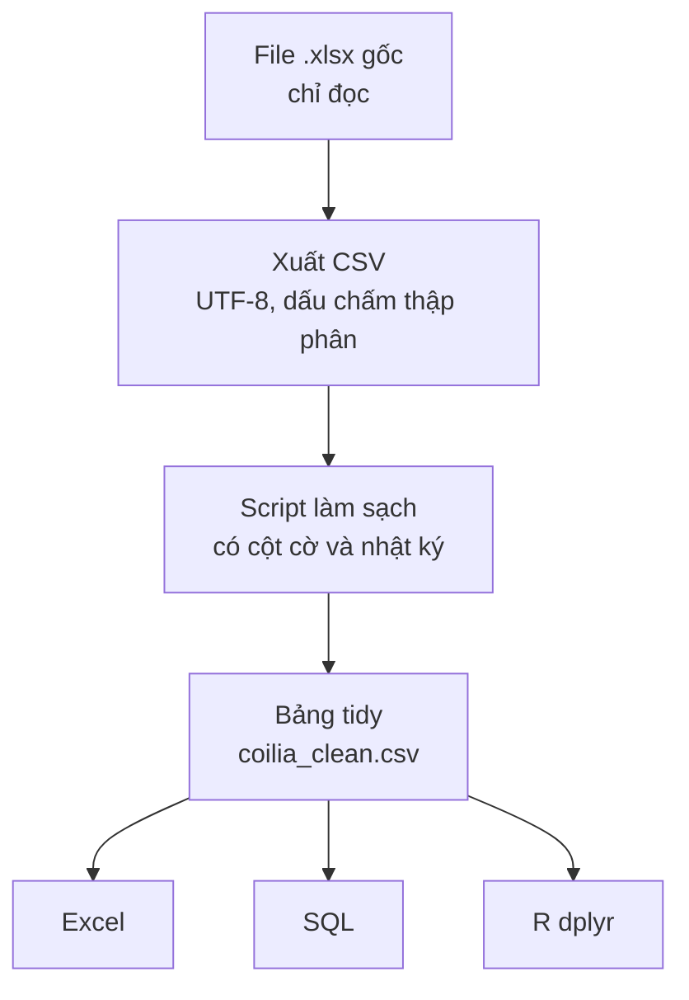
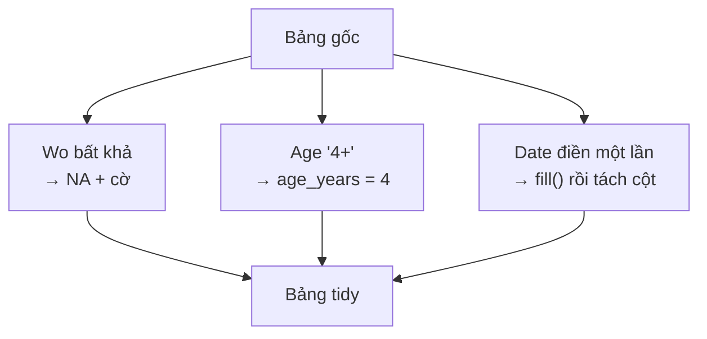

Một con cá *Coilia grayii* nặng 31,4 g, mổ xong lại nặng 38,8 g, và Excel vẫn lọc, tính hàm, sắp xếp bảng chứa nó mà không báo gì. Bài này viết song song bốn thao tác "cơ sở dữ liệu" của Excel (Advanced Filter, `DMAX`/`DAVERAGE`, Sort nhiều khoá, Histogram) bằng SQL và R `dplyr` trên cùng một bảng 25 cá thể, để ba công cụ cho cùng một kết quả. Luận điểm chính: câu lệnh truy vấn thì dễ, phần khó là bảng có đủ sạch để truy vấn đúng hay không. Dữ liệu CSV và mọi đoạn code đều có trong bài để bạn chạy lại.

## 1. Mở đầu: bảng tính là cơ sở dữ liệu đầu tiên của nhà sinh học

Với nhiều sinh viên sinh học, cơ sở dữ liệu đầu tiên là một sheet Excel: mỗi dòng một con cá hay một mẫu máu, mỗi cột một số đo. Excel gọi vùng này là **Database Range**: hàng đầu chứa tên trường (*field*), các hàng dưới là bản ghi (*record*). Khoa học dữ liệu gọi đúng cấu trúc đó là **dữ liệu dạng bảng chữ nhật** (rectangular data), với dòng là quan sát và cột là biến (Bruce & Bruce, 2017). Lý thuyết cơ sở dữ liệu gọi nó là **quan hệ** (relation): Codd (1970) đề xuất mô hình dữ liệu quan hệ, nền tảng lý thuyết của các hệ quản trị cơ sở dữ liệu quan hệ mà SQL được dùng để truy vấn (→ Dữ liệu và database).

Vì cấu trúc giống nhau, mọi thao tác trên Database Range của Excel đều có câu lệnh tương ứng trong SQL và R. Nói được cùng một truy vấn bằng cả ba công cụ có ba lợi ích:

- **Tái lập**: câu lệnh SQL hay script R ghi lại chính xác điều kiện lọc, còn thao tác chuột trong hộp thoại thì không. Wilson et al. (2017) khuyên ghi mọi bước xử lý dữ liệu, tốt nhất bằng script.
- **Quy mô**: dữ liệu nhiều đợt thu mẫu, nhiều bảng cần nối, hoặc vượt cỡ một sheet thì SQL và R xử lý gọn hơn.
- **Kiểm tra chéo**: hai công cụ độc lập cho cùng một con số là bằng chứng tốt rằng điều kiện đã viết đúng; khi chúng lệch nhau, chỗ lệch thường chỉ ra một ô trống hay một giá trị lạ.

Bài đi theo trình tự: mô tả dữ liệu (mục 2), kiểm tra bảng trước khi truy vấn (mục 3), rồi lọc (mục 4), tổng hợp (mục 5), sắp xếp kèm một phép kiểm tra sinh học (mục 6) và phân bố tần số (mục 7), mỗi thao tác có bảng đối chiếu Excel ↔ SQL ↔ `dplyr`.

## 2. Dữ liệu và cách tái lập

### 2.1. Ba bảng số liệu

Ví dụ chính là bảng đặc điểm sinh học của 25 cá *Coilia grayii*, một loài cá lành canh, dùng trong giảng dạy thống kê sinh học; chưa rõ tác giả, năm và nơi thu mẫu. Bảng có 13 trường: các số đo chiều dài và khối lượng, các trường phân loại (giới tính, độ chín sinh dục, tuổi, thức ăn chính) và hệ số béo K. Chiều dài L từ 15,5 đến 22,3 cm (trung bình 19,36; độ lệch chuẩn 1,93), khối lượng W từ 12,4 đến 44,8 g (trung bình 28,0; độ lệch chuẩn 8,77).

Bảng thứ hai gồm 165 cá thể một loài thuỷ sản chưa rõ tên ở vịnh Bắc Bộ, thu trong 6 đợt (tháng 7–8), có chiều dài L và Ls (mm), khối lượng W và Wo (g) cùng vài trường mã hoá. Bảng thứ ba là số đo nhân trắc của 98 nữ sinh phổ thông; vì là dữ liệu người thật, bài chỉ dùng con số tổng hợp.

Bảng 1 là từ điển dữ liệu (data dictionary) của bảng *C. grayii*, với tên trường viết thường, không dấu, không khoảng trắng để dùng thẳng trong SQL và R. Ellis và Leek (2018) khuyên mọi bộ dữ liệu chia sẻ đều kèm một bảng như vậy.

**Bảng 1.** Từ điển dữ liệu của bảng *C. grayii*

| Tên trường | Tên gốc | Kiểu, đơn vị | Ghi chú |
| --- | --- | --- | --- |
| `fish` | Fish | số nguyên | số hiệu cá, khoá chính |
| `l_cm`, `lo_cm` | L(cm), Lo(cm) | số thực, cm | chưa rõ L là chiều dài toàn thân hay chiều dài chuẩn |
| `w_g`, `wo_g`, `wf_g` | W(g), Wo(g), Wf(g) | số thực, g | toàn thân, sau mổ (phải có Wo ≤ W); Wf chưa rõ nghĩa |
| `sex`, `msex` | Sex, Msex | số nguyên | 0/1 chưa có chú giải; độ chín sinh dục 2–5 |
| `fs`, `ls` | FS, LS | số nguyên | chưa rõ nghĩa |
| `age`, `age_years` | Age | văn bản; số nguyên | nhãn gốc "0+" … "5+"; cột số thêm vào |
| `main_food` | Main-Food | văn bản | 6 nhóm thức ăn |
| `k_fulton` | K | số thực | tính lại bằng 100·W/L³ |

### 2.2. Quy trình

Nguyên tắc đầu tiên là coi dữ liệu gốc là chỉ đọc (Buffalo, 2015): không sửa ô rồi lưu đè, mà để script đọc bản gốc và ghi kết quả ra file mới. Hình 1 tóm tắt quy trình dùng trong bài; mỗi bước có một file đầu ra riêng, nên bất kỳ ai cũng chạy lại được từ đầu (Broman & Woo, 2018; Wilson et al., 2017; → Quy trình tái lập).



**Hình 1.** Từ file gốc đến ba công cụ truy vấn.

Bảng *C. grayii* đủ nhỏ để chép nguyên vào bài. Lưu khối dưới thành `coilia_raw.csv`; cột K được bỏ vì sẽ tính lại từ W và L, và ô `msex` của cá số 1 để trống đúng như bản gốc.

```csv
fish,l_cm,lo_cm,w_g,wo_g,wf_g,sex,msex,fs,ls,age,main_food
1,19.4,17.2,26.6,24.5,0.17,0,,4,0,1+,Copepoda
2,15.9,13.9,12.8,11.7,0.11,0,3,4,2,0+,Copepoda
3,17.7,15.5,20.2,17.9,0.15,1,2,4,3,2+,Cladocera
4,17.3,15.4,17.2,15.5,0.11,0,3,1,3,2+,Copepoda
5,17.4,15.1,16.3,15.2,0.1,0,2,3,3,3+,Copepoda
6,20.7,18.6,33.0,29.7,0.14,0,4,2,3,4+,Polychaeta
7,21.0,18.9,33.3,30.0,0.16,1,2,4,4,5+,Acetes
8,21.5,19.5,33.3,29.8,0.11,1,3,2,3,5+,Acetes
9,19.2,17.3,33.6,30.2,0.12,1,4,2,3,3+,Cladocera
10,19.6,17.5,37.4,30.1,0.16,0,2,2,3,3+,Copepoda
11,22.3,20.1,44.8,41.1,0.17,1,3,4,3,4+,Acetes
12,21.1,19.0,33.3,30.7,0.16,1,2,4,3,4+,Acetes
13,20.6,18.6,30.5,28.3,0.16,0,2,4,3,4+,Copepoda
14,21.0,18.7,33.7,31.4,0.12,0,4,3,3,5+,Acetes
15,21.6,19.3,34.3,31.7,0.12,0,2,3,3,5+,Amphipoda
16,19.5,17.3,33.0,29.7,0.17,1,2,4,3,4+,Cladocera
17,21.0,18.9,34.8,30.8,0.18,1,3,3,3,4+,Polychaeta
18,20.1,18.1,31.4,38.8,0.17,1,4,2,3,4+,Copepoda
19,20.6,18.6,33.3,30.7,0.2,0,2,4,4,3+,Mysis
20,19.5,17.3,28.9,25.4,0.14,1,5,1,4,4+,Cladocera
21,18.0,16.2,23.0,20.2,0.13,1,2,3,3,3+,Cladocera
22,20.2,18.1,31.8,28.7,0.21,1,3,4,4,5+,Acetes
23,17.2,15.4,17.1,15.6,0.12,0,2,4,1,3+,Cladocera
24,16.2,14.2,12.4,11.9,0.13,0,2,4,1,3+,Copepoda
25,15.5,14.0,14.0,12.7,0.1,0,3,1,1,2+,Copepoda
```

Code trong bài đã chạy với R 4.4 cùng `dplyr` 1.2.1, `tidyr` 1.3.2 (Wickham et al., 2019; → tidyverse, Data frames), SQLite 3.37 và Python 3.13 với pandas 3.0.

## 3. Kiểm tra sức khoẻ bảng tính trước khi truy vấn

Một bảng tính "nhìn đúng" vẫn có thể cho truy vấn sai. Trước khi lọc hay tính bất kỳ thứ gì, hãy đối chiếu bảng với hai bộ nguyên tắc: 12 khuyến nghị tổ chức bảng tính của Broman và Woo (2018), như không để ô trống, mỗi ô một thứ, không đặt phép tính trong file dữ liệu gốc; và ba quy tắc dữ liệu gọn (tidy data) của Wickham (2014): mỗi biến một cột, mỗi quan sát một dòng, mỗi loại đơn vị quan sát một bảng. Bảng 2 là nhật ký các vấn đề tìm được trong ba bảng số liệu.

**Bảng 2.** Nhật ký vấn đề dữ liệu

| Vấn đề | Vị trí | Bằng chứng | Cách xử lý |
| --- | --- | --- | --- |
| Giá trị bất khả | cá số 18 | Wo = 38,8 g > W = 31,4 g; 24 cá còn lại có Wo/W từ 0,805 đến 0,960 | gắn cờ, Wo = NA, đối chiếu phiếu gốc |
| Ô trống | `msex` của cá số 1 | "chưa xác định" hay "quên nhập"? | ghi NA rõ ràng, gắn cờ |
| Biến số lưu dạng văn bản | `age` | "0+" … "5+" không so sánh số được | thêm `age_years` |
| Phép tính trong dữ liệu gốc | cột K | K = 100·W/L³, sai khác dưới 10⁻¹⁵ | bỏ cột, tính lại bằng script |
| Mã hoá không nhất quán | giới tính | 0/1 ở bảng 1; d/c/dc (77/77/11) ở bảng 2; không chú giải | thống nhất mã, ghi vào từ điển |
| Giá trị chỉ điền một lần | Date, bảng 2 | 6/165 dòng có giá trị | điền xuống bằng `fill()` |
| Hai biến trong một ô | Date, bảng 2 | "Me1,5/7": mã đợt và ngày, không có năm | tách hai cột |
| Định dạng che giá trị | Ls, bảng 2 | 86/165 ô có phần lẻ, định dạng "0" chỉ hiện số nguyên | cột cờ "ước tính", hỏi nguồn |
| Nghi nhập liệu sai | 3 cá, bảng 2 | K Fulton 4,04; 2,66; 2,00 so với trung vị 0,72 | gắn cờ, đối chiếu phiếu gốc |
| Trùng, giá trị cực đoan | bảng nhân trắc | 1 cặp trùng cả 13 số đo; 8 giá trị cách trung vị hơn 3,5 lần MAD chuẩn hoá | kiểm tra với nguồn |

### 3.1. Các lỗi mà phép lọc không nhìn thấy

**Giá trị bất khả.** Cá đã mổ không thể nặng hơn cá nguyên con. Đây là ràng buộc giữa hai cột, và không hàm lọc nào tự kiểm tra nó; phải viết thành phép thử `wo_g <= w_g`. Nếu không xử lý từ đầu, mọi bản trích xuất từ bảng gốc đều mang theo lỗi này. Cách đúng là đánh dấu NA và ghi lý do, không đoán giá trị, vì không biết W hay Wo mới là số gõ sai.

**Ô trống và biến văn bản.** Broman và Woo (2018) khuyên ghi giá trị thiếu bằng một mã thống nhất như NA. Ô trống còn gây rắc rối khi chuyển công cụ: CSV không có khái niệm NULL, nên SQLite nạp ô trống thành chuỗi rỗng (mục 4.2). Nhãn "4+" đọc được bằng mắt nhưng không so sánh được với 3, nên điều kiện "tuổi từ 3 trở lên" cần cột số `age_years`.

**Phép tính trong dữ liệu gốc.** Cột K là hệ số béo Fulton 100·W/L³. Nếu K là giá trị đã dán, sửa W của một con cá sẽ không làm K đổi theo. Cùng lý do, vùng điều kiện, vùng kết quả và bảng tần số nên nằm ở sheet riêng; Microsoft cũng lưu ý không đặt vùng điều kiện chồng lên danh sách (Microsoft, n.d.-a). Khi chép công thức, hai vùng lệch nhau một dòng như `MIN(B9:B34)` và `MAX(B10:B34)` vô hại nếu dòng thừa là tiêu đề, nhưng sai lặng lẽ nếu đó là dữ liệu.

**Giá trị điền một lần.** Ở bảng thứ hai, cột Date chỉ có giá trị ở dòng đầu mỗi đợt, kiểu trình bày quen thuộc khi in bảng. Theo tidy data, mỗi dòng là một quan sát (Wickham, 2014), nên phải tự mang giá trị đợt của nó; nếu không, lọc theo đợt sẽ bỏ sót 159 dòng. "Me1,5/7" lại chứa hai biến, và "5/7" không có năm nên không chuyển được sang dạng YYYY-MM-DD.

**Định dạng che giá trị thật.** 86 ô Ls chứa số lẻ như 239,41 nhưng chỉ hiện 239. Cả 86 giá trị nằm đúng trên đường thẳng Ls = 1,024·L − 22,67 (sai lệch dưới 10⁻¹²) và thuộc ba đợt thu mẫu cuối, nên nhiều khả năng được tính từ L chứ không đo trực tiếp. Điều này cần hỏi nguồn dữ liệu; trong lúc chờ, nên thêm cột cờ "đo" hay "ước tính", vì phân tích quan hệ L–Ls trên các dòng ước tính sẽ cho tương quan hoàn hảo giả tạo.

### 3.2. Sửa bằng script, không sửa bằng tay

Hình 2 tóm tắt các biến đổi từ bảng gốc sang bảng tidy.



**Hình 2.** Các biến đổi chính từ bảng gốc sang bảng tidy.

Script R dưới làm các biến đổi đó cho bảng *C. grayii* và ghi `coilia_clean.csv`:

```r
library(dplyr)

raw <- read.csv("coilia_raw.csv")             # ô trống được đọc thành NA

clean <- raw |>
  mutate(
    age_years = as.integer(sub("+", "", age, fixed = TRUE)),  # "4+" -> 4
    flag = case_when(
      wo_g > w_g  ~ "wo_g > w_g: đối chiếu phiếu gốc",
      is.na(msex) ~ "msex trống",
      .default = ""
    ),
    wo_g = if_else(wo_g > w_g, NA_real_, wo_g),   # gắn NA, không tự sửa số
    k_fulton = 100 * w_g / l_cm^3                 # tính lại từ dữ liệu thô
  )
write.csv(clean, "coilia_clean.csv", row.names = FALSE, na = "")
clean |> filter(flag != "") |> select(fish, w_g, wo_g, msex, flag)
```

```text
  fish  w_g wo_g msex                            flag
1    1 26.6 24.5   NA                      msex trống
2   18 31.4   NA    4 wo_g > w_g: đối chiếu phiếu gốc
```

Với cột Date của bảng thứ hai, `fill()` điền giá trị xuống các dòng trống, rồi `separate_wider_delim()` tách mã đợt và ngày (năm dòng thật của bảng, các dòng giữa lược bớt; → [Thao tác dữ liệu trong R](/blog/cac-thao-tac-voi-du-lieu-trong-r/)):

```r
library(dplyr)
library(tidyr)

# Năm dòng thật của bảng thứ hai (dòng tt = 2–23 lược bớt)
mt <- tibble::tribble(
  ~date,      ~tt, ~l_mm, ~w_g, ~dc,
  "Me1,5/7",    1,   190,   49, "d",
  NA,          24,   140,   32, "c",
  NA,          25,   200,   71, "c",
  "Me2,5/7",   26,   208,   69, "c",
  NA,          27,   205,   55, "d"
)

mt |>
  fill(date) |>                                        # mỗi dòng tự mang giá trị đợt
  separate_wider_delim(date, ",", names = c("dot", "ngay"))   # một ô, một giá trị
```

```text
# A tibble: 5 × 6
  dot   ngay     tt  l_mm   w_g dc
  <chr> <chr> <dbl> <dbl> <dbl> <chr>
1 Me1   5/7       1   190    49 d
2 Me1   5/7      24   140    32 c
3 Me1   5/7      25   200    71 c
4 Me2   5/7      26   208    69 c
5 Me2   5/7      27   205    55 d
```

### 3.3. Dấu phẩy thập phân và chuyện Excel tự đổi dữ liệu

Trong file .xlsx, số được lưu dưới dạng số; dấu phẩy thập phân chỉ là cách hiển thị theo cài đặt vùng tiếng Việt. Rủi ro thật xuất hiện khi xuất CSV theo cài đặt này: dấu phẩy thành dấu thập phân, dấu chấm phẩy thành dấu phân cách cột, và pandas, SQLite hay `read.csv()` sẽ đọc sai cả bảng. Vì vậy quy trình ở Hình 1 xuất CSV với dấu chấm thập phân.

Nếu bạn dùng Excel cho dữ liệu gene, còn một rủi ro nữa: Excel tự đổi một số tên gene thành ngày tháng, ví dụ DEC1 thành "1-DEC"; Zeeberg et al. (2004) đếm được ít nhất 30 tên gene bị đổi kiểu này. Khoảng một phần năm số bài báo có danh sách gene dạng Excel trong tài liệu bổ sung chứa lỗi này (Ziemann et al., 2016), và khảo sát PubMed Central giai đoạn 2014–2020 cho thấy lỗi vẫn tích luỹ: 30,9% (3.436/11.117) số bài, một phần vì phần mềm quét phát hiện thêm dạng lỗi mới (Abeysooriya et al., 2021). Cách phòng có trong [bài về làm sạch dữ liệu](/blog/process-data-from-dirty-to-clean/).

## 4. Lọc bản ghi: Advanced Filter ↔ WHERE ↔ filter()

### 4.1. Quy tắc AND và OR của vùng điều kiện

Advanced Filter (Data → Advanced) cần List range (Database Range), Criteria range (vùng điều kiện) và vùng đích nếu chép kết quả sang chỗ khác. Vùng điều kiện gồm ít nhất một nhãn cột và ít nhất một ô điều kiện bên dưới. Quy tắc đọc: điều kiện **cùng hàng** nối bằng AND, **khác hàng** nối bằng OR (Microsoft, n.d.-a). Nhãn nên chép đúng tên trường; tài liệu không nói thẳng, nhưng các ví dụ của Microsoft đều dùng nhãn trùng tên cột.

Giả sử dữ liệu ở A1:L26 với tiêu đề như CSV ở mục 2. Hai truy vấn lọc có vùng điều kiện như sau:

```text
Truy vấn 1: L > 21 HOẶC tuổi 5+         Truy vấn 2: Msex = 3 HOẶC 4
   O        P                               R
1  l_cm     age                          1  msex
2  >21                                   2  3
3           5+                           3  4
```

Ở truy vấn 1, ">21" và "5+" nằm ở hai hàng khác nhau nên là OR. Nếu đặt chúng cùng hàng 2, điều kiện sẽ thành "L > 21 **và** tuổi 5+", chỉ còn 2 cá (số 8 và 15). Lỗi này dễ mắc vì hai vùng điều kiện trông gần như giống hệt nhau.

### 4.2. Cùng một truy vấn bằng ba công cụ

Trong SQL, `WHERE` nhận điều kiện viết bằng `AND`, `OR` và `IN` (→ SELECT & WHERE). Đoạn dưới tạo bảng trong SQLite, nạp `coilia_clean.csv` và chạy hai truy vấn lọc. Bảng được khai báo kiểu trước khi nạp để cột số không bị lưu thành văn bản.

```sql
CREATE TABLE fish (
  fish INTEGER PRIMARY KEY, l_cm REAL, lo_cm REAL, w_g REAL, wo_g REAL,
  wf_g REAL, sex INTEGER, msex INTEGER, fs INTEGER, ls INTEGER, age TEXT,
  main_food TEXT, age_years INTEGER, flag TEXT, k_fulton REAL
);
.import --csv --skip 1 coilia_clean.csv fish
-- CSV không có khái niệm NULL: ô trống được nạp thành chuỗi rỗng ''
UPDATE fish SET msex = NULLIF(msex, ''), wo_g = NULLIF(wo_g, '');
.mode column
.headers on

-- Truy vấn 1: L > 21 hoặc tuổi 5+
SELECT fish, sex, msex, l_cm, age FROM fish
WHERE l_cm > 21 OR age = '5+';

-- Truy vấn 2: Msex = 3 hoặc 4
SELECT msex, COUNT(*) AS n FROM fish
WHERE msex IN (3, 4) GROUP BY msex;
```

```text
fish  sex  msex  l_cm  age
----  ---  ----  ----  ---
7     1    2     21.0  5+
8     1    3     21.5  5+
11    1    3     22.3  4+
12    1    2     21.1  4+
14    0    4     21.0  5+
15    0    2     21.6  5+
22    1    3     20.2  5+
msex  n
----  -
3     7
4     4
```

Trong `dplyr`, `filter()` dùng `|` cho OR và `%in%` cho tập giá trị:

```r
library(dplyr)
fish <- read.csv("coilia_clean.csv")

fish |> filter(l_cm > 21 | age == "5+") |> pull(fish)             # truy vấn 1
fish |> filter(msex %in% c(3, 4)) |> count(msex)                  # truy vấn 2
fish |> filter(l_cm >= 19, l_cm < 21) |>                          # truy vấn 3
  summarise(n = n(), w_max = max(w_g))
fish |> filter(ls >= 3) |> summarise(n = n(), l_mean = mean(l_cm)) # truy vấn 4
fish |> group_by(age) |>                                          # mở rộng
  summarise(n = n(), l_mean = mean(l_cm), w_mean = mean(w_g))
```

```text
[1]  7  8 11 12 14 15 22
  msex n
1    3 7
2    4 4
   n w_max
1 10  37.4
   n l_mean
1 20 19.995
# A tibble: 6 × 4
  age       n l_mean w_mean
  <chr> <int>  <dbl>  <dbl>
1 0+        1   15.9   12.8
2 1+        1   19.4   26.6
3 2+        3   16.8   17.1
4 3+        7   18.3   24.7
5 4+        8   20.6   33.7
6 5+        5   21.1   33.3
```

Cả ba công cụ cho 7 bản ghi ở truy vấn 1 và 11 bản ghi ở truy vấn 2 (Bảng 3). Cá số 7, 14 và 17 dài đúng 21,0 cm: hai con đầu vào kết quả vì tuổi 5+, còn cá số 17 (tuổi 4+) thì không, vì "L > 21" không gồm 21,0.

**Bảng 3.** Lọc bản ghi bằng ba công cụ

| Truy vấn | Excel (vùng điều kiện) | SQL | `dplyr` | Kết quả |
| --- | --- | --- | --- | --- |
| L > 21 hoặc tuổi 5+ | ">21" và "5+" ở hai hàng | `WHERE l_cm > 21 OR age = '5+'` | `filter(l_cm > 21 \| age == "5+")` | 7 cá: 7, 8, 11, 12, 14, 15, 22 |
| Msex = 3 hoặc 4 | 3 và 4 ở hai hàng dưới nhãn `msex` | `WHERE msex IN (3, 4)` | `filter(msex %in% c(3, 4))` | 11 cá |
| 19 ≤ L < 21 | hai cột `l_cm` cùng hàng: ">=19", "<21" | `WHERE l_cm >= 19 AND l_cm < 21` | `filter(l_cm >= 19, l_cm < 21)` | 10 cá |

Điều kiện khoảng ở dòng cuối cần hai cột cùng tên `l_cm` đặt cạnh nhau trong vùng điều kiện của Excel. Trong SQL, đừng viết `BETWEEN 19 AND 21`: `BETWEEN` tương đương `>= 19 AND <= 21`, lấy cả hai đầu mút (SQLite, n.d.-a), nên đếm thêm ba cá dài đúng 21,0 cm thành 13 thay vì 10.

### 4.3. Bẫy giá trị thiếu

Cá số 1 có Msex trống, nên không thuộc kết quả của truy vấn 2 ở cả ba công cụ. Với điều kiện phủ định thì khác. Hỏi "có bao nhiêu cá có Msex khác 3?", SQL và `dplyr` đều trả lời 17, bỏ qua cá số 1, vì phép so sánh với NULL hay NA không cho TRUE. pandas trả lời 18, vì `NaN != 3` cho `True`:

```sql
SELECT COUNT(*) AS khac_3 FROM fish WHERE msex <> 3;
SELECT COUNT(*) AS khac_3_hoac_trong FROM fish WHERE msex <> 3 OR msex IS NULL;
```

```text
khac_3
------
17
khac_3_hoac_trong
-----------------
18
```

```r
fish |> filter(msex != 3) |> nrow()                 # 17: dòng NA bị loại
fish |> filter(msex != 3 | is.na(msex)) |> nrow()   # 18
```

```python
import pandas as pd

fish = pd.read_csv("coilia_clean.csv")
print(len(fish[fish["msex"] != 3]))                            # NaN != 3 là True
print(len(fish[fish["msex"].ne(3) & fish["msex"].notna()]))   # loại ô trống rõ ràng
```

```text
18
17
```

Không câu trả lời nào sai; mỗi công cụ theo một quy ước riêng. Với Excel, hãy đếm thử điều kiện "<>3" trên một vùng có ô trống trước khi tin kết quả. Cách an toàn ở mọi công cụ là viết rõ ý định: "khác 3 **và** có giá trị", hay "khác 3 **hoặc** trống".

## 5. Hàm cơ sở dữ liệu và tổng hợp: DMAX, DAVERAGE ↔ MAX, AVG ↔ summarise()

Các hàm cơ sở dữ liệu của Excel có chung cú pháp `Dxxx(database, field, criteria)`: `database` là Database Range kể cả hàng tiêu đề, `field` là tên cột trong ngoặc kép hoặc số thứ tự cột, `criteria` là vùng điều kiện theo đúng quy tắc AND/OR ở mục 4 (Microsoft, n.d.-a). Trên máy đặt dấu phẩy làm dấu thập phân, các đối số thường phân cách bằng dấu chấm phẩy. Hai truy vấn dưới dùng `DMAX` và `DAVERAGE`, với vùng điều kiện đặt bên phải dữ liệu:

```text
   O       P       R
1  l_cm    l_cm    ls
2  >=19    <21     >=3

=DMAX(A1:L26, "w_g", O1:P2)        -> 37.4
=DAVERAGE(A1:L26, "l_cm", R1:R2)   -> 19.995
```

**Truy vấn 3**: trong 10 cá có 19 ≤ L < 21, W lớn nhất là **37,4 g**, thuộc cá số 10 (L = 19,6 cm). **Truy vấn 4**: trong 20 cá có LS ≥ 3, L trung bình là **19,995 cm**. SQL dùng các hàm tổng hợp `MAX()` và `AVG()` sau `WHERE` (→ Hàm tổng hợp):

```sql
-- Truy vấn 3: W lớn nhất khi 19 <= L < 21
SELECT COUNT(*) AS n, MAX(w_g) AS w_max FROM fish
WHERE l_cm >= 19 AND l_cm < 21;

-- Truy vấn 4: L trung bình khi LS >= 3
SELECT COUNT(*) AS n, AVG(l_cm) AS l_mean FROM fish WHERE ls >= 3;

-- BETWEEN lấy cả hai đầu mút: 19 <= L <= 21
SELECT COUNT(*) AS n FROM fish WHERE l_cm BETWEEN 19 AND 21;

-- Mở rộng: tổng hợp theo nhóm tuổi
SELECT age, COUNT(*) AS n, ROUND(AVG(l_cm), 2) AS l_mean,
       ROUND(AVG(w_g), 2) AS w_mean
FROM fish GROUP BY age ORDER BY age;
```

```text
n   w_max
--  -----
10  37.4
n   l_mean
--  ------
20  19.995
n
--
13
age  n  l_mean  w_mean
---  -  ------  ------
0+   1  15.9    12.8
1+   1  19.4    26.6
2+   3  16.83   17.13
3+   7  18.31   24.73
4+   8  20.6    33.71
5+   5  21.06   33.28
```

**Bảng 4.** Kết quả hàm cơ sở dữ liệu bằng ba công cụ

| Truy vấn | Excel | SQL | `dplyr` | n | Kết quả |
| --- | --- | --- | --- | --- | --- |
| W lớn nhất khi 19 ≤ L < 21 | `DMAX` | `MAX(w_g) … WHERE` | `filter() \|> summarise(max())` | 10 | 37,4 g |
| L trung bình khi LS ≥ 3 | `DAVERAGE` | `AVG(l_cm) … WHERE` | `filter() \|> summarise(mean())` | 20 | 19,995 cm |

Mỗi hàm D- chỉ trả về **một** con số. Muốn tính cho từng nhóm, Excel cần PivotTable, SQL dùng `GROUP BY`, R dùng `group_by()` rồi `summarise()` (→ GROUP BY & HAVING). Theo Bảng 5, chiều dài và khối lượng tăng theo tuổi đến 4+ rồi gần như chững lại, nhưng nhóm 0+ và 1+ chỉ có một cá mỗi nhóm, nên so sánh chỉ mang tính mô tả. Theo thức ăn chính, Copepoda có 9 cá, Cladocera và Acetes mỗi nhóm 6, Polychaeta 2, Amphipoda và Mysis mỗi nhóm 1.

**Bảng 5.** Chiều dài và khối lượng trung bình theo nhóm tuổi

| Tuổi | n | L trung bình (cm) | W trung bình (g) |
| --- | --- | --- | --- |
| 0+ | 1 | 15,90 | 12,80 |
| 1+ | 1 | 19,40 | 26,60 |
| 2+ | 3 | 16,83 | 17,13 |
| 3+ | 7 | 18,31 | 24,73 |
| 4+ | 8 | 20,60 | 33,71 |
| 5+ | 5 | 21,06 | 33,28 |

## 6. Sắp xếp nhiều khoá và một phép kiểm tra sinh học: hệ số béo K

### 6.1. Sắp xếp và vị trí của giá trị thiếu

Truy vấn 5 là sắp xếp tăng dần theo Wo (khoá chính), rồi Wf, rồi Msex (khoá phụ). Trong Excel, đó là Data → Sort với ba mức. Trong SQL là `ORDER BY wo_g, wf_g, msex`, trong R là `arrange(wo_g, wf_g, msex)` (→ Sắp xếp & Tìm kiếm). Điểm cần chú ý là giá trị thiếu đứng ở đâu. SQLite coi NULL nhỏ hơn mọi giá trị khác, nên NULL đứng đầu khi sắp tăng dần; cú pháp `NULLS LAST` đổi lại thứ tự này (SQLite, n.d.-b). `arrange()` của `dplyr` luôn đẩy NA xuống cuối.

```sql
-- Truy vấn 5: Wo tăng dần, rồi Wf, rồi Msex
SELECT fish, wo_g, wf_g, msex FROM fish
ORDER BY wo_g, wf_g, msex LIMIT 3;

SELECT fish, wo_g, wf_g, msex FROM fish
ORDER BY wo_g NULLS LAST, wf_g, msex LIMIT 3;
```

```text
fish  wo_g  wf_g  msex
----  ----  ----  ----
18          0.17  4
2     11.7  0.11  3
24    11.9  0.13  2
fish  wo_g  wf_g  msex
----  ----  ----  ----
2     11.7  0.11  3
24    11.9  0.13  2
25    12.7  0.1   3
```

```r
library(dplyr)
fish <- read.csv("coilia_clean.csv")
fish |> arrange(wo_g, wf_g, msex) |> select(fish, wo_g, wf_g, msex) |> tail(3)
```

```text
   fish wo_g wf_g msex
23   15 31.7 0.12    2
24   11 41.1 0.17    3
25   18   NA 0.17    4
```

Cùng một câu lệnh, cá số 18 đứng đầu bảng SQL và cuối bảng R; báo cáo "ba cá có Wo nhỏ nhất" từ SQL mà không để ý sẽ đưa một con cá không có Wo vào danh sách.

Sắp xếp còn là công cụ phát hiện lỗi rẻ tiền. Trên bảng gốc chưa làm sạch, sắp theo Wo đặt cá số 18 (38,8 g, dài 20,1 cm) ngay sát cá số 11 (41,1 g), con dài nhất bảng với 22,3 cm. Một con cá cỡ trung bình đứng cạnh con lớn nhất là dấu hiệu nên xem lại dòng đó.

### 6.2. K trong bảng được tính thế nào

Tính lại từng dòng cho thấy K = 100·W/L³ (W tính bằng g, L bằng cm), tức hệ số béo Fulton, sai khác dưới 10⁻¹⁵. K trung bình là 0,372 (độ lệch chuẩn 0,047; từ 0,29 đến 0,50), và tương quan với L là r = 0,28. Nếu cá tăng trưởng đẳng tốc, tức khối lượng tỷ lệ với lập phương chiều dài, K sẽ không phụ thuộc L.

Quan hệ khối lượng–chiều dài W = a·L^b thành đường thẳng sau khi lấy log hai vế (→ [Tương quan và hồi quy](/blog/tuong-quan-va-hoi-quy/)). Với 25 cá, log₁₀W = −2,931 + 3,388·log₁₀L, R² = 0,90. Sai số chuẩn của b là 0,233, nên khoảng tin cậy 95% của b xấp xỉ 2,91–3,87. Khoảng này chứa 3: với n = 25, chưa đủ bằng chứng để nói cá tăng trưởng dị tốc (→ [Kiểm định giả thiết](/blog/kiem-dinh-gia-thiet-thong-ke-trong-nghien-cuu-sinh-hoc/)).

Froese (2006) cho thấy K trung bình suy từ quan hệ W–L bằng 100·a·L^(b−3), nên khi b khác 3, K phụ thuộc chiều dài: với hệ số của bảng này, K dự đoán là 0,34 ở L = 16 cm và 0,39 ở L = 22 cm. So K Fulton giữa hai nhóm cá khác kích thước vì vậy dễ lẫn hiệu ứng kích thước với thể trạng. Le Cren (1951) đề xuất hệ số béo tương đối Kn = W/(a·L^b), so khối lượng thực với khối lượng dự đoán; Froese (2006) đề xuất khối lượng tương đối tính từ a và b trung bình của loài để so sánh giữa các quần thể.


**Hình 3.** Quan hệ log W – log L của 25 cá *C. grayii*, đường hồi quy và đường theo hệ số FishBase. Cá số 18 nằm sát đường hồi quy: lỗi của nó ở Wo, không ở W.

### 6.3. Đối chiếu với FishBase

FishBase đưa ước lượng Bayes cho *C. grayii* là a = 0,00229 và b = 3,10, với L là chiều dài toàn thân tính bằng cm (FishBase, n.d.). Nếu L trong bảng là chiều dài toàn thân, Kn theo hệ số FishBase trung bình là 1,21 (từ 0,96 đến 1,61), tức cá nặng hơn dự đoán khoảng 20%. Nhưng L có thể không phải chiều dài toàn thân: ở loài có thân thon dần về phía đuôi như *Coilia*, cách đo có thể khác nhau, và vì W tỷ lệ với khoảng lập phương của L, chiều dài lệch khoảng 6% đã đủ tạo ra 20% này. Vì vậy 1,21 chỉ là một phép kiểm tra hợp lý, không phải kết luận về thể trạng (→ ĐVCXS dưới nước).

**Bảng 6.** Hệ số béo theo nhóm tuổi

| Tuổi | n | K Fulton | Kn (a, b của bảng) | Kn (a, b của FishBase) |
| --- | --- | --- | --- | --- |
| 0+ | 1 | 0,32 | 0,93 | 1,05 |
| 1+ | 1 | 0,36 | 0,98 | 1,18 |
| 2+ | 3 | 0,36 | 1,02 | 1,18 |
| 3+ | 7 | 0,38 | 1,06 | 1,25 |
| 4+ | 8 | 0,38 | 1,02 | 1,24 |
| 5+ | 5 | 0,36 | 0,93 | 1,15 |
| Cả bảng | 25 | 0,37 | 1,01 | 1,21 |

Kn theo hệ số của chính bảng có trung bình xấp xỉ 1 theo cách xây dựng, nên chỉ dùng để so sánh trong cùng bảng. K Fulton trung bình ở bảng thứ hai là 0,78, gấp đôi bảng *C. grayii*, gợi ý một loài có hình dạng thân khác hẳn.

Theo FishBase, *C. grayii* sống ở vùng ven biển và cửa sông của Biển Hoa Đông và Biển Đông, có thể có ở Việt Nam, và đạt chiều dài chuẩn tối đa khoảng 33 cm (FishBase, n.d.). Trong lưới thức ăn ở sông Châu Giang, Trung Quốc, loài này có bậc dinh dưỡng cao, ước tính 5,0 (Tang et al., 2022). Một số tài liệu viết tên loài là *Coilia grayi*.

## 7. Phân bố tần số: bin cố định hay theo quy tắc?

### 7.1. Histogram của Excel đếm như thế nào

Công cụ Histogram trong Analysis ToolPak nhận một cột dữ liệu và một cột bin. Mỗi số trong cột bin là **cận trên, tính cả đầu mút**: một giá trị được đếm vào bin nếu nó lớn hơn số bin phía trước và nhỏ hơn hoặc bằng số bin hiện tại (Microsoft, n.d.-b). Bỏ trống Bin Range thì Excel tự tạo các bin chia đều.

Một cách lập cột bin hay gặp là: bin đầu bằng `MIN` của dữ liệu, các bin sau cộng dần độ rộng a, bin cuối bằng `MAX`. Với L từ 15,5 đến 22,3 cm và a = 1 cm, cột bin là 15,5; 16,5; …; 21,5; 22,3. Đọc theo quy tắc cận trên, nhãn "15,5" thực ra là "≤ 15,5", chỉ chứa đúng giá trị nhỏ nhất (cá số 25); nhãn "21,5" là khoảng (20,5; 21,5], có 8 cá; còn bin cuối chỉ rộng 0,8 cm vì là `MAX` chứ không phải 21,5 + 1. Vì vậy khi trình bày bảng tần số, nên ghi bin dưới dạng khoảng chứ không phải một điểm, như cột `bin` trong kết quả R dưới đây.

SQL và R phải theo đúng quy ước "cận phải đóng" này thì mới khớp với Excel. Trong SQL, cách dễ đọc nhất là một bảng bin có cận dưới và cận trên, nối với dữ liệu bằng điều kiện `l_cm > lo AND l_cm <= hi`; `LEFT JOIN` giữ lại cả bin trống:

```sql
-- Bảng tần số theo L, cận phải đóng như Histogram của Excel
WITH bins(lo, hi) AS (
  VALUES (-1e9, 15.5), (15.5, 16.5), (16.5, 17.5), (17.5, 18.5),
         (18.5, 19.5), (19.5, 20.5), (20.5, 21.5), (21.5, 22.3)
)
SELECT b.hi AS bin, COUNT(f.fish) AS frequency
FROM bins b LEFT JOIN fish f ON f.l_cm > b.lo AND f.l_cm <= b.hi
GROUP BY b.lo, b.hi ORDER BY b.hi;
```

```text
bin   frequency
----  ---------
15.5  1
16.5  2
17.5  3
18.5  2
19.5  4
20.5  3
21.5  8
22.3  2
```

Trong R, `cut(..., right = TRUE)` tạo khoảng cận phải đóng, rồi `count()` đếm; `nclass.FD()` và `nclass.Sturges()` trả về số bin theo hai quy tắc ở mục 7.2:

```r
library(dplyr)
fish <- read.csv("coilia_clean.csv")
breaks <- c(-Inf, seq(15.5, 21.5, by = 1), 22.3)
fish |> count(bin = cut(l_cm, breaks = breaks, right = TRUE))
nclass.FD(fish$l_cm)        # số bin theo Freedman–Diaconis
nclass.Sturges(fish$l_cm)   # số bin theo Sturges
```

```text
          bin n
1 (-Inf,15.5] 1
2 (15.5,16.5] 2
3 (16.5,17.5] 3
4 (17.5,18.5] 2
5 (18.5,19.5] 4
6 (19.5,20.5] 3
7 (20.5,21.5] 8
8 (21.5,22.3] 2
[1] 4
[1] 6
```

Các thư viện không cùng quy ước đầu mút: `hist()` của R mặc định cận phải đóng như Excel, còn `numpy.histogram` và Matplotlib dùng khoảng [a, b) cho mọi bin trừ bin cuối, nên có thể đếm lệch ở những giá trị rơi đúng đầu mút như 21,5.

### 7.2. Độ rộng bin theo quy tắc

Độ rộng 1 cm là một lựa chọn chủ quan. Quy tắc Freedman–Diaconis đặt độ rộng h = 2·IQR·n^(−1/3) (Freedman & Diaconis, 1981; NumPy Developers, n.d.); quy tắc Sturges đặt số bin k = 1 + log₂n (Sturges, 1926); quy tắc của Scott (1979) dùng độ lệch chuẩn thay cho IQR, nên kém bền hơn khi phân bố có đuôi dài.

Với L của *C. grayii* (n = 25, IQR = 3,3 cm), Freedman–Diaconis cho h ≈ 2,26 cm, tức khoảng ba bin trên khoảng 6,8 cm; R và NumPy làm tròn lên thành 4 bin rộng 1,7 cm. Sturges cho k ≈ 5,6, làm tròn thành 6 bin. Bin 1 cm cho 8 bin, nhiều bin chỉ có 1–3 cá. Trên Hình 4, bin 1 cm tạo một đỉnh nhọn ở (20,5; 21,5] và vài "đỉnh phụ" bên trái; với 4 bin, đó chỉ là một phân bố lệch trái. Với n = 25, các đỉnh phụ gần như chắc chắn là nhiễu lấy mẫu. Tài liệu NumPy cũng lưu ý Freedman–Diaconis có thể quá thận trọng với dữ liệu nhỏ, còn Sturges giả định dữ liệu xấp xỉ chuẩn (NumPy Developers, n.d.).


**Hình 4.** Phân bố chiều dài L của 25 cá *C. grayii* với ba cách chọn bin. Bin 1 cm theo quy ước cận phải đóng của Excel.

Với khối lượng W ở bảng thứ hai (n = 165, từ 13 đến 272 g, trung vị 55 g, IQR = 38 g, hệ số bất đối xứng ≈ 2,33), Freedman–Diaconis cho h ≈ 13,9 g, tức 19 bin; Sturges cho khoảng 9 bin. Cột bin 13, 23, …, 263, 272 lập theo cách ở mục 7.1 cho 27 bin, 8 bin ở đuôi phải trống. Ở cả ba cách (Hình 5), kết luận không đổi: phân bố lệch phải rõ, đỉnh ở (53; 63] g với 27 cá, và khoảng (23; 83] g chứa 124/165 cá (75%). Trên thang log, phân bố gần đối xứng hơn nhiều.


**Hình 5.** Phân bố khối lượng W của 165 cá thể ở bảng thứ hai: bin 10 g (cận phải đóng), Freedman–Diaconis, và thang log với số bin theo Sturges.

Ba khuyến nghị rút ra: giữ các bin trống trên hình và thử vài độ rộng trước khi chọn (Bruce & Bruce, 2017); ghi rõ quy tắc chọn bin và quy ước đầu mút trong phần phương pháp; và mô tả phân bố lệch phải như W bằng trung vị và IQR thay vì trung bình và độ lệch chuẩn (→ [Đặc trưng thống kê mẫu](/blog/3-dac-trung-thong-ke-cua-mot-mau-va-uoc-luong-tham-so-cua-tong-the/)).

## 8. Bàn luận: khi nào vẫn dùng Excel, khi nào chuyển sang SQL hoặc R

Excel vẫn là công cụ tốt để nhập liệu có kiểm soát (data validation chặn giá trị ngoài khoảng ngay khi gõ) và để xem nhanh một bảng nhỏ. SQL và R phát huy khi cần tái lập, khi dữ liệu gồm nhiều bảng nối với nhau, hoặc khi một phân tích phải chạy lại cho nhiều đợt thu mẫu (Broman & Woo, 2018; Wilson et al., 2017). Ranh giới thực tế là thao tác có cần được ghi lại hay không: lọc để xem qua thì dùng chuột cũng được, còn một con số sẽ vào báo cáo thì nên đến từ một dòng code.

Ba nguyên tắc cốt lõi áp dụng cho mọi công cụ: coi dữ liệu thô là chỉ đọc (Buffalo, 2015); mỗi biến một cột, mỗi quan sát một dòng (Wickham, 2014); kèm từ điển dữ liệu khi chia sẻ (Ellis & Leek, 2018). Giữ được ba nguyên tắc này, chuyển từ Excel sang SQL hay R gần như chỉ còn là đổi cú pháp.

Trước khi gửi file dữ liệu cho người hướng dẫn hay cộng tác viên, hãy rà mười điểm sau, tổng hợp từ Broman và Woo (2018) và Ellis và Leek (2018):

1. Một hình chữ nhật: một dòng tiêu đề, mỗi dòng một quan sát, mỗi cột một biến.
2. Tên cột ngắn, không dấu, không khoảng trắng; đơn vị ghi trong tên hoặc từ điển.
3. Giá trị thiếu ghi bằng một mã thống nhất như NA, không để trống.
4. Mỗi ô một giá trị.
5. Không ô gộp, không giá trị "điền một lần" cho cả nhóm dòng.
6. Ngày dạng YYYY-MM-DD, có năm.
7. Mã hoá thống nhất giữa các bảng, có chú giải.
8. Không phép tính, vùng điều kiện hay vùng kết quả trong file dữ liệu gốc.
9. Không dùng màu hay định dạng để mang thông tin hoặc che giá trị thật.
10. Có từ điển dữ liệu và bản CSV dùng dấu chấm thập phân.

Bài có hai giới hạn. Bộ dữ liệu là một bảng giảng dạy nhỏ, chưa rõ nguồn gốc và nơi thu mẫu, nên mọi nhận xét sinh học về *C. grayii* chỉ là kiểm tra hợp lý. Nghĩa của nhiều mã hoá và định nghĩa chính xác của L vẫn chưa rõ; chính những khoảng trống này cho thấy vì sao từ điển dữ liệu quan trọng. Cú pháp cho các công cụ khác có trong bảng tra cứu lập trình.

## 9. Kết luận

Bốn thao tác "cơ sở dữ liệu" của Excel đều có bản tương đương một dòng trong SQL và `dplyr`: vùng điều kiện cùng hàng là `AND`, khác hàng là `OR`; `DMAX` và `DAVERAGE` là `MAX` và `AVG` sau `WHERE`; Sort nhiều khoá là `ORDER BY` và `arrange()`; Histogram là một bảng bin cận phải đóng nối với dữ liệu. Trên bảng 25 cá *C. grayii*, ba công cụ cho cùng kết quả: 7 và 11 bản ghi cho hai phép lọc, W lớn nhất 37,4 g khi 19 ≤ L < 21, và L trung bình 19,995 cm khi LS ≥ 3.

Phần khó nằm trước câu lệnh. Khối lượng sau mổ lớn hơn khối lượng toàn thân, một ô trống, nhãn tuổi dạng văn bản hay định dạng che phần thập phân đều không làm Excel báo lỗi, nhưng làm truy vấn sai hoặc làm ba công cụ cho kết quả khác nhau: giá trị thiếu đứng đầu bảng trong SQLite và cuối bảng trong R; `NaN != 3` là đúng trong pandas nhưng NA bị bỏ qua trong `dplyr`. Bin và hệ số béo cũng cần quy tắc rõ: ghi bin thành khoảng, chọn độ rộng theo một quy tắc có tên, và chỉ so K Fulton giữa các nhóm khi đã xét số mũ b. Bảng sạch trước, truy vấn sau.

## Tài liệu tham khảo

Abeysooriya, M., Soria, M., Kasu, M. S., & Ziemann, M. (2021). Gene name errors: Lessons not learned. *PLOS Computational Biology, 17*(7), e1008984. https://doi.org/10.1371/journal.pcbi.1008984

Broman, K. W., & Woo, K. H. (2018). Data organization in spreadsheets. *The American Statistician, 72*(1), 2–10. https://doi.org/10.1080/00031305.2017.1375989

Bruce, P., & Bruce, A. (2017). *Practical statistics for data scientists: 50 essential concepts*. O'Reilly Media.

Buffalo, V. (2015). *Bioinformatics data skills: Reproducible and robust research with open source tools*. O'Reilly Media.

Codd, E. F. (1970). A relational model of data for large shared data banks. *Communications of the ACM, 13*(6), 377–387. https://doi.org/10.1145/362384.362685

Ellis, S. E., & Leek, J. T. (2018). How to share data for collaboration. *The American Statistician, 72*(1), 53–57. https://doi.org/10.1080/00031305.2017.1375987

FishBase. (n.d.). *Coilia grayii* Richardson, 1845: Gray's grenadier anchovy. Truy cập ngày 12/11/2026, từ https://www.fishbase.se/summary/626

Freedman, D., & Diaconis, P. (1981). On the histogram as a density estimator: L₂ theory. *Zeitschrift für Wahrscheinlichkeitstheorie und Verwandte Gebiete, 57*(4), 453–476. https://doi.org/10.1007/BF01025868

Froese, R. (2006). Cube law, condition factor and weight–length relationships: History, meta-analysis and recommendations. *Journal of Applied Ichthyology, 22*(4), 241–253. https://doi.org/10.1111/j.1439-0426.2006.00805.x

Le Cren, E. D. (1951). The length-weight relationship and seasonal cycle in gonad weight and condition in the perch (*Perca fluviatilis*). *Journal of Animal Ecology, 20*(2), 201–219. https://doi.org/10.2307/1540

Microsoft. (n.d.-a). *DAVERAGE function*. Microsoft Support. https://support.microsoft.com/en-us/office/daverage-function-a6a2d5ac-4b4b-48cd-a1d8-7b37834e5aee

Microsoft. (n.d.-b). *Create a histogram*. Microsoft Support. https://support.microsoft.com/en-us/office/create-a-histogram-85680173-064b-4024-b39d-80f17ff2f4e8

NumPy Developers. (n.d.). *numpy.histogram_bin_edges*. NumPy documentation. https://numpy.org/doc/stable/reference/generated/numpy.histogram_bin_edges.html

Scott, D. W. (1979). On optimal and data-based histograms. *Biometrika, 66*(3), 605–610. https://doi.org/10.1093/biomet/66.3.605

SQLite. (n.d.-a). *SQL language expressions*. https://www.sqlite.org/lang_expr.html

SQLite. (n.d.-b). *SELECT*. https://www.sqlite.org/lang_select.html

Sturges, H. A. (1926). The choice of a class interval. *Journal of the American Statistical Association, 21*(153), 65–66. https://doi.org/10.1080/01621459.1926.10502161

Tang, J., Zhang, J., Su, L., Jia, Y., & Yang, Y. (2022). Bioavailability and trophic magnification of antibiotics in aquatic food webs of Pearl River, China: Influence of physicochemical characteristics and biotransformation. *Science of the Total Environment, 820*, 153285. https://doi.org/10.1016/j.scitotenv.2022.153285

Wickham, H. (2014). Tidy data. *Journal of Statistical Software, 59*(10). https://doi.org/10.18637/jss.v059.i10

Wickham, H., Averick, M., Bryan, J., Chang, W., McGowan, L. D., François, R., Grolemund, G., Hayes, A., Henry, L., Hester, J., Kuhn, M., Pedersen, T. L., Miller, E., Bache, S. M., Müller, K., Ooms, J., Robinson, D., Seidel, D. P., Spinu, V., … Yutani, H. (2019). Welcome to the tidyverse. *Journal of Open Source Software, 4*(43), 1686. https://doi.org/10.21105/joss.01686

Wilson, G., Bryan, J., Cranston, K., Kitzes, J., Nederbragt, L., & Teal, T. K. (2017). Good enough practices in scientific computing. *PLOS Computational Biology, 13*(6), e1005510. https://doi.org/10.1371/journal.pcbi.1005510

Zeeberg, B. R., Riss, J., Kane, D. W., Bussey, K. J., Uchio, E., Linehan, W. M., Barrett, J. C., & Weinstein, J. N. (2004). Mistaken identifiers: Gene name errors can be introduced inadvertently when using Excel in bioinformatics. *BMC Bioinformatics, 5*, 80. https://doi.org/10.1186/1471-2105-5-80

Ziemann, M., Eren, Y., & El-Osta, A. (2016). Gene name errors are widespread in the scientific literature. *Genome Biology, 17*, 177. https://doi.org/10.1186/s13059-016-1044-7
