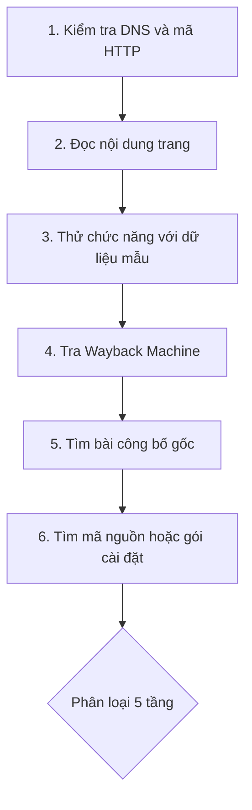

Công cụ tin sinh học trên web xuất hiện nhanh và biến mất cũng nhanh: trong 3.649 web service công bố từ 1994 đến 2017, chỉ 69% còn hoạt động khi được kiểm tra lại (Ősz et al., 2019). Bài này lặp lại phép kiểm tra đó ở quy mô nhỏ, trên một bảng tra cứu 19 công cụ tin sinh thường gặp khi học sắp gióng trình tự, tìm motif và tra genome, bằng một quy trình sáu bước bạn có thể tự chạy lại. Kết quả cho thấy nhãn "còn dùng được / không truy cập được" che mất nhiều thông tin: có công cụ chỉ chuyển nhà, có trang còn sống nhưng công cụ không chạy được. Cuối bài là checklist giúp lab report của bạn vẫn tái lập được sau vài năm.

## 1. Tóm tắt

Trong một danh sách 19 công cụ tin sinh (21 URL), bao nhiêu công cụ còn dùng được vào tháng 11/2026, và công cụ "chết" đã chết theo cách nào? Mỗi URL được kiểm tra hai lần cách nhau một tuần (11/11 và 18/11/2026) bằng `host` và `curl`, đối chiếu với Wayback Machine, bài công bố gốc (qua Crossref và PubMed) và Bioconda. Ngày 18/11/2026, 15/21 URL trả HTTP 200, nhưng chỉ 12 URL trong số đó là trang công cụ hoạt động bình thường; 3 tên miền không còn phân giải DNS; 2 máy chủ không phản hồi. Ở cấp công cụ, 11/19 còn sống, 3 sống một phần, 1 chuyển nhà và 4 mất. Bản web của các công cụ đã mất đều công bố 2002–2004, khớp với xu hướng khả năng truy cập giảm theo tuổi công cụ trong các khảo sát lớn (Kern et al., 2020; Mangul, Mosqueiro, et al., 2019; Ősz et al., 2019). Khuyến nghị chính: chọn công cụ có mã nguồn và gói cài đặt, ghi phiên bản cùng ngày truy cập trong mọi báo cáo.

## 2. Mở đầu: vì sao link công cụ tin sinh "chết"

MAVID, một công cụ sắp gióng nhiều trình tự genome, được công bố năm 2004 (Bray & Pachter, 2004). Gõ địa chỉ web của MAVID vào trình duyệt hôm nay, bạn nhận được lỗi "không tìm thấy máy chủ": tên miền `baboon.math.berkeley.edu` không còn tồn tại. Thuật toán vẫn nằm trong bài báo, nhưng công cụ để bấm vào và chạy thì đã biến mất.

Bảng tra cứu công cụ tin sinh mà sinh viên hay tự lập khi làm bài tập [sắp gióng trình tự và BLAST](/blog/phan-tich-trinh-tu/) thường có một cột trạng thái đơn giản. Bảng dùng trong bài này cũng vậy: mỗi dòng có tên công cụ, vai trò, link, nền tảng và nhãn **O** (dùng được) hoặc **X** (không truy cập được); 12 công cụ mang nhãn O, 7 mang nhãn X. Nhãn nhị phân trả lời câu hỏi "link có mở được không", nhưng chưa trả lời "công cụ còn dùng được ở đâu và theo cách nào".

Link chết trong tài liệu khoa học đã được đo nhiều lần; Bảng 1 tóm tắt các nghiên cứu chính.

**Bảng 1.** Các nghiên cứu về độ bền của URL và web service trong tin sinh học

| Nghiên cứu | Mẫu | Kết quả chính |
|---|---|---|
| Wren (2004) | 1.630 URL trong abstract MEDLINE | Khoảng 12% URL sai định dạng hoặc chính tả ngay khi in; sau khi sửa, khoảng 63% luôn truy cập được, 19% lúc được lúc không |
| Schultheiss et al. (2011) | 927 web service trong các số Web Server của *Nucleic Acids Research*, 2003–2009 | 72% còn ở địa chỉ đã công bố, 9% mất hẳn, nhưng chỉ xác nhận được chức năng cho 45% |
| Ősz et al. (2019) | 3.649 web service công bố 1994–2017 | 69% còn hoạt động; trên 95% còn chạy trong 2 năm đầu, 84% ở năm thứ ba; thời gian bán huỷ trung bình 10,39 năm |
| Mangul, Mosqueiro, et al. (2019) | 36.702 tài nguyên omics công bố 2005–2017 | Gần 28% không truy cập được qua URL trong bài gốc; trong 98 công cụ thử cài, 51% dễ cài, 28% không cài được |
| Kern et al. (2020) | 2.396 web tool công bố trong 10 năm, theo dõi 133 ngày | Khoảng 90% công cụ năm 2019–2020 truy cập được, so với khoảng 50% công cụ năm 2010; 31% luôn chạy, 48,4% lúc có lúc không, 20,6% không bao giờ truy cập được |

Wren (2004) đặt tên cho vấn đề bằng chính mã lỗi quen thuộc: "404 not found". Schultheiss et al. (2011) thêm một phân biệt quan trọng: service còn ở địa chỉ cũ chưa chắc còn chạy đúng, và khoảng cách giữa 72% với 45% chính là phần một cột O/X không nhìn thấy. Kern et al. (2020) phát hiện gần một nửa số công cụ lúc có lúc không, với thời gian gián đoạn trung vị 1 ngày, nên một lần kiểm tra duy nhất có thể kết luận sai. Hiện tượng "reference rot" cũng xảy ra trong bài báo học thuật nói chung, không riêng tin sinh (Klein et al., 2014).

Các nghiên cứu trên lấy mẫu từ bài báo rồi kiểm tra URL được in, tức là nhìn từ phía tác giả công cụ. Bài này nhìn từ phía **người dùng**: một danh sách công cụ sinh viên thật sự dùng, với câu hỏi thực tế hơn "link còn sống không": nếu link chết, phân tích còn chạy lại được không?

## 3. Dữ liệu và phương pháp

### 3.1. Dữ liệu đầu vào

Bảng tra cứu có 19 công cụ. Clustal W (GenomeNet và DDBJ) và genome người (UCSC và mirror US East của Ensembl) mỗi dòng có hai URL, nên tổng cộng có 21 URL. Link ENA (European Nucleotide Archive) là dạng mẫu cần điền mã SRA, nên bài kiểm tra trang browser gốc. Vai trò ở Bảng 2 lấy theo bài công bố gốc.

**Bảng 2.** Cấu trúc dữ liệu đầu vào

| Nhãn ban đầu | Công cụ | Vai trò |
|---|---|---|
| O | Genome VISTA, CHAOS-DIALIGN, POASTA (partial order alignment), Clustal W | Sắp gióng trình tự (alignment) và so sánh genome |
| O | OLIGO, Primer3 | Thiết kế và phân tích mồi PCR |
| O | BLAST | Tìm trình tự tương đồng |
| O | iCn3D | Hiển thị cấu trúc 3D của protein |
| O | UCSC Genome Browser, Ensembl, NGDC Database Commons | Dữ liệu genome người và thực vật |
| O | ENA, Galaxy | Tải dữ liệu thô theo mã SRA; xử lý file lớn |
| X | DIALIGN (máy chủ Bielefeld), MAVID | Sắp gióng nhiều trình tự |
| X | WAViS | Hiển thị và trình bày kết quả sắp gióng |
| X | AlignACE, Gibbs Motif Sampler | Tìm motif trong các trình tự chưa sắp gióng |
| X | Meta-MEME | Dựng mô hình Markov ẩn (HMM) dựa trên motif cho họ protein |
| X | GTOP | Cơ sở dữ liệu cấu trúc protein dự đoán từ trình tự genome |

Nguồn vai trò nhóm X: Lawrence et al. (1993), Roth et al. (1998), Thompson et al. (2003), Grundy et al. (1997), Kawabata et al. (2002).

### 3.2. Quy trình kiểm tra sáu bước



**Hình 1.** Quy trình kiểm tra một công cụ, từ URL tới phân loại

**Bước 1: DNS và mã HTTP.** `host` cho biết tên miền còn phân giải không; `curl -L` đi theo chuyển hướng và trả về mã HTTP cùng URL cuối. Script dưới đây chạy trên macOS và Linux, ghi thời điểm UTC:

```bash
# Kiểm tra DNS, mã HTTP cuối và URL cuối cho từng dòng "tên|URL"
while IFS='|' read -r ten url; do
  may=$(echo "$url" | sed -E 's#https?://([^/]+).*#\1#')
  if host "$may" > /dev/null 2>&1; then dns="ok"; else dns="khong_phan_giai"; fi
  ketqua=$(curl -sL -o /dev/null -m 20 -w "%{http_code},%{url_effective}" "$url")
  echo "$(date -u +%Y-%m-%dT%H:%M:%SZ),$ten,$dns,$ketqua"
done <<'DS'
MAVID|http://baboon.math.berkeley.edu/mavid/
Primer3|https://primer3.ut.ee/
Genome VISTA|https://genome.lbl.gov/vista/index.shtml
DS
```

Chạy ngày 18/11/2026, ba dòng mẫu cho kết quả `khong_phan_giai,000` cho MAVID, `200` cho Primer3, và `200` kèm URL cuối `.../vista/shutdown.html` cho Genome VISTA, lý do cần bước 2.

**Bước 2: Đọc nội dung.** Mã 200 không nói trang đó là gì: trang công cụ thật, trang tĩnh còn sót, trang báo "đã chuyển" hay trang lỗi trả 200 (soft 404).

**Bước 3: Thử chức năng.** Với công cụ có form, chạy một truy vấn nhỏ (ví dụ ba trình tự ngắn) và ghi có ra kết quả hay không. Đây là tầng "còn hoạt động đúng" mà Schultheiss et al. (2011) tách khỏi "còn địa chỉ".

**Bước 4: Wayback Machine.** CDX API của Internet Archive trả về các bản lưu của một URL kèm mã trạng thái; bản lưu 200 đầu tiên và cuối cùng cho biết khoảng thời gian trang chắc chắn còn sống:

```python
import json
import urllib.parse
import urllib.request

def ban_luu_200(url):
    """Trả về (bản lưu 200 đầu tiên, bản lưu 200 cuối cùng) theo Wayback CDX API."""
    ket_qua = []
    for gioi_han in (1, -1):  # 1: bản đầu tiên, -1: bản cuối cùng
        q = urllib.parse.urlencode({"url": url, "filter": "statuscode:200",
                                    "fl": "timestamp", "limit": gioi_han,
                                    "output": "json"})
        with urllib.request.urlopen("https://web.archive.org/cdx/search/cdx?" + q,
                                    timeout=60) as r:
            dong = json.load(r)
        ket_qua.append(dong[1][0] if len(dong) > 1 else None)  # dòng 0 là tiêu đề
    return tuple(ket_qua)

print(ban_luu_200("baboon.math.berkeley.edu/mavid/"))
# ('20021206111657', '20100102055555')
```

**Bước 5: Bài công bố gốc.** Tìm bài mô tả công cụ, xác minh DOI qua Crossref và PMID qua PubMed, ghi năm công bố và URL in trong abstract. URL trong abstract thường khác URL người dùng đang lưu, và đó là bằng chứng công cụ đã đổi địa chỉ.

**Bước 6: Mã nguồn và gói cài đặt.** Tìm trang mới của nhóm tác giả, GitHub, và gói trên Bioconda qua API `api.anaconda.org/package/bioconda/<tên>`.

### 3.3. Phân loại năm tầng

Thay cho O/X, mỗi công cụ được xếp vào một trong năm tầng:

- **Sống**: URL trả 200 và nội dung là trang công cụ đang hoạt động.
- **Sống một phần**: trang còn nhưng công cụ không dùng ngay được (trang tĩnh cũ, trang bảo trì, phần mềm phải xin giấy phép).
- **Chuyển nhà**: URL cũ chết, công cụ chạy ở địa chỉ mới.
- **Chỉ còn mã nguồn hoặc gói cài đặt**: không còn web service, nhưng vẫn cài và chạy được trên máy.
- **Mất**: không tìm thấy trang, mã nguồn hay gói trong phạm vi đã kiểm tra.

Viết quy tắc thành code giúp áp dụng giống nhau cho mọi dòng. Ví dụ với nhóm X:

```python
import io
import pandas as pd

csv = """cong_cu,nam_cong_bo,http_cuoi,noi_dung,dia_chi_moi,goi_cai_dat,ban_200_cuoi
DIALIGN (Bielefeld),1999,000,,dialign.gobics.de,dialign2,2025-05-12
AlignACE,1998,200,phai_xin_giay_phep,,,2026-10-19
MAVID,2004,000,,,,2010-01-02
WAViS,2004,000,,,,2020-02-23
Gibbs Motif Sampler (Brown),2003,000,,,,2018-08-02
Meta-MEME (UCL),1997,200,trang_tinh_cu,,,
GTOP,2002,000,,,,2022-06-15
"""
df = pd.read_csv(io.StringIO(csv), dtype={"http_cuoi": str})

def phan_tang(d):
    if d.http_cuoi == "200" and d.noi_dung == "trang_cong_cu":
        return "Sống"
    if d.http_cuoi == "200":
        return "Sống một phần"
    if pd.notna(d.dia_chi_moi):
        return "Chuyển nhà"
    if pd.notna(d.goi_cai_dat):
        return "Chỉ còn mã/gói"
    return "Mất"

df["tang"] = df.apply(phan_tang, axis=1)
df["ban_200_cuoi"] = pd.to_datetime(df["ban_200_cuoi"])
# "Tuổi thọ web" thô = năm của bản lưu 200 cuối - năm công bố (chỉ là cận dưới)
mat = df["tang"].isin(["Mất", "Chuyển nhà"])
df.loc[mat, "tuoi_tho_tho"] = df.loc[mat, "ban_200_cuoi"].dt.year - df.loc[mat, "nam_cong_bo"]
print(df[["cong_cu", "tang", "tuoi_tho_tho"]].to_string(index=False))
print(df["tang"].value_counts().to_string())
```

## 4. Kết quả

### 4.1. Bức tranh chung

Ngày 18/11/2026 (15:25 UTC), 15/21 URL trả HTTP 200, nhưng chỉ 12 là trang công cụ hoạt động bình thường; ba URL kia là trang bảo trì của Genome VISTA, trang phần mềm AlignACE và trang tài liệu tĩnh của Meta-MEME. Trong 6 URL không trả 200, ba tên miền không còn phân giải (Bielefeld, Berkeley, máy chủ WAViS ở Praha), hai máy chủ không phản hồi (Brown và Viện Di truyền Quốc gia Nhật Bản), và một là mirror US East của Ensembl.

Genome VISTA còn trả HTTP 200 hôm 11/11, đến 18/11 thì chuyển hướng sang trang báo bảo trì ngoài kế hoạch; Wayback vẫn có bản lưu 200 của trang chủ ngày 7/11/2026. Đây đúng là kiểu "lúc có lúc không" mà Kern et al. (2020) cảnh báo, nên VISTA được xếp "sống một phần" chứ không phải "mất".

Mirror `useast.ensembl.org` là trường hợp khác. DNS của nó giờ trỏ tới `jun2026.archive.ensembl.org`: Ensembl thông báo ngày 23/10/2026 rằng mirror US East và Asia được cho ngừng, hai địa chỉ vẫn chạy nhưng phục vụ bản lưu trữ release 116 thay vì bản mới nhất (Ensembl, 2026). Link vẫn "sống" nhưng dữ liệu đằng sau đã đóng băng, vì vậy nên đổi sang `www.ensembl.org` hoặc ghi rõ release đang dùng.

Hai lỗi đo cần biết khi tự kiểm tra: OLIGO trả mã 406 với `curl` mặc định nhưng trả 200 khi gửi header giống trình duyệt (máy chủ chặn bot); UCSC báo lỗi chứng chỉ trên máy kiểm tra chạy macOS cũ nhưng trả 200 từ dịch vụ bên ngoài. Một mã lỗi nên được kiểm tra lại từ môi trường khác trước khi kết luận.


**Hình 2.** Phân loại 19 công cụ theo năm tầng, tách theo nhãn ban đầu. Nguồn: kiểm tra ngày 18/11/2026.

Ở cấp công cụ (Hình 2), 11/19 công cụ còn sống, 3 sống một phần, 1 chuyển nhà và 4 mất. Nhãn O khớp khá tốt: 11/12 công cụ còn sống. Nhãn X thì không đồng nhất: trong 7 công cụ X, chỉ 4 thật sự mất, 2 vẫn còn trang và 1 đang chạy ở địa chỉ mới.

### 4.2. Bảy công cụ nhãn X

**Bảng 3.** Kết quả kiểm tra bảy công cụ nhãn X (18/11/2026)

| Công cụ | URL cũ | Bản lưu 200 cuối (Wayback) | Bài gốc | Mã nguồn hoặc gói | Phân loại |
|---|---|---|---|---|---|
| DIALIGN (Bielefeld) | DNS không phân giải | 12/5/2025 | 1999 | Chạy tại GOBICS; Bioconda `dialign2` 2.2.1, `dialign-tx` 1.0.2 | Chuyển nhà |
| AlignACE | HTTP 200, trang tĩnh | 19/10/2026 | 1998 | Phải liên hệ bộ phận cấp phép; không có trên Bioconda | Sống một phần |
| MAVID | DNS không phân giải | 2/1/2010 | 2004 | Không có trên Bioconda | Mất |
| WAViS | DNS không phân giải | 23/2/2020 | 2004 | Không có trên Bioconda | Mất |
| Gibbs Motif Sampler (Brown) | Hết thời gian chờ | 2/8/2018 | 1993; bản web 2003 | Không có trên Bioconda | Mất |
| Meta-MEME (UCL) | HTTP 200, tài liệu tĩnh MEME 4.7.0 | Không có bản lưu | 1997 | MEME Suite có trên Bioconda (`meme` 5.5.9) | Sống một phần |
| GTOP | Hết thời gian chờ | 15/6/2022 | 2002 | Không có trên Bioconda | Mất |

Nguồn năm công bố: Morgenstern (1999); Roth et al. (1998); Bray và Pachter (2004); Zika et al. (2004); Lawrence et al. (1993); Thompson et al. (2003); Grundy et al. (1997); Kawabata et al. (2002).

Ba trường hợp sau cho thấy một chữ X không đủ.

<div class="callout callout-example">
<p class="callout-title">DIALIGN: chết ở Bielefeld, sống ở Göttingen</p>

DIALIGN 2 (Morgenstern, 1999) chạy nhiều năm trên máy chủ BiBiServ của Đại học Bielefeld. Tên miền đó không còn bản ghi DNS. Nhưng DIALIGN không chết: trang `dialign.gobics.de` tại Göttingen tự giới thiệu là trang chủ mới của DIALIGN (Al Ait et al., 2013), CHAOS-DIALIGN trong nhóm O chạy chính trên máy chủ này (Brudno et al., 2004), và Bioconda có gói `dialign2`. Cùng một bảng tra cứu chứa cả địa chỉ cũ đã chết lẫn "người kế nhiệm" của nó.

</div>

<div class="callout callout-example">
<p class="callout-title">AlignACE: trang còn, phần mềm không tải tự do được</p>

AlignACE tìm motif điều hoà trong vùng không mã hoá của các gen có biểu hiện giống nhau (Roth et al., 1998). Trang công cụ được Wayback lưu từ 1999 đến tháng 10/2026 và vẫn trả 200, nhưng muốn có phần mềm phải liên hệ bộ phận cấp phép: tầng "còn trang nhưng không dùng ngay được" mà O/X không phân biệt.

</div>

<div class="callout callout-example">
<p class="callout-title">MAVID: tuổi thọ web khoảng sáu năm</p>

MAVID công bố năm 2004; bản lưu 200 cuối trên Wayback là ngày 2/1/2010. Trang công cụ sống ít nhất khoảng sáu năm, ngắn hơn nhiều so với thời gian bán huỷ trung bình 10,39 năm mà Ősz et al. (2019) ước lượng.

</div>


**Hình 3.** Năm công bố bài gốc và khoảng thời gian có bản lưu HTTP 200 trên Wayback Machine cho bảy công cụ nhãn X. Nguồn: Wayback CDX API, truy vấn ngày 18/11/2026; năm công bố theo DOI.

Lấy năm của bản lưu 200 cuối trừ năm công bố (Hình 3) được "tuổi thọ web" thô: MAVID khoảng 6 năm, Gibbs Motif Sampler ở địa chỉ Brown khoảng 15 năm (tính từ bản web 2003), WAViS khoảng 16 năm, GTOP khoảng 20 năm. Đây là **cận dưới**: bản lưu cuối chỉ cho biết trang còn sống ít nhất đến ngày đó, không phải ngày máy chủ tắt.

Abstract năm 2003 của Gibbs Recursive Sampler in địa chỉ ở Wadsworth Center và Rensselaer Polytechnic Institute (Thompson et al., 2003), không phải Brown, và bản lưu 200 đầu tiên ở Brown là năm 2009: công cụ đã đổi địa chỉ ít nhất một lần trước khi mất. Với Meta-MEME, trang còn lại là bản sao tài liệu tĩnh của MEME Suite 4.7.0, chưa từng được Wayback lưu. MEME Suite vẫn có trên Bioconda, nhưng chưa xác nhận được Meta-MEME còn nằm trong bản hiện tại hay không.

### 4.3. Mười hai công cụ nhãn O

Công cụ còn sống không hẳn "trẻ" hơn. Clustal W công bố năm 1994 (Thompson et al., 1994), VISTA năm 2000 (Mayor et al., 2000) và bộ công cụ web năm 2004 (Frazer et al., 2004), Primer3 có bản cập nhật lớn năm 2012 (Untergasser et al., 2012); trẻ nhất là POASTA (van Dijk et al., 2025). Điểm chung nằm ở chỗ khác. Phần lớn đặt tại các trung tâm dữ liệu lớn: NCBI (BLAST, iCn3D), EMBL-EBI (ENA), UCSC, DDBJ, GenomeNet, NGDC. Nhiều công cụ có mã nguồn hoặc gói cài đặt: Bioconda có `clustalw` 2.1, `primer3` 2.6.1 và `blast` 2.17.0; POASTA phân phối mã nguồn trên GitHub. Galaxy chạy chủ yếu qua các máy chủ công khai miễn phí của cộng đồng (The Galaxy Community et al., 2024).

## 5. Bàn luận

### 5.1. So với tài liệu

Ở cấp URL, 6/21 URL (29%) không trả 200 ngày 18/11/2026, và thêm 3 URL trả 200 nhưng không phục vụ công cụ dùng được. Ở cấp công cụ, 4/19 (21%) mất trong phạm vi đã kiểm tra. Các con số này cùng vùng với gần 28% của Mangul, Mosqueiro, et al. (2019) và 20,6% công cụ không bao giờ truy cập được của Kern et al. (2020); lưu ý 31% trong Kern et al. là tỉ lệ **luôn chạy**, không phải tỉ lệ chết.

So sánh này chỉ định tính: n = 19 quá nhỏ để suy luận thống kê, và danh sách thiên về công cụ cũ (cả bảy công cụ X công bố 1993–2004). Kern et al. (2020) chỉ khảo sát công cụ 2010–2020, nên không áp thẳng số liệu của họ cho công cụ trước 2010 được; nhưng xu hướng càng cũ càng khó truy cập của họ, cùng tỉ lệ còn chạy giảm dần sau năm thứ hai của Ősz et al. (2019), khớp với việc bản web của mọi công cụ "mất" ở đây đều công bố 2002–2004.

Tầng "sống một phần" (VISTA, AlignACE, Meta-MEME) tương ứng với khoảng cách giữa 72% service còn địa chỉ và 45% xác nhận được chức năng trong Schultheiss et al. (2011). Khảo sát chỉ dựa vào mã HTTP sẽ đếm cả ba là "còn sống".

### 5.2. Vì sao công cụ chết

Schultheiss et al. (2011) chỉ ra nguyên nhân về con người: phần lớn service do người không có vị trí cố định phát triển, và một phần tư không có kế hoạch bảo trì. Trong bảy công cụ X, các địa chỉ đã chết đều nằm trên tên miền cấp khoa hoặc nhóm nghiên cứu (`techfak` ở Bielefeld, `math` ở Berkeley, `ccmbweb` ở Brown). Đây chỉ là quan sát trên vài trường hợp, chưa đủ để khái quát, nhưng gợi ý một câu hỏi khi chọn công cụ: ai đang duy trì máy chủ này?

### 5.3. Vì sao một số công cụ sống

Công cụ sống thường thuộc hạ tầng quốc gia hoặc quốc tế, có cộng đồng và mã nguồn mở, hoặc có gói cài đặt. Kern et al. (2020) thấy số trích dẫn liên quan thuận với khả năng còn truy cập được. Mangul, Mosqueiro, et al. (2019) thấy công cụ dễ cài đặt được trích dẫn nhiều hơn, và cùng nhóm tác giả đề xuất các biện pháp, kể cả chính sách của tạp chí, để cải thiện khả năng cài đặt và lưu trữ lâu dài của phần mềm tin sinh (Mangul, Martin, et al., 2019).

DIALIGN cho thấy điều quan trọng nhất: khi thuật toán được đóng gói và phân phối qua kênh bền vững, nó sống lâu hơn máy chủ đầu tiên chạy nó.

### 5.4. Giải pháp hạ tầng

**Bioconda** là kênh phân phối phần mềm tin sinh cho trình quản lý gói Conda, cho phép cài một công cụ với phiên bản xác định bằng một lệnh (The Bioconda Team et al., 2018). **BioContainers** cung cấp môi trường chạy độc lập nền tảng dựa trên Docker, giữ được nhiều phiên bản của cùng phần mềm (da Veiga Leprevost et al., 2017). **Galaxy** đưa các công cụ lên giao diện web có lưu lịch sử phân tích, hợp với người chưa quen dòng lệnh (The Galaxy Community et al., 2024). Grüning, Chilton, et al. (2018) đề xuất kết hợp ba lớp này: gói phần mềm di động, container để cô lập môi trường, và hệ thống workflow để điều phối toàn bộ pipeline (→ quy trình tái lập với workflow và container).

### 5.5. Hạn chế

Mẫu nhỏ, không ngẫu nhiên và thiên về công cụ sắp gióng, tìm motif. Hai lần kiểm tra cách nhau một tuần chưa đủ để tách gián đoạn tạm thời khỏi chết hẳn như Kern et al. (2020) làm. Wayback không lưu mọi trang, nên thiếu bản lưu không có nghĩa trang chưa từng tồn tại. Và chưa thử chức năng bằng truy vấn mẫu, nên "sống" ở đây nghĩa là trang công cụ còn phục vụ, chưa phải đã xác nhận chạy đúng.

## 6. Khuyến nghị thực hành cho sinh viên

Checklist dưới đây dùng được ngay khi làm lab report có phần tin sinh.

**Khi chọn công cụ**

- [ ] Ưu tiên công cụ có mã nguồn công khai và gói Bioconda hoặc BioContainers, hoặc có sẵn trên Galaxy.
- [ ] Với công cụ chỉ có bản web, đọc bài gốc xem có cách cài cục bộ không.
- [ ] Ưu tiên máy chủ của trung tâm lớn (NCBI, EMBL-EBI, DDBJ) hơn máy chủ của một nhóm nhỏ.

**Khi ghi phương pháp**

- [ ] Ghi tên công cụ, **phiên bản**, URL và **ngày truy cập**.
- [ ] Ghi các tham số khác mặc định.
- [ ] Ghi phiên bản cơ sở dữ liệu: database BLAST, bản genome tham chiếu, release Ensembl.

Sandve et al. (2013) gói các yêu cầu này trong mười quy tắc, trong đó có lưu đúng phiên bản của mọi chương trình bên ngoài, tránh thao tác dữ liệu bằng tay, và với mọi kết quả thì ghi lại cách nó được tạo ra.

**Khi lưu kết quả**

- [ ] Lưu file đầu vào, đầu ra thô và tham số đã dùng.
- [ ] Nếu dùng Conda, xuất môi trường bằng `conda env export > environment.yml`.

**Khi gặp link chết**

1. Tra Wayback Machine để biết công cụ là gì và còn sống tới khi nào.
2. Tìm bài gốc qua PubMed hoặc Crossref.
3. Tìm tên công cụ trên Bioconda và GitHub.
4. Tìm công cụ kế nhiệm trong các bài sau của cùng nhóm tác giả, như DIALIGN chuyển sang GOBICS.

**Với bảng tra cứu công cụ của riêng bạn**

- [ ] Thêm cột "Ngày kiểm tra" và "Phiên bản".
- [ ] Thay cột O/X bằng năm tầng: sống, sống một phần, chuyển nhà, chỉ còn mã hoặc gói, mất.
- [ ] Ghi kèm DOI bài gốc để lần lại công cụ khi địa chỉ đổi (→ [tổ chức và truy vấn dữ liệu dạng bảng](/blog/phan-tich-co-so-du-lieu/)).

## 7. Kết luận

Kiểm tra lại 19 công cụ tin sinh cho thấy cùng xu hướng các khảo sát lớn đã báo cáo: công cụ web càng cũ càng dễ mất, và một phần "còn link" nhưng không dùng ngay được. "Chết" thường là cái chết của một URL chứ không nhất thiết của một thuật toán: DIALIGN sống tiếp ở địa chỉ mới và trên Bioconda, còn công cụ chỉ tồn tại như một trang web trên máy chủ của khoa thì biến mất cùng máy chủ. Với sinh viên, cách giảm rủi ro tốt nhất không phải là tìm web service "bền" hơn, mà là chọn công cụ có mã nguồn và gói cài đặt, rồi ghi phiên bản cùng ngày truy cập trong mọi báo cáo.

## Tài liệu tham khảo

Al Ait, L., Yamak, Z., & Morgenstern, B. (2013). DIALIGN at GOBICS—multiple sequence alignment using various sources of external information. *Nucleic Acids Research, 41*(W1), W3–W7. https://doi.org/10.1093/nar/gkt283

Bray, N., & Pachter, L. (2004). MAVID: Constrained ancestral alignment of multiple sequences. *Genome Research, 14*(4), 693–699. https://doi.org/10.1101/gr.1960404

Brudno, M., Steinkamp, R., & Morgenstern, B. (2004). The CHAOS/DIALIGN WWW server for multiple alignment of genomic sequences. *Nucleic Acids Research, 32*(Web Server issue), W41–W44. https://doi.org/10.1093/nar/gkh361

da Veiga Leprevost, F., Grüning, B. A., Alves Aflitos, S., Röst, H. L., Uszkoreit, J., Barsnes, H., Vaudel, M., Moreno, P., Gatto, L., Weber, J., Bai, M., Jimenez, R. C., Sachsenberg, T., Pfeuffer, J., Vera Alvarez, R., Griss, J., Nesvizhskii, A. I., & Perez-Riverol, Y. (2017). BioContainers: An open-source and community-driven framework for software standardization. *Bioinformatics, 33*(16), 2580–2582. https://doi.org/10.1093/bioinformatics/btx192

Ensembl. (2026, October 23). *Ensembl USEast and Asia mirror sites are being retired*. Ensembl Blog. https://www.ensembl.info/2026/10/23/ensembl-useast-and-asia-mirror-sites-are-being-retired/

Frazer, K. A., Pachter, L., Poliakov, A., Rubin, E. M., & Dubchak, I. (2004). VISTA: Computational tools for comparative genomics. *Nucleic Acids Research, 32*(Web Server issue), W273–W279. https://doi.org/10.1093/nar/gkh458

Grundy, W. N., Bailey, T. L., Elkan, C. P., & Baker, M. E. (1997). meta-MEME: Motif-based hidden Markov models of protein families. *Computer Applications in the Biosciences, 13*(4), 397–406. https://doi.org/10.1093/bioinformatics/13.4.397

Grüning, B., Chilton, J., Köster, J., Dale, R., Soranzo, N., van den Beek, M., Goecks, J., Backofen, R., Nekrutenko, A., & Taylor, J. (2018). Practical computational reproducibility in the life sciences. *Cell Systems, 6*(6), 631–635. https://doi.org/10.1016/j.cels.2018.03.014

Kawabata, T., Fukuchi, S., Homma, K., Ota, M., Araki, J., Ito, T., Ichiyoshi, N., & Nishikawa, K. (2002). GTOP: A database of protein structures predicted from genome sequences. *Nucleic Acids Research, 30*(1), 294–298. https://doi.org/10.1093/nar/30.1.294

Kern, F., Fehlmann, T., & Keller, A. (2020). On the lifetime of bioinformatics web services. *Nucleic Acids Research, 48*(22), 12523–12533. https://doi.org/10.1093/nar/gkaa1125

Klein, M., Van de Sompel, H., Sanderson, R., Shankar, H., Balakireva, L., Zhou, K., & Tobin, R. (2014). Scholarly context not found: One in five articles suffers from reference rot. *PLoS ONE, 9*(12), e115253. https://doi.org/10.1371/journal.pone.0115253

Lawrence, C. E., Altschul, S. F., Boguski, M. S., Liu, J. S., Neuwald, A. F., & Wootton, J. C. (1993). Detecting subtle sequence signals: A Gibbs sampling strategy for multiple alignment. *Science, 262*(5131), 208–214. https://doi.org/10.1126/science.8211139

Mangul, S., Martin, L. S., Eskin, E., & Blekhman, R. (2019). Improving the usability and archival stability of bioinformatics software. *Genome Biology, 20*, 47. https://doi.org/10.1186/s13059-019-1649-8

Mangul, S., Mosqueiro, T., Abdill, R. J., Duong, D., Mitchell, K., Sarwal, V., Hill, B., Brito, J., Littman, R. J., Statz, B., Lam, A. K.-M., Dayama, G., Grieneisen, L., Martin, L. S., Flint, J., Eskin, E., & Blekhman, R. (2019). Challenges and recommendations to improve the installability and archival stability of omics computational tools. *PLOS Biology, 17*(6), e3000333. https://doi.org/10.1371/journal.pbio.3000333

Mayor, C., Brudno, M., Schwartz, J. R., Poliakov, A., Rubin, E. M., Frazer, K. A., Pachter, L. S., & Dubchak, I. (2000). VISTA: Visualizing global DNA sequence alignments of arbitrary length. *Bioinformatics, 16*(11), 1046–1047. https://doi.org/10.1093/bioinformatics/16.11.1046

Morgenstern, B. (1999). DIALIGN 2: Improvement of the segment-to-segment approach to multiple sequence alignment. *Bioinformatics, 15*(3), 211–218. https://doi.org/10.1093/bioinformatics/15.3.211

Ősz, Á., Pongor, L. S., Szirmai, D., & Győrffy, B. (2019). A snapshot of 3649 Web-based services published between 1994 and 2017 shows a decrease in availability after 2 years. *Briefings in Bioinformatics, 20*(3), 1004–1010. https://doi.org/10.1093/bib/bbx159

Roth, F. P., Hughes, J. D., Estep, P. W., & Church, G. M. (1998). Finding DNA regulatory motifs within unaligned noncoding sequences clustered by whole-genome mRNA quantitation. *Nature Biotechnology, 16*(10), 939–945. https://doi.org/10.1038/nbt1098-939

Sandve, G. K., Nekrutenko, A., Taylor, J., & Hovig, E. (2013). Ten simple rules for reproducible computational research. *PLoS Computational Biology, 9*(10), e1003285. https://doi.org/10.1371/journal.pcbi.1003285

Schultheiss, S. J., Münch, M.-C., Andreeva, G. D., & Rätsch, G. (2011). Persistence and availability of Web services in computational biology. *PLoS ONE, 6*(9), e24914. https://doi.org/10.1371/journal.pone.0024914

The Bioconda Team, Grüning, B., Dale, R., Sjödin, A., Chapman, B. A., Rowe, J., Tomkins-Tinch, C. H., Valieris, R., & Köster, J. (2018). Bioconda: Sustainable and comprehensive software distribution for the life sciences. *Nature Methods, 15*(7), 475–476. https://doi.org/10.1038/s41592-018-0046-7

The Galaxy Community, Abueg, L. A. L., Afgan, E., Allart, O., Awan, A. H., Bacon, W. A., Baker, D., Bassetti, M., Batut, B., Bernt, M., Blankenberg, D., Bombarely, A., Bretaudeau, A., Bromhead, C. J., Burke, M. L., Capon, P. K., Čech, M., Chavero-Díez, M., Chilton, J. M., … Zoabi, R. (2024). The Galaxy platform for accessible, reproducible, and collaborative data analyses: 2024 update. *Nucleic Acids Research, 52*(W1), W83–W94. https://doi.org/10.1093/nar/gkae410

Thompson, J. D., Higgins, D. G., & Gibson, T. J. (1994). CLUSTAL W: Improving the sensitivity of progressive multiple sequence alignment through sequence weighting, position-specific gap penalties and weight matrix choice. *Nucleic Acids Research, 22*(22), 4673–4680. https://doi.org/10.1093/nar/22.22.4673

Thompson, W., Rouchka, E. C., & Lawrence, C. E. (2003). Gibbs Recursive Sampler: Finding transcription factor binding sites. *Nucleic Acids Research, 31*(13), 3580–3585. https://doi.org/10.1093/nar/gkg608

Untergasser, A., Cutcutache, I., Koressaar, T., Ye, J., Faircloth, B. C., Remm, M., & Rozen, S. G. (2012). Primer3—new capabilities and interfaces. *Nucleic Acids Research, 40*(15), e115. https://doi.org/10.1093/nar/gks596

van Dijk, L. R., Manson, A. L., Earl, A. M., Garimella, K. V., & Abeel, T. (2025). Fast and exact gap-affine partial order alignment with POASTA. *Bioinformatics, 41*(1), btae757. https://doi.org/10.1093/bioinformatics/btae757

Wren, J. D. (2004). 404 not found: The stability and persistence of URLs published in MEDLINE. *Bioinformatics, 20*(5), 668–672. https://doi.org/10.1093/bioinformatics/btg465

Zika, R., Paces, J., Pavlicek, A., & Paces, V. (2004). WAViS server for handling, visualization and presentation of multiple alignments of nucleotide or amino acids sequences. *Nucleic Acids Research, 32*(Web Server issue), W48–W49. https://doi.org/10.1093/nar/gkh358
