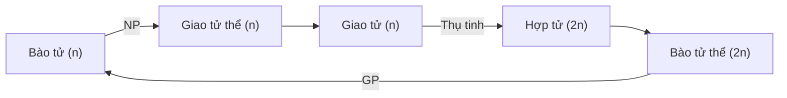

> Chép lại từ ảnh bảng và ảnh mẫu vật buổi thực hành tảo (folder Drive [Thực vật](https://drive.google.com/drive/folders/1-0xFcmG10pAwRmsOOQphm7RH60JEHijh), ảnh `IMG_3949`–`IMG_3996`, `IMG_5221`, `IMG_5586`). Ảnh bảng và ảnh có người không giữ trong vault.

## Vòng đời xen kẽ thế hệ (sơ đồ trên bảng)
- Hai mức bội thể, mỗi mức có thể là **đơn bào** hoặc **đa bào**:
	- **n**: đơn bào / đa bào.
	- **2n**: đơn bào / đa bào.
- Chu trình (theo mũi tên trên bảng):
	- **Bào tử (n)** → nguyên phân (NP) → **giao tử thể (n)** – "Có giao thế thế hệ".
	- Giao tử thể tạo **giao tử (n)** → hai giao tử **thụ tinh** → **hợp tử (2n)**.
	- Hợp tử → **bào tử thể (2n)** → giảm phân (GP) → bào tử (n), quay lại đầu chu trình. (→ [Nguyên phân và giảm phân](/blog/nguyen-phan-giam-phan-va-bai-tap-giao-tu/))

Bổ sung

- Kiểu vòng đời này gọi là **xen kẽ thế hệ** (*alternation of generations*). Tuỳ nhóm tảo mà pha n hay pha 2n chiếm ưu thế: tảo lục *Zygnema*, *Spirogyra* chỉ có hợp tử là 2n (giảm phân ngay ở hợp tử); *Ulva* có hai thế hệ đa bào giống nhau (đồng hình); tảo nâu *Laminaria* có bào tử thể lớn, giao tử thể rất nhỏ (dị hình).
- Ở thực vật trên cạn, xu hướng tiến hoá là **bào tử thể (2n) ngày càng ưu thế**: rêu (giao tử thể ưu thế) → dương xỉ → thực vật có hạt.

## Bảng so sánh các ngành tảo (khung trên bảng)
- Các cột: **Thành tế bào** · **Sắc tố** quang hợp · **Chất dự trữ** · **Vòng đời** · **Ứng dụng**.
- Trên bảng mới ghi hàng đầu là **Chlorophyta**, chưa điền nội dung.

Bổ sung

Điền khung bảng theo kiến thức chung (không có trong ảnh gốc):

| Ngành | Thành tế bào | Sắc tố | Chất dự trữ | Ứng dụng |
| --- | --- | --- | --- | --- |
| Chlorophyta (tảo lục) | Cellulose | Chlorophyll a, b; carotenoid | Tinh bột (trong lục lạp) | Thức ăn, *Chlorella*, chỉ thị môi trường |
| Phaeophyta (tảo nâu) | Cellulose + **alginate** | Chlorophyll a, c; **fucoxanthin** | Laminarin, mannitol | Alginate, phân bón, thức ăn |
| Rhodophyta (tảo đỏ) | Cellulose + **agar**, carrageenan | Chlorophyll a; **phycoerythrin**, phycocyanin | Tinh bột floridean | Agar, carrageenan, thực phẩm |
| Bacillariophyta (tảo silic) | Vỏ **silica** 2 mảnh | Chlorophyll a, c; fucoxanthin | Chrysolaminarin, lipid | Đất tảo silic, chỉ thị chất lượng nước |

## Mẫu vật và hình quan sát
- **Rau câu** (*Gracilaria*, tảo đỏ) – mẫu tươi trong đĩa petri:
	- 
- **Rong mơ** (*Sargassum*, tảo nâu) và **Tảo quạt** (*Padina*, tảo nâu, tiêu bản ép khô) – giảng viên giới thiệu mẫu (ảnh có người, không giữ).
- **Zygnema** (tảo lục tiếp hợp): ảnh tra cứu trên ResearchGate, mỗi tế bào có 2 lục lạp hình sao.
- **Tảo silic**: hình vẽ cấu tạo vỏ trong sách, có trục **pervalvar**, mảnh vỏ trên (*epivalve*) và mảnh vỏ dưới (*hypovalve*).
- Tế bào lớn vách mỏng, tế bào chất dồn ở góc tế bào, quan sát dưới kính hiển vi (tảo hay mẫu khác (?)):
	- 
- Thực vật bậc thấp khác trong vault: [Nấm lỗ Trametes](/blog/thuc-vat-bac-thap-nam-tao-mau-nam-trametes-sp/) (nay xếp vào giới Nấm, không thuộc thực vật).

Cần kiểm tra

- Tên học phần, số bài và ngày của buổi thực hành tảo không có trong ảnh. Băng rôn "Lễ bảo vệ khoá luận tốt nghiệp… 22/6/2022" trong ảnh `IMG_5586` là của phòng học, không phải ngày học.
- Chữ viết tay trên ảnh `IMG_3953` đọc là "Rong mơ (?)".
- Mẫu trong ảnh `IMG_3989` (`IMG_3987`, `IMG_3988`, `IMG_3990` tương tự) chưa xác định được.

