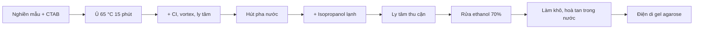

> Báo cáo thực hành Di truyền học – Bài 5–6 · K66 Sinh học (ca chiều thứ 3, tiết 9–10) · Mẫu của tác giả: giếng 12 và 13.

## Mục đích
- Tách chiết **DNA tổng số** từ mô thực vật (hoa, quả, lá) bằng đệm **CTAB**.
- Kiểm tra sản phẩm tách chiết bằng **điện di gel agarose**, đánh giá độ nguyên vẹn và độ sạch của DNA.

## Nguyên lý
- **Cấu trúc DNA**: đại phân tử sợi kép, hai mạch xoắn quanh một trục chung (xoắn kép). (→ [Nhân đôi DNA, phiên mã, dịch mã](/blog/sinh-hoc/kien-thuc-chung/b-co-che-di-truyen-va-bien-di/04-nhan-doi-dna-phien-ma-va-dich-ma/))
	- Đơn phân là **nucleotide**, gồm 4 loại base: **A, G, C, T**, nối với nhau bằng liên kết **phosphodiester**.
	- Bổ sung giữa hai mạch: **A = T** (2 liên kết hydrogen), **G ≡ C** (3 liên kết hydrogen).
	- Thông tin di truyền nằm ở **trình tự nucleotide**; đoạn DNA mã hoá protein là **gene**.
- **Vị trí DNA trong tế bào thực vật**: chủ yếu trên **nhiễm sắc thể** trong nhân; một phần nằm ở **ti thể** và **lục lạp** (DNA ngoài nhân). (→ [Di truyền ngoài nhân](/blog/sinh-hoc/kien-thuc-chung/c-quy-luat-di-truyen/13-di-truyen-ngoai-nhan-moi-truong-va-bien-di/))
- **CTAB** (hexadecyltrimethylammonium bromide): chất hoạt động bề mặt cation, phá màng tế bào và màng bào quan, giải phóng DNA; tạo phức với polysaccharide giúp loại chúng – rất hợp với mô thực vật nhiều polysaccharide.
- **Chloroform : isoamyl alcohol (CI)** tách pha: protein biến tính tụ ở **mặt phân cách**, DNA ở **pha nước** phía trên.
- **Isopropanol** lạnh kết tủa DNA; **ethanol 70%** rửa muối; DNA hoà tan lại trong nước.
- **Điện di**: DNA tích điện âm (nhóm phosphate) chạy về cực dương; đoạn ngắn chạy nhanh hơn. So kích thước với **thang chuẩn (ladder) 1 kb**.

## Vật liệu & phương pháp
### Hoá chất và dụng cụ
- **Đệm CTAB**: 2% CTAB, 100 mM Tris-HCl (pH 8), 20 mM EDTA, 1,4 M NaCl.
- CI (chloroform : isoamyl alcohol = 24 : 1, v/v); isopropanol lạnh trên đá; ethanol 70%; nước khử trùng.
- Micropipette và đầu tip, ống ly tâm 1,7 ml, chày cối sứ, kéo, giấy thấm, bút viết kính.
- Máy ly tâm lạnh, vortex, bể ổn nhiệt đặt sẵn **65 °C**, hộp đá.
- Điện di: bột agarose, đệm **1× TAE**, thang DNA 1 kb, **6× loading dye**, dung dịch nhuộm có **ethidium bromide**; lò vi sóng, cân, bộ điện di, máy soi gel UV (Gel Doc).

### Quy trình tách chiết
1. Cắt nhỏ **50 mg** mẫu, cho vào cối, thêm **1 ml CTAB**, nghiền thành dịch đồng nhất (có thể thêm CTAB để thu ~0,5 ml dịch chiết).
2. Ghi tên lên nắp và thân ống eppendorf 1,7 ml.
3. Hút **0,5 ml** dịch chiết vào ống (dịch đặc thì cắt bớt đầu tip).
4. Cắm ống vào xốp, ủ trong bể ổn nhiệt **15 phút**.
5. Để nguội về nhiệt độ phòng, thêm **500 µl CI**, vortex 30 giây.
6. Ly tâm **13.000 rpm, 10 phút, 4 °C**.
7. Hút pha nổi phía trên sang ống mới – **không để đầu tip chạm mặt phân cách hai pha**.
8. Thêm isopropanol theo tỷ lệ **1 mẫu : 0,6 isopropanol**, đảo nhẹ → thấy sợi DNA kết tủa trắng.
9. Đặt ống trên đá 5 phút.
10. Ly tâm 13.000 rpm, 10 phút, 4 °C để thu cặn DNA.
11. Thêm 500 µl ethanol 70%, đảo nhẹ 1 lần, đổ bỏ ethanol, giữ cặn.
12. Để khô cặn ở nhiệt độ phòng.
13. Hoà tan bằng **30–100 µl** nước tuỳ lượng cặn.

## Kết quả chính
- Hầu hết các giếng đều có DNA; các mẫu **2, 4, 10, 11, 12** tách khá thành công.
- **Giếng 12** (của tác giả): chấp nhận được; DNA bị đứt gãy, còn **protein** bám ở miệng giếng và **RNA** ở cuối đường chạy.
- **Giếng 13** (của tác giả): vạch DNA mờ, không sáng rõ; cuối đường chạy còn lẫn tạp chất.
- Nhận xét chung: DNA bị đứt gãy, lượng thu được ít nên vạch mờ; còn lẫn protein và nhiều RNA.
- Xem thêm: [Virtual Lab: tách DNA bằng CTAB](/projects/virtual-lab/11-tai-lieu-drive-cho-giai-doan-6/) – làm lại 13 bước của bài trong app; ảnh gel mô phỏng có DNA đứt gãy, protein ở giếng, vệt RNA như ảnh gel thật.

## Kết luận
### Vai trò các thành phần – tách chiết
| Thành phần  | Vai trò                                                                                                                      |
| ----------- | ---------------------------------------------------------------------------------------------------------------------------- |
| CTAB        | Phá màng tế bào, màng bào quan, giải phóng DNA                                                                                |
| EDTA        | Tạo phức với ion hoá trị II (Mg²⁺) → ức chế **DNase**, bảo vệ DNA; làm giảm độ bền của màng ngoài tế bào                       |
| CI          | Chloroform không tan trong nước → tách 2 pha; protein kết tủa nằm ở mặt phân cách. Isoamyl alcohol chống tạo bọt, ổn định pha |
| Isopropanol | Kết tủa DNA                                                                                                                  |
| Ethanol 70% | Rửa muối và tạp chất kết tủa theo DNA (DNA không tan trong cồn)                                                              |
| Nước        | Hoà tan DNA                                                                                                                  |

### Vai trò các thành phần – điện di
| Thành phần       | Vai trò                                                                                                    |
| ---------------- | ---------------------------------------------------------------------------------------------------------- |
| Loading dye      | Làm mẫu nặng để chìm xuống đáy giếng, tạo màu theo dõi đường chạy                                           |
| Ethidium bromide | Chèn vào giữa các cặp base, phát huỳnh quang dưới UV                                                        |
| Đệm TAE          | Tris giữ pH hơi kiềm cho DNA tan tốt; EDTA giữ Mg²⁺ → ức chế nuclease; cung cấp ion dẫn điện                 |
| Thang chuẩn DNA  | So sánh kích thước băng của mẫu                                                                           |

Bổ sung

- Trong bản gốc, isoamyl alcohol được mô tả là chất "làm kết tủa DNA khi có cation hoá trị I". Vai trò chính của isoamyl alcohol trong hỗn hợp CI là **chống tạo bọt** và giúp ranh giới hai pha rõ hơn; việc kết tủa DNA là do **isopropanol/ethanol** khi có muối (Na⁺).
- Bản gốc ghi "sử dụng cồn tuyệt đối" ở dòng ethanol 70%: bước rửa dùng **ethanol 70%** vì lượng nước 30% hoà tan được muối, còn DNA vẫn không tan.
- Muốn giảm RNA lẫn trong mẫu: thêm bước ủ với **RNase A** (37 °C, 30 phút) trước khi kết tủa. Muốn giảm đứt gãy: nghiền nhanh trong nitơ lỏng, hút bằng đầu tip cắt rộng, tránh vortex mạnh sau khi DNA đã ra khỏi tế bào.
- Đánh giá độ sạch bằng quang phổ: **A260/A280 ≈ 1,8** là DNA sạch; thấp hơn → lẫn protein. **A260/A230** thấp → lẫn polysaccharide, polyphenol hoặc muối.

- DNA tách chiết là nguyên liệu đầu vào cho **PCR** (→ [PCR](/blog/sinh-hoc/biology-project-and-lab-report/genetics/02-pcr-cac-van-de-co-ban/)) và các thí nghiệm sinh học phân tử khác (→ [Kết quả thực hành Sinh học phân tử](/blog/sinh-hoc/biology-project-and-lab-report/biochemistry-and-molecular-biology/11-phan-tich-ket-qua-thuc-hanh-sinh-hoc-phan-tu/)).

## Tài liệu gốc
*Báo cáo DTH bài 5+6.pdf*
