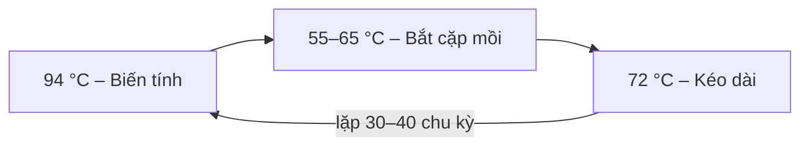

> Tóm tắt chương "Polymerase Chain Reaction – Các vấn đề cơ bản" (tài liệu tham khảo tiếng Việt, 25 trang) lưu trong Drive "Sinh". Nguồn: tài liệu tham khảo, không phải ghi chép của chủ vault.

## PCR là gì
- **PCR** là kỹ thuật nhân bản một đoạn DNA trong ống nghiệm dựa vào **các chu kỳ nhiệt**, chạy trong **máy luân nhiệt (thermal cycler)**.
- **PCR mix** (10–50 µl) gồm:
	- **Taq polymerase** – DNA polymerase chịu nhiệt, hoạt tính tối đa ở **72 °C**. (→ [DNA polymerase trong nhân đôi DNA](/blog/nhan-doi-dna-phien-ma-va-dich-ma/))
	- 4 loại **dNTP** (dATP, dTTP, dGTP, dCTP).
	- **DNA khuôn** chứa đoạn đích.
	- **Mồi xuôi và mồi ngược** – oligonucleotide 20–30 nucleotide bổ sung đặc hiệu với hai đầu đoạn đích.
	- **Mg²⁺** (MgCl₂) – cofactor của polymerase.
	- **Đệm Tris-KCl**.

## Nguyên tắc – một chu kỳ nhiệt
1. **Biến tính (denaturation) – 94 °C**: đứt liên kết hydrogen, DNA sợi kép → 2 mạch đơn.
2. **Bắt cặp (annealing) – 55–65 °C**: mồi bắt cặp bổ sung vào hai đầu đoạn đích.
3. **Kéo dài (extension) – 72 °C**: Taq polymerase gắn dNTP vào **đầu 3'** của mồi, tổng hợp mạch bổ sung.
- Mỗi chu kỳ nhân đôi số bản sao → sau $n$ chu kỳ có tối đa $2^n$ bản sao; 30–40 chu kỳ → $2^{30}$–$2^{40}$ (hàng tỷ) bản sao.

## Lịch sử
- **Kary Mullis** phát minh PCR năm **1985** (bài đăng trên *Scientific American* sau khi bị *Nature* từ chối); nhận **giải Nobel Hoá học 1993** – chỉ 8 năm sau phát minh.
- PCR nguyên thuỷ dùng polymerase không chịu nhiệt từ *E. coli* → phải thêm enzyme sau mỗi lần biến tính, bắt cặp và kéo dài đều ở 37 °C.

## Ba tiến bộ kỹ thuật làm PCR trở nên phổ biến
1. **Polymerase chịu nhiệt**: đầu tiên tách từ vi khuẩn suối nước nóng *Thermus aquaticus* (→ tên **Taq**); nay chủ yếu là enzyme tái tổ hợp. Không phải mở ống thêm enzyme, bắt cặp được ở nhiệt độ tối ưu → đặc hiệu hơn.
2. **Máy luân nhiệt hiệu quả**: buồng ủ dùng **hiệu ứng Peltier** (tăng/giảm nhiệt nhanh, đồng nhất), có bộ vi xử lý và cảm biến nhiệt.
3. **Chống ngoại nhiễm sản phẩm khuếch đại**: thay dTTP bằng **dUTP** và thêm enzyme **UNG** (uracil-N-glycosylase).
	- Ủ 40 °C, 10 phút trước PCR → UNG phá các sản phẩm khuếch đại cũ (chứa U) lỡ lẫn vào; DNA đích tự nhiên (chứa T) không bị phá.
	- UNG bị bất hoạt ở nhiệt độ biến tính → không phá sản phẩm mới.

## Vai trò của mồi
- Polymerase chỉ kéo dài được khi **nucleotide đầu 3' của mồi bắt cặp đúng** với mạch khuôn → mồi quyết định **tính đặc hiệu** của PCR.
- Nhiệt độ bắt cặp **Ta** thường thấp hơn nhiệt độ chảy **Tm** của mồi khoảng 5–10 °C; Tm phụ thuộc chiều dài và **tỷ lệ G + C** của mồi.
- Thiết kế mồi bằng phần mềm (vd Primer Premier 5.0): chọn chiều dài mồi, Ta, kích thước sản phẩm.

## Pha PCR master mix (ví dụ cho 1 phản ứng 25 µl)
| Thành phần     | Nồng độ gốc | Trong 1 phản ứng |
| -------------- | ----------- | ---------------- |
| PCR buffer     | 10×         | 1×               |
| MgCl₂          | 50 mM       | 1,5 mM           |
| Taq polymerase | 5 U/µl      | 1,25 U           |
| dNTP           | 25 mM/loại  | 200 µM/loại      |
| Mồi xuôi       | 100 pmol/µl | 10 pmol          |
| Mồi ngược      | 100 pmol/µl | 10 pmol          |
| dUTP           | 100 mM      | 200 µM           |
| UNG            | 1 U/µl      | 1 U              |
| Nước khử ion   | –           | đủ 20 µl         |
- Thêm **5 µl mẫu** DNA → tổng 25 µl. (→ [Virtual Lab: pha master mix 100 phản ứng theo bảng](/projects/virtual-lab/tai-lieu-drive-cho-giai-doan-6/), protocol `pm-touchdown`)

## Các biến thể PCR
- **Multiplex PCR (PCR đa mồi)**: nhiều cặp mồi trong một ống để phát hiện đồng thời nhiều đích. Các mồi phải có **cùng Ta**, không bắt cặp với nhau, độ nhạy không giảm so với PCR đơn mồi. (→ [Kết quả multiplex PCR trong thực hành](/blog/bao-cao-tong-ket-thuc-hanh-sinh-hoc-phan-tu-phan-tich-ket-qua/))
- **Nested PCR (PCR lồng)**: PCR vòng ngoài với cặp mồi ngoài (Fout/Rout), sản phẩm làm khuôn cho PCR vòng trong với cặp mồi trong (Fin/Rin) → **tăng độ nhạy và độ đặc hiệu**; nhược điểm: phải mở ống → **dễ ngoại nhiễm**.
	- **Semi-/hemi-nested**: dùng lại một mồi vòng ngoài làm mồi vòng trong.
	- **Non-stop nested**: cả hai vòng trong cùng ống; mồi ngoài có Ta cao hơn mồi trong 8–10 °C, hàm lượng mồi ngoài thấp.
- **Touch-down PCR**: bắt đầu ở Ta cao rồi giảm dần (vd 65 °C, giảm 0,5 °C mỗi chu kỳ) → hạn chế sản phẩm không đặc hiệu. (→ [Virtual Lab: so sánh touch-down với PCR thường](/projects/virtual-lab/tai-lieu-drive-cho-giai-doan-6/))
- **RT-PCR**: đích là **RNA** → phiên mã ngược thành **cDNA** bằng **reverse transcriptase** (M-MLV hoặc AMV) rồi mới PCR.
	- Mồi cho bước RT: mồi đặc hiệu, **mồi ngẫu nhiên (random hexamer)** cho cDNA < 600 base, hoặc **oligo(dT)** bắt vào đuôi poly(A) của mRNA.
	- RNA rất dễ bị phân huỷ → phải chống RNase trong suốt quy trình.
- **Real-time PCR**: theo dõi lượng sản phẩm theo từng chu kỳ bằng tín hiệu huỳnh quang → định lượng (tài liệu chỉ nhắc, trình bày ở chương khác).

## Ứng dụng
- Chẩn đoán tác nhân gây bệnh (vd thiết kế mồi đặc hiệu cho DNA vi khuẩn lao).
- **PCR + giải trình tự**: biến phương pháp Sanger thành phản ứng chu kỳ nhiệt, nhạy hơn nhiều; cho phép giải trình tự bộ gene virus trực tiếp từ bệnh phẩm bằng các đoạn PCR chồng lấp nhau → góp phần hoàn tất dự án giải mã bộ gene người sớm hơn dự định. (→ [Bioinformatics](/topics/bioinformatics/))

Bổ sung

- Chuẩn bị khuôn DNA cho PCR: xem [Tách chiết DNA thực vật](/blog/tach-chiet-dna-thuc-vat-bang-ctab-va-dien-di-gel-agarose/). DNA còn lẫn polysaccharide, polyphenol hoặc ethanol có thể **ức chế Taq polymerase**.
- Luôn chạy **đối chứng âm** (không có khuôn) để phát hiện ngoại nhiễm, và **đối chứng dương** để kiểm tra phản ứng.
- **Hot-start PCR**: polymerase bị khoá (kháng thể hoặc hoá chất) cho đến bước biến tính đầu tiên → giảm mồi bắt cặp sai và dimer mồi ở nhiệt độ phòng.
- Thời gian kéo dài thường tính **~1 phút cho 1 kb** sản phẩm với Taq.

## Tài liệu gốc
*PCR_basic.pdf*
