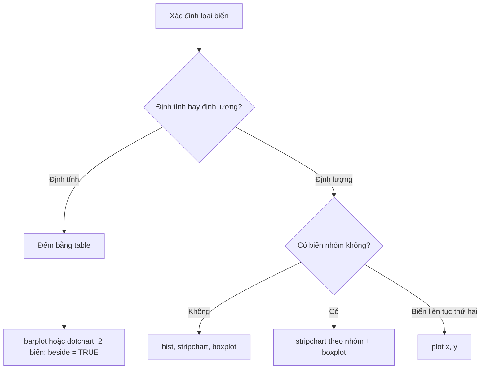

Trong một bộ dữ liệu giả lập, cân nặng của nam và nữ được sinh từ đúng một phân phối, vậy mà biểu đồ cột trung bình lại cho thấy nam nặng hơn gần 4 kg, kèm p = 0,024. Bài đầu tiên của series *Nhập môn phân tích dữ liệu bằng R* trả lời câu hỏi "nên vẽ gì" thay vì chỉ "gọi hàm nào": một bảng ánh xạ từ loại biến sang biểu đồ base R, ba nhóm bằng chứng (thí nghiệm graphical perception, tổng quan về bar graph trong các tạp chí sinh học, cái giá của việc chia nhóm biến liên tục) và một quy trình để người khác vẽ lại đúng hình của bạn. Mọi đoạn code trong bài đều chạy được trên R 4.4.3.

## 1. Mở đầu: biểu đồ là một phép đo bằng mắt

Gọi `barplot()` hay `pie()` trong R chỉ mất vài giây. Phần khó là quyết định nên vẽ gì, vì mỗi biểu đồ buộc người đọc làm một phép so sánh bằng mắt: so chiều cao hai cột, so hai góc, hay so vị trí hai đám điểm. Có phép so sánh mắt người làm khá chính xác, có phép sai số lớn; có biểu đồ hiện từng quan sát, có biểu đồ gói cả nhóm vào một con số.

Anscombe (1973) minh hoạ điều này bằng bốn bộ dữ liệu nhỏ có trung bình, phương sai, hệ số tương quan và đường hồi quy gần như giống hệt nhau nhưng đồ thị tán xạ khác hẳn nhau. Matejka và Fitzmaurice (2017) dùng simulated annealing để biến một bộ dữ liệu thành nhiều hình dạng rất khác nhau mà thống kê tóm tắt gần như không đổi. Bài học chung: phải nhìn dữ liệu, và phải chọn cách nhìn không che mất dữ liệu.

Bài dùng hai bộ dữ liệu. Bộ thứ nhất là dữ liệu **giả lập** 45 học sinh, sinh bằng code dưới đây: giới tính (`gioi_tinh`), điểm toán trên thang 10 với bước 0,5 (`diem_toan`) và cân nặng lấy từ phân phối chuẩn $N(50, 6^2)$ (`can_nang`). Đây là dữ liệu minh hoạ, không mô tả học sinh thật nào. Bộ thứ hai là `mtcars` có sẵn trong R, gồm 32 mẫu xe trích từ tạp chí *Motor Trend* năm 1974, được Henderson và Velleman (1981) dùng để minh hoạ cách xây dựng mô hình hồi quy; bài dùng hai biến `wt` (khối lượng, đơn vị 1000 pound) và `mpg` (số dặm đi được trên một gallon nhiên liệu).

```r
set.seed(42)
gioi_tinh <- sample(c("Nam", "Nu"), 45, replace = TRUE)
diem_toan <- sample(seq(0, 10, 0.5), 45, replace = TRUE)
can_nang  <- rnorm(45, 50, 6)
du_lieu   <- data.frame(gioi_tinh, diem_toan, can_nang)
str(du_lieu)
```

Lưu ý: `diem_toan` được rút **đều** từ 21 giá trị 0; 0,5; …; 10, nên phân bố phẳng, khác điểm thi thật vốn thường dồn về giữa. Dùng để dạy kỹ thuật thì được, nhưng muốn dữ liệu "trông như thật" thì phải mô phỏng phân phối hợp lý. Mọi con số trong bài được tính từ đúng code này trên R 4.4.3.

## 2. Bảng ánh xạ: loại biến nào, biểu đồ nào

Bước đầu tiên luôn là xác định loại biến, vì loại biến quyết định phép so sánh có nghĩa. Trong bộ dữ liệu trên có đủ bốn loại. `gioi_tinh` là biến định tính danh nghĩa (nominal): các nhóm không có thứ tự. `xep_loai`, tạo ra ở mục 5 bằng cách chia điểm thành bốn mức, là biến định tính thứ bậc (ordinal): "Yếu" < "Trung bình" < "Khá" < "Giỏi", nhưng khoảng cách giữa các mức không xác định. `diem_toan` là biến định lượng rời rạc (discrete), chỉ nhận các giá trị cách nhau 0,5. `can_nang`, `wt` và `mpg` là biến định lượng liên tục (continuous).

Bảng 1 là xương sống của bài. Nếu chỉ đọc một mục, bạn có thể đọc mục này; các mục sau giải thích vì sao từng dòng được viết như vậy.

**Bảng 1.** Ánh xạ từ loại biến sang biểu đồ base R

| Dữ liệu | Phép so sánh chính | Nên dùng | Hạn chế dùng |
| --- | --- | --- | --- |
| 1 biến định tính | số lượng giữa các nhóm | `barplot(table(x))`, `dotchart()` | `pie()` khi có nhiều nhóm |
| 2 biến định tính | một nhóm con giữa các nhóm lớn | `barplot(table(x, y), beside = TRUE)` | cột chồng, trừ khi tổng mỗi cột là thông tin chính |
| 1 biến liên tục | hình dạng phân bố | `hist(breaks = ...)`, `stripchart()`, `boxplot()` | chỉ báo cáo trung bình |
| Liên tục theo nhóm | phân bố giữa các nhóm | `stripchart(y ~ g, vertical = TRUE, method = "jitter")` kèm `boxplot(y ~ g)` | cột trung bình ± SD |
| 2 biến liên tục | quan hệ giữa hai biến | `plot(x, y)` | `type = "l"` khi trục x không có thứ tự thật |

Hai dòng đầu dành cho dữ liệu đếm: `table()` đếm số quan sát mỗi nhóm, hoặc tạo bảng chéo (contingency table) khi có hai biến, rồi `barplot()` hay `dotchart()` thể hiện số đếm; mục 3 giải thích vì sao cột kép thường dễ đọc hơn cột chồng. Ba dòng sau dành cho dữ liệu đo: biểu đồ phải cho thấy **hình dạng phân bố** (lệch hay cân, một hay hai đỉnh, có giá trị nằm xa không), và mục 4 lập luận rằng khi so sánh giữa các nhóm, mặc định nên là strip chart (mỗi quan sát một điểm) chồng lên boxplot.

Cũng cần phân biệt bar chart với histogram, hai loại hình trông giống nhau nhưng khác hẳn về bản chất (Bruce & Bruce, 2017). Trục x của bar chart là các **nhóm** rời rạc, thứ tự cột có thể đổi tuỳ ý, giữa các cột có khoảng trống. Trục x của histogram là một **thang số** liên tục được chia thành các khoảng (bin), các cột nằm sát nhau và không được đổi chỗ. Vẽ `barplot()` cho cân nặng hay `hist()` cho giới tính đều là dùng sai công cụ.

Hình 1 cho thấy sáu loại biểu đồ trong bảng, vẽ từ chính hai bộ dữ liệu của bài.


*Hình 1. Sáu loại biểu đồ base R thường gặp, vẽ từ dữ liệu giả lập 45 học sinh và `mtcars`.*

Quy trình chọn biểu đồ có thể tóm thành sơ đồ sau.



Bảng 1 không phải luật cứng. Nó tóm tắt một nguyên tắc chung: chọn biểu đồ sao cho phép so sánh quan trọng nhất được mã hoá bằng **vị trí trên một trục chung**, và với dữ liệu đo trên mẫu nhỏ thì cho người đọc thấy từng quan sát. Nếu muốn đọc thêm về thiết kế biểu đồ cho người xem, xem [nguyên tắc trực quan hoá dữ liệu](/blog/share-data-through-the-art-of-visualization/) và trực quan hoá trong R.

## 3. Bằng chứng 1: thang độ chính xác của Cleveland và McGill

### 3.1. Các nhiệm vụ nhận thức cơ bản

Cleveland và McGill (1984) đặt nền cho việc chọn biểu đồ bằng khái niệm graphical perception: quá trình người xem giải mã thông tin số đã được mã hoá trên hình. Họ đề xuất rằng khi đọc biểu đồ, người xem thực hiện một số "nhiệm vụ nhận thức cơ bản" (elementary perceptual tasks) và xếp mười nhiệm vụ này theo độ chính xác, từ cao đến thấp:

1. Vị trí trên một trục chung (position along a common scale)
2. Vị trí trên các trục không thẳng hàng (positions along nonaligned scales)
3. Độ dài, hướng, góc (length, direction, angle)
4. Diện tích (area)
5. Thể tích, độ cong (volume, curvature)
6. Độ đậm, độ bão hoà màu (shading, color saturation)

Thứ tự này là một giả thuyết; nhóm tác giả kiểm tra một phần của nó bằng thí nghiệm trong đó người tham gia ước lượng tỷ lệ giữa hai giá trị được đánh dấu trên biểu đồ, và kết quả ủng hộ các phần được kiểm tra. Từ đó họ rút ra một nguyên tắc thiết kế: biểu đồ nên dùng những nhiệm vụ nằm càng cao trong thang càng tốt. Áp nguyên tắc này vào bar chart, divided bar chart và pie chart, họ đề xuất thay thế bằng dot chart, dot chart có nhóm và framed-rectangle chart (Cleveland & McGill, 1984).

Heer và Bostock (2010) lặp lại thí nghiệm so sánh vị trí và độ dài của Cleveland và McGill trên Amazon Mechanical Turk, với 50 người trả lời cho mỗi biểu đồ. Kết quả không trùng hoàn toàn với bản gốc, nhưng hình dạng chung và thứ hạng độ chính xác của các kiểu so sánh vị trí và độ dài được giữ nguyên; các phép so sánh vị trí trên trục chung vẫn chính xác hơn có ý nghĩa so với phép so sánh độ dài. Thang độ chính xác vì thế không chỉ là sản phẩm của một phòng thí nghiệm năm 1984.

### 3.2. Cột chồng và cột kép

Áp thang này vào bảng chéo giới tính × xếp loại. Với cột chồng, `barplot(bang)`, chỉ đoạn dưới cùng của mỗi cột đứng trên đáy chung. Muốn so sánh số học sinh nữ giữa các mức xếp loại khi nữ nằm ở đoạn trên, người đọc phải so các đoạn có đáy lệch nhau, tức là so độ dài hoặc vị trí trên trục không thẳng hàng. Với cột kép, `barplot(bang, beside = TRUE)`, mọi cột đứng trên cùng một đáy nên phép so sánh trở thành so vị trí trên trục chung, bậc cao nhất của thang.

```r
du_lieu$xep_loai <- cut(du_lieu$diem_toan,
                        breaks = c(0, 5, 6.5, 8, 10),
                        labels = c("Yeu", "Trungbinh", "Kha", "Gioi"),
                        right = FALSE, include.lowest = TRUE)
bang <- table(du_lieu$gioi_tinh, du_lieu$xep_loai)
bang
barplot(bang, legend.text = TRUE)                 # cột chồng
barplot(bang, beside = TRUE, legend.text = TRUE)  # cột kép
```


*Hình 2. Cùng một bảng chéo giới tính × xếp loại (n = 45) vẽ bằng cột chồng (trái) và cột kép (phải).*

Trong Hình 2, câu hỏi "ở mức Khá, nam hay nữ nhiều hơn" được trả lời ngay ở bên phải: nữ có 3 học sinh, nam không có ai. Ở bên trái bạn phải ước lượng độ dài đoạn trên. Cột chồng vẫn có chỗ dùng: khi **tổng** mỗi cột là thông tin chính (tổng số học sinh mỗi mức), đoạn dưới cùng là nhóm cần so sánh nhất, hoặc chỉ có hai nhóm con.

### 3.3. Pie chart: khi nào nên và không nên dùng

`pie()` mã hoá giá trị bằng góc và diện tích, nằm ở bậc thứ ba và thứ tư của thang. Thay thế trực tiếp là `dotchart()` với các nhóm sắp theo số đếm: mỗi giá trị là một điểm trên trục chung, đọc được cả thứ hạng lẫn khoảng cách.

```r
tab <- sort(table(du_lieu$xep_loai))
dotchart(as.vector(tab), labels = names(tab), xlab = "Số học sinh")
pie(table(du_lieu$xep_loai))
```


*Hình 3. Phân bố xếp loại của 45 học sinh giả lập: pie chart (trái) và dot chart sắp theo số đếm (phải).*

Trên pie trong Hình 3, rất khó nói "Trung bình" (4 học sinh) hay "Khá" (3) lớn hơn; trên dot chart thì thấy ngay. Bruce và Bruce (2017) ghi nhận giới thống kê thường tránh pie chart vì nó chứa ít thông tin trực quan hơn bar chart.

Tuy vậy, kết luận "không bao giờ dùng pie" là quá mạnh. Spence và Lewandowsky (1991) cho người tham gia đọc tỷ lệ từ pie chart, bar chart và bảng trong một loạt thí nghiệm. Kết quả cho thấy pie và bar gần như ngang nhau; pie còn nhỉnh hơn một chút khi phép phán đoán phức tạp, ví dụ ước lượng tổng của nhiều phần, và cả hai loại biểu đồ đều tốt hơn bảng. Hai nghiên cứu không mâu thuẫn nhau mà trả lời hai câu hỏi khác nhau. Cleveland và McGill đo độ chính xác khi so sánh **hai giá trị với nhau**; Spence và Lewandowsky đo việc đọc **một phần so với toàn thể**. Quy tắc thực hành rút ra là: pie chấp nhận được khi bạn có hai, ba nhóm và thông điệp chính là "phần này chiếm bao nhiêu trong tổng"; còn khi cần so sánh giữa các nhóm, hãy dùng bar hoặc dot chart.

## 4. Bằng chứng 2: bar graph che mất phân bố

### 4.1. Vấn đề trong các tạp chí sinh học

Weissgerber và cộng sự (2015) tổng quan có hệ thống 703 bài báo nghiên cứu trên các tạp chí sinh lý học hàng đầu. Phần lớn bài trình bày dữ liệu liên tục bằng bar graph hoặc line graph, trong khi scatterplot, boxplot và histogram, những hình cho phép người đọc tự đánh giá dữ liệu, hiếm khi xuất hiện. Vấn đề là nhiều phân phối khác nhau có thể cho ra cùng một bar graph: một nhóm có thể cân đối, nhóm khác có một giá trị cực đoan, nhóm khác nữa chia thành hai cụm, và dữ liệu đầy đủ có thể dẫn đến kết luận khác với thống kê tóm tắt. Nhóm tác giả đề nghị đào tạo nhà nghiên cứu về trình bày dữ liệu và thay đổi chính sách biên tập của tạp chí.

Dù nhiều tạp chí sau đó đã khuyến khích bỏ bar graph cho dữ liệu liên tục, trong tổng quan các tạp chí hàng đầu về bệnh mạch máu ngoại biên, 47,7% số bài có hình dữ liệu vẫn dùng bar graph cho dữ liệu liên tục (Weissgerber et al., 2019). Bài này kèm hướng dẫn chọn hình theo thiết kế nghiên cứu, cỡ mẫu và loại biến.

### 4.2. Một dương tính giả trong dữ liệu giả lập

Dữ liệu 45 học sinh là ví dụ tự nhiên cho vấn đề này. Trong code ở mục 1, cân nặng của **cả 45 học sinh** được sinh từ cùng một lệnh `rnorm(45, 50, 6)`, còn giới tính được gán ngẫu nhiên và độc lập. Theo cách sinh dữ liệu, không có khác biệt thật nào giữa nam và nữ. Vậy mà:

```r
aggregate(can_nang ~ gioi_tinh, data = du_lieu,
          FUN = function(x) c(n = length(x), tb = mean(x), sd = sd(x)))
t.test(can_nang ~ gioi_tinh, data = du_lieu)   # mặc định là Welch t-test
```

Nhóm nam có 22 học sinh, trung bình 52,33 kg (SD 4,73); nhóm nữ có 23 học sinh, trung bình 48,61 kg (SD 5,89). Welch t-test cho t = 2,34, df ≈ 41,8, p = 0,024. Nếu chỉ vẽ cột trung bình ± SD (panel trái của Hình 4), người đọc sẽ thấy hai cột chênh nhau gần 4 kg, có thêm p < 0,05, và dễ kết luận "nam nặng hơn".


*Hình 4. Cân nặng theo giới của 45 học sinh giả lập, vẽ theo ba cách. Vạch ngang ở panel giữa là trung bình nhóm. Cả 45 giá trị được sinh từ cùng một phân phối.*

Panel giữa và phải cho thấy một bức tranh khác. Hai đám điểm chồng lấn gần hết, khoảng từ 41 đến 59 kg. Nhóm nữ có một giá trị đơn lẻ 32,04 kg, thấp hơn hẳn các điểm còn lại; khi vẽ boxplot cho cả 45 giá trị, đây là điểm duy nhất nằm ngoài râu. Bỏ giá trị này đi, trung bình nhóm nữ tăng từ 48,61 lên 49,36 kg và p vẫn là 0,044, nên kết quả không chỉ do một điểm. Lời giải thích đơn giản hơn: đây là **dương tính giả** (false positive). Khi không có khác biệt thật, khoảng 5% số lần lặp lại thí nghiệm sẽ cho p < 0,05 chỉ do ngẫu nhiên, và `set.seed(42)` tình cờ rơi vào nhóm đó.

Có thể kiểm tra lời giải thích này bằng mô phỏng: lặp lại 10.000 lần việc sinh 45 học sinh theo đúng cách trên, mỗi lần chạy một t-test.

```r
set.seed(2026)
p <- replicate(10000, {
  g <- sample(c("Nam", "Nu"), 45, replace = TRUE)
  y <- rnorm(45, 50, 6)
  t.test(y ~ g)$p.value
})
mean(p < 0.05)   # 0.0461
```


*Hình 5. Phân bố p-value của 10.000 bộ dữ liệu mô phỏng không có khác biệt thật. Cột đỏ: p < 0,05.*

Kết quả là 4,61% số lần cho p < 0,05, gần với mức 5% lý thuyết, và các p-value phân bố gần đều từ 0 đến 1 (Hình 5). Bài học không phải là t-test sai, mà là một con số tóm tắt kèm một p-value không đủ để người đọc đánh giá. Hiện từng điểm dữ liệu cho người đọc tự thấy mức chồng lấn của hai nhóm, đúng tinh thần "reveal, don't conceal" của Weissgerber et al. (2019).

Code base R cho panel giữa và phải của Hình 4:

```r
stripchart(can_nang ~ gioi_tinh, data = du_lieu, vertical = TRUE,
           method = "jitter", pch = 19, col = c("#0072B2", "#E69F00"),
           ylab = "Cân nặng (kg)")

boxplot(can_nang ~ gioi_tinh, data = du_lieu,
        outline = FALSE, ylab = "Cân nặng (kg)")
stripchart(can_nang ~ gioi_tinh, data = du_lieu, vertical = TRUE,
           method = "jitter", pch = 19, add = TRUE)
```

`method = "jitter"` xê dịch nhẹ các điểm theo chiều ngang để những giá trị gần nhau không đè lên nhau. Khi chồng điểm lên boxplot, đặt `outline = FALSE` để boxplot không vẽ riêng các outlier, nếu không thì những điểm này sẽ xuất hiện hai lần.

### 4.3. Đọc boxplot

Boxplot do Tukey giới thiệu và có nhiều biến thể, trong đó có notch và độ rộng hộp theo cỡ mẫu (McGill et al., 1978); Krzywinski và Altman (2014) có một bài ngắn giải thích cách đọc boxplot cho người làm sinh học. Trong R, vạch giữa hộp là median, hai cạnh hộp là hai "hinge", và râu kéo dài tới giá trị xa nhất còn nằm trong khoảng 1,5 lần độ dài hộp tính từ cạnh hộp (tham số `range = 1.5` của `boxplot()`); các điểm vượt quá được vẽ riêng.

Có một chi tiết kỹ thuật cần biết: hinge do `boxplot()` tính bằng `fivenum()`, gần nhưng không luôn trùng với tứ phân vị $Q_1$, $Q_3$ mà `quantile()` trả về theo mặc định. Với biến `wt` của `mtcars`, `quantile()` cho $Q_1$ = 2,581 và $Q_3$ = 3,610, còn hai hinge là 2,5425 và 3,650. Vì vậy hai cách đánh dấu outlier, một cách tự tính ngưỡng $Q_1 - 1{,}5\,IQR$ và $Q_3 + 1{,}5\,IQR$ từ `quantile()`, một cách lấy `boxplot.stats()$out`, có thể cho kết quả khác nhau trên cùng dữ liệu. Chi tiết về các định nghĩa quantile và việc xử lý outlier thuộc về bài về thống kê mô tả của series.

Con số đi kèm hình lấy từ `summary()` (min, $Q_1$, median, trung bình, $Q_3$, max; với `can_nang` là 32,04; 46,74; 51,55; 50,43; 54,08; 59,08) hoặc từ `mean()`, `median()`, `var()` (chia cho $n - 1$) và `sd()`; cách tính bằng Excel có ở bài về đặc trưng thống kê mẫu.

### 4.4. Histogram và tham số `breaks`

Histogram phụ thuộc vào cách chia khoảng. Theo mặc định, `hist()` dùng quy tắc Sturges; với n = 45, `nclass.Sturges()` gợi ý 7 lớp, nhưng R làm tròn các mốc về số "đẹp" bằng `pretty()`, nên cuối cùng ra 6 lớp rộng 5 kg từ 30 đến 60. Một hệ quả bất ngờ: khi bạn đưa một con số, ví dụ `breaks = 4`, R chỉ coi đó là **gợi ý** và ở đây vẫn ra đúng 6 lớp như mặc định. Muốn kiểm soát chính xác, hãy đưa một vector mốc.

```r
hist(du_lieu$can_nang)                                 # Sturges: 6 lớp
hist(du_lieu$can_nang, breaks = 4)                     # vẫn 6 lớp
hist(du_lieu$can_nang, breaks = seq(30, 60, by = 10))  # đúng 3 lớp
hist(du_lieu$can_nang, breaks = 15)                    # 14 lớp rộng 2 kg
```


*Hình 6. Cùng 45 giá trị cân nặng, ba cách chia khoảng cho ba hình dạng khác nhau.*

3 lớp gần như xoá mất hình dạng, 6 lớp cho một phân bố lệch trái nhẹ, 14 lớp cho hình răng cưa nhiều nhiễu. Với mẫu vài chục quan sát, histogram không ổn định; nên vẽ kèm strip chart hoặc thử vài giá trị `breaks`.

## 5. Bằng chứng 3: `cut()` và cái giá của việc chia nhóm

### 5.1. Mốc cắt đóng bên nào

Hàm `cut()` chia một biến liên tục thành các khoảng, ví dụ chia `diem_toan` thành bốn mức xếp loại với các mốc 5; 6,5 và 8. Kết quả phụ thuộc vào hai tham số dễ bị bỏ qua. Tham số `right` quyết định khoảng đóng ở bên nào: mặc định `right = TRUE` tạo các khoảng (0, 5], (5, 6,5], (6,5, 8], (8, 10], tức điểm 5,0 rơi vào mức thấp hơn, cũng như 6,5 và 8,0. Tham số `include.lowest` quyết định giá trị bằng mốc ngoài cùng có được tính hay không; với `right = TRUE` và không có `include.lowest = TRUE`, điểm 0 nằm ngoài khoảng (0, 5] và trở thành `NA`.

```r
moc  <- c(0, 5, 6.5, 8, 10)
nhan <- c("Yeu", "Trungbinh", "Kha", "Gioi")
a <- cut(du_lieu$diem_toan, breaks = moc, labels = nhan)
b <- cut(du_lieu$diem_toan, breaks = moc, labels = nhan,
         right = FALSE, include.lowest = TRUE)
table(a, useNA = "ifany")
table(b, useNA = "ifany")
```

Trong dữ liệu giả lập có một học sinh điểm 0, một học sinh điểm 5,0, hai học sinh 6,5 và ba học sinh 8,0, nên hai cách cắt cho kết quả khác nhau rõ rệt (Bảng 2).

**Bảng 2.** Số học sinh mỗi mức theo hai quy ước `cut()` (n = 45)

| Quy ước | Yếu | Trung bình | Khá | Giỏi | `NA` |
| --- | --- | --- | --- | --- | --- |
| Mặc định `right = TRUE` | 26 | 5 | 4 | 9 | 1 |
| `right = FALSE, include.lowest = TRUE` | 26 | 4 | 3 | 12 | 0 |

Theo quy ước thứ hai, mỗi mức có dạng "từ … đến dưới …": từ 5,0 đến dưới 6,5 là Trung bình, từ 8,0 trở lên là Giỏi (mốc 10 được giữ nhờ `include.lowest = TRUE`). Nhóm Giỏi đổi từ 9 lên 12 học sinh chỉ vì cách đóng khoảng. Quy ước nào đúng tuỳ vào quy định xếp loại bạn đang áp dụng, nên hãy viết rõ quy ước đó trong phần phương pháp. Hình 7 cho thấy từng học sinh rơi vào mức nào theo mỗi quy ước.


*Hình 7. Điểm toán của 45 học sinh giả lập, tô màu theo mức xếp loại. Trên: quy ước mặc định, điểm 0 thành `NA` (xám). Dưới: khoảng đóng bên trái. Đường đứt là các mốc 5; 6,5; 8.*

<div class="callout callout-warning">
<p class="callout-title"><code>cut()</code> không báo lỗi khi bạn gõ sai tên tham số</p>

`cut()` nhận thêm tham số qua `...`, nên một tham số viết sai tên, ví dụ `include.lowertail = TRUE` thay cho `include.lowest = TRUE`, bị bỏ qua mà không có cảnh báo nào. Lệnh `cut(c(0, 5, 10), breaks = c(0, 5, 10), include.lowertail = TRUE)` vẫn trả về `NA` cho giá trị 0. Sau mỗi lần dùng `cut()`, hãy chạy `table(x, useNA = "ifany")` và so tổng với số quan sát ban đầu. Một học sinh biến mất khỏi bảng chéo sẽ biến mất khỏi mọi biểu đồ vẽ từ bảng đó mà không ai nhận ra.

</div>

### 5.2. Chia nhóm làm mất thông tin

Ngoài chuyện mốc cắt, chia nhóm luôn có một cái giá. Nhóm "Yếu" gộp mọi điểm từ 0 đến 4,5 làm một: học sinh 0,5 điểm và học sinh 4,5 điểm trở nên "giống nhau", trong khi học sinh 4,5 và học sinh 5,0 bị tách sang hai nhóm dù chỉ cách nhau nửa điểm. Hình 7 cho thấy rõ điều này: 26 học sinh trải đều trên cả nửa thang điểm được dồn vào một cột.

Trong nghiên cứu y sinh, Altman và Royston (2006) gọi đây là "cái giá của việc chia đôi biến liên tục". Royston, Altman và Sauerbrei (2006) phân tích chi tiết trường hợp chia một biến liên tục thành hai nhóm: sự đơn giản đạt được phải trả giá, vì chia nhóm có thể tạo ra vấn đề thay vì tránh chúng, đáng chú ý là mất power đáng kể và nhiễu còn sót (residual confounding); còn chọn mốc cắt "tối ưu" dựa trên chính dữ liệu thì dẫn tới sai lệch nghiêm trọng. Kết luận của họ là chia nhóm dữ liệu liên tục không cần thiết cho phân tích thống kê, và đặc biệt không nên áp dụng cho biến giải thích trong mô hình hồi quy.

Chia nhóm vẫn hợp lý khi mục đích là **mô tả** theo một quy định có sẵn, như báo cáo tỷ lệ học sinh mỗi mức xếp loại. Khi đó hãy giữ biến gốc, dùng biến đã chia nhóm cho bảng và biểu đồ mô tả, còn mọi phân tích làm trên thang gốc; mốc cắt định trước và ghi rõ.

## 6. Tuỳ chỉnh biểu đồ đúng mục đích

Các hàm vẽ base R có chung các tham số `main`, `sub` (tiêu đề chính, phụ), `xlab`, `ylab` (nhãn trục), `xlim`, `ylim` (giới hạn trục), `col` (màu; xem `colors()`) và `pch` (ký hiệu điểm); `legend()` thêm chú thích tại toạ độ hoặc từ khoá như `"topleft"`. Murrell (2018) mô tả đầy đủ hệ thống đồ hoạ của R; ở đây chỉ có năm nguyên tắc để dùng chúng có mục đích.

Thứ nhất, **nhãn trục phải có đơn vị**. "can_nang" không phải nhãn trục; "Cân nặng (kg)" mới là nhãn. Với `mtcars`, `wt` tính bằng nghìn pound, không phải tấn hay kg, và người đọc không thể đoán được điều đó.

Thứ hai, **trục của bar chart phải bắt đầu từ 0**. Chiều cao cột mã hoá giá trị, nên cắt trục ở 40 sẽ làm cột 52 kg trông cao gấp đôi cột 48 kg. Với scatter plot và strip chart, giá trị được mã hoá bằng vị trí điểm, nên trục không bắt buộc bắt đầu từ 0.

Thứ ba, **chỉ dùng màu khi màu mang thông tin**. Tô ba cột của cùng một biến bằng đỏ, xanh dương và xanh lá không thêm thông tin gì, chỉ thêm một chú thích người đọc phải tra. Màu có ý nghĩa khi nó phân biệt một biến khác, như giới tính trong Hình 2 và 4. Khi đó nên chọn cặp màu vẫn phân biệt được với người mù màu đỏ–lục (bài dùng cặp xanh dương–cam), và đừng để màu là cách duy nhất phân biệt nhóm. Tufte (1983) gọi phần mực dùng để thể hiện dữ liệu là data-ink và khuyến khích bớt những trang trí không mang dữ liệu; đây là một định hướng tốt, miễn là không bỏ đi nhãn và đơn vị.

Thứ tư, **ưu tiên nhãn trực tiếp** hơn chú thích, và chỉ thêm `legend()` khi có nhiều chuỗi dữ liệu trên cùng một hình.

```r
mau <- c(Nam = "#0072B2", Nu = "#E69F00")
barplot(bang, beside = TRUE, col = mau, ylim = c(0, 16),
        ylab = "Số học sinh", xlab = "Xếp loại")
legend("topright", legend = names(mau), fill = mau, bty = "n")
```

Thứ năm, **chỉ nối điểm bằng đường khi trục x có thứ tự thật**. `plot(x, type = "l")` nối các quan sát theo thứ tự hàng trong bảng. Với `mtcars`, thứ tự hàng là thứ tự tên xe, không mang nghĩa gì, nên đường nối là vô nghĩa. Dùng `type = "l"` cho chuỗi thời gian, liều tăng dần hay các mức nồng độ.

Cũng nên tránh `attach(mtcars)`: lệnh này đưa các cột vào đường tìm kiếm của R, gọi nhiều lần sẽ sinh cảnh báo về tên bị che (masking) và dễ gây nhầm biến. Cách gọn hơn là `with()`:

```r
with(mtcars, plot(wt, mpg,
                  xlab = "Khối lượng xe (nghìn pound)",
                  ylab = "Mức tiêu hao nhiên liệu (dặm/gallon)",
                  main = "mtcars: khối lượng và mức tiêu hao nhiên liệu",
                  pch = 19))
with(mtcars, cor(wt, mpg))   # -0.868
```


*Hình 8. Khối lượng và mức tiêu hao nhiên liệu của 32 mẫu xe trong `mtcars`, nhãn trục có đơn vị. Hệ số tương quan Pearson r = −0,87 chỉ dùng để mô tả.*

## 7. Tái lập: từ `set.seed(42)` đến R Markdown

Dữ liệu giả lập chỉ hữu ích khi người khác sinh lại được đúng dữ liệu đó. `set.seed(42)` cố định trạng thái đầu của bộ sinh số ngẫu nhiên, nhưng chỉ đảm bảo cùng kết quả khi **thuật toán** sinh số ngẫu nhiên giống nhau. Theo trang trợ giúp `?RNGkind`, trước R 3.6.0 hàm `sample()` dùng mặc định `sample.kind = "Rounding"`, cách này làm `sample()` không đều rõ rệt trên tập lớn; từ R 3.6.0 mặc định là `"Rejection"` (R Core Team, 2025). Vì vậy cùng `set.seed(42)`, chạy trên R 3.5 sẽ cho giới tính và điểm toán khác với bài này. Muốn tái hiện kết quả cũ, bạn có thể đặt `RNGkind(sample.kind = "Rounding")` trước `set.seed()`, nhưng trang trợ giúp nhấn mạnh rằng cách này chỉ nên dùng để tái hiện kết quả cũ.

Sandve và cộng sự (2013) đề xuất mười quy tắc cho nghiên cứu tính toán tái lập được. Bốn quy tắc gắn trực tiếp với việc vẽ biểu đồ: theo dõi cách mỗi kết quả được tạo ra (quy tắc 1), tránh thao tác tay trên dữ liệu (quy tắc 2), ghi lại seed của mọi phân tích có yếu tố ngẫu nhiên (quy tắc 6) và luôn lưu dữ liệu thô đứng sau mỗi biểu đồ (quy tắc 7).

R Markdown gom chữ, code và kết quả (bảng, hình) vào cùng một tài liệu; khi knit, mọi hình được vẽ lại từ code nên không có bước sao chép tay (Xie et al., 2018). Một file `.Rmd` cho bài thực hành nên có ba thứ ở cuối: phiên bản R và các package, loại RNG, và lệnh xuất hình với kích thước cố định.

```r
# Xuất hình với kích thước và độ phân giải cố định
png("hinh-4-can-nang-theo-gioi.png", width = 1400, height = 900, res = 130)
stripchart(can_nang ~ gioi_tinh, data = du_lieu, vertical = TRUE,
           method = "jitter", pch = 19, ylab = "Cân nặng (kg)")
dev.off()

# Ghi lại môi trường chạy ở cuối tài liệu
RNGkind()       # "Mersenne-Twister" "Inversion" "Rejection"
sessionInfo()   # phiên bản R, hệ điều hành, package đã nạp
```

Nếu xuất PDF có nhãn tiếng Việt, hãy dùng `cairo_pdf()` thay cho `pdf()`: thiết bị `pdf()` mặc định không chuyển được các ký tự có dấu như "ặ", "ố" và sẽ báo lỗi chuyển mã. Base R đủ để làm mọi thứ trong bài, đúng như mục tiêu ban đầu của R là một ngôn ngữ cho phân tích dữ liệu và đồ hoạ (Ihaka & Gentleman, 1996). Khi đã quen, bạn có thể chuyển sang ggplot2, được xây dựng trên ngữ pháp đồ hoạ (grammar of graphics) của Wilkinson (2005) và Wickham (2010); các nguyên tắc chọn biểu đồ trong bài vẫn giữ nguyên.

## 8. Kết luận và checklist

Chọn biểu đồ là chọn phép so sánh mà người đọc phải làm bằng mắt. So sánh vị trí trên trục chung chính xác hơn so sánh độ dài, góc hay diện tích (Cleveland & McGill, 1984; Heer & Bostock, 2010), dù pie vẫn ổn khi đọc một phần so với toàn thể (Spence & Lewandowsky, 1991). Với dữ liệu liên tục và mẫu nhỏ, bar graph trung bình che mất phân bố (Weissgerber et al., 2015, 2019) và có thể biến một khác biệt ngẫu nhiên thành "phát hiện". Chia nhóm biến liên tục làm mất thông tin, nên chỉ dùng để mô tả.

Checklist tám bước trước khi đưa một biểu đồ vào báo cáo:

1. Xác định loại biến: danh nghĩa, thứ bậc, rời rạc hay liên tục.
2. Viết ra phép so sánh quan trọng nhất mà người đọc cần làm.
3. Mã hoá phép so sánh đó bằng vị trí trên trục chung (cột kép, dot chart, strip chart).
4. Với dữ liệu liên tục và n nhỏ, hiện từng điểm; không dùng cột trung bình ± SD.
5. Sau `cut()`, kiểm tra `table(x, useNA = "ifany")` và ghi rõ quy ước đóng khoảng.
6. Nhãn trục có đơn vị; trục bar chart bắt đầu từ 0; màu chỉ dùng khi mang thông tin.
7. Ghi seed, `RNGkind()` và `sessionInfo()`; xuất hình bằng code với kích thước cố định.
8. Đọc lại hình như một người lạ: không có chú thích của bạn, họ có hiểu đúng không?

Bài tiếp theo, các thao tác với dữ liệu trong R, đi vào chọn, lọc và xử lý dữ liệu thiếu; quantile, hinge và outlier có ở bài thống kê mô tả; còn [làm sạch dữ liệu](/blog/process-data-from-dirty-to-clean/) là bước nên làm trước khi vẽ bất kỳ biểu đồ nào.

## Tài liệu tham khảo

Altman, D. G., & Royston, P. (2006). The cost of dichotomising continuous variables. *BMJ, 332*(7549), 1080. https://doi.org/10.1136/bmj.332.7549.1080

Anscombe, F. J. (1973). Graphs in statistical analysis. *The American Statistician, 27*(1), 17–21. https://doi.org/10.1080/00031305.1973.10478966

Bruce, P., & Bruce, A. (2017). *Practical statistics for data scientists*. O'Reilly Media.

Cleveland, W. S., & McGill, R. (1984). Graphical perception: Theory, experimentation, and application to the development of graphical methods. *Journal of the American Statistical Association, 79*(387), 531–554. https://doi.org/10.1080/01621459.1984.10478080

Heer, J., & Bostock, M. (2010). Crowdsourcing graphical perception: Using Mechanical Turk to assess visualization design. In *Proceedings of the SIGCHI Conference on Human Factors in Computing Systems* (pp. 203–212). ACM. https://doi.org/10.1145/1753326.1753357

Henderson, H. V., & Velleman, P. F. (1981). Building multiple regression models interactively. *Biometrics, 37*(2), 391–411. https://doi.org/10.2307/2530428

Ihaka, R., & Gentleman, R. (1996). R: A language for data analysis and graphics. *Journal of Computational and Graphical Statistics, 5*(3), 299–314. https://doi.org/10.1080/10618600.1996.10474713

Krzywinski, M., & Altman, N. (2014). Visualizing samples with box plots. *Nature Methods, 11*(2), 119–120. https://doi.org/10.1038/nmeth.2813

Matejka, J., & Fitzmaurice, G. (2017). Same stats, different graphs: Generating datasets with varied appearance and identical statistics through simulated annealing. In *Proceedings of the 2017 CHI Conference on Human Factors in Computing Systems* (pp. 1290–1294). ACM. https://doi.org/10.1145/3025453.3025912

McGill, R., Tukey, J. W., & Larsen, W. A. (1978). Variations of box plots. *The American Statistician, 32*(1), 12–16. https://doi.org/10.1080/00031305.1978.10479236

Murrell, P. (2018). *R graphics* (3rd ed.). Chapman and Hall/CRC. https://doi.org/10.1201/9780429422768

R Core Team. (2025). *R: A language and environment for statistical computing* (Version 4.4.3). R Foundation for Statistical Computing. https://www.R-project.org/

Royston, P., Altman, D. G., & Sauerbrei, W. (2006). Dichotomizing continuous predictors in multiple regression: A bad idea. *Statistics in Medicine, 25*(1), 127–141. https://doi.org/10.1002/sim.2331

Sandve, G. K., Nekrutenko, A., Taylor, J., & Hovig, E. (2013). Ten simple rules for reproducible computational research. *PLOS Computational Biology, 9*(10), e1003285. https://doi.org/10.1371/journal.pcbi.1003285

Spence, I., & Lewandowsky, S. (1991). Displaying proportions and percentages. *Applied Cognitive Psychology, 5*(1), 61–77. https://doi.org/10.1002/acp.2350050106

Tufte, E. R. (1983). *The visual display of quantitative information*. Graphics Press.

Weissgerber, T. L., Milic, N. M., Winham, S. J., & Garovic, V. D. (2015). Beyond bar and line graphs: Time for a new data presentation paradigm. *PLOS Biology, 13*(4), e1002128. https://doi.org/10.1371/journal.pbio.1002128

Weissgerber, T. L., Winham, S. J., Heinzen, E. P., Milin-Lazovic, J. S., Garcia-Valencia, O., Bukumiric, Z., Savic, M. D., Garovic, V. D., & Milic, N. M. (2019). Reveal, don't conceal: Transforming data visualization to improve transparency. *Circulation, 140*(18), 1506–1518. https://doi.org/10.1161/CIRCULATIONAHA.118.037777

Wickham, H. (2010). A layered grammar of graphics. *Journal of Computational and Graphical Statistics, 19*(1), 3–28. https://doi.org/10.1198/jcgs.2009.07098

Wilkinson, L. (2005). *The grammar of graphics*. Springer. https://doi.org/10.1007/0-387-28695-0

Xie, Y., Allaire, J. J., & Grolemund, G. (2018). *R Markdown: The definitive guide*. Chapman and Hall/CRC. https://doi.org/10.1201/9781138359444
