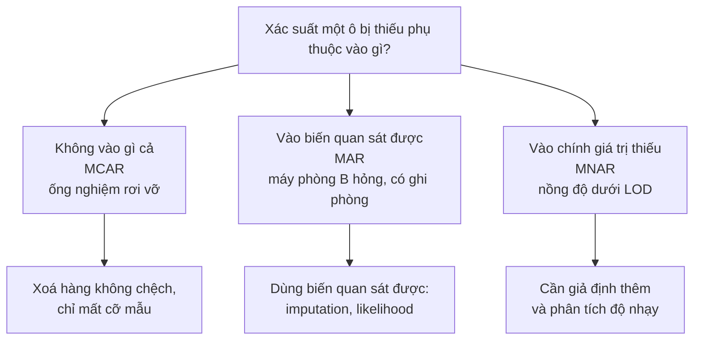

Một dòng `na.omit()` có thể xoá trọn một nhóm quan sát khỏi phân tích mà không báo lỗi nào. Bài thứ hai của series *Nhập môn phân tích dữ liệu bằng R* dùng bộ dữ liệu bán lẻ BigMart để chẩn đoán cơ chế thiếu (MCAR, MAR, MNAR) trước khi chọn cách xử lý, rồi so sánh xoá hàng, thay bằng trung bình, điền theo khoá và multiple imputation bằng `mice` qua một thí nghiệm che giá trị đã biết, lặp 200 lần. Cuối bài có hai mục kỹ thuật và một checklist cho số liệu thí nghiệm sinh học.

## 1. Mở đầu: dữ liệu thiếu không phải lỗi gõ phím

Trong phòng thí nghiệm, ô trống trong bảng số liệu hiếm khi xuất hiện ngẫu nhiên. Một giếng ELISA bị bọt khí nên máy không đọc được; một phôi cá chết trước giờ đo nhịp tim; một nồng độ thấp hơn ngưỡng phát hiện nên máy trả về "< LOD". Mỗi ô trống có một nguyên nhân khác, và mỗi nguyên nhân dẫn tới một cách xử lý khác. Phôi chết trước giờ đo nhiều khả năng là phôi yếu nhất: bỏ nó đi làm nhóm còn lại trông khoẻ hơn thực tế.

Vì vậy xử lý dữ liệu thiếu là một **quyết định phân tích**, không phải bước dọn dẹp kỹ thuật. Hai cách phổ biến nhất với người mới học R là xoá mọi dòng có NA bằng `na.omit()` và thay NA bằng giá trị trung bình; trên cùng một bộ dữ liệu, chúng có thể cho hai câu trả lời khác nhau. Bài này hỏi: cách nào đúng, trong điều kiện nào, và làm sao biết bạn đang ở điều kiện nào.

Ví dụ xuyên suốt là bộ dữ liệu BigMart, phát hành cho một bài thực hành dự đoán doanh số trên nền tảng Analytics Vidhya (Analytics Vidhya, n.d.): 1559 mã hàng bán ở 10 cửa hàng, chia thành tập train (8523 dòng × 12 cột, có doanh số `Item_Outlet_Sales`) và tập test (5681 dòng × 11 cột, không có doanh số). Các biến mô tả sản phẩm gồm mã hàng (`Item_Identifier`), cân nặng (`Item_Weight`), mức chất béo, tỷ lệ diện tích trưng bày (`Item_Visibility`), nhóm hàng và giá niêm yết (`Item_MRP`); các biến mô tả cửa hàng gồm mã, năm mở, kích thước, khu vực và loại cửa hàng. Không rõ đây là số liệu thật hay được dựng lại cho cuộc thi, nên mọi diễn giải về "vì sao cửa hàng không ghi" chỉ là giả thuyết. Bài không đăng lại dữ liệu thô, chỉ trình bày số liệu tóm tắt và hình tự vẽ.

Mục 2 định nghĩa ba cơ chế thiếu, mục 3 chẩn đoán, mục 4–5 trình bày và so sánh bốn cách xử lý, mục 6–7 là hai mục kỹ thuật, mục 8 là checklist.

## 2. Ba cơ chế thiếu theo Rubin: MCAR, MAR, MNAR

Rubin (1976) xếp các bài toán dữ liệu thiếu vào ba loại, tuỳ theo xác suất một ô bị thiếu phụ thuộc vào cái gì; quá trình quyết định xác suất đó gọi là cơ chế thiếu (missing data mechanism) (van Buuren, 2018, mục 1.2).

**MCAR** (missing completely at random, thiếu hoàn toàn ngẫu nhiên): xác suất thiếu như nhau cho mọi quan sát, tức nguyên nhân thiếu không liên quan tới dữ liệu. Ví dụ: một ống nghiệm rơi vỡ, hoặc pin của cân hết giữa buổi cân chuột. Ngoài việc mất thông tin, MCAR không gây thêm rắc rối, nhưng van Buuren (2018) nhận xét rằng nó thường không thực tế với dữ liệu thật.

**MAR** (missing at random, thiếu ngẫu nhiên có điều kiện): xác suất thiếu chỉ như nhau **trong từng nhóm được xác định bởi dữ liệu quan sát được**. Ví dụ: máy đọc plate ở phòng B hỏng một tuần, và bảng số liệu có ghi mẫu nào đo ở phòng B; nhìn cả bảng thì mẫu phòng B thiếu nhiều hơn, nhưng trong từng phòng thì thiếu là ngẫu nhiên. Tên gọi dễ gây hiểu lầm: MAR không phải "ngẫu nhiên" theo nghĩa thông thường, mà là điều kiện rằng thông tin giải thích sự thiếu đã nằm sẵn trong dữ liệu.

**MNAR** (missing not at random, thiếu không ngẫu nhiên): xác suất thiếu phụ thuộc vào chính giá trị bị thiếu hoặc vào thông tin không có trong bảng. Ví dụ kinh điển là nồng độ dưới ngưỡng phát hiện (limit of detection, LOD): giá trị thiếu chính vì nó nhỏ. Phôi chết trước giờ đo cũng gần với MNAR nếu không biến nào ghi lại độ yếu của phôi.



*Hình 1. Ba cơ chế thiếu và hệ quả cho cách xử lý.*

Khi dữ liệu là MCAR, phân tích trên các trường hợp đầy đủ (complete-case analysis, hay listwise deletion) cho ước lượng không chệch của trung bình, phương sai và hệ số hồi quy; cái giá là sai số chuẩn lớn hơn vì mất cỡ mẫu (van Buuren, 2018, mục 1.3.1). Khi dữ liệu không phải MCAR, xoá hàng có thể làm chệch nặng trung bình, hệ số hồi quy và tương quan, và độ chệch tăng theo khoảng cách giữa nhóm quan sát được và nhóm bị thiếu (Little & Rubin, 2019; Schafer & Graham, 2002). Với MAR, các phương pháp dùng thông tin từ biến quan sát được (multiple imputation, maximum likelihood) có thể cho kết quả hợp lệ; Rubin (1976) gọi tình huống cơ chế thiếu có thể bỏ qua khi suy luận là *ignorable*. Với MNAR, không phương pháp nào tự sửa được nếu không thêm giả định về quá trình gây thiếu.

Dữ liệu chỉ có thể giúp **bác bỏ** MCAR, chẳng hạn bằng kiểm định của Little (1988). MAR và MNAR khác nhau ở những giá trị không quan sát được, nên không phép thử nào trên dữ liệu có sẵn phân biệt được hai loại này; lập luận phải dựa vào hiểu biết về quy trình thu thập: ai đo, đo bằng gì, vì sao bỏ trống.

## 3. Chẩn đoán dữ liệu thiếu trên BigMart

Chẩn đoán chỉ cần vài dòng base R và `data.table`. Bước đầu tiên là gộp train và test để thấy toàn bộ 14204 dòng. Tập test không có cột doanh số, nên phải tạo cột đó với giá trị NA trước khi gộp; nếu không, `rbind()` báo lỗi vì hai bảng lệch số cột.

```r
library(data.table)
train <- fread("Train_UWu5bXk.csv")      # đường dẫn tương đối tới thư mục dự án
test  <- fread("Test_u94Q5KV.csv")
test[, Item_Outlet_Sales := NA]          # test không có nhãn; thiếu dòng này thì rbind() báo lỗi
combi <- rbind(train, test)              # 14204 dòng
colSums(is.na(combi))                    # Item_Weight 2439, Item_Outlet_Sales 5681
sum(combi$Outlet_Size == "")             # 4016 ô rỗng mà is.na() không thấy
sum(combi$Item_Visibility == 0)          # 879
table(combi$Item_Fat_Content)            # 5 nhãn cho 2 mức
```

`Item_Weight` thiếu 2439 ô (17,2%), đây là dữ liệu thiếu thật. `Item_Outlet_Sales` thiếu 5681 ô, đúng bằng số dòng test: doanh số bị bỏ trống **theo thiết kế** của bài toán dự đoán, không phải dữ liệu thiếu. Gộp hai loại này vào một "tỷ lệ thiếu" sẽ dẫn tới kết luận sai.

### 3.1. Thiếu ẩn: những ô `is.na()` không đếm

`is.na()` chỉ đếm giá trị NA. Ba cột khác của BigMart có những dạng thiếu hoặc lỗi không mang nhãn NA (Bảng 1).

| Cột | Dạng | Số ô (train + test) | `is.na()` có đếm không? |
| --- | --- | --- | --- |
| `Item_Weight` | NA | 2439 | có |
| `Item_Outlet_Sales` | NA do test không có nhãn | 5681 | có (nhưng không phải thiếu thật) |
| `Outlet_Size` | chuỗi rỗng `""` | 4016 | không |
| `Item_Visibility` | số 0 | 879 | không |
| `Item_Fat_Content` | 5 nhãn cho 2 mức | 900 ô viết lệch | không |

*Bảng 1. Thiếu và thiếu ẩn theo cột.*

`Outlet_Size` có 4016 chuỗi rỗng, vì cả `fread()` lẫn `read.csv()` đọc ô trống của cột ký tự thành `""` chứ không phải NA. Cách sửa là khai báo ngay khi đọc file:

```r
train2 <- fread("Train_UWu5bXk.csv", na.strings = c("", "NA"))
sum(is.na(train2$Outlet_Size))           # 2410 ô trong train, giờ đã là NA
```

`Item_Visibility` bằng 0 ở 879 dòng. Một sản phẩm đang có doanh số khó có diện tích trưng bày bằng 0, nên nhiều khả năng đây là giá trị thiếu được mã hoá bằng 0; đó là giả thuyết, muốn chắc phải hỏi người tạo dữ liệu. Trong số liệu thí nghiệm, dạng tương tự là -99, 999 hay 0 trong cột nồng độ.

`Item_Fat_Content` có năm nhãn cho hai mức: `Low Fat` (8485), `Regular` (4824), `LF` (522), `reg` (195) và `low fat` (178). Đây là lỗi nhất quán chứ không phải thiếu, nhưng thường lộ ra cùng lúc; nguyên tắc tidy data (Wickham, 2014) giúp phát hiện sớm, và cách chuẩn hoá nhãn có ở bài [làm sạch dữ liệu](/blog/process-data-from-dirty-to-clean/).

### 3.2. Bảng chéo quyết định

Bước quan trọng nhất chỉ là một dòng: lập bảng chéo giữa trạng thái thiếu và một biến nhóm.

```r
table(combi$Outlet_Identifier, is.na(combi$Item_Weight))
```

Kết quả thay đổi toàn bộ câu chuyện. Toàn bộ 2439 ô thiếu `Item_Weight` nằm ở đúng hai cửa hàng: OUT019 (880/880 dòng) và OUT027 (1559/1559 dòng). Tám cửa hàng còn lại không thiếu ô nào. Tương tự, `Outlet_Size` trống ở trọn ba cửa hàng OUT010, OUT017 và OUT045. Hình 2 cho thấy các "khối" thiếu này.


*Hình 2. Tỷ lệ ô thiếu theo cửa hàng ở ba cột (train + test, 14204 dòng). Thiếu `Item_Weight` và `Outlet_Size` dồn thành khối theo cửa hàng; số 0 ở `Item_Visibility` rải đều 5–7% ở mọi cửa hàng.*

Bảng 2 đặt các khối thiếu cạnh đặc điểm cửa hàng.

| Cửa hàng | Năm mở | Loại | Số dòng | % thiếu `Item_Weight` |
| --- | --- | --- | --- | --- |
| OUT010 | 1998 | Grocery Store | 925 | 0 |
| OUT013 | 1987 | Supermarket Type1 | 1553 | 0 |
| OUT017 | 2007 | Supermarket Type1 | 1543 | 0 |
| OUT018 | 2009 | Supermarket Type2 | 1546 | 0 |
| OUT019 | 1985 | Grocery Store | 880 | 100 |
| OUT027 | 1985 | Supermarket Type3 | 1559 | 100 |
| OUT035 | 2004 | Supermarket Type1 | 1550 | 0 |
| OUT045 | 2002 | Supermarket Type1 | 1548 | 0 |
| OUT046 | 1997 | Supermarket Type1 | 1550 | 0 |
| OUT049 | 1999 | Supermarket Type1 | 1550 | 0 |

*Bảng 2. Mười cửa hàng BigMart (train + test).*

Hai cửa hàng thiếu cân nặng cùng mở năm 1985, sớm nhất trong bộ dữ liệu; có thể hệ thống ghi chép của chúng khác các cửa hàng mới hơn, nhưng dữ liệu không đủ để khẳng định.

Ngược lại, thiếu không liên quan tới đặc điểm sản phẩm: tỷ lệ thiếu theo `Item_Type` đều nhau (15,6–18,6%), giá niêm yết trung bình của dòng không thiếu và dòng thiếu gần như bằng nhau (141,0 so với 140,9). Nhưng doanh số trung bình của dòng thiếu cân nặng cao hơn rõ (2483,7 so với 2118,6 trong train), vì OUT027 là cửa hàng **Supermarket Type3 duy nhất**, loại có doanh số trung bình cao nhất (3694,0, so với 2316,2 của Type1, 1995,5 của Type2 và 339,8 của Grocery Store).

```r
tapply(is.na(combi$Item_Weight), combi$Item_Type, mean)        # 0,156 - 0,186
tapply(combi$Item_MRP, is.na(combi$Item_Weight), mean)         # 141,0 và 140,9
tapply(train$Item_Outlet_Sales, is.na(train$Item_Weight), mean) # 2118,6 và 2483,7
```

Kết luận chẩn đoán: `Item_Weight` thiếu **theo cửa hàng**. Nếu điều kiện theo `Outlet_Identifier`, xác suất thiếu là 0 hoặc 1 và không phụ thuộc vào cân nặng, nên cơ chế gần với MAR, chắc chắn không phải MCAR. Vì dòng thiếu khác dòng đầy đủ ở doanh số, xoá dòng thiếu sẽ làm chệch mẫu.

<div class="callout callout-note">
<p class="callout-title">Kiểm định MCAR của Little trong R</p>

Gói `naniar` (phiên bản 1.1.0) có hàm `mcar_test()` thực hiện kiểm định của Little (1988). Trên tập train với bốn biến số, thống kê kiểm định là 196 (df = 3, p < 0,001, 2 kiểu thiếu), tức là bác bỏ MCAR.
```r
library(naniar)
mcar_test(train[, .(Item_Weight, Item_MRP, Item_Visibility, Item_Outlet_Sales)])
```
Không bác bỏ MCAR không có nghĩa dữ liệu là MCAR, và bác bỏ MCAR cũng không cho biết dữ liệu là MAR hay MNAR. Ở BigMart, bảng chéo theo cửa hàng nói nhiều hơn một giá trị p.

</div>

## 4. Bốn cách xử lý và code R tương ứng

### 4.1. Xoá hàng (complete-case)

```r
cc <- na.omit(train)
nrow(cc)                                 # 7060 trên 8523 dòng
table(train$Outlet_Type)
table(cc$Outlet_Type)                    # không còn Supermarket Type3
```

`na.omit(train)` giảm tập train từ 8523 xuống 7060 dòng (mất 17,2%), nhưng con số tỷ lệ che mất điều quan trọng hơn: cả 935 dòng Supermarket Type3 biến mất, Grocery Store chỉ còn 555 trên 1083 dòng. Mô hình fit trên `cc` không thể ước lượng gì cho loại cửa hàng bán chạy nhất. Đúng như Schafer và Graham (2002) cảnh báo, khi thiếu không phải MCAR, xoá hàng không chỉ mất cỡ mẫu mà còn đổi luôn tổng thể mà phân tích mô tả.

### 4.2. Thay bằng trung bình hoặc trung vị toàn cột

```r
w_mean <- replace(combi$Item_Weight, is.na(combi$Item_Weight),
                  mean(combi$Item_Weight, na.rm = TRUE))
c(sd(combi$Item_Weight, na.rm = TRUE), sd(w_mean))   # 4,65 và 4,23
```

Chỉ một dòng code và giữ đủ số dòng, nhưng cả 2439 ô nhận cùng giá trị 12,79, nên độ lệch chuẩn co từ 4,65 xuống 4,23. Theo van Buuren (2018, mục 1.3.3), thay bằng trung bình làm ước lượng phương sai thấp đi, làm méo quan hệ giữa các biến, làm chệch gần như mọi ước lượng khác ngoài trung bình, và làm chệch cả trung bình khi dữ liệu không phải MCAR. Donders và cộng sự (2006) thêm rằng mọi cách điền một lần (single imputation) đều cho sai số chuẩn quá nhỏ vì coi giá trị điền như giá trị đo thật.

### 4.3. Điền theo nhóm: trung bình theo `Item_Identifier`

Một cách làm thường gặp với BigMart là thay mỗi ô thiếu bằng trung bình cân nặng của **cùng mã hàng** ở các cửa hàng khác. Vì mỗi mã hàng bán ở 7–10 cửa hàng, hầu như mã nào cũng có cân nặng ở ít nhất một nơi.

```r
w <- combi$Item_Weight
for (i in which(is.na(w))) {
  w[i] <- mean(w[combi$Item_Identifier == combi$Item_Identifier[i]], na.rm = TRUE)
}
sum(is.na(w))                            # 0
```

Nếu chỉ dùng tập train, có 4 mã hàng mà mọi dòng train đều thuộc hai cửa hàng thiếu; `mean()` trên vector rỗng trả về `NaN`, nên còn sót 4 ô. Gộp train và test trước giúp mọi mã hàng có ít nhất một cân nặng quan sát được.

Nhưng có một câu hỏi nên đặt ra trước khi gọi đây là "ước lượng": cân nặng của một mã hàng có thay đổi giữa các cửa hàng không?

```r
rng <- tapply(combi$Item_Weight, combi$Item_Identifier,
              function(x) diff(range(x, na.rm = TRUE)))
summary(rng)                             # mọi giá trị đều bằng 0
```

Khoảng biến thiên trong nhóm bằng 0 ở cả 1559 mã hàng: cân nặng là **thuộc tính cố định của mã hàng**, như khối lượng phân tử của một hợp chất. Nói cách khác, `Item_Weight` phụ thuộc hàm vào `Item_Identifier`, và theo nguyên tắc tidy data, biến này lẽ ra nên nằm ở một bảng sản phẩm riêng (Wickham, 2014). "Trung bình theo nhóm" ở đây thực chất là **tra cứu giá trị đúng**, tức điền tất định dựa trên phụ thuộc hàm (deterministic imputation), không phải ước lượng. Hiểu cấu trúc dữ liệu có thể giá trị hơn mọi thuật toán.

### 4.4. Multiple imputation bằng `mice`

Multiple imputation (MI) tạo nhiều bộ dữ liệu hoàn chỉnh, mỗi bộ điền ô thiếu bằng giá trị rút ngẫu nhiên từ phân bố dự đoán, phân tích từng bộ rồi gộp kết quả. Gói `mice` làm việc này bằng phương trình nối chuỗi (chained equations): mỗi biến thiếu được điền từ một mô hình hồi quy trên các biến khác, lặp nhiều vòng (van Buuren & Groothuis-Oudshoorn, 2011). Với biến số liên tục, mặc định của `mice()` là predictive mean matching (`pmm`) với 5 "người cho" (donor): với mỗi ô thiếu, thuật toán tìm 5 trường hợp đầy đủ có giá trị dự đoán gần nhất rồi lấy ngẫu nhiên giá trị quan sát được của một trong số đó (van Buuren, 2018, mục 3.4), nên không bao giờ điền ra cân nặng âm. Kết quả được gộp theo quy tắc Rubin (Rubin, 1987) bằng `pool()`.

```r
library(mice)
dat <- train[, .(Item_Weight, Item_MRP, Item_Visibility,
                 Item_Type = factor(Item_Type), Outlet_Type = factor(Outlet_Type),
                 Item_Outlet_Sales)]
imp <- mice(dat, m = 5, method = "pmm", seed = 2026, printFlag = FALSE)
head(imp$loggedEvents, 2)                # mice bỏ biến giả Supermarket Type3
fit <- with(imp, lm(Item_Outlet_Sales ~ Item_Weight + Item_MRP + Outlet_Type))
summary(pool(fit))[2:3, 1:3]
```

Hai chi tiết đáng chú ý. Thứ nhất, chỉ dùng tập train, vì doanh số của test là NA do thiết kế. Thứ hai, `imp$loggedEvents` cho thấy `mice` tự loại biến giả `Outlet_TypeSupermarket Type3` khỏi mô hình điền `Item_Weight`: nhóm Type3 không có cân nặng nào quan sát được, nên biến này vô dụng. Đây chính là vấn đề bảng chéo ở mục 3.2 đã chỉ ra, lần này dưới dạng một cảnh báo kỹ thuật dễ bị bỏ qua. Mô hình gộp cho hệ số `Item_Weight` −0,85 (SE 2,76) và `Item_MRP` 15,56 (SE 0,20).

Trước khi dùng MI cho khoá luận, bạn nên đọc hướng dẫn thực hành của White và cộng sự (2011) về cách xây dựng mô hình điền, chọn số bộ điền và giới hạn của phương pháp, cùng bài của Sterne và cộng sự (2009) về cách dùng và báo cáo MI trong nghiên cứu dịch tễ và lâm sàng.

## 5. Thí nghiệm: che giá trị đã biết rồi khôi phục

Trên dữ liệu thiếu thật, ta không biết giá trị đúng nên không thể so sánh các phương pháp. Giải pháp là một thí nghiệm mô phỏng: che bớt những ô có cân nặng thật theo một cơ chế định trước, áp dụng từng phương pháp rồi so với giá trị thật. Thí nghiệm được thiết kế theo khung ADEMP của Morris và cộng sự (2019): mục tiêu (Aims), cơ chế sinh dữ liệu (Data-generating mechanisms), đại lượng cần ước lượng (Estimands), phương pháp (Methods) và thước đo hiệu năng (Performance measures).

### 5.1. Phương pháp theo ADEMP

**Mục tiêu.** So sánh các cách xử lý `Item_Weight` bị thiếu về độ chính xác của giá trị điền và độ chệch của suy luận, dưới ba cơ chế thiếu.

**Dữ liệu và cơ chế che.** Dữ liệu gốc là 11765 dòng (train + test) có cân nặng thật, trong đó 7060 dòng train có doanh số. Ba kịch bản:

- **A (MCAR):** che ngẫu nhiên 20% số dòng (2353 ô, khoảng 1410 ô trong train).
- **B (theo cửa hàng):** che trọn hai cửa hàng OUT046 và OUT049 (3100 ô, 1860 ô trong train), mô phỏng đúng kiểu thiếu đã chẩn đoán ở mục 3.
- **C (MNAR mô phỏng):** xác suất che tăng theo chính cân nặng, $P(\text{che}) = \operatorname{logit}^{-1}(z - 1{,}6)$ với $z$ là cân nặng chuẩn hoá, khoảng 1500 ô trong train. Sản phẩm càng nặng càng dễ bị thiếu.

**Đại lượng cần ước lượng.** (i) Giá trị từng ô bị che; (ii) độ lệch chuẩn và trung bình của `Item_Weight`; (iii) hệ số của `Item_Weight` và `Item_MRP` trong mô hình `lm(Item_Outlet_Sales ~ Item_Weight + Item_MRP + Outlet_Type)`. Giá trị tham chiếu là kết quả trên 7060 dòng train khi chưa che: trung bình 12,858, SD 4,643, hệ số `Item_Weight` −0,467 (SE 2,768), hệ số `Item_MRP` 15,244 (SE 0,206).

**Phương pháp.** Sáu cách: xoá hàng (`na.omit`), thay bằng mean, thay bằng median, tra theo `Item_Identifier`, `mice` pmm (m = 5) với các biến dự đoán như mục 4.4, và `mice` pmm có thêm một biến phụ (auxiliary variable) là cân nặng đã biết của cùng mã hàng ở các dòng chưa bị che.

**Thước đo hiệu năng.** RMSE trên các ô bị che; SD sau khi điền; độ chệch của trung bình; hệ số và sai số chuẩn trung bình. Mỗi kịch bản lặp 200 lần, kèm sai số chuẩn Monte Carlo (MCSE) (Morris et al., 2019). Phiên bản: R 4.4.3, data.table 1.18.4, mice 3.19.0.

Lõi của một lần lặp như sau:

```r
library(data.table); library(mice)
train <- fread("Train_UWu5bXk.csv"); test <- fread("Test_u94Q5KV.csv")
test[, Item_Outlet_Sales := NA]
base <- rbind(train, test)[!is.na(Item_Weight)]          # 11765 dòng có cân nặng thật
base[, `:=`(Item_Type = factor(Item_Type), Outlet_Type = factor(Outlet_Type))]
truth <- base$Item_Weight
tr    <- !is.na(base$Item_Outlet_Sales)                    # 7060 dòng train
fml   <- Item_Outlet_Sales ~ Item_Weight + Item_MRP + Outlet_Type

make_mask <- function(scenario) {
  n <- nrow(base)
  switch(scenario,
    A = seq_len(n) %in% sample(n, round(0.2 * n)),                 # MCAR 20%
    B = base$Outlet_Identifier %in% c("OUT046", "OUT049"),         # trọn 2 cửa hàng
    C = runif(n) < plogis(as.numeric(scale(truth)) - 1.6))         # MNAR: nặng hơn, dễ thiếu hơn
}

run_once <- function(scenario) {
  m <- make_mask(scenario)
  w <- replace(truth, m, NA)
  look <- ave(w, base$Item_Identifier, FUN = function(x) mean(x, na.rm = TRUE))
  look[is.nan(look)] <- NA                                  # mã hàng bị che toàn bộ
  filled <- list(mean   = replace(w, m, mean(w, na.rm = TRUE)),
                 median = replace(w, m, median(w, na.rm = TRUE)),
                 item   = replace(w, m, look[m]))
  dat <- base[tr, .(Item_Weight = w[tr], Item_MRP, Item_Visibility,
                    Item_Type, Outlet_Type, Item_Outlet_Sales)]
  imp     <- mice(dat, m = 5, method = "pmm", printFlag = FALSE)
  imp_aux <- mice(cbind(dat, aux = look[tr]), m = 5, method = "pmm",
                  printFlag = FALSE, remove.collinear = FALSE, eps = 0)
  list(mask = m[tr], filled = lapply(filled, `[`, tr), imp = imp, imp_aux = imp_aux,
       cc = lm(fml, data = base[tr][!m[tr]]))
}

set.seed(2026)
r <- run_once("A")
sqrt(mean((r$filled$mean[r$mask] - truth[tr][r$mask])^2))  # RMSE của mean
summary(pool(with(r$imp, lm(Item_Outlet_Sales ~ Item_Weight + Item_MRP + Outlet_Type))))[2, 1:3]
```

`set.seed()` đặt trước mọi lệnh ngẫu nhiên (`sample()`, `runif()`, `mice()`); thiếu nó, không ai tái lập được con số trong báo cáo.

### 5.2. Kết quả

| Kịch bản | Phương pháp | RMSE | SD sau điền | Chệch của trung bình | Hệ số `Item_Weight` (SE) | n fit |
| --- | --- | --- | --- | --- | --- | --- |
| A | na.omit | — | 4,64 | 0,00 | −0,62 (3,09) | 5650 |
| A | mean | 4,64 | 4,16 | −0,01 | −0,63 (3,09) | 7060 |
| A | tra theo mã hàng | 0,00 | 4,64 | 0,00 | −0,47 (2,77) | 7060 |
| A | mice pmm | 6,49 | 4,64 | 0,00 | −0,70 (3,15) | 7060 |
| A | mice pmm + biến phụ | 0,01 | 4,64 | 0,00 | −0,47 (2,77) | 7060 |
| B | na.omit | — | 4,64 | −0,01 | 2,96 (3,19) | 5200 |
| B | mean | 4,67 | 3,98 | −0,03 | 2,85 (3,23) | 7060 |
| B | tra theo mã hàng | 0,00 | 4,64 | 0,00 | −0,47 (2,77) | 7060 |
| B | mice pmm | 6,49 | 4,62 | −0,03 | 2,81 (3,33) | 7060 |
| B | mice pmm + biến phụ | 0,00 | 4,64 | 0,00 | −0,47 (2,77) | 7060 |
| C | na.omit | — | 4,43 | −0,87 | 0,57 (3,27) | 5564 |
| C | mean | 5,72 | 3,93 | −0,88 | 0,58 (3,27) | 7060 |
| C | tra theo mã hàng | 0,00 | 4,64 | −0,01 | −0,45 (2,77) | 7055 |
| C | mice pmm | 7,14 | 4,43 | −0,86 | 0,43 (3,33) | 7060 |
| C | mice pmm + biến phụ | 0,40 | 4,64 | −0,01 | −0,46 (2,77) | 7060 |

*Bảng 3. Kết quả thí nghiệm, trung bình 200 lần lặp mỗi kịch bản. Giá trị tham chiếu: SD 4,643; trung bình 12,858; hệ số `Item_Weight` −0,467 (SE 2,768). "Chệch của trung bình" là trung bình `Item_Weight` sau xử lý trừ giá trị tham chiếu. Ở kịch bản C, trung bình 5 ô mỗi lần lặp thuộc mã hàng bị che toàn bộ nên phương pháp tra cứu để trống, n fit còn 7055.*

MCSE của RMSE và của độ chệch trung bình đều dưới 0,005, của hệ số `Item_Weight` khoảng 0,10–0,12 ở kịch bản A và C. Kịch bản B che cố định hai cửa hàng, nên các phương pháp tất định cho cùng kết quả ở cả 200 lần. Thay bằng median cho kết quả gần như trùng mean (RMSE 4,65 / 4,68 / 6,13 ở A / B / C) nên không đưa vào bảng.

Bốn kết quả nổi bật: (1) tra theo mã hàng khôi phục chính xác ở cả ba kịch bản, kể cả MNAR; (2) mean làm co SD từ 4,64 xuống 3,93–4,16 vì hơn 1400 ô dồn vào một giá trị (Hình 3); (3) `mice` pmm có RMSE cao nhất (6,49–7,14) nhưng giữ SD gần đúng ở A và B; (4) thêm biến phụ là cân nặng đã biết của cùng mã hàng thì `mice` gần như khôi phục chính xác.


*Hình 3. Phân bố `Item_Weight` ở các ô bị che trong một lần lặp kịch bản A (1412 ô): giá trị thật, sau khi thay bằng trung bình và sau mice pmm (bộ điền thứ nhất). Trục tung của hình giữa khác hai hình còn lại.*


*Hình 4. Hệ số `Item_Weight` (trung bình 200 lần lặp) ± 1,96 × SE theo phương pháp và kịch bản. Đường đứt đoạn là giá trị tham chiếu trên dữ liệu đầy đủ.*

### 5.3. Bàn luận

**Vì sao RMSE của pmm cao?** Các biến dự đoán trong mô hình điền gần như không giải thích được cân nặng (tương quan giữa cân nặng và doanh số chỉ là r = 0,014), nên pmm về cơ bản lấy cân nặng của một donor gần như ngẫu nhiên. Hiệu của hai giá trị độc lập cùng phân bố có độ lệch chuẩn $\sqrt{2}\,\sigma$, nên RMSE kỳ vọng khoảng $\sqrt{2} \times 4{,}64 \approx 6{,}57$, gần con số 6,49 quan sát được; đây là lập luận đơn giản để hiểu con số, không phải định lý từ tài liệu. Điều cốt lõi: MI không nhằm làm mỗi ô gần giá trị thật nhất, mà nhằm suy luận hợp lệ, tức ước lượng không chệch và khoảng tin cậy có độ phủ đúng (van Buuren, 2018, mục 2.5). Mean thắng về RMSE chính vì đặt mọi ô vào tâm phân bố, cũng là lý do nó phá hỏng phương sai. Đánh giá MI bằng RMSE từng ô là dùng sai thước đo.

**Kịch bản B: lợi ích của việc giữ dòng.** Khi che trọn hai cửa hàng, mọi phương pháp không dùng thông tin mã hàng đều đẩy hệ số `Item_Weight` lên khoảng 2,8–3,0, lệch khoảng một SE: thông tin về quan hệ cân nặng–doanh số chỉ còn đến từ tám cửa hàng, và các biến dự đoán yếu không thêm được gì. Khác biệt nằm ở các hệ số khác: xoá hàng còn 5200 dòng và hệ số `Item_MRP` đổi từ 15,24 thành 14,91 (SE 0,24), còn các phương pháp điền giữ đủ 7060 dòng và `Item_MRP` gần như nguyên vẹn. Biến thiếu không phải biến duy nhất bị ảnh hưởng khi bạn xoá dòng.

**Kịch bản C: không phương pháp MAR nào tự sửa được MNAR.** Khi sản phẩm nặng dễ bị thiếu hơn, trung bình cân nặng bị kéo xuống khoảng 0,86–1,00 với xoá hàng, mean, median và cả `mice` pmm, vì pmm tìm donor dựa trên các biến quan sát được, mà các biến này không mang thông tin về cân nặng. Chỉ hai phương pháp dùng mã hàng mới thoát được chệch.

**Mô hình điền phải chứa biến giải thích giá trị thiếu.** Cùng một thuật toán, chỉ thêm một biến có thông tin, RMSE giảm từ 6,5 xuống gần 0. Trong số liệu sinh học, biến phụ có thể là giá trị của cùng cá thể ở lần đo trước, một phép đo song song, hay thông tin lô và máy đo. Chọn biến cho mô hình điền là trọng tâm trong hướng dẫn của White và cộng sự (2011).

**Về sai số chuẩn.** SE của hệ số `Item_Weight` sau khi thay bằng mean (3,09–3,27) lại lớn hơn SE tham chiếu, vì biến dự đoán ít biến thiên hơn. Điều này không mâu thuẫn với nhận xét single imputation cho SE quá nhỏ (Donders et al., 2006): nhận xét đó nói về độ bất định của chính giá trị được điền, thứ mean bỏ qua hoàn toàn còn MI đưa vào qua quy tắc Rubin (SE của pmm lớn hơn mean ở mọi kịch bản). Vì hệ số cân nặng gần 0 với SE lớn, mọi khác biệt hệ số ở Bảng 3 đều trong khoảng một SE; muốn đánh giá độ phủ của khoảng tin cậy cần một estimand nhạy hơn.

**Giới hạn.** Một bộ dữ liệu, một biến thiếu, MNAR là giả lập, và hồi quy chỉ là thước đo. Kết quả "tra cứu thắng tuyệt đối" dựa vào việc cân nặng cố định theo mã hàng, một đặc điểm hiếm gặp nhưng luôn đáng kiểm tra.

## 6. Bẫy khi mã hoá lại biến: factor, `match()` và `cut()`

Mã hoá lại biến (recode) là nơi dữ liệu thiếu hoặc giá trị sai sinh ra mà không có thông báo lỗi nào. Các ví dụ dưới dùng bộ `mtcars` có sẵn trong R (`am` = 0 là số tự động, 1 là số sàn; 19 xe số tự động, 13 xe số sàn).

**Factor sang số phải qua ký tự.** Factor lưu mã mức (1, 2, 3…) theo thứ tự chữ cái của nhãn, nên ép thẳng sang số trả về mã mức chứ không phải giá trị:

```r
f <- factor(c("10", "5", "20"))
levels(f)                        # "10" "20" "5"
as.numeric(f)                    # 1 3 2   (mã mức)
as.numeric(as.character(f))      # 10 5 20 (giá trị đúng)
as.numeric(c("12.5", "n/a", "7"))  # 12.5 NA 7, kèm cảnh báo NAs introduced by coercion
```

Dòng cuối là một nguồn NA ẩn khác: nhãn "n/a" thành NA chỉ kèm một cảnh báo, dễ trôi qua khi chạy cả script.

**Năm cách mã hoá `am` thành nhãn.** Các cách dưới cho cùng một bảng tần số khi viết đúng, nhưng khác nhau ở kiểu dữ liệu và ở chỗ dễ sai.

```r
df <- mtcars
df$trans  <- factor(df$am, levels = c(0, 1), labels = c("Automatic", "Manual"))
df$trans2 <- factor(c("Automatic", "Manual"))[match(df$am, c(0, 1))]
df$trans3 <- replace(df$am, df$am == 1, "Manual")      # cột thành character: "0" và "Manual"
df$trans3 <- replace(df$trans3, df$am == 0, "Automatic")
table(df$trans, useNA = "ifany")                        # Automatic 19, Manual 13
identical(as.character(df$trans), df$trans3)            # TRUE
```

| Cách | Kết quả | Bẫy |
| --- | --- | --- |
| `factor(levels, labels)` | factor, 19 / 13 | an toàn nhất; mức không khớp thành NA |
| `match()` + chỉ số | factor, 19 / 13 | `match(1, c("0","1"))` vẫn trả về 2 nhờ ép kiểu ngầm; nên viết `c(0, 1)` |
| `replace()` một mức | character, `"0"` / `"Manual"` | cả cột thành chuỗi, sót `"0"` |
| `replace()` hai mức | character, 19 / 13 | đúng, nhưng là chuỗi |
| gán theo điều kiện | character | dòng không thoả điều kiện nào giữ NA |

*Bảng 4. Năm cách mã hoá `am` trên `mtcars`.*

**Gán theo điều kiện để lại NA.** Khi chia công suất `hp` thành ba nhóm bằng các lệnh gán theo điều kiện, quên một điều kiện là để lại NA ở mọi dòng thuộc nhóm đó:

```r
q <- rep(NA_character_, nrow(mtcars))
q[mtcars$hp < 96.5] <- "L"
q[mtcars$hp > 180]  <- "H"        # quên nhóm M
table(q, useNA = "ifany")         # H 7, L 8, <NA> 17
```

Thói quen nên có: luôn kiểm tra kết quả recode bằng `table(..., useNA = "ifany")`.

**`cut()` và vị trí mốc chia.** `cut()` mặc định `right = TRUE`, tức khoảng đóng bên phải: giá trị đúng bằng mốc 96,5 rơi vào nhóm thấp hơn. Lệnh gán theo điều kiện `96.5 <= hp & hp <= 180` lại xếp 96,5 vào nhóm M.

```r
x <- c(96.5, 180, 180.5)
cut(x, breaks = c(-Inf, 96.5, 180, Inf), labels = c("L", "M", "H"))               # L M H
cut(x, breaks = c(-Inf, 96.5, 180, Inf), labels = c("L", "M", "H"), right = FALSE) # M H H
```

Với `mtcars`, không xe nào có `hp` đúng bằng 96,5 nên hai cách cho cùng bảng (L 8, M 17, H 7), nhưng định nghĩa nhóm khác nhau, và với dữ liệu khác chúng sẽ cho kết quả khác. Ghi rõ khoảng đóng hay mở khi báo cáo.

**Rời rạc hoá có giá của nó.** Chia biến liên tục thành L/M/H giúp mô tả, nhưng khi đưa nhóm vào phân tích, thông tin bên trong mỗi nhóm bị vứt bỏ: xe 97 và 180 mã lực bị coi như nhau. Altman và Royston (2006) phân tích cái giá của việc chia đôi biến liên tục, và Royston và cộng sự (2006) kết luận chia đôi biến dự đoán trong hồi quy bội là một ý tưởng tồi. Hãy dùng `cut()` cho bảng mô tả và biểu đồ ([bài 1 của series](/blog/trinh-bay-va-mo-ta-du-lieu-thuc-hanh-r/)), còn mô hình giữ biến liên tục.

## 7. Vòng lặp hay vector hoá?

Vòng `for` điền cân nặng ở mục 4.3 đúng, nhưng có thể viết gọn và nhanh hơn bằng vector hoá. Ba cách dưới cho kết quả giống hệt nhau (`all.equal` trả về `TRUE`, không còn NA nào):

```r
w0 <- combi$Item_Weight; id <- combi$Item_Identifier
f_loop  <- function(w, id) {
  for (i in which(is.na(w))) w[i] <- mean(w[id == id[i]], na.rm = TRUE)
  w
}
f_ave   <- function(w, id) {
  m <- ave(w, id, FUN = function(x) mean(x, na.rm = TRUE))
  w[is.na(w)] <- m[is.na(w)]
  w
}
f_match <- function(w, id) {
  tra <- tapply(w, id, mean, na.rm = TRUE)               # bảng tra: một giá trị mỗi mã hàng
  miss <- is.na(w)
  w[miss] <- tra[match(id[miss], names(tra))]
  w
}
all.equal(f_loop(w0, id), f_ave(w0, id))                 # TRUE
all.equal(f_loop(w0, id), as.numeric(f_match(w0, id)))   # TRUE
median(replicate(20, system.time(f_loop(w0, id))["elapsed"]))
```

| Cách | Thời gian (trung vị 20 lần chạy) | So với vòng `for` |
| --- | --- | --- |
| Vòng `for` | 0,389 s | 1× |
| `ave()` | 0,016 s | nhanh khoảng 24× |
| `tapply()` + `match()` | 0,011 s | nhanh khoảng 35× |

*Bảng 5. Thời gian điền 2439 ô trên 14204 dòng (R 4.4.3, một máy tính cá nhân; con số tuyệt đối thay đổi theo máy, tỷ lệ mới đáng chú ý).*

Vòng lặp chậm ở đây vì mỗi lần lặp so sánh `id == id[i]` trên toàn bộ 14204 dòng, tổng cộng khoảng 2439 × 14204 ≈ 35 triệu phép so sánh. `ave()` và `tapply()` chia nhóm một lần, còn `match()` tra bảng một lần cho mọi ô thiếu; cách thứ ba còn thể hiện đúng bản chất bài toán: cân nặng là thuộc tính của mã hàng.

Hai ví dụ vector hoá nhỏ hơn. Tổng $\sum (x_i^2 + y_i)$ chỉ cần `sum(x^2 + y)` thay cho một vòng lặp cộng dồn; trên hai vector 10 phần tử, cả hai cách đều cho 585. Hàm tính $\sum x_i^{\,i}$ viết bằng vòng lặp có một bẫy đáng nhớ:

```r
tinhtong_old <- function(x) { tong <- 0; for (i in 1:length(x)) tong <- tong + x[i]^i; tong }
tinhtong     <- function(x) { tong <- 0; for (i in seq_along(x)) tong <- tong + x[i]^i; tong }
tinhtong(c(2, 3, 4, 5))          # 700
sum(c(2, 3, 4, 5)^seq_along(c(2, 3, 4, 5)))  # 700, bản vector hoá
1:length(numeric(0))             # 1 0
tinhtong_old(numeric(0))         # numeric(0), không phải 0
tinhtong(numeric(0))             # 0
```

Khi `x` rỗng, `1:length(x)` là `1:0`, tức vòng lặp chạy hai lần với `i = 1` rồi `i = 0`, sinh ra NA rồi vector rỗng. `seq_along(x)` trả về vector rỗng và vòng lặp không chạy. Tương tự, `mean(numeric(0))` trả về `NaN`, chính là nguồn của 4 ô sót ở mục 4.3 nếu chỉ dùng tập train.

Không nên thần thánh hoá vector hoá: với người mới, vòng `for` dễ đọc và dễ kiểm tra; 0,4 giây không phải vấn đề với một báo cáo thực hành. Đúng trước, rõ ràng sau, nhanh sau cùng, và luôn so bản nhanh với bản chậm bằng `all.equal()`.

## 8. Kết luận và checklist xử lý dữ liệu thiếu

Thông điệp của bài gói trong một câu hỏi: **dữ liệu thiếu ở đâu, và vì sao?** Ở BigMart, một bảng chéo một dòng cho thấy cân nặng thiếu theo cửa hàng, rằng `na.omit()` sẽ xoá trọn loại siêu thị bán chạy nhất, và rằng "trung bình theo nhóm" thực chất là tra cứu. Thí nghiệm cho thấy không phương pháp nào thắng ở mọi thước đo, và không phương pháp nào dựa trên giả định MAR tự sửa được MNAR. Thứ quyết định kết quả là thông tin bạn đưa vào, không phải tên thuật toán.

Checklist dưới đây áp dụng được cho số liệu thí nghiệm sinh học như cho dữ liệu bán lẻ:

1. **Đọc dữ liệu với `na.strings` phù hợp** (`c("", "NA")`, `"-99"`, `"n/a"`), rồi tìm thiếu ẩn: số 0 vô lý, chuỗi rỗng, nhãn lạ, "< LOD".
2. **Tách thiếu thật khỏi trống do thiết kế** (nhãn của tập test, biến không áp dụng cho nhóm đối chứng).
3. **Lập bảng chéo trạng thái thiếu với mọi biến nhóm**: lô, máy, ngày đo, người đo, vị trí trên plate.
4. **Hỏi người thu thập vì sao thiếu** và ghi giả định MCAR, MAR hay MNAR; nếu có thể MNAR, lên kế hoạch phân tích độ nhạy.
5. **Kiểm tra phụ thuộc hàm**: biến thiếu có cố định theo một khoá (mã sản phẩm, mã cá thể, mã mẫu) không? Nếu có, tra cứu trước.
6. **Chọn phương pháp theo cơ chế**: xoá hàng chỉ khi gần MCAR và mất ít dòng; tránh thay bằng trung bình cho suy luận; dùng MI khi MAR hợp lý, với các biến giải thích cả sự thiếu lẫn giá trị thiếu trong mô hình điền (White et al., 2011), và đọc cảnh báo như `imp$loggedEvents`.
7. **Báo cáo đầy đủ**: số dòng trước và sau, phương pháp, số bộ điền, biến trong mô hình điền, phiên bản gói và seed (Sterne et al., 2009); dùng đường dẫn tương đối thay cho `setwd()` tới thư mục tuyệt đối (Wilson et al., 2017; xem thêm quy trình tái lập).

Các bài sau trong series luyện tiếp những thao tác này: bài tập R cơ bản, hồi quy trên dữ liệu nhà ở Boston và thống kê mô tả với trung vị và giá trị ngoại lai.

## Tài liệu tham khảo

Altman, D. G., & Royston, P. (2006). The cost of dichotomising continuous variables. *BMJ, 332*(7549), 1080. https://doi.org/10.1136/bmj.332.7549.1080

Analytics Vidhya. (n.d.). *Big Mart sales prediction* [Data set and practice problem]. https://www.analyticsvidhya.com/datahack/contest/big-mart-sales-prediction

Donders, A. R. T., van der Heijden, G. J. M. G., Stijnen, T., & Moons, K. G. M. (2006). Review: A gentle introduction to imputation of missing values. *Journal of Clinical Epidemiology, 59*(10), 1087–1091. https://doi.org/10.1016/j.jclinepi.2006.01.014

Little, R. J. A. (1988). A test of missing completely at random for multivariate data with missing values. *Journal of the American Statistical Association, 83*(404), 1198–1202. https://doi.org/10.1080/01621459.1988.10478722

Little, R. J. A., & Rubin, D. B. (2019). *Statistical analysis with missing data* (3rd ed.). Wiley. https://doi.org/10.1002/9781119482260

Morris, T. P., White, I. R., & Crowther, M. J. (2019). Using simulation studies to evaluate statistical methods. *Statistics in Medicine, 38*(11), 2074–2102. https://doi.org/10.1002/sim.8086

Royston, P., Altman, D. G., & Sauerbrei, W. (2006). Dichotomizing continuous predictors in multiple regression: A bad idea. *Statistics in Medicine, 25*(1), 127–141. https://doi.org/10.1002/sim.2331

Rubin, D. B. (1976). Inference and missing data. *Biometrika, 63*(3), 581–592. https://doi.org/10.1093/biomet/63.3.581

Rubin, D. B. (1987). *Multiple imputation for nonresponse in surveys*. Wiley. https://doi.org/10.1002/9780470316696

Schafer, J. L., & Graham, J. W. (2002). Missing data: Our view of the state of the art. *Psychological Methods, 7*(2), 147–177. https://doi.org/10.1037/1082-989X.7.2.147

Sterne, J. A. C., White, I. R., Carlin, J. B., Spratt, M., Royston, P., Kenward, M. G., Wood, A. M., & Carpenter, J. R. (2009). Multiple imputation for missing data in epidemiological and clinical research: Potential and pitfalls. *BMJ, 338*, b2393. https://doi.org/10.1136/bmj.b2393

van Buuren, S. (2018). *Flexible imputation of missing data* (2nd ed.). Chapman and Hall/CRC. https://doi.org/10.1201/9780429492259 (bản trực tuyến: https://stefvanbuuren.name/fimd/)

van Buuren, S., & Groothuis-Oudshoorn, K. (2011). mice: Multivariate imputation by chained equations in R. *Journal of Statistical Software, 45*(3), 1–67. https://doi.org/10.18637/jss.v045.i03

White, I. R., Royston, P., & Wood, A. M. (2011). Multiple imputation using chained equations: Issues and guidance for practice. *Statistics in Medicine, 30*(4), 377–399. https://doi.org/10.1002/sim.4067

Wickham, H. (2014). Tidy data. *Journal of Statistical Software, 59*(10), 1–23. https://doi.org/10.18637/jss.v059.i10

Wilson, G., Bryan, J., Cranston, K., Kitzes, J., Nederbragt, L., & Teal, T. K. (2017). Good enough practices in scientific computing. *PLOS Computational Biology, 13*(6), e1005510. https://doi.org/10.1371/journal.pcbi.1005510
