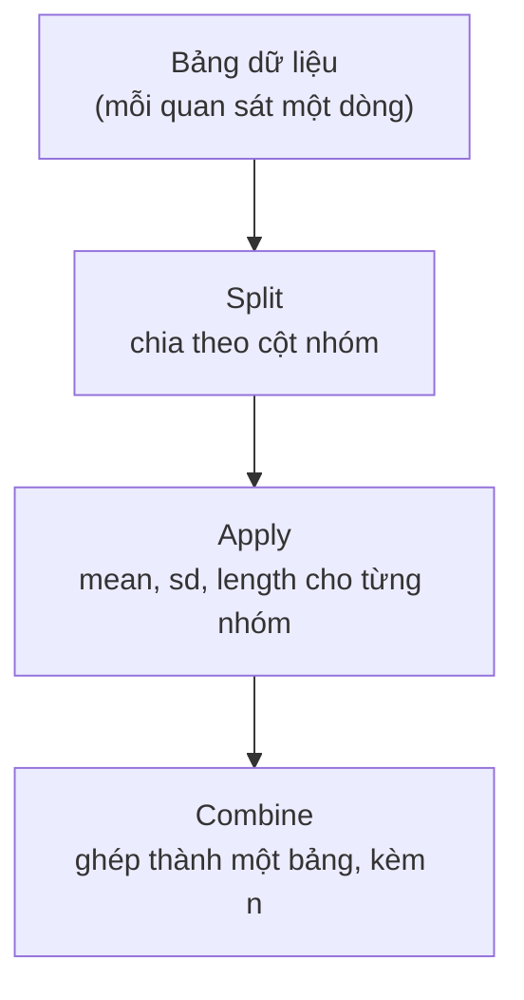

Cùng 20 con số trong bộ dữ liệu `sleep` của R có thể cho p = 0,079 hoặc p = 0,003, tuỳ bạn coi chúng là hai nhóm người hay mười người được đo hai lần, và câu trả lời đúng nằm sẵn trong trang `?sleep`. Bài thứ ba của series *Nhập môn phân tích dữ liệu bằng R* lần theo nguồn gốc của các bộ dữ liệu có sẵn quen thuộc và một bảng số liệu WHO, chỉ ra nguồn gốc quyết định cách phân tích, rồi thay các vòng `for` tính theo nhóm bằng `tapply()`, `aggregate()` và `split()`. Cuối bài có checklist sáu bước.

## 1. Mở đầu: dữ liệu có sẵn không có nghĩa là không có lịch sử

Gói `datasets` đi kèm mọi bản cài đặt R. Vì dữ liệu nằm sẵn trong bộ nhớ, người học dễ coi chúng là bảng số "trung tính" để luyện cú pháp. Thực ra mỗi bộ là kết quả của một thí nghiệm hay khảo sát có thật, với thiết kế riêng: đo hai lần trên cùng một người, cân cùng một con gà 12 lần, hay gán ngẫu nhiên mỗi con gà vào một loại thức ăn rồi cân một lần. Thiết kế đó quyết định phép tính nào hợp lệ.

Mỗi bộ dữ liệu trong gói `datasets` có một trang help (gõ `?sleep`) với các mục **Description**, **Format**, **Details** và **Source** (R Core Team, 2025). Mục Source là hồ sơ nguồn gốc (data provenance); mục Details thường ghi điều cần biết trước khi tính bất cứ thứ gì. Bảng 1 tóm tắt hồ sơ của bảy bộ dữ liệu dùng trong bài, lấy từ trang help của gói `datasets` và gói `Stat2Data` (Cannon et al., 2019).

**Bảng 1.** Hồ sơ bảy bộ dữ liệu theo trang help của R

| Bộ dữ liệu | Kích thước | Đơn vị quan sát | Nguồn ghi trong help | Thiết kế |
| --- | --- | --- | --- | --- |
| `sleep` | 20 dòng, 3 biến | một lần đo trên một bệnh nhân | Cushny & Peebles (1905); Student (1908) | ghép cặp: 10 người, mỗi người dùng 2 thuốc |
| `iris` | 150 dòng, 5 biến | một bông hoa | Fisher (1936); dữ liệu do Edgar Anderson thu thập | quan sát, 50 hoa mỗi loài |
| `ChickWeight` | 578 dòng, 4 biến | một lần cân một con gà | Crowder & Hand (1990); Hand & Crowder (1996); Pinheiro & Bates (2000) | đo lặp: 50 gà, 4 chế độ ăn, có gà mất số đo giữa chừng |
| `chickwts` | 71 dòng, 2 biến | một con gà | "Anonymous (1948) Biometrika 35, 214" | ngẫu nhiên, 6 loại thức ăn, cân một lần |
| `AirPassengers` | 144 tháng | một tháng | Box, Jenkins và Reinsel, "Series G" | chuỗi thời gian 1949–1960 |
| `BirdNest` | 84 dòng, 12 biến | một loài chim | đề tài của Amy R. Moore, Grinnell College (1999) | tổng hợp từ tài liệu |
| `AHCAvote2017` | 430 dòng, 11 biến | một dân biểu | FiveThirtyEight, New York Times | quan sát |

Mỗi bộ dữ liệu được xem như một case: nguồn gốc, cách tóm tắt thường gặp, phân tích lại đúng thiết kế, bài học. Ba vấn đề chính là thiết kế ghép cặp bị coi như hai nhóm độc lập (mục 2), dữ liệu đo lặp có cá thể bỏ cuộc (mục 4) và giá trị thiếu được thay bằng median trước khi chia nhóm (mục 6); kỹ thuật xuyên suốt là split-apply-combine (mục 5). Mọi số liệu được chạy bằng R 4.4.3.

## 2. sleep: bộ dữ liệu của t-test đầu tiên, và vì sao phải ghép cặp

### 2.1. Nguồn gốc

Năm 1905, Cushny và Peebles công bố thử nghiệm về tác dụng gây ngủ của các đồng phân quang học của hyoscine trên *The Journal of Physiology* (Cushny & Peebles, 1905). Ba năm sau, William Sealy Gosset, ký tên "Student", dùng lại số liệu của họ làm ví dụ trong bài "The probable error of a mean" trên *Biometrika* (Student, 1908), bài báo đặt nền cho phân phối t. Zabell (2008) bình luận lại bài báo này một thế kỷ sau. Senn và Richardson (1994) phân tích lại thứ họ gọi là "t-test đầu tiên"; theo phần tóm tắt của bài, dữ liệu của thử nghiệm *within-patient* (so sánh trong cùng bệnh nhân) này đã bị cả Student lẫn Fisher trích dẫn sai.

Trang `?sleep` mô tả dữ liệu là tác dụng của hai thuốc gây ngủ (số giờ ngủ tăng thêm so với đối chứng) trên **10 bệnh nhân**. Bảng có ba cột: `extra` (giờ ngủ tăng thêm), `group` (thuốc được dùng) và `ID` (mã bệnh nhân). Mục Details cảnh báo thẳng rằng tên biến `group` có thể gây hiểu nhầm: đây là số đo trên 10 người, không phải hai nhóm (R Core Team, 2025).

### 2.2. Cách tóm tắt thường gặp và vấn đề của nó

Cách tóm tắt nhanh nhất là tính trung bình theo `group`: thuốc 1 tăng 0,75 giờ, thuốc 2 tăng 2,33 giờ, chênh 1,58 giờ. Nếu chỉ nhìn cột `group`, bước tiếp theo sẽ là t-test hai mẫu độc lập (independent two-sample t-test), và cột `ID` cùng toàn bộ cấu trúc ghép cặp bị bỏ quên.

```r
with(sleep, tapply(extra, group, mean))
#    1    2
# 0.75 2.33

t.test(extra ~ group, data = sleep)              # Welch, coi như 2 nhóm độc lập
x1 <- sleep$extra[sleep$group == 1]
x2 <- sleep$extra[sleep$group == 2]
t.test(x1, x2, paired = TRUE)                    # ghép cặp theo bệnh nhân
cor(x1, x2)                                      # 0.795
```

Ghép `x1` với `x2` theo vị trí chỉ đúng khi hai vector cùng thứ tự bệnh nhân; với `sleep` điều này đúng, nhưng cách an toàn hơn ở cuối mục này.

### 2.3. Phân tích lại

Bảng 2 đặt ba kiểu t-test cạnh nhau: hai kiểu đầu coi 20 số đo là hai mẫu độc lập, kiểu thứ ba dùng đúng thiết kế.

**Bảng 2.** Ba cách kiểm định chênh lệch giữa thuốc 1 và thuốc 2 trong `sleep`

| Kiểm định | t | df | p | KTC 95% của chênh lệch (giờ) |
| --- | --- | --- | --- | --- |
| Welch (độc lập, phương sai khác nhau) | −1,861 | 17,78 | 0,0794 | −3,37 đến 0,21 |
| Student (độc lập, phương sai bằng nhau) | −1,861 | 18 | 0,0792 | — |
| **Ghép cặp (paired)** | **−4,062** | **9** | **0,0028** | **−2,46 đến −0,70** |

Ước lượng điểm của chênh lệch giống hệt nhau, đều là −1,58 giờ. Khác biệt nằm ở sai số chuẩn. Với t-test độc lập (Welch), sai số chuẩn được tính từ phương sai của từng nhóm:

$$SE_{\text{độc lập}} = \sqrt{\frac{s_1^2}{n_1} + \frac{s_2^2}{n_2}} = \sqrt{\frac{1{,}789^2}{10} + \frac{2{,}002^2}{10}} \approx 0{,}849$$

Với t-test ghép cặp, bạn tính hiệu số $d_i = x_{2i} - x_{1i}$ cho từng người rồi làm t-test một mẫu trên 10 hiệu số:

$$t = \frac{\bar d}{s_d / \sqrt{n}} = \frac{1{,}58}{1{,}230 / \sqrt{10}} \approx 4{,}06$$

Vì sao $s_d$ nhỏ hơn hẳn? Phương sai của hiệu hai biến là $\operatorname{Var}(X_2 - X_1) = \sigma_1^2 + \sigma_2^2 - 2\rho\,\sigma_1\sigma_2$. Hai lần đo trên cùng một người tương quan rất mạnh ($r = 0{,}795$): người ngủ thêm nhiều với thuốc 1 cũng thường ngủ thêm nhiều với thuốc 2. Thay số, $1{,}789^2 + 2{,}002^2 - 2 \times 0{,}795 \times 1{,}789 \times 2{,}002 \approx 1{,}51$, tức $s_d \approx 1{,}23$. Hạng tử $-2\rho\sigma_1\sigma_2$ là phần biến thiên giữa người (between-subject variability) mà thiết kế ghép cặp loại bỏ; t-test độc lập không biết hai số đo nào thuộc cùng một người nên giữ nguyên nó trong sai số.


**Hình 1.** Dữ liệu `sleep` nhìn theo đúng thiết kế. (a) Mỗi đường nối số giờ ngủ tăng thêm của một bệnh nhân khi dùng thuốc 1 và thuốc 2. (b) Hiệu số trên từng người: 9/10 người ngủ thêm nhiều hơn với thuốc 2, người còn lại không đổi. Phần (b) phỏng theo ví dụ trong `?sleep`.

Giá trị giữa các bệnh nhân trải rộng từ −1,6 đến 5,5 giờ nên hai "đám mây" điểm chồng lên nhau, nhưng gần như mọi đường trong Hình 1a đều đi lên; hiệu số tập trung quanh 1,3 giờ (Hình 1b).

Cách an toàn để ghép cặp là chuyển bảng sang dạng rộng theo `ID`, để mỗi dòng là một bệnh nhân:

```r
sleep2 <- reshape(sleep, direction = "wide", idvar = "ID", timevar = "group")
head(sleep2, 3)
#   ID extra.1 extra.2
# 1  1     0.7     1.9
# 2  2    -1.6     0.8
# 3  3    -0.2     1.1
with(sleep2, t.test(extra.1, extra.2, paired = TRUE))$p.value   # 0.00283
```

### 2.4. Bài học

Thiết kế mỗi người tự làm đối chứng được dùng chính vì nó loại được biến thiên giữa các cá thể. Phân tích như hai nhóm độc lập lãng phí đúng phần thông tin đó, và ở đây đổi kết luận từ "có khác biệt rõ" thành "chưa đủ bằng chứng". Tín hiệu nhận ra thiết kế ghép cặp: một cột định danh (`ID`, `Chick`, `Subject`) lặp lại qua các mức của biến nhóm. Kiểm định giả thuyết nói chung được bàn kỹ hơn ở [bài kiểm định giả thiết thống kê](/blog/kiem-dinh-gia-thiet-thong-ke-trong-nghien-cuu-sinh-hoc/).

## 3. iris: dữ liệu của Anderson, bài báo của Fisher, và tên một tạp chí

### 3.1. Hai người, hai vai trò

`iris` gồm 150 bông hoa thuộc ba loài *Iris setosa*, *I. versicolor* và *I. virginica*, 50 bông mỗi loài, mỗi bông đo dài và rộng của đài hoa và cánh hoa (cm). Nó thường được gọi là "dữ liệu iris của Fisher", nhưng trang `?iris` đặt tiêu đề là *Edgar Anderson's Iris Data* và ghi rõ dữ liệu do nhà thực vật học Edgar Anderson thu thập; help dẫn bài của Anderson năm 1935 trên *Bulletin of the American Iris Society* (R Core Team, 2025). Ronald Fisher dùng số đo đó trong bài "The use of multiple measurements in taxonomic problems" năm 1936, bài báo giới thiệu phân tích phân biệt tuyến tính (linear discriminant analysis) (Fisher, 1936).

Phần Examples của `?iris` diễn đạt lại câu hỏi nghiên cứu gốc của Fisher: liệu *I. versicolor*, xét theo các số đo tổng hợp, có khác *I. setosa* nhiều gấp đôi so với khác *I. virginica* hay không. Đó là một câu hỏi phân loại học có thật, không chỉ là dữ liệu để vẽ biểu đồ.

### 3.2. Phiên bản của dữ liệu

Dữ liệu được sao chép qua nhiều thập kỷ có thể không còn giống bản gốc: Bezdek et al. (1999) chỉ ra rằng các bản iris lưu hành trong tài liệu và phần mềm không hoàn toàn trùng nhau. Vì vậy hãy ghi rõ bạn dùng bản nào, từ gói và phiên bản nào; `sessionInfo()` và `citation()` làm việc đó trong một dòng.

### 3.3. Bối cảnh của tạp chí

Bài báo năm 1936 của Fisher đăng trên *Annals of Eugenics*, một tạp chí mà chính cái tên đã gắn với phong trào ưu sinh (eugenics) đầu thế kỷ 20. Fisher là một trong những người sáng lập thống kê và di truyền học quần thể hiện đại, đồng thời có quan điểm ủng hộ ưu sinh; Bodmer et al. (2021), một nhóm nhà di truyền học và thống kê học, đã viết riêng một bài trên *Heredity* để thảo luận các quan điểm của ông về ưu sinh và chủng tộc. Bài này không đánh giá cá nhân Fisher; chỉ nên biết dữ liệu bạn dùng xuất hiện lần đầu trong bối cảnh nào.

### 3.4. Tóm tắt theo loài

Chiều dài cánh hoa (`Petal.Length`) trung bình của 150 bông là 3,758 cm, nhưng ba loài khác nhau rất xa: setosa 1,462 cm (SD 0,174), versicolor 4,260 (SD 0,470), virginica 5,552 (SD 0,552). Thay vì lọc ba lần, chỉ cần một dòng:

```r
tapply(iris$Petal.Length, iris$Species, mean)
#     setosa versicolor  virginica
#      1.462      4.260      5.552
tapply(iris$Petal.Length, iris$Species, sd)
#     setosa versicolor  virginica
#  0.1736640  0.4699110  0.5518947
```

Trung bình chung không đại diện cho loài nào, nên dữ liệu có cấu trúc nhóm cần được tóm tắt theo nhóm trước. Ví dụ `pairs(iris[1:4], col = iris$Species)` trong trang help cho thấy setosa tách hẳn khỏi hai loài còn lại.

## 4. ChickWeight và chickwts: hai thí nghiệm gà, hai thiết kế

### 4.1. ChickWeight: đo lặp trên cùng con gà

`ChickWeight` có 578 dòng từ một thí nghiệm về ảnh hưởng của chế độ ăn lên tăng trưởng sớm của gà con: cân lúc mới nở, hai ngày một lần đến ngày 20, thêm lần ngày 21, với bốn chế độ ăn protein. Help ghi ba nguồn: Crowder và Hand (1990), *Analysis of Repeated Measures*, ví dụ 5.3; Hand và Crowder (1996), *Practical Longitudinal Data Analysis*, bảng A.2; và Pinheiro và Bates (2000). Bộ dữ liệu vốn thuộc gói `nlme` (R Core Team, 2025). Một chi tiết ít người để ý: biến `Chick` là factor có thứ tự, trong đó các con gà cùng chế độ ăn được xếp cạnh nhau theo cân nặng cuối cùng, từ nhẹ nhất đến nặng nhất.

Đơn vị quan sát là **một lần cân**, không phải một con gà: 578 dòng đến từ 50 con.

```r
table(ChickWeight$Diet[ChickWeight$Time == 0])    # số gà lúc mới nở
#  1  2  3  4
# 20 10 10 10
table(ChickWeight$Diet[ChickWeight$Time == 21])   # số gà còn số đo ngày 21
#  1  2  3  4
# 16 10 10  9

last <- aggregate(Time ~ Chick + Diet, data = ChickWeight, FUN = max)
subset(last, Time < 21)                            # gà không có số đo đến ngày 21
#    Chick Diet Time
# 1     18    1    2
# 2     16    1   12
# 3     15    1   14
# 8      8    1   20
# 41    44    4   18
```

Hai điều lộ ra ngay: thiết kế không cân bằng (chế độ 1 có 20 con, các chế độ khác 10 con), và 5 con không có số đo đến ngày 21: gà 18, 16, 15 và 8 thuộc chế độ 1 dừng ở ngày 2, 12, 14 và 20; gà 44 thuộc chế độ 4 dừng ở ngày 18. Ngày 0, cân nặng trung bình của 50 con là 41,06 g (phương sai 1,28), tức các nhóm xuất phát gần như như nhau.

### 4.2. Trung bình ngày 21 là trung bình của ai?

Bảng tóm tắt ngày 21 (mean ± SD, g) là: chế độ 1: 177,8 ± 58,7 (n = 16); chế độ 2: 214,7 ± 78,1 (n = 10); chế độ 3: 270,3 ± 71,6 (n = 10); chế độ 4: 238,6 ± 43,3 (n = 9). Nếu bỏ cột n, bạn sẽ không biết trung bình của chế độ 1 chỉ tính trên 16 trong 20 con ban đầu.

Những con mất số đo có giống những con còn lại không? Nếu gà nhẹ cân dễ bị loại hơn, trung bình của những con còn lại bị chệch lên, một dạng thiên lệch do sống sót (survivorship bias). Có thể kiểm tra trực tiếp bằng cách so cân nặng lần đo cuối của mỗi con bỏ cuộc với các con cùng chế độ ăn được cân cùng ngày. Kết quả: gà 18 (35 g ở ngày 2, các con khác trung bình 47,9 g), gà 16 (54 g so với 111,6 g ở ngày 12), gà 15 (68 g so với 126,6 g ở ngày 14) và gà 44 (146 g so với 209,2 g ở ngày 18) đều là con **nhẹ nhất** nhóm tại thời điểm đó; gà 8 (125 g so với 173,2 g ở ngày 20) đứng thứ 5 từ dưới lên trong 17 con. Bộ dữ liệu không ghi lý do mất số đo, nên không thể nói các con này chết hay bị loại vì lý do khác, nhưng mẫu hình thì rõ: những con mất số đo đều thuộc nhóm nhẹ.

Ở chế độ 1, ngày 12, trung bình của mọi con còn được cân là 108,5 g; chỉ tính 16 con đủ số đo đến ngày 21 thì là 114,4 g. Trung bình ngày 21 của chế độ 1 vì vậy nhiều khả năng cao hơn mức mà cả 20 con ban đầu sẽ đạt, và vì đây là nhóm mất nhiều gà nhất, so sánh giữa các chế độ ở ngày 21 không hoàn toàn công bằng.


**Hình 2.** Đường tăng trưởng của 50 gà trong `ChickWeight`, chia theo chế độ ăn. Đường đen kết thúc bằng dấu x là gà không có số đo đến ngày 21; bốn trong năm con là con nhẹ nhất nhóm tại lần cân cuối.

Hướng phân tích phù hợp là mô hình cho dữ liệu đo lặp, như mô hình hỗn hợp (mixed-effects model), dùng mọi lần cân thay vì một lát cắt ngày 21 (Pinheiro & Bates, 2000); phần này nằm ngoài phạm vi bài.

### 4.3. chickwts: ngẫu nhiên hoá, cân một lần

Theo `?chickwts`, gà con mới nở được **phân ngẫu nhiên** vào sáu nhóm, mỗi nhóm bổ sung một loại thức ăn, và cân sau sáu tuần: 71 con, mỗi con một dòng. Nguồn ghi trong help là "Anonymous (1948) *Biometrika* 35, 214" (R Core Team, 2025); tra Crossref không tìm thấy mục nào của tập 35 bắt đầu ở trang 214, nên bài gốc hiện chưa xác định được. Hồ sơ nguồn gốc của dữ liệu đóng gói sẵn cũng có thể khó lần lại.

Cân nặng trung bình chung là 261,3 g (phương sai 6095,5). Theo loại thức ăn (n; mean; SD, g): casein 12; 323,6; 64,4 · horsebean 10; 160,2; 38,6 · linseed 12; 218,8; 52,2 · meatmeal 11; 276,9; 64,9 · soybean 14; 246,4; 54,1 · sunflower 12; 328,9; 48,8.

Vì mỗi con đo một lần và được phân ngẫu nhiên, phân tích phương sai một yếu tố (one-way ANOVA) là bước tiếp theo hợp lệ: F(5, 65) = 15,37, p ≈ 5,9 × 10⁻¹⁰.

```r
aggregate(weight ~ feed, data = chickwts,
          FUN = function(x) round(c(n = length(x), mean = mean(x), sd = sd(x)), 1))
summary(aov(weight ~ feed, data = chickwts))
#             Df Sum Sq Mean Sq F value   Pr(>F)
# feed         5 231129   46226   15.37 5.94e-10 ***
# Residuals   65 195556    3009
```

`ChickWeight` là đo lặp, các dòng không độc lập và có cá thể bỏ cuộc; `chickwts` là mỗi cá thể một dòng, phân ngẫu nhiên. Cùng là "cân nặng gà theo chế độ ăn", nhưng phép kiểm định hợp lệ cho bộ này lại sai cho bộ kia.

## 5. Phương pháp: từ vòng for sang split-apply-combine

### 5.1. Khái niệm

Mọi phép tóm tắt ở trên có chung một khuôn: chia dữ liệu theo nhóm, áp một hàm lên mỗi nhóm, rồi ghép kết quả. Wickham (2011) gọi đó là chiến lược **split-apply-combine**, cách nghĩ chung cho phần lớn bài toán tóm tắt theo nhóm. Chiến lược này hoạt động tốt nhất khi dữ liệu ở dạng gọn (tidy data): mỗi biến một cột, mỗi quan sát một dòng (Wickham, 2014), vì khi đó "nhóm" chỉ là một cột.



**Hình 3.** Chiến lược split-apply-combine, vẽ theo mô tả của Wickham (2011).

Base R có bốn công cụ: `tapply(X, INDEX, FUN)` áp `FUN` lên các phần của vector `X` chia theo factor `INDEX`; `aggregate()` nhận công thức `y ~ nhóm` và trả về data frame; `split()` tách dữ liệu thành list để dùng với `sapply()`; `by()` áp hàm lên từng phần của data frame (R Core Team, 2025). Thao tác tổng hợp theo nhóm trong R được giới thiệu ở bài tổng hợp dữ liệu.

### 5.2. Trước và sau

Bảng 3 đặt cạnh nhau cách viết bằng vòng lặp hoặc lọc thủ công và phiên bản một dòng tương ứng.

**Bảng 3.** Cách viết bằng vòng lặp và bằng split-apply-combine

| Việc cần làm | Lọc thủ công, vòng `for` | Split-apply-combine |
| --- | --- | --- |
| Số gà mỗi chế độ ăn | hàm đếm gọi 4 lần, mỗi lần một `Diet` | `table(ChickWeight$Diet[ChickWeight$Time == 0])` |
| Mean, SD ngày 21 theo chế độ ăn | hàm lọc `Diet == d & Time == 21`, gọi trong `for (d in 1:4)` | `aggregate(weight ~ Diet, data = subset(ChickWeight, Time == 21), FUN = ...)` |
| Phương sai theo loại thức ăn | `for (f in feed_type)` với vector tên viết tay | `tapply(chickwts$weight, chickwts$feed, var)` |
| Chiều dài cánh hoa theo loài | 3 dòng lọc `iris$Species == "..."` | `tapply(iris$Petal.Length, iris$Species, mean)` |
| Tuổi thọ trung bình theo nhóm quốc gia | hàm gọi 3 lần, mỗi lần một nhãn | `tapply(who$LifeExpectancy, who$nhom, mean)` |

Hai cách cho cùng kết quả, và bạn nên kiểm tra điều đó bằng `all.equal()` thay vì tin bằng mắt:

```r
feed_type <- c("horsebean", "linseed", "soybean", "sunflower", "meatmeal", "casein")
v_loop <- numeric(0)
for (f in feed_type) v_loop[f] <- var(chickwts$weight[chickwts$feed == f])

v_tap <- tapply(chickwts$weight, chickwts$feed, var)
all.equal(v_loop, c(v_tap[feed_type]))                         # TRUE

v_split <- sapply(split(chickwts$weight, chickwts$feed), var)
all.equal(v_split, c(v_tap))                                   # TRUE
```

### 5.3. Vì sao split-apply-combine an toàn hơn

Vector tên nhóm viết tay như `feed_type` có thể thiếu nhóm hoặc sai chính tả mà vòng lặp vẫn chạy, chỉ cho ra `NA` hay nhóm rỗng; `tapply()` lấy nhóm từ `levels()` của factor nên không bỏ sót. Quan trọng hơn, viết `aggregate(weight ~ Diet, ...)` buộc bạn nói rõ "nhóm" là cột nào và một dòng là gì, câu hỏi dẫn thẳng tới các vấn đề ở mục 2 và 4.

Quy tắc đi kèm: **mọi bảng tóm tắt theo nhóm đều có cột n**; thiếu n, con số 16/10/10/9 ở ngày 21 sẽ không hiện ra.

### 5.4. AirPassengers: tổng, trung bình và đơn vị của câu hỏi

`AirPassengers` là chuỗi số hành khách quốc tế theo tháng, 1949–1960, đơn vị nghìn người; help gọi đây là dữ liệu hàng không kinh điển của Box và Jenkins, "Series G" (R Core Team, 2025). Help ghi nguồn là "Box, Jenkins and Reinsel (1976), Third Edition, Holden-Day", nhưng thư mục Open Library cho thấy đây là hai ấn bản khác nhau: bản năm 1976 của Holden-Day là ấn bản sửa đổi (revised edition) của Box và Jenkins, còn ấn bản thứ ba có thêm Reinsel do Prentice Hall xuất bản năm 1994 (Box & Jenkins, 1976; Box et al., 1994). Trích dẫn trong tài liệu phần mềm cũng cần kiểm tra trước khi chép lại.

Khi đổi chuỗi thành ma trận năm × tháng, cần phân biệt ba phép tính dễ lẫn: `rowSums()` cho **tổng** hành khách mỗi năm (12 con số); `mean(rowSums())` cho **một** con số, tổng trung bình một năm (3.363,6 nghìn); còn **trung bình tháng của từng năm** là `rowMeans()`. Với chuỗi thời gian, `aggregate()` làm việc này mà không cần dựng ma trận, và `cycle()` cho biết mỗi quan sát thuộc tháng nào, nên dùng được làm nhóm cho `tapply()`.

```r
data1 <- matrix(AirPassengers, ncol = 12, byrow = TRUE)   # 12 năm x 12 tháng
round(rowMeans(data1), 1)                                 # trung bình tháng của từng năm
#  [1] 126.7 139.7 170.2 197.0 225.0 238.9 284.0 328.2 368.4 381.0 428.3 476.2
all.equal(rowMeans(data1), c(aggregate(AirPassengers, FUN = mean)))   # TRUE
round(tapply(AirPassengers, cycle(AirPassengers), mean), 1)           # theo tháng
#     1     2     3     4     5     6     7     8     9    10    11    12
# 241.8 235.0 270.2 267.1 271.8 311.7 351.3 351.1 302.4 266.6 232.8 261.8
```

Trung bình tháng tăng từ 126,7 nghìn hành khách (1949) lên 476,2 nghìn (1960); theo mùa, tháng 1 trung bình 241,75 nghìn, cao nhất là tháng 7 (351,3 nghìn). Đơn vị của câu hỏi quyết định hàm cần dùng.

## 6. WHO1.csv: khi median và ngưỡng tự đặt vẽ lại bản đồ thế giới

### 6.1. Một tệp không có trang help

Khác các bộ dữ liệu ở trên, bảng `WHO1.csv` không có hồ sơ nguồn gốc. Tệp có 194 quốc gia và 10 cột: vùng WHO, dân số, tỷ lệ dân dưới 15 và trên 60 tuổi, tỷ suất sinh, tuổi thọ, tử vong trẻ em, tỷ lệ biết chữ và GNI bình quân đầu người. Tệp không ghi năm dữ liệu, ấn phẩm gốc hay đơn vị của GNI. Giá trị thiếu: FertilityRate 11 nước, LiteracyRate 91 nước (47%), GNI 32 nước. GNI có median 7.870, trung bình 13.321, lớn nhất 86.440 (Qatar). Mức của Qatar gợi ý GNI ở đây có thể được tính theo sức mua tương đương (purchasing power parity, PPP), nhưng vì tệp không ghi đơn vị nên không thể khẳng định.

### 6.2. Thay GNI thiếu bằng median rồi chia nhóm

Giả sử bạn chia các nước thành ba nhóm theo ngưỡng GNI 10.000 và 20.000, sau khi thay 32 giá trị GNI thiếu bằng median. Code dưới đây làm cả hai cách để so sánh.

```r
who <- read.csv("WHO1.csv", check.names = FALSE)
names(who) <- c("Country", "Region", "Population", "Under15", "Over60", "FertilityRate",
                "LifeExpectancy", "ChildMortality", "LiteracyRate", "GNI")
colSums(is.na(who))[c("FertilityRate", "LiteracyRate", "GNI")]
# FertilityRate  LiteracyRate           GNI
#            11            91            32

miss   <- is.na(who$GNI)
breaks <- c(0, 10000, 20000, Inf)
labs   <- c("Thấp", "Trung bình", "Cao")
who$nhom_goc <- cut(who$GNI, breaks, labels = labs)
gni_imp      <- ifelse(miss, median(who$GNI, na.rm = TRUE), who$GNI)
who$nhom_imp <- cut(gni_imp, breaks, labels = labs)

table(who$nhom_goc, useNA = "ifany")   # 93 / 32 / 37 / NA 32
table(who$nhom_imp)                    # 125 / 32 / 37
round(tapply(who$LifeExpectancy, who$nhom_goc, mean), 1)   # 64.8 73.4 79.0
round(tapply(who$LifeExpectancy, who$nhom_imp, mean), 1)   # 66.5 73.4 79.0
who$Country[miss]
```

Median 7.870 nằm dưới ngưỡng 10.000, nên cả 32 nước thiếu GNI đều rơi vào nhóm thấp nhất. Danh sách đó gồm Andorra, Monaco, San Marino, New Zealand, Kuwait, Bahrain, Brunei Darussalam, Cyprus, Malta, Oman, Bahamas, Trinidad and Tobago, cùng với Somalia, South Sudan, Zimbabwe, Myanmar, Cộng hoà Dân chủ Nhân dân Triều Tiên và một số quốc đảo Thái Bình Dương. Các nước thiếu GNI không phải một mẫu ngẫu nhiên.

**Bảng 4.** Cỡ nhóm và tuổi thọ trung bình trước và sau khi thay GNI thiếu bằng median

| Nhóm GNI | n (bỏ NA) | n (sau thay median) | Tuổi thọ TB (bỏ NA) | Tuổi thọ TB (sau thay median) |
| --- | --- | --- | --- | --- |
| Thấp (≤ 10.000) | 93 | 125 | 64,8 | 66,5 |
| Trung bình (10.000–20.000] | 32 | 32 | 73,4 | 73,4 |
| Cao (> 20.000) | 37 | 37 | 79,0 | 79,0 |
| Thiếu GNI | 32 | 0 | 71,2 | — |

Tuổi thọ trung bình của 32 nước thiếu GNI là 71,2 năm, cao hơn hẳn nhóm thấp (64,8), nên khi bị dồn vào đó chúng kéo trung bình nhóm lên 66,5. Thay median vừa xoá nhóm "không có số liệu", vừa làm lệch đặc điểm của nhóm nhận thêm thành viên.


**Hình 4.** GNI bình quân đầu người theo vùng WHO trong `WHO1.csv`. Điểm xanh là nước có số liệu; điểm đỏ hình thoi là 32 nước thiếu GNI, tất cả bị gán cùng giá trị median 7.870. Đường đứt là hai ngưỡng 10.000 và 20.000.

Rubin (1976) chỉ ra rằng chỉ có thể bỏ qua cơ chế gây ra dữ liệu thiếu khi suy luận nếu dữ liệu thiếu thoả những điều kiện nhất định, trong đó cốt lõi là thiếu ngẫu nhiên (missing at random, MAR). Ở đây việc thiếu GNI rõ ràng liên quan tới đặc điểm quốc gia, nên gán một giá trị chung là giả định rất mạnh; với LiteracyRate (91 nước thiếu) càng mạnh hơn. Chẩn đoán cơ chế thiếu (MCAR, MAR, MNAR) và các cách xử lý tốt hơn được trình bày ở [bài 02 của series](/blog/cac-thao-tac-voi-du-lieu-trong-r/); cách đơn giản và trung thực là giữ nhóm "không có số liệu" và báo cáo n của nó. Lưu ý thêm: `cut()` mặc định dùng khoảng đóng bên phải, `(0, 10000]`, nên một nước có GNI đúng 10.000 sẽ rơi vào nhóm thấp; nếu định nghĩa nhóm là "nhỏ hơn 10.000", hãy thêm `right = FALSE`.

### 6.3. Ngưỡng tự đặt và phân loại của World Bank

Ngưỡng 10.000/20.000 là ngưỡng tự đặt, và nhãn kiểu "phát triển, đang phát triển, chưa phát triển" không phải hệ phân loại chính thức. World Bank phân các nền kinh tế thành bốn nhóm thu nhập (thấp, trung bình thấp, trung bình cao, cao) dựa trên GNI bình quân đầu người tính bằng đô la Mỹ theo **phương pháp Atlas**, và cập nhật ngưỡng hằng năm (Metreau et al., 2024). Cho năm tài khoá 2027, tính trên GNI bình quân đầu người năm 2025, các ngưỡng là: thu nhập thấp ≤ 1.175 USD; trung bình thấp 1.176–4.635 USD; trung bình cao 4.636–14.375 USD; cao > 14.375 USD (World Bank, n.d.; truy cập ngày 12/11/2026).

Vì GNI trong `WHO1.csv` không rõ năm và có thể không phải theo phương pháp Atlas, không nên đặt các con số của nó cạnh ngưỡng World Bank để kết luận nước nào thuộc nhóm nào. Theo ngưỡng tự đặt của bảng, China (8.390) và Viet Nam (3.250) cùng rơi vào nhóm thấp, Mexico (15.390) vào nhóm trung bình, Canada (39.660) vào nhóm cao. Cách định nghĩa nhóm quyết định câu chuyện bảng tóm tắt kể ra.

## 7. Thêm hai bộ dữ liệu từ Stat2Data: sinh thái chim và một cuộc bỏ phiếu

Gói `Stat2Data` có nhiều bộ dữ liệu ngắn kèm hồ sơ nguồn gốc (Cannon et al., 2019). `BirdNest` gồm 84 loài chim sẻ (passerine) Bắc Mỹ, do Amy R. Moore tổng hợp từ tài liệu có sẵn khi còn là sinh viên Grinnell College năm 1999, với tài liệu tham chiếu là *The Birder's Handbook* của Ehrlich và cộng sự. Tổ hình chén (cup) chiếm 53 loài, tổ trong hốc (cavity) 17 loài; dài nhất là Clark's Nutcracker (31,5 cm), ngắn nhất là Golden-crowned Kinglet (9 cm). Tổng thời gian chăm sóc trung bình 27,73 ngày, tính trên 83 loài vì có một giá trị thiếu (`na.rm = TRUE`).

`AHCAvote2017` ghi phiếu bầu của Hạ viện Mỹ về đạo luật y tế AHCA ngày 4/5/2017, có nguồn từ FiveThirtyEight và New York Times. Bảng có 430 dân biểu, khớp với kết quả bỏ phiếu 217–213 ghi trong help, không phải 435 ghế. Bảng chéo phiếu bầu × kết quả bầu cử tổng thống tại khu vực: 203 phiếu thuận từ khu vực Trump thắng, 14 từ khu vực Clinton thắng; 190 phiếu chống từ khu vực Clinton thắng, 23 từ khu vực Trump thắng. Help mô tả `uni2013` và `uni2015` là "Percentage" dân không có bảo hiểm y tế, nhưng giá trị thực tế là tỷ lệ từ 0 đến 1: cao nhất năm 2013 là 0,385, thấp nhất năm 2015 là 0,019 (khu vực MA-8). Hãy luôn đối chiếu đơn vị và số dòng thực tế với tài liệu bằng `range()` và `nrow()`, vì tài liệu cũng có thể sai.

## 8. Checklist và kết luận

Sáu bước dưới đây nên làm trước khi tóm tắt bất kỳ bộ dữ liệu nào, dù là dữ liệu có sẵn trong R hay một tệp CSV được gửi tới.

1. **Đọc hồ sơ.** Mở `?dataset`, đọc mục Source và Details. Với tệp không có help, tìm năm, nguồn và đơn vị; không có thì ghi rõ là chưa có.
2. **Xác định đơn vị quan sát.** Một dòng là một người, một con gà, một lần cân hay một quốc gia?
3. **Tìm ID lặp lại.** Có cột định danh lặp qua các mức của biến nhóm hoặc qua thời gian không? Nếu có, dữ liệu là ghép cặp hoặc đo lặp, và các dòng không độc lập.
4. **Đếm n theo nhóm và theo thời điểm.** `table()` theo nhóm, theo thời điểm, và theo cả hai.
5. **Kiểm tra giá trị thiếu và lý do thiếu.** `colSums(is.na())`, rồi xem những dòng thiếu có điểm chung gì trước khi quyết định xử lý.
6. **Tóm tắt bằng split-apply-combine, luôn kèm n.** Dùng `tapply()` hoặc `aggregate()`, và kiểm tra bằng `all.equal()` khi thay code cũ.

Các bộ dữ liệu "kinh điển" của R không phải bảng số trung tính. `sleep` là một thử nghiệm within-patient năm 1905; phân tích nó như hai nhóm độc lập làm mất phần lớn thông tin. `iris` là số đo của Anderson trong bài báo của Fisher, và tồn tại thành nhiều phiên bản. `ChickWeight` có gà mất số đo, và đó lại là những con nhẹ nhất. Một tệp CSV không có hồ sơ, gặp median imputation, có thể xếp Monaco cạnh những nước thu nhập thấp nhất. Thông tin cần để tránh các sai lầm này đều có sẵn, trong trang help hoặc trong một lệnh `table()`. Nguồn gốc dữ liệu là một phần của phương pháp phân tích, và lần theo nó nên là bước đầu tiên chứ không phải chú thích cuối bài. [Bài tiếp theo của series](/blog/tieu-luan-van-dung-r-phan-tich-du-lieu-nha-o-boston/) áp dụng tinh thần này cho một bộ dữ liệu lớn hơn: giá nhà ở Boston.

## Tài liệu tham khảo

Bezdek, J. C., Keller, J. M., Krishnapuram, R., Kuncheva, L. I., & Pal, N. R. (1999). Will the real iris data please stand up? *IEEE Transactions on Fuzzy Systems, 7*(3), 368–369. https://doi.org/10.1109/91.771092

Bodmer, W., Bailey, R. A., Charlesworth, B., Eyre-Walker, A., Farewell, V., Mead, A., & Senn, S. (2021). The outstanding scientist, R.A. Fisher: His views on eugenics and race. *Heredity, 126*(4), 565–576. https://doi.org/10.1038/s41437-020-00394-6

Box, G. E. P., & Jenkins, G. M. (1976). *Time series analysis: Forecasting and control* (Rev. ed.). Holden-Day.

Box, G. E. P., Jenkins, G. M., & Reinsel, G. C. (1994). *Time series analysis: Forecasting and control* (3rd ed.). Prentice Hall.

Cannon, A., Cobb, G., Hartlaub, B., Legler, J., Lock, R., Moore, T., Rossman, A., & Witmer, J. (2019). *Stat2Data: Datasets for Stat2* (R package version 2.0.0) [Computer software]. https://CRAN.R-project.org/package=Stat2Data

Crowder, M. J., & Hand, D. J. (1990). *Analysis of repeated measures*. Chapman and Hall.

Cushny, A. R., & Peebles, A. R. (1905). The action of optical isomers: II. Hyoscines. *The Journal of Physiology, 32*(5–6), 501–510. https://doi.org/10.1113/jphysiol.1905.sp001097

Fisher, R. A. (1936). The use of multiple measurements in taxonomic problems. *Annals of Eugenics, 7*(2), 179–188. https://doi.org/10.1111/j.1469-1809.1936.tb02137.x

Hand, D. J., & Crowder, M. J. (1996). *Practical longitudinal data analysis*. Chapman & Hall.

Metreau, E., Young, K. E., & Eapen, S. G. (2024, July 1). *World Bank country classifications by income level for 2024–2025*. World Bank Data Blog. https://blogs.worldbank.org/en/opendata/world-bank-country-classifications-by-income-level-for-2024-2025

Pinheiro, J. C., & Bates, D. M. (2000). *Mixed-effects models in S and S-PLUS*. Springer. https://doi.org/10.1007/b98882

R Core Team. (2025). *R: A language and environment for statistical computing* (Version 4.4.3) [Computer software]. R Foundation for Statistical Computing. https://www.R-project.org/

Rubin, D. B. (1976). Inference and missing data. *Biometrika, 63*(3), 581–592. https://doi.org/10.1093/biomet/63.3.581

Senn, S., & Richardson, W. (1994). The first t-test. *Statistics in Medicine, 13*(8), 785–803. https://doi.org/10.1002/sim.4780130802

Student. (1908). The probable error of a mean. *Biometrika, 6*(1). https://doi.org/10.2307/2331554

Wickham, H. (2011). The split-apply-combine strategy for data analysis. *Journal of Statistical Software, 40*(1), 1–29. https://doi.org/10.18637/jss.v040.i01

Wickham, H. (2014). Tidy data. *Journal of Statistical Software, 59*(10), 1–23. https://doi.org/10.18637/jss.v059.i10

World Bank. (n.d.). *World Bank country and lending groups*. World Bank Data Help Desk. Retrieved November 12, 2026, from https://datahelpdesk.worldbank.org/knowledgebase/articles/906519-world-bank-country-and-lending-groups

Zabell, S. L. (2008). On Student's 1908 article "The probable error of a mean". *Journal of the American Statistical Association, 103*(481), 1–7. https://doi.org/10.1198/016214508000000030
