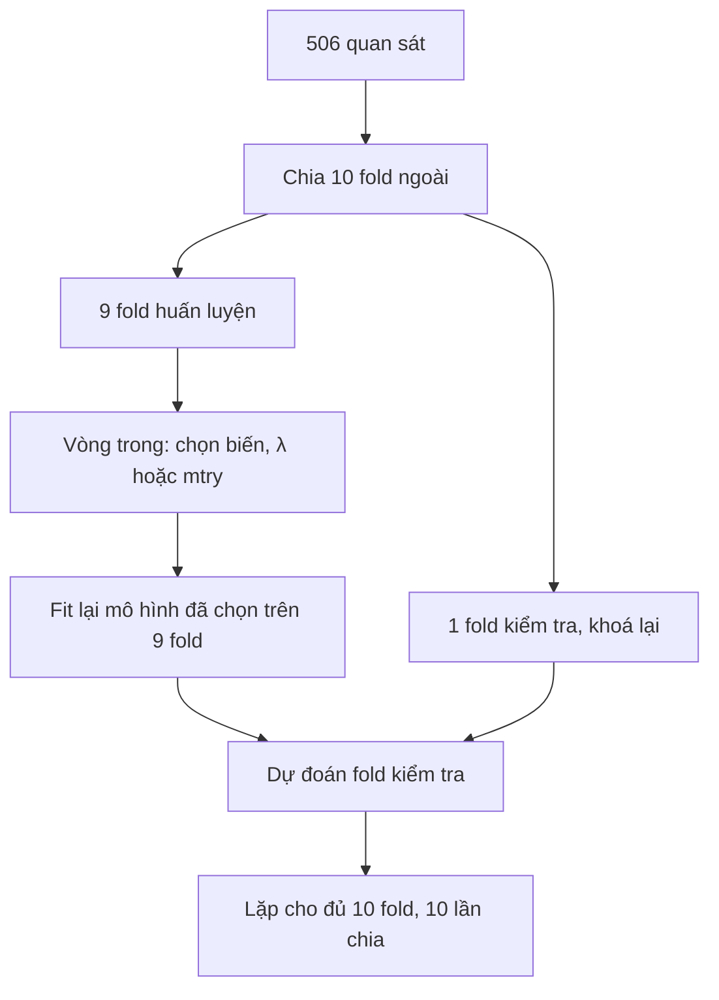

Một con số RMSE trên một lần chia train/test chưa đủ để nói Random Forest tốt hơn hồi quy tuyến tính. Bài thứ tư của series *Nhập môn phân tích dữ liệu bằng R* dùng bộ dữ liệu nhà ở Boston (506 khu dân cư, 14 biến) để so chín mô hình, từ `lm(medv ~ lstat)` tới Random Forest, trên cùng các fold của 10 × 10-fold cross-validation, kèm phần kiểm tra rò rỉ thông tin khi chọn biến, giá trị bị chặn ở 50 và chẩn đoán phần dư. Phần cuối kể lại nguồn gốc của bộ dữ liệu và lý do scikit-learn ngừng hỗ trợ nó: biến `B` được tạo từ tỷ lệ cư dân da đen. Code R và Python trong bài đều đã chạy thử.

## Tóm tắt

Bộ dữ liệu nhà ở Boston (Harrison & Rubinfeld, 1978) là bài tập hồi quy kinh điển và cũng là nơi dễ mắc một lỗi đánh giá phổ biến: so $R^2$ trong mẫu của mô hình này với RMSE trên tập test của mô hình kia. Bài viết so chín mô hình dự đoán `medv`, từ hồi quy đơn biến tới lasso chạy lồng và Random Forest, trên cùng các fold của 10 × 10-fold CV. Random Forest có sai số thấp nhất (RMSE 3,64 nghìn USD; $R^2_{\text{out}}$ = 0,843) nhưng chỉ hơn lasso lồng 0,08 và hơn mô hình tuyến tính có tương tác 0,23 nghìn USD, trong khi một lần chia 80:20 làm RMSE của cùng một mô hình dao động gần 2 nghìn USD. Một mô phỏng trên nhiễu thuần cho thấy chọn biến ngoài vòng CV tạo ra $R^2$ ngoài mẫu dương ở 100/100 lần thử. Bỏ biến `B`, vốn mã hoá thành phần chủng tộc, không làm giảm độ chính xác.

## 1. Mở đầu: vì sao phân tích lại một bộ dữ liệu ai cũng biết

Năm 1978, hai nhà kinh tế học David Harrison và Daniel Rubinfeld cần trả lời một câu hỏi chính sách: người dân vùng Boston sẵn lòng trả bao nhiêu cho không khí sạch hơn? Họ dùng mô hình giá hedonic (hedonic price model), coi giá một căn nhà là tổng giá trị của các đặc điểm gắn với nó, từ số phòng, khoảng cách tới nơi làm việc đến nồng độ nitric oxide trong không khí, rồi ước lượng phần giá gắn với chất lượng không khí (Harrison & Rubinfeld, 1978). Biến chính sách là `nox`; các biến còn lại có mặt để kiểm soát những gì khác làm giá nhà thay đổi.

Bộ dữ liệu sau đó đi một con đường khác. Belsley, Kuh và Welsch (1980) dùng nó làm ví dụ trong sách về chẩn đoán hồi quy (StatLib, n.d.); gói MASS đưa nó vào R với tên `Boston` (Venables & Ripley, 2002), scikit-learn đưa vào Python với hàm `load_boston`. Từ đó, hàng thế hệ sinh viên học `lm()` và Random Forest với cùng 506 dòng này, như ở [bài 03](/blog/bai-tap-r-co-ban-buoi-5-buoi-6-va-buoi-7/) của series.

Chính vì quá quen thuộc, Boston hay là sân khấu cho một kiểu so sánh sai cách: mô hình tuyến tính được báo cáo bằng $R^2$ trên chính dữ liệu đã fit, Random Forest bằng RMSE trên một tập test tách ra một lần, mỗi con số từ một cách chia khác nhau, rồi kết luận "Random Forest tốt nhất". $R^2$ trong mẫu cho biết mô hình khớp dữ liệu cũ đến đâu; RMSE ngoài mẫu cho biết mô hình đoán sai bao nhiêu trên dữ liệu mới. Đặt cạnh nhau, chúng không trả lời được câu hỏi mô hình nào dự đoán tốt hơn.

Breiman (2001b) mô tả hai "văn hoá" mô hình hoá: văn hoá mô hình dữ liệu (data modeling) giả định một mô hình ngẫu nhiên cụ thể như hồi quy tuyến tính rồi diễn giải tham số; văn hoá mô hình thuật toán (algorithmic modeling) coi cơ chế sinh dữ liệu là hộp đen và chấm mô hình bằng độ chính xác dự đoán, với Random Forest là ví dụ tiêu biểu (Breiman, 2001a). Muốn so hai văn hoá một cách công bằng thì phải cùng dữ liệu, cùng cách chia, cùng chỉ số đo ngoài mẫu (James et al., 2021; Kuhn, 2008).

Bài viết này là một tái phân tích (reanalysis) theo đúng nguyên tắc đó. Câu hỏi chính: khi mọi mô hình dùng chung các fold và mọi bước chọn biến nằm trong vòng lặp cross-validation, Random Forest có dự đoán giá nhà trung vị `medv` tốt hơn mô hình tuyến tính có số hạng bậc hai và tương tác không, hơn bao nhiêu, và chắc chắn đến đâu? Năm câu hỏi phụ:

1. **Q1**: $R^2$ trong mẫu lạc quan đến đâu, và RMSE của một lần chia 80:20 dao động bao nhiêu?
2. **Q2**: chọn công thức bằng cách nhìn toàn bộ dữ liệu có tạo lợi thế không công bằng so với chọn biến tự động chạy lồng (nested) trong CV không?
3. **Q3**: 16 khu có `medv` = 50 ảnh hưởng thế nào tới hệ số và sai số?
4. **Q4**: đọc hệ số của `lstat` thế nào khi có tương tác, và nên mã hoá `rad` ra sao?
5. **Q5**: có nên dùng biến `B` không, và bỏ nó thì mất gì?

Bài chỉ dùng `MASS::Boston`, chỉ bàn về đánh giá mô hình dự đoán, không ước lượng tác động nhân quả của biến nào và không suy rộng sang thị trường nhà ở hiện nay.

## 2. Dữ liệu và phương pháp

### 2.1. Dữ liệu

`MASS::Boston` có 506 dòng, mỗi dòng là một census tract (khu điều tra dân số) ở vùng đô thị Boston, và 14 biến. Bảng 1 mô tả các biến theo tệp gốc trên StatLib, kèm đơn vị; tên biến trong R viết thường, và biến `B` có tên `black` trong gói MASS.

**Bảng 1.** Các biến của bộ dữ liệu Boston (theo StatLib, n.d.)

| Biến | Ý nghĩa | Ghi chú |
|---|---|---|
| `crim` | tỷ lệ tội phạm bình quân đầu người theo thị trấn | lệch phải mạnh |
| `zn` | tỷ lệ đất ở được quy hoạch cho lô trên 25.000 ft² | |
| `indus` | tỷ lệ diện tích kinh doanh phi bán lẻ | |
| `chas` | biến giả: 1 nếu khu giáp sông Charles | 35/506 khu (6,9%) |
| `nox` | nồng độ nitric oxides | phần mười triệu (parts per 10 million) |
| `rm` | số phòng trung bình mỗi căn | |
| `age` | tỷ lệ căn nhà chủ ở xây trước 1940 | |
| `dis` | khoảng cách có trọng số tới 5 trung tâm việc làm | |
| `rad` | chỉ số tiếp cận đường cao tốc hướng tâm | giá trị 1–8 và 24 |
| `tax` | thuế suất tài sản theo giá trị đầy đủ | USD trên 10.000 USD |
| `ptratio` | tỷ lệ học sinh/giáo viên theo thị trấn | |
| `black` (B) | $1000(B_k - 0{,}63)^2$, $B_k$ là tỷ lệ cư dân da đen | xem mục 4.4 |
| `lstat` | % dân số có địa vị thấp (lower status) | |
| `medv` | giá trị trung vị của nhà chủ ở | nghìn USD; bị chặn ở 50 |

Ba đặc điểm cần biết trước khi fit mô hình. Thứ nhất, 471/506 khu (93,1%) không giáp sông Charles; `medv` trung bình là 22,09 nghìn USD ở nhóm này và 28,44 ở nhóm giáp sông. Thứ hai, `rad` là chỉ số thứ bậc với giá trị 1–8 và một bước nhảy lên 24 (132 khu); khoảng cách giữa 8 và 24 không có ý nghĩa đo lường. Thứ ba, đúng 16 khu có `medv` = 50,0, giá trị lớn nhất. Sự dồn cục ở một con số tròn là dấu hiệu của kiểm duyệt phải (right censoring): giá thật là "từ 50 trở lên". Gilley và Pace (1996) đã rà soát dữ liệu, công bố các chỉnh sửa và xem xét censoring; bản đã sửa (biến `cmedv`, kèm toạ độ do Pace & Gilley, 1997 bổ sung) có trong gói `mlbench` với tên `BostonHousing2` (Leisch & Dimitriadou, 2026). Bài này dùng bản MASS vì phổ biến nhất.

### 2.2. Giao thức đánh giá thống nhất

Mọi mô hình được đánh giá bằng repeated k-fold cross-validation: chia ngẫu nhiên thành 10 fold, mỗi fold lần lượt làm tập kiểm tra, lặp 10 lần với 10 cách chia (seed 2026–2035). Điểm then chốt là **mọi mô hình dùng chung đúng các fold đó**, nên chênh lệch giữa hai mô hình trên một fold là phép so sánh ghép cặp (paired comparison), loại được phần dao động do cách chia.

Với mỗi lần lặp, gộp 506 dự đoán ngoài fold $\hat y_i$ và tính:

$$\text{RMSE} = \sqrt{\tfrac{1}{n}\sum_i (y_i - \hat y_i)^2}, \qquad \text{MAE} = \tfrac{1}{n}\sum_i |y_i - \hat y_i|, \qquad R^2_{\text{out}} = 1 - \frac{\sum_i (y_i - \hat y_i)^2}{\sum_i (y_i - \bar y)^2}.$$

RMSE và MAE tính bằng nghìn USD; RMSE phạt nặng sai số lớn. $R^2_{\text{out}}$ âm nếu mô hình đoán tệ hơn trung bình. Kết quả là trung bình và độ lệch chuẩn qua 10 lần lặp. Bài còn chạy 200 lần chia ngẫu nhiên 80:20 (405 train, 101 test) cho ba mô hình để xem một lần chia bất định đến đâu. Code R dưới đây (base R và MASS) chạy phần mô hình tuyến tính:

```r
library(MASS)
data(Boston)
f4 <- medv ~ . - indus - age - zn - black + rm:lstat + rm:rad + lstat:rad

cv_lm <- function(formula, data, k = 10, reps = 5, seed = 2026) {
  set.seed(seed)
  res <- replicate(reps, {
    fold <- sample(rep(1:k, length.out = nrow(data)))
    pred <- numeric(nrow(data))
    for (i in 1:k) {
      fit <- lm(formula, data = data[fold != i, ])
      pred[fold == i] <- predict(fit, newdata = data[fold == i, ])
    }
    y <- data$medv
    c(RMSE = sqrt(mean((y - pred)^2)),
      MAE  = mean(abs(y - pred)),
      R2   = 1 - sum((y - pred)^2) / sum((y - mean(y))^2))
  })
  rowMeans(res)
}
round(cv_lm(f4, Boston), 3)          # RMSE 3.842  MAE 2.608  R2 0.825
round(cv_lm(medv ~ ., Boston), 3)    # RMSE 4.889  MAE 3.399  R2 0.717
```

Con số hơi khác Bảng 3 vì chỉ 5 lần lặp với bộ sinh số ngẫu nhiên của R.

### 2.3. Chín mô hình

Bảng 2 liệt kê các mô hình. M0–M5 là các công thức hồi quy tuyến tính cố định, từ đơn giản tới phức tạp. M4 là kiểu công thức hay gặp trong bài tập: bỏ `indus`, `age`, `zn`, `black` vì p-value lớn, thêm ba tương tác `rm:lstat`, `rm:rad`, `lstat:rad` vì chúng làm $R^2$ tăng. Công thức này được chọn bằng cách thử và nhìn kết quả trên toàn bộ dữ liệu, nên nó là đối tượng của câu hỏi Q2.

**Bảng 2.** Các mô hình được so sánh

| Mã | Mô hình | Cách chọn cấu trúc |
|---|---|---|
| M0 | `medv ~ lstat` | cố định |
| M1 | đủ 13 biến | cố định |
| M2 | M1 bỏ `indus`, `age` | cố định |
| M3 | M2 + $lstat^2$ | cố định |
| M4 | M2 bỏ `zn`, `black` + `rm:lstat` + `rm:rad` + `lstat:rad` | chọn tay trên toàn bộ dữ liệu |
| M5 | M2 + $lstat^2$ + $rm^2$ | cố định |
| M6 | best subset trên 15 ứng viên (13 biến + $lstat^2$ + $rm^2$) | chọn bằng BIC **trong từng fold** |
| M7 | lasso trên 103 ứng viên (13 biến, 12 bình phương, 78 tương tác cặp) | chọn λ bằng 5-fold CV **trong từng fold** |
| M8 | Random Forest, 500 cây | chọn `mtry` bằng OOB error **trong từng fold** |

M6 xét toàn bộ $2^{15} - 1 = 32.767$ tập con trong mỗi fold huấn luyện và chọn tập có BIC nhỏ nhất (James et al., 2021). M7 dùng lasso (Tibshirani, 1996): hàm phạt $\lambda \sum_j |\beta_j|$ kéo nhiều hệ số về 0 nên vừa ước lượng vừa chọn biến; biến được chuẩn hoá, λ chọn bằng 5-fold CV bên trong fold huấn luyện (Friedman et al., 2010). Không gian ứng viên rộng cho lasso cơ hội tự tìm ra những gì M4 tìm bằng tay.

M8 là Random Forest (Breiman, 2001a): mỗi cây trồng trên một mẫu bootstrap, mỗi lần tách nút chỉ xét `mtry` biến ngẫu nhiên; các quan sát ngoài mẫu bootstrap (out-of-bag, OOB) cho phép ước lượng lỗi mà không cần tập test. Mặc định của `randomForest` trong R cho hồi quy là `mtry` $= \lfloor p/3 \rfloor$, nút lá tối thiểu 5 (Liaw & Wiener, 2002). Ở đây `mtry` được chọn trong {3, 4, 6, 9, 13} bằng OOB error **chỉ trên fold huấn luyện**.

### 2.4. Rò rỉ thông tin khi chọn mô hình và nested cross-validation

Rò rỉ dữ liệu (data leakage) là khi thông tin lẽ ra không có lúc dự đoán lọt vào quá trình xây dựng mô hình, làm hiệu năng trông đẹp hơn thực tế (Kaufman et al., 2012). Một dạng khó thấy là **chọn mô hình trên toàn bộ dữ liệu rồi mới cross-validate**: nếu bạn nhìn p-value trên cả 506 quan sát để quyết định bỏ biến nào, thêm tương tác nào, thì fold kiểm tra đã góp phần chọn cấu trúc mô hình, và CV chỉ còn kiểm tra bước ước lượng hệ số.

Cách sửa là nested cross-validation: mọi quyết định dựa trên dữ liệu, gồm chọn biến, chọn λ, chọn `mtry`, phải được lặp lại từ đầu bên trong từng fold huấn luyện (Varma & Simon, 2006). Hình 1 tóm tắt quy trình.



**Hình 1.** Nested cross-validation: fold kiểm tra không tham gia bất kỳ quyết định nào về mô hình.

### 2.5. Chẩn đoán, phân tích độ nhạy và công cụ

M4 được fit lại trên toàn bộ dữ liệu để vẽ phần dư theo giá trị dự đoán và phần dư chuẩn hoá theo leverage, kèm đường Cook's distance (Cook, 1977; Belsley et al., 1980). Hiệu ứng của `lstat` trong Random Forest được mô tả bằng partial dependence: cho `lstat` chạy trên một lưới, giữ nguyên các biến khác, lấy trung bình dự đoán. Bài không xếp hạng variable importance vì thước đo này có thể bị lệch (Strobl et al., 2007).

Phân tích độ nhạy (5 × 10-fold CV, Random Forest cố định `mtry` $= \lfloor p/3 \rfloor$) gồm: (a) bỏ `black` khỏi M1 và Random Forest; (b) bỏ 16 khu `medv` = 50, hoặc chỉ tính sai số trên các khu không bị chặn; (c) mô hình Tobit với ngưỡng kiểm duyệt phải 50 (Tobin, 1958); (d) mã hoá `rad` thành nhị phân (`rad` = 24) hoặc factor.

Hồi quy tuyến tính, Tobit (gói `survival`) và mô phỏng rò rỉ chạy trên R 4.4.3 với MASS 7.3.65; best subset, lasso và Random Forest chạy bằng Python 3.13 với numpy và scikit-learn 1.9.0 trên đúng các fold đó, dữ liệu xuất từ R bằng `write.csv()`. Random Forest của scikit-learn với `min_samples_leaf = 5` gần nhưng không trùng với mặc định của `randomForest`, nên chạy lại bằng `randomForest`, `leaps` và `glmnet` trong R có thể cho số lệch nhẹ.

## 3. Kết quả

### 3.1. $R^2$ trong mẫu và ngoài mẫu (Q1)

Bảng 3 đặt $R^2$ khi fit trên toàn bộ dữ liệu cạnh $R^2_{\text{out}}$ từ CV. Với các mô hình cố định, khoảng cách nhỏ (0,741 so với 0,719 ở M1; 0,842 so với 0,826 ở M4) vì 506 quan sát là nhiều so với tối đa 13 hệ số. Khoảng cách tăng nhanh khi số biến tiến gần số quan sát (mục 3.4). Nhưng hai con số trả lời hai câu hỏi khác nhau, nên một bảng so sánh chỉ có ý nghĩa khi mọi dòng dùng cùng một loại con số.

### 3.2. Kết quả chính

**Bảng 3.** Sai số ngoài mẫu của chín mô hình, 10 × 10-fold CV với fold dùng chung (trung bình ± độ lệch chuẩn qua 10 lần lặp; đơn vị RMSE và MAE là nghìn USD)

| Mô hình | RMSE | MAE | $R^2_{\text{out}}$ | $R^2$ trong mẫu (n = 506) |
|---|---|---|---|---|
| M0 `lstat` | 6,24 ± 0,01 | 4,53 ± 0,01 | 0,540 | 0,544 |
| M1 đủ 13 biến | 4,87 ± 0,04 | 3,39 ± 0,02 | 0,719 | 0,741 |
| M2 bỏ `indus`, `age` | 4,85 ± 0,04 | 3,38 ± 0,02 | 0,721 | 0,741 |
| M3 + $lstat^2$ | 4,40 ± 0,03 | 3,16 ± 0,02 | 0,771 | 0,787 |
| M4 tương tác, chọn tay | 3,84 ± 0,05 | 2,60 ± 0,02 | 0,826 | 0,842 |
| M5 + $lstat^2$, $rm^2$ | 4,13 ± 0,04 | 2,77 ± 0,03 | 0,798 | 0,817 |
| M6 best subset, nested | 4,19 ± 0,05 | 2,82 ± 0,03 | 0,792 | — |
| M7 lasso, nested | 3,70 ± 0,13 | 2,44 ± 0,05 | 0,838 | — |
| M8 Random Forest | 3,64 ± 0,06 | 2,33 ± 0,03 | 0,843 | — |


**Hình 2.** RMSE ngoài mẫu của chín mô hình. Chấm nhỏ là từng lần lặp, chấm lớn và thanh ngang là trung bình ± độ lệch chuẩn. Màu cam đánh dấu M4, mô hình có công thức chọn tay; màu xanh lá là Random Forest.

Có ba nhóm rõ rệt (Hình 2). Nhóm tuyến tính thuần (M1, M2) có RMSE quanh 4,85–4,87; bỏ `indus` và `age` gần như không đổi gì. Thêm độ cong cho `lstat` (M3) giảm RMSE 0,45, thêm $rm^2$ (M5) giảm thêm 0,27. Nhóm tốt nhất gồm M4, lasso lồng (M7) và Random Forest (M8), RMSE 3,64–3,84.

Random Forest có RMSE và MAE thấp nhất. So ghép cặp trên cùng 100 fold, nó thấp hơn M4 trung bình 0,23 nghìn USD (độ lệch chuẩn theo fold 0,40), tốt hơn ở 74% số fold và ở cả 10/10 lần lặp. Với lasso lồng M7, chênh lệch chỉ 0,08 (độ lệch chuẩn 0,67): Random Forest tốt hơn ở 60% số fold, và ở 2/10 lần lặp lasso thắng. Lasso dao động nhiều nhất (± 0,13), một phần vì số hệ số khác 0 thay đổi từ 26 đến 68 giữa các fold (trung vị 60/103).

Best subset lồng (M6) chọn 11 hoặc 12 trong 15 ứng viên ở mọi fold và cho kết quả (4,19) gần M5 (4,13). Random Forest chọn `mtry` = 6 ở 88/100 fold; OOB RMSE khi fit trên toàn bộ dữ liệu với `mtry` = 4 là 3,62, gần với RMSE từ CV.

Đoạn Python dưới đây tóm gọn ý tưởng fold dùng chung (3 lần lặp, `max_features` cố định nên số hơi khác Bảng 3):

```python
import numpy as np, pandas as pd
from sklearn.model_selection import KFold
from sklearn.linear_model import LinearRegression
from sklearn.ensemble import RandomForestRegressor

d = pd.read_csv("boston.csv")            # write.csv(MASS::Boston, "boston.csv", row.names = FALSE)
y = d["medv"].to_numpy()
X_rf = d.drop(columns="medv")

# Ma trận thiết kế của M4: bỏ indus, age, zn, black; thêm ba tương tác
X_m4 = d.drop(columns=["medv", "indus", "age", "zn", "black"]).copy()
X_m4["rm_lstat"] = d.rm * d.lstat
X_m4["rm_rad"] = d.rm * d.rad
X_m4["lstat_rad"] = d.lstat * d.rad

models = {
    "M4": (LinearRegression(), X_m4),
    "RF": (RandomForestRegressor(n_estimators=500, max_features=4,
                                 min_samples_leaf=5, random_state=1, n_jobs=-1), X_rf),
}
rows = []
for rep in range(3):                                  # 3 lần lặp cho nhanh
    kf = KFold(n_splits=10, shuffle=True, random_state=2026 + rep)
    for fold, (tr, te) in enumerate(kf.split(d)):     # CÙNG fold cho mọi mô hình
        for name, (model, X) in models.items():
            pred = model.fit(X.iloc[tr], y[tr]).predict(X.iloc[te])
            rows.append({"rep": rep, "fold": fold, "model": name,
                         "rmse": np.sqrt(np.mean((y[te] - pred) ** 2))})

res = pd.DataFrame(rows).pivot_table(index=["rep", "fold"], columns="model", values="rmse")
print(res.mean().round(3))          # trung bình RMSE theo fold: M4 3.729, RF 3.523
diff = res["RF"] - res["M4"]                          # chênh lệch ghép cặp theo fold
print(f"RF - M4: trung bình {diff.mean():.3f}, RF tốt hơn ở {(diff < 0).mean():.0%} số fold")
# RF - M4: trung bình -0.205, RF tốt hơn ở 67% số fold
```

### 3.3. Một lần chia 80:20 dao động đến đâu

Qua 200 lần chia ngẫu nhiên 80:20, RMSE của M1 có trung vị 4,88 (phân vị 5–95%: 3,93–5,79), của M4 là 3,80 (2,98–4,72), của Random Forest là 3,73 (2,64–5,00) (Hình 3). Mỗi khoảng rộng gần 2 nghìn USD, gấp nhiều lần chênh lệch giữa các mô hình tốt nhất.


**Hình 3.** RMSE của 200 lần chia ngẫu nhiên 80:20. Mỗi chấm là một lần chia, vạch đỏ là trung vị; đường đứt nét đánh dấu mức RMSE 2,93 để so sánh.

Một con số như RMSE = 2,93 không hiếm: Random Forest đạt mức đó hoặc thấp hơn ở 13,5% số lần chia, M4 ở 4%. Ngay cả khi dùng chung tập test, Random Forest chỉ thắng M4 ở 63% số lần chia, và chênh lệch RMSE trải từ −0,71 đến +0,52 (phân vị 5–95%). Một lần chia chỉ cho bạn một điểm trong phân phối này mà không cho biết điểm đó nằm ở đâu.

### 3.4. Rò rỉ khi chọn mô hình (Q2)

Công thức M4 được chọn tay trên toàn bộ dữ liệu, nên RMSE 3,84 của nó lẽ ra lạc quan. Thực tế, lasso lồng M7, tự chọn biến và tương tác từ 103 ứng viên trong từng fold, đạt 3,70, còn tốt hơn. Tín hiệu mà M4 nắm được, nhất là tương tác `rm`–`lstat`, là có thật và tìm lại được bằng quy trình không rò rỉ. Mức lạc quan ở đây nhỏ, nhưng chỉ biết được điều đó khi chạy quy trình lồng để so.

Đoạn R dưới đây cho thấy rò rỉ nguy hiểm đến đâu: $y$ hoàn toàn độc lập với 2.000 biến dự đoán, chỉ có 60 quan sát, giống tình huống "nhiều gene, ít mẫu". Cách sai chọn 5 biến tương quan mạnh nhất với $y$ trên toàn bộ dữ liệu rồi mới chạy 5-fold CV; cách đúng chọn lại bên trong từng fold.

```r
set.seed(1)
n <- 60; p <- 2000
X <- matrix(rnorm(n * p), n, p)
y <- rnorm(n)                       # y không liên quan gì tới X
top <- function(X, y, m = 5) order(abs(cor(X, y)), decreasing = TRUE)[1:m]
fold <- sample(rep(1:5, length.out = n))
pred_leak <- pred_nest <- numeric(n)
sel_all <- top(X, y)                # SAI: chọn biến trên toàn bộ dữ liệu
for (i in 1:5) {
  tr <- fold != i; te <- fold == i
  fit <- lm(y[tr] ~ X[tr, sel_all])
  pred_leak[te] <- cbind(1, X[te, sel_all]) %*% coef(fit)
  sel_i <- top(X[tr, ], y[tr])      # ĐÚNG: chọn lại bên trong mỗi fold
  fit <- lm(y[tr] ~ X[tr, sel_i])
  pred_nest[te] <- cbind(1, X[te, sel_i]) %*% coef(fit)
}
r2 <- function(p) 1 - sum((y - p)^2) / sum((y - mean(y))^2)
round(c(leak = r2(pred_leak), nested = r2(pred_nest)), 2)
#   leak nested
#   0.42  -0.43
```

Với seed này, cách sai báo cáo $R^2_{\text{out}}$ = 0,42 cho một mô hình dự đoán nhiễu thuần; cách đúng cho −0,43, tệ hơn đoán bằng trung bình, đúng như phải thế. Lặp lại với 100 seed, cách sai cho $R^2_{\text{out}}$ dương ở 100/100 lần (trung vị 0,39; phân vị 5–95%: 0,25–0,52), cách đúng cho trung vị −0,38 (−0,82 đến −0,01).

### 3.5. Giá trị bị chặn và phân tích độ nhạy (Q3, Q5)

**Bảng 4.** RMSE ngoài mẫu (nghìn USD) trong các phân tích độ nhạy

| Kịch bản | M1 | M4 | M8 Random Forest |
|---|---|---|---|
| Gốc (5 × 10-fold CV, `mtry` cố định) | 4,86 | 3,82 | 3,66 |
| Bỏ biến `black` | 4,91 | (vốn không có) | 3,64 |
| Huấn luyện đủ, chỉ tính sai số trên 490 khu không bị chặn* | 4,08 | 3,22 | 2,84 |
| Bỏ hẳn 16 khu `medv` = 50 | 3,87 | 3,03 | 2,90 |
| `rad` dạng nhị phân (`rad` = 24) | 4,89 | — | — |
| `rad` dạng factor 9 mức | 4,83 | — | — |

\* Lấy từ phân tích chính 10 × 10-fold CV, `mtry` tinh chỉnh.

Các khu bị chặn chiếm một phần lớn sai số: chỉ tính trên 490 khu không bị chặn, RMSE của mọi mô hình giảm mạnh, và khoảng cách giữa Random Forest và M4 nới từ 0,19 lên 0,38. Bỏ hẳn 16 khu này cũng cho RMSE thấp hơn, nhưng không so được với dòng gốc vì phần đuôi khó đoán nhất đã bị cắt: đó là một cách "làm đẹp" RMSE cần báo cáo rõ nếu dùng.

Censoring lại hầu như không làm lệch hệ số tuyến tính. Mô hình Tobit cho M3 cho hệ số gần trùng OLS: `lstat` −1,70 so với −1,67, `rm` 3,34 so với 3,23, `nox` −13,59 so với −13,54, điều dễ hiểu khi chỉ 3,2% quan sát bị chặn:

```r
library(MASS); library(survival)
f3 <- medv ~ crim + zn + chas + nox + rm + dis + rad + tax + ptratio + black +
              lstat + I(lstat^2)
ols <- lm(f3, data = Boston)
tob <- survreg(update(f3, Surv(medv, medv < 50, type = "right") ~ .),
               data = Boston, dist = "gaussian")
round(cbind(OLS = coef(ols), Tobit = coef(tob)[names(coef(ols))]), 3)
```

Bỏ `black` làm RMSE của M1 tăng 0,05 và không làm Random Forest kém đi (3,64 so với 3,66): về mặt dự đoán, biến này gần như không mang thêm thông tin. Mã hoá lại `rad` đổi RMSE của M1 không quá 0,04, nhỏ hơn độ dao động giữa các lần lặp.

### 3.6. Chẩn đoán phần dư và hình dạng hiệu ứng (Q4)

Ở Hình 4A, phần dư của các khu bị chặn nằm trên một đường chéo dốc xuống, vì với $y$ = 50 cố định, phần dư bằng đúng $50 - \hat y$. Mười lăm trong 16 khu này có phần dư dương, trung bình 8,9 nghìn USD: mô hình đoán thấp có hệ thống ở phân khúc giá cao nhất. Đường trung bình trượt còn hơi cong ở hai đầu.


**Hình 4.** Chẩn đoán phần dư của M4 (n = 506). A: phần dư theo giá trị dự đoán; tam giác cam là 16 khu có `medv` = 50. B: phần dư chuẩn hoá theo leverage, kèm đường Cook's distance 0,5 và 1.

Ở Hình 4B, khu 372, 373 và 369 (đều có `medv` = 50) có phần dư chuẩn hoá 6,46, 6,02 và 5,66; với phân phối chuẩn, giá trị trên 4 đã rất hiếm, nên đuôi phần dư nặng hơn chuẩn rõ rệt. Khu 365 có leverage 0,23 và phần dư chuẩn hoá −4,47, cho Cook's distance 0,47, sát đường 0,5: số phòng trung bình 8,78, thuộc nhóm cao nhất, nhưng `medv` chỉ 21,9. Cả bốn khu đều có `rad` = 24, nơi các tương tác với `rad` tác động mạnh nhất. Một điểm gần ngưỡng như khu 365 đáng được kiểm tra lại và thử fit khi bỏ nó, thay vì kết luận rằng "không có điểm ảnh hưởng" (Cook, 1977).


**Hình 5.** Partial dependence của `lstat`: Random Forest (đường liền) và M3 với $lstat^2$ (đường đứt), cả hai fit trên toàn bộ dữ liệu; chấm xám là dữ liệu.

Hình 5 so hình dạng hiệu ứng của `lstat` trong hai văn hoá mô hình hoá. Cả hai đồng ý rằng giá giảm nhanh khi `lstat` tăng từ 3% lên 10%. Bên phải, Random Forest đi ngang quanh 19,5 nghìn USD khi `lstat` vượt khoảng 20% vì cây không ngoại suy, còn đường bậc hai của M3 xuống khoảng 15,6 quanh `lstat` = 25% rồi **đi lên** lại, hệ quả của dạng parabol chứ không phải của dữ liệu. Đặt hai đường cạnh nhau giúp bạn thấy giả định của từng mô hình.

## 4. Thảo luận

### 4.1. Vì sao một con số RMSE chưa đủ để chọn thuật toán

Kết quả mục 3 cho thấy "Random Forest tốt nhất" có thể đúng trên dữ liệu này, nhưng không thể rút ra từ một RMSE đặt cạnh một $R^2$, vì ba lỗi của quy trình chứ không phải của thuật toán:

- **Khác thước đo**: $R^2$ trong mẫu không giảm khi thêm biến và nhìn chung lạc quan hơn $R^2$ ngoài mẫu; quan trọng hơn, $R^2$ và RMSE không cùng thang nên không xếp hạng chung được.

- **Khác dữ liệu**: hai mô hình chấm trên hai tập test khác nhau thì chênh lệch lẫn cả độ khó của tập test; RMSE của cùng M4 trải từ 2,98 đến 4,72 qua các lần chia.

- **Một lần chia duy nhất**: Random Forest chỉ thắng M4 ở 63% số lần chia, tức khoảng ba lần chia thì một lần cho kết luận ngược lại. Repeated CV với fold dùng chung giảm nhiễu này.

<div class="callout callout-warning">
<p class="callout-title"><code>rsq</code> của randomForest không phải $R^2$ trên tập test</p>

Trong gói `randomForest` của R, `fit$mse` là vector sai số bình phương trung bình tính trên dự đoán OOB, một phần tử cho mỗi số cây từ 1 tới `ntree`, và `fit$rsq` là "pseudo R-squared" $1 - \text{mse}/\text{Var}(y)$ tương ứng (Liaw & Wiener, 2002). Vì vậy `mean(fit$rsq)` là trung bình của một đường cong khi rừng lớn dần, kéo xuống bởi các rừng chỉ có vài cây; con số cần báo cáo là phần tử cuối `tail(fit$rsq, 1)`, và nó vẫn là ước lượng OOB trên dữ liệu huấn luyện, không phải $R^2$ trên tập test. Muốn có $R^2$ ngoài mẫu, hãy tính $1 - \text{SSE}/\text{SST}$ từ `predict(fit, newdata = test)`.

</div>

### 4.2. Rò rỉ khi chọn biến: bài học cho người làm sinh học

Thí nghiệm nhiễu thuần ở mục 3.4 tái hiện ở quy mô nhỏ một sai lầm từng xuất hiện trong các nghiên cứu biểu hiện gen. Ambroise và McLachlan (2002) phân tích lại hai bộ dữ liệu microarray đã công bố và chỉ ra rằng khi bước chọn gen được làm trên toàn bộ mẫu, rồi chỉ bước phân loại được cross-validate, các quy tắc dự đoán chỉ dùng vài gene được báo cáo có tỷ lệ lỗi gần như bằng 0; khi hiệu chỉnh selection bias bằng cách thực hiện CV bên ngoài bước chọn gen, lỗi CV không còn bằng 0 nữa. Họ khuyến nghị 10-fold CV thay cho leave-one-out trong tình huống này. Varma và Simon (2006) cho thấy bằng mô phỏng rằng ngay cả việc chỉ tinh chỉnh tham số của bộ phân loại bằng CV rồi báo cáo luôn lỗi CV tốt nhất cũng đã làm ước lượng lỗi lệch mạnh: trên dữ liệu "null", nơi hai nhóm không hề khác nhau, SVM đã tinh chỉnh có lỗi CV dưới 30% ở 38% số bộ dữ liệu mô phỏng, trong khi trên tập kiểm tra độc lập nó không tốt hơn đoán ngẫu nhiên. Nested CV, với vòng trong để tinh chỉnh và vòng ngoài để đánh giá, cho ước lượng rất gần với lỗi trên tập kiểm tra độc lập.

Với sinh viên sinh học, tình huống này rất gần: chọn 50 gene khác biệt nhất giữa hai nhóm trên toàn bộ dữ liệu rồi mới chia train/test; chuẩn hoá hay điền giá trị thiếu bằng trung bình của toàn bộ mẫu. Quy tắc chung: **mọi bước học từ dữ liệu phải nằm trong vòng lặp**. Trong R, `caret` hoặc `tidymodels` cho phép gói tiền xử lý và mô hình vào một quy trình được resample cùng nhau (Kuhn, 2008). Xem thêm bài về machine learning trong sinh học.

Trên Boston, rò rỉ do chọn tay M4 không gây hậu quả lớn vì tín hiệu mạnh và ít biến. Khi số biến lớn hơn nhiều so với số mẫu, như dữ liệu omics, khoảng cách giữa lỗi báo cáo và lỗi thật có thể rất lớn.

### 4.3. Diễn giải hệ số khi mô hình có tương tác

Trong M4 fit trên toàn bộ dữ liệu, hệ số của `lstat` là +1,87. Đọc vội, bạn sẽ kết luận khu có tỷ lệ dân địa vị thấp cao hơn thì giá nhà **cao** hơn, ngược với mọi biểu đồ phân tán. Nhưng khi có tương tác `rm:lstat` (−0,331) và `lstat:rad` (−0,036), hệ số +1,87 chỉ là độ dốc của `lstat` tại điểm `rm` = 0 và `rad` = 0, một căn nhà không có phòng nào ở khu không có chỉ số tiếp cận, tức không tồn tại. Độ dốc thật của `lstat` là

$$\frac{\partial\, \widehat{medv}}{\partial\, lstat} = 1{,}87 - 0{,}331 \cdot rm - 0{,}036 \cdot rad.$$

Tại giá trị trung bình `rm` = 6,28 và `rad` = 9,55, độ dốc là −0,56 nghìn USD cho mỗi điểm phần trăm `lstat`; với `rm` trung bình, độ dốc là −0,25 ở `rad` = 1 và −1,08 ở `rad` = 24. Cách đọc đúng một mô hình có tương tác là báo cáo hiệu ứng tại các giá trị có ý nghĩa của biến kia, hoặc căn giữa (centering) các biến trước khi tạo tương tác để hệ số chính mang nghĩa "độ dốc tại giá trị trung bình". Phần nền về hồi quy bội có trong bài tương quan và hồi quy và bài hồi quy tuyến tính và logistic.

Tương tác với `rad` cũng đáng ngờ: nhân một chỉ số thứ bậc mà 24 không "gấp ba" 8 theo nghĩa nào với `lstat` hay `rm` là giả định độ dốc đổi tuyến tính theo một con số không có thang đo. Mã hoá lại `rad` không cải thiện độ chính xác (mục 3.5), nhưng vấn đề ở đây là diễn giải.

Phần dư của M4 nhắc rằng $R^2$ cao không có nghĩa là mô hình đúng: đuôi nặng, 15/16 khu bị chặn bị đoán thấp, và mô hình Tobit không chữa được điều đó vì vấn đề nằm ở dạng hàm chứ không ở censoring. Ngoài ra, các khu gần nhau có giá và đặc điểm giống nhau; Pace và Gilley (1997) cho thấy mô hình tính tới cấu hình không gian ước lượng tốt hơn OLS trên chính dữ liệu này, nên phần dư của các mô hình trong bài nhiều khả năng còn tương quan không gian, và CV ngẫu nhiên có thể lạc quan khi các khu lân cận rơi vào cả train lẫn test.

### 4.4. Nguồn gốc và đạo đức của bộ dữ liệu

Bộ dữ liệu Boston được tạo ra để đo giá trị của không khí sạch, không phải để dạy machine learning (Harrison & Rubinfeld, 1978). Các biến của nó là biến kiểm soát trong một nghiên cứu kinh tế những năm 1970, chọn theo giả định của nhóm tác giả về những gì làm giá nhà thay đổi.

Biến `B` là ví dụ rõ nhất. Nó không phải tỷ lệ cư dân da đen $B_k$ mà là $1000(B_k - 0{,}63)^2$ (StatLib, n.d.), một parabol có cực tiểu tại $B_k$ = 0,63, nên hai khu có tỷ lệ rất khác nhau có thể nhận cùng giá trị `B`. Ai dùng `B` làm biến dự đoán cũng thừa hưởng giả định đằng sau dạng hàm đó, thường mà không biết.

scikit-learn đánh dấu `load_boston` là deprecated từ phiên bản 1.0 và thông báo sẽ gỡ ở phiên bản 1.2. Trang tài liệu nói thẳng bộ dữ liệu "has an ethical problem": các tác giả đã tạo một biến `B` không khả nghịch dựa trên giả định rằng việc tự tách biệt theo chủng tộc (racial self-segregation) làm giá nhà tăng, trong khi nghiên cứu gốc, vốn nhắm tới chất lượng không khí, không chứng minh thoả đáng giả định đó. Tài liệu khuyên không dùng nó trừ khi mục đích là nghiên cứu và giáo dục về đạo đức trong khoa học dữ liệu, và gợi ý thay bằng bộ California housing hoặc Ames housing (scikit-learn developers, n.d.). Bộ dữ liệu vẫn còn trong MASS, và việc nó còn đó không phải là vấn đề; vấn đề là dùng nó mà không biết gì về nó.

Mục 3.5 thêm một lý lẽ thực dụng: bỏ `black` gần như không mất độ chính xác. Nếu mục tiêu là dự đoán, biến này không cần; nếu mục tiêu là hiểu phân biệt đối xử trong nhà ở, cần một thiết kế nghiên cứu nghiêm túc chứ không phải một số hạng bậc hai. Lời khuyên cho người dạy: dùng Boston khi bài học **là** về nguồn gốc dữ liệu, rò rỉ và đạo đức, như bài này; với bài học kỹ thuật hồi quy thuần tuý, chọn bộ dữ liệu khác. Câu hỏi "dữ liệu này đến từ đâu, ai thu thập, để làm gì" nên đến trước dòng `library()` đầu tiên.

### 4.5. Giới hạn

Bài có bốn giới hạn: 506 quan sát là ít, và chênh lệch giữa các mô hình tốt nhất cùng cỡ với dao động giữa các fold; Random Forest chỉ được tinh chỉnh `mtry`, không xét boosting hay mô hình không gian; CV ngẫu nhiên bỏ qua cấu trúc không gian, chia fold theo thị trấn có thể cho sai số cao hơn; và bài dùng bản MASS chưa sửa lỗi, lặp lại trên `cmedv` sẽ cho biết lỗi dữ liệu có đổi kết luận không.

## 5. Kết luận

Ba thông điệp áp dụng cho mọi bài tập hồi quy. Một, đánh giá mọi mô hình bằng **một giao thức duy nhất**: cùng dữ liệu, cùng fold, cùng chỉ số ngoài mẫu, kèm độ dao động. Hai, **mọi bước chọn biến và tinh chỉnh nằm trong vòng lặp CV**; nếu không, trên dữ liệu nhiều biến ít mẫu, nhiễu thuần có thể trông như một mô hình có ích. Ba, **biết nguồn gốc dữ liệu trước khi dùng**: Boston được tạo ra để định giá không khí sạch, mang theo một biến mã hoá chủng tộc và một trần giá ở 50.

Trên dữ liệu này, Random Forest dự đoán tốt nhất, nhưng khoảng cách với mô hình tuyến tính có tương tác hay lasso lồng nhỏ hơn nhiều so với cảm giác khi đặt một RMSE đẹp từ một lần chia cạnh một $R^2$ trong mẫu; đổi lại, mô hình tuyến tính cho hệ số đọc được, nếu đọc đúng cách.

<div class="callout callout-note">
<p class="callout-title">Checklist 8 mục cho một bài phân tích hồi quy trong R</p>

1. Đặt `set.seed()` ở đầu và ghi lại seed.
2. Viết toàn bộ phân tích trong một file R Markdown chạy từ đầu đến cuối.
3. Dùng chung một bộ fold cho mọi mô hình được so sánh.
4. Báo cáo chỉ số ngoài mẫu (RMSE, MAE, $R^2_{\text{out}}$) kèm độ dao động, không chỉ $R^2$ trong mẫu.
5. Đưa mọi bước chọn biến, chuẩn hoá, tinh chỉnh vào trong vòng CV (nested CV).
6. Xem biểu đồ chẩn đoán và đánh dấu các giá trị bị chặn hay bất thường.
7. Ghi `sessionInfo()` cuối file (hoặc dùng `renv`).
8. Ghi nguồn gốc, mục đích thu thập và giới hạn đạo đức của bộ dữ liệu.

</div>

Bài tiếp theo quay về [thống kê mô tả](/blog/data-exploration-using-descriptive-statistics/), nơi các giá trị bị chặn như `medv` = 50 lẽ ra đã được phát hiện trước khi fit mô hình. Tái lập ở mức dự án được bàn trong bài về quy trình tái lập.

## Tài liệu tham khảo

Ambroise, C., & McLachlan, G. J. (2002). Selection bias in gene extraction on the basis of microarray gene-expression data. *Proceedings of the National Academy of Sciences, 99*(10), 6562–6566. https://doi.org/10.1073/pnas.102102699

Belsley, D. A., Kuh, E., & Welsch, R. E. (1980). *Regression diagnostics: Identifying influential data and sources of collinearity*. Wiley. https://doi.org/10.1002/0471725153

Breiman, L. (2001a). Random forests. *Machine Learning, 45*(1), 5–32. https://doi.org/10.1023/A:1010933404324

Breiman, L. (2001b). Statistical modeling: The two cultures. *Statistical Science, 16*(3), 199–231. https://doi.org/10.1214/ss/1009213726

Cook, R. D. (1977). Detection of influential observation in linear regression. *Technometrics, 19*(1), 15–18. https://doi.org/10.1080/00401706.1977.10489493

Friedman, J., Hastie, T., & Tibshirani, R. (2010). Regularization paths for generalized linear models via coordinate descent. *Journal of Statistical Software, 33*(1), 1–22. https://doi.org/10.18637/jss.v033.i01

Gilley, O. W., & Pace, R. K. (1996). On the Harrison and Rubinfeld data. *Journal of Environmental Economics and Management, 31*(3), 403–405. https://doi.org/10.1006/jeem.1996.0052

Harrison, D., & Rubinfeld, D. L. (1978). Hedonic housing prices and the demand for clean air. *Journal of Environmental Economics and Management, 5*(1), 81–102. https://doi.org/10.1016/0095-0696(78)90006-2

James, G., Witten, D., Hastie, T., & Tibshirani, R. (2021). *An introduction to statistical learning: With applications in R* (2nd ed.). Springer. https://doi.org/10.1007/978-1-0716-1418-1

Kaufman, S., Rosset, S., Perlich, C., & Stitelman, O. (2012). Leakage in data mining: Formulation, detection, and avoidance. *ACM Transactions on Knowledge Discovery from Data, 6*(4), 1–21. https://doi.org/10.1145/2382577.2382579

Kuhn, M. (2008). Building predictive models in R using the caret package. *Journal of Statistical Software, 28*(5), 1–26. https://doi.org/10.18637/jss.v028.i05

Leisch, F., & Dimitriadou, E. (2026). *mlbench: Machine learning benchmark problems* (R package version 2.1-11) [Computer software]. https://CRAN.R-project.org/package=mlbench

Liaw, A., & Wiener, M. (2002). Classification and regression by randomForest. *R News, 2*(3), 18–22. https://CRAN.R-project.org/doc/Rnews/

Pace, R. K., & Gilley, O. W. (1997). Using the spatial configuration of the data to improve estimation. *The Journal of Real Estate Finance and Economics, 14*(3), 333–340. https://doi.org/10.1023/A:1007762613901

scikit-learn developers. (n.d.). *sklearn.datasets.load_boston* (Version 1.0 documentation). Retrieved November 17, 2026, from https://scikit-learn.org/1.0/modules/generated/sklearn.datasets.load_boston.html

StatLib. (n.d.). *Boston house-price data*. Carnegie Mellon University. Retrieved November 17, 2026, from https://lib.stat.cmu.edu/datasets/boston

Strobl, C., Boulesteix, A.-L., Zeileis, A., & Hothorn, T. (2007). Bias in random forest variable importance measures: Illustrations, sources and a solution. *BMC Bioinformatics, 8*, 25. https://doi.org/10.1186/1471-2105-8-25

Tibshirani, R. (1996). Regression shrinkage and selection via the lasso. *Journal of the Royal Statistical Society: Series B (Methodological), 58*(1), 267–288. https://doi.org/10.1111/j.2517-6161.1996.tb02080.x

Tobin, J. (1958). Estimation of relationships for limited dependent variables. *Econometrica, 26*(1), 24–36. https://doi.org/10.2307/1907382

Varma, S., & Simon, R. (2006). Bias in error estimation when using cross-validation for model selection. *BMC Bioinformatics, 7*, 91. https://doi.org/10.1186/1471-2105-7-91

Venables, W. N., & Ripley, B. D. (2002). *Modern applied statistics with S* (4th ed.). Springer. https://doi.org/10.1007/978-0-387-21706-2
