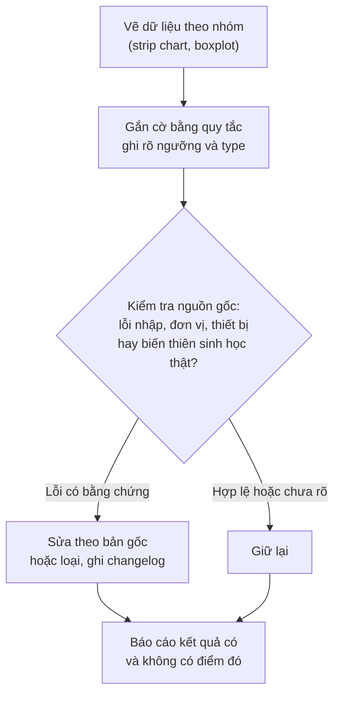

Một giá trị có phải là outlier hay không phụ thuộc vào quy tắc bạn chọn và cả cách phần mềm tính quartile. Bài thứ năm của series *Nhập môn phân tích dữ liệu bằng R* so sánh ba họ quy tắc phát hiện giá trị ngoại lai (Tukey 1,5 × IQR, |z| > 3 và robust z dựa trên median/MAD), giải thích chín định nghĩa quantile khiến R, Excel, NumPy và SPSS cho số khác nhau, rồi dùng dữ liệu Palmer Penguins để minh hoạ nghịch lý Simpson. Các bảng và hình chính đều tính lại được bằng code R đi kèm, đã chạy thử trên R 4.4.3.

## 1. Mở đầu: con số 950 có phải outlier?

Hãy xét doanh số tháng của tám chi nhánh một công ty, tính bằng triệu đồng: 200, 350, 420, 480, 510, 560, 620 và 950. Đây là dữ liệu giả định, dùng làm ví dụ minh hoạ cho boxplot và IQR (Hoàng et al., 2026). Câu hỏi rất đơn giản: chi nhánh 950 có phải là outlier không?

Nếu tính quartile theo cách quen thuộc trong sách nhập môn, lấy median của nửa dưới và nửa trên, bạn được $Q_1 = 385$, $Q_3 = 590$, $IQR = 205$ và hàng rào trên $590 + 1{,}5 \times 205 = 897{,}5$. Vì 950 > 897,5 nên câu trả lời là **có**. Hàm `quantile()` mặc định của R cho $Q_1 = 402{,}5$ và $Q_3 = 575$, hàng rào trên 833,75, nên câu trả lời vẫn là **có**. Nhưng nếu dùng định nghĩa quantile mà trang trợ giúp của R ghi là cách của Minitab và SPSS (R Core Team, 2025), hàng rào trên thành 961,25 và câu trả lời là **không**. Còn quy tắc |z| > 3 thì cho z(950) = 1,99, cũng **không**. Thực ra với tám quan sát, quy tắc này không thể gắn cờ điểm nào, kể cả khi doanh số là 9.000 thay vì 950 (Shiffler, 1988).

| Cách làm | Ngưỡng trên | 950 là outlier? |
|---|---|---|
| Tukey, quartile tính tay (median của hai nửa) | 897,5 | Có |
| Tukey, `quantile()` mặc định của R (type 7) | 833,75 | Có |
| Tukey, quantile type 6 (Minitab, SPSS) | 961,25 | Không |
| \|z\| > 3, dùng mean và SD mẫu | z(950) = 1,99 | Không |

*Bảng 1. Cùng một dữ liệu, bốn cách làm, hai kết luận trái ngược.*

Bảng 1 cho thấy luận điểm chính của bài: **outlier là một nhãn do quy tắc gán, không phải thuộc tính sẵn có của dữ liệu**. Vì thế, báo cáo nào có chữ "outlier" cũng cần ghi rõ quy tắc, ngưỡng, hàm và phần mềm đã dùng. Sau phần nền tảng về các chỉ số **bền vững** (robust) ở mục 2, bài đi theo ba trục: quy tắc phát hiện outlier (mục 3), định nghĩa quantile (mục 4) và tương quan gộp so với tương quan theo nhóm (mục 5).

## 2. Nền tảng: vị trí và phân tán, bản thường và bản bền vững

### 2.1. Mean, median và trimmed mean

Trung bình (mean) dùng mọi giá trị, nên một giá trị cực đoan đủ để kéo nó đi xa. Trung vị (median) chỉ phụ thuộc vào thứ tự, nên không bị kéo theo. Bruce và Bruce (2017) gọi tính chất này là *robust* hay *resistant*: ước lượng ít bị ảnh hưởng bởi giá trị cực đoan. Với tám chi nhánh, mean là 511,25 và median là 495. Bỏ chi nhánh 950 đi, mean giảm còn 448,57 (= 3140/7) trong khi median chỉ giảm từ 495 xuống 480.

Giữa hai thái cực là trung bình cắt tỉa (trimmed mean): bỏ một tỷ lệ cố định ở hai đầu rồi lấy trung bình phần còn lại (Bruce & Bruce, 2017). Bỏ một giá trị ở mỗi đầu của tám chi nhánh (`mean(x, trim = 0.125)` trong R) cho 490, gần median hơn mean.

Mode, giá trị xuất hiện nhiều nhất, là chỉ số trung tâm duy nhất dùng được cho biến định danh (nominal) như nhóm máu hay loài. Với biến thứ bậc (ordinal), như mức độ đau từ 1 đến 5 hay giai đoạn bệnh, các mức có thứ tự nên median vẫn có nghĩa và thường hữu ích hơn mode.

### 2.2. SD, IQR và MAD

Độ lệch chuẩn (standard deviation, SD) bình phương từng độ lệch so với mean, nên giá trị càng xa thì ảnh hưởng càng lớn: SD của tám chi nhánh là 220,0, bỏ 950 đi còn 140,8. Khoảng tứ phân vị (interquartile range, IQR) chỉ dùng 50% dữ liệu ở giữa. Độ lệch tuyệt đối trung vị (median absolute deviation, MAD) là median của các khoảng cách $|x_i - \tilde{x}|$, trong đó $\tilde{x}$ là median:

$$\mathrm{MAD} = 1{,}4826 \times \operatorname{median}\left(|x_i - \tilde{x}|\right)$$

Hằng số 1,4826 đưa MAD về cùng thang với SD khi dữ liệu có phân phối chuẩn (Bruce & Bruce, 2017). Hàm `mad()` của R nhân sẵn hằng số này (R Core Team, 2025). Với tám chi nhánh, MAD là 148,26; bỏ 950 còn 118,6. MAD không phải ước lượng bền vững duy nhất: Rousseeuw và Croux (1993) đề xuất hai ước lượng $S_n$ và $Q_n$, chịu được tỷ lệ dữ liệu bẩn cao như MAD nhưng hiệu quả hơn khi dữ liệu chuẩn.


*Hình 1. Tám chi nhánh với mean ± SD (đỏ) và median ± MAD (xanh), trước và sau khi bỏ chi nhánh 950. Một giá trị kéo mean và SD dịch xa hơn hẳn median và MAD.*

### 2.3. Breakdown point

Mức độ "bền vững" được đo bằng **điểm sụp đổ** (breakdown point): tỷ lệ quan sát lớn nhất có thể bị thay bằng giá trị tuỳ ý mà ước lượng vẫn không bị kéo ra vô cùng (Rousseeuw & Croux, 1993; Rousseeuw & Hubert, 2011). Mean và SD có breakdown point bằng 0, vì chỉ một giá trị đủ lớn là đủ làm chúng lớn tuỳ ý. IQR chịu được tới 25% dữ liệu bẩn, vì phải hỏng hơn một phần tư dữ liệu thì một quartile mới bị kéo đi. Median và MAD chịu được tới 50%, mức cao nhất có thể. Quy tắc nào xây trên mean và SD thì kế thừa điểm yếu đó, như mục 3 sẽ cho thấy.

Một lưu ý nhỏ về phương sai mẫu: chia cho $n - 1$ làm $s^2$ trở thành ước lượng không chệch của $\sigma^2$, nhưng $s = \sqrt{s^2}$ vẫn là ước lượng hơi chệch của $\sigma$, vì căn bậc hai không giữ nguyên kỳ vọng. Phần ước lượng và khoảng tin cậy được bàn kỹ hơn trong bài về đặc trưng thống kê mẫu và ước lượng tham số.

## 3. Trục 1: ba họ quy tắc phát hiện outlier

### 3.1. Hàng rào Tukey

Boxplot do Tukey giới thiệu (Tukey, 1977; Bruce & Bruce, 2017), và kèm theo nó là quy tắc hàng rào:

$$\left[\,Q_1 - 1{,}5 \times IQR;\ Q_3 + 1{,}5 \times IQR\,\right]$$

Điểm nằm ngoài khoảng này được vẽ riêng như điểm nghi ngờ. McGill et al. (1978) mô tả các biến thể của boxplot, còn Hoaglin et al. (1986) khảo sát hiệu năng của các quy tắc "resistant" kiểu này khi dùng để gắn nhãn outlier. Cần phân biệt **hàng rào** (fence), là ngưỡng tính ra, với **râu** (whisker), là đoạn kéo tới điểm dữ liệu thực xa nhất còn nằm trong hàng rào. Với tám chi nhánh, hàng rào trên tính tay là 897,5 nhưng râu trên dừng ở 620, vì 620 là giá trị lớn nhất không vượt hàng rào.

Nếu dữ liệu có phân phối chuẩn, xác suất một điểm nằm ngoài hàng rào Tukey tính theo quartile của tổng thể là khoảng 0,70%. Trên mẫu n = 200, tỷ lệ gắn cờ trung bình qua 2000 lần mô phỏng là 0,85%, cao hơn một chút vì quartile mẫu dao động quanh quartile thật.

### 3.2. Quy tắc |z| > 3 và giới hạn của Shiffler

Điểm chuẩn hoá $z_i = (x_i - \bar{x})/s$ đo khoảng cách tới mean theo đơn vị SD. Quy tắc phổ biến là gắn cờ khi |z| > 3. Quy tắc này có hai điểm yếu.

Điểm yếu thứ nhất là **giới hạn theo cỡ mẫu**. Khi $\bar{x}$ và $s$ được tính từ chính mẫu đó, điểm z lớn nhất có thể đạt được bị chặn trên (Shiffler, 1988):

$$|z_i| \le \frac{n-1}{\sqrt{n}}$$

Với n = 8, cận trên là 2,47; với n = 10 là 2,85; phải từ n = 11 (cận 3,02) thì |z| > 3 mới có thể xảy ra. Điểm càng xa càng kéo mean về phía nó và làm SD phình to, nên z của nó không tăng mãi. Đổi 950 thành 9.000, z của chi nhánh đó chỉ là 2,47, đúng bằng cận trên. Với mẫu nhỏ, chuyện thường gặp trong thí nghiệm sinh học có 3 đến 10 lần lặp, quy tắc |z| > 3 về mặt toán học không gắn cờ được gì.


*Hình 2. Điểm |z| lớn nhất có thể đạt được theo cỡ mẫu. Đường cong chỉ vượt ngưỡng 3 từ n = 11.*

Điểm yếu thứ hai là **hiệu ứng che lấp** (masking): khi có nhiều outlier cùng lúc, chính chúng làm mean và SD lệch đi, nên outlier này "che" outlier kia (Rousseeuw & Hubert, 2011). Một mô phỏng nhỏ cho thấy rõ điều này. Lấy 30 giá trị từ phân phối chuẩn N(0, 1) rồi thêm k giá trị bằng 8, tức là cách tâm khoảng 8 SD. Với k = 1, cả ba quy tắc đều gắn cờ điểm đó (z = 4,33). Với k = 3, SD tăng lên 2,58 và z của mỗi điểm 8 chỉ còn 2,85, nên |z| > 3 không gắn cờ điểm nào; hàng rào Tukey và robust z > 3 gắn cờ đủ cả ba. Với k = 5, z giảm còn 2,28; |z| > 3 vẫn không gắn cờ gì, còn hai quy tắc kia gắn cờ đủ năm điểm.

### 3.3. Robust z dựa trên median và MAD

Cách khắc phục tự nhiên là thay mean bằng median và SD bằng MAD:

$$z_i^{\text{robust}} = \frac{x_i - \tilde{x}}{\mathrm{MAD}}$$

Leys et al. (2013) lập luận rằng nên dùng độ lệch tuyệt đối quanh median thay vì độ lệch chuẩn quanh mean để phát hiện outlier, và coi ngưỡng 2,5 là lựa chọn mặc định hợp lý, với điều kiện người phân tích nêu lý do chọn ngưỡng. Một biến thể có từ trước là **modified z-score** của Iglewicz và Hoaglin (1993): $M_i = 0{,}6745\,(x_i - \tilde{x})/\mathrm{MAD}_{\text{thô}}$, gắn nhãn outlier tiềm năng khi $|M_i| > 3{,}5$ (NIST/SEMATECH, n.d.). Vì $0{,}6745 \approx 1/1{,}4826$, modified z-score chính là robust z ở trên khi dùng `mad()` của R; khác biệt nằm ở ngưỡng.

Với tám chi nhánh, median là 495 và MAD là 148,26, nên robust z(950) = 3,07: bị gắn cờ ở cả ngưỡng 2,5 và 3, nhưng không ở ngưỡng 3,5. Ở đầu kia, robust z(200) = −1,99. Robust z không bị chặn theo n như |z|.

### 3.4. Một biến thật, nhiều câu trả lời

Biến `wt` (khối lượng xe, nghìn pound) trong bộ dữ liệu `mtcars` có sẵn của R gồm 32 xe, đúng loại biến hay dùng để tập vẽ boxplot (xem [bài 01 về trình bày dữ liệu bằng R](/blog/trinh-bay-va-mo-ta-du-lieu-thuc-hanh-r/)). Hình 3 áp sáu quy tắc lên cùng biến này:

- Hàng rào Tukey với `quantile()` mặc định (type 7): hàng rào trên 5,153, gắn cờ 3 xe (Cadillac Fleetwood 5,250; Chrysler Imperial 5,345; Lincoln Continental 5,424).
- `boxplot.stats()`, hàm mà `boxplot()` dùng để vẽ điểm rời: hàm này lấy "hinges" của `fivenum()` (2,5425 và 3,65) thay cho quartile, nên chỉ gắn cờ 2 xe (5,345 và 5,424).
- Hàng rào Tukey với quantile type 6: hàng rào trên 5,469, không xe nào.
- |z| > 3: z lớn nhất là 2,26, không xe nào.
- Robust z > 2,5: 3 xe (2,74; 2,63; 2,51); robust z > 3: không xe nào.


*Hình 3. Biến `mtcars$wt` (n = 32) dưới sáu quy tắc. Điểm đỏ là xe bị gắn cờ.*

Như vậy, hai cách "loại outlier" thường gặp trong R, lọc theo `quantile()` và lọc theo `boxplot.stats()$out`, sẽ để lại 29 và 30 xe. Khối code dưới đây tái lập Hình 3.

```r
flag_rules <- function(v) {
  tukey <- function(type) {
    q <- quantile(v, c(0.25, 0.75), type = type, names = FALSE)
    i <- q[2] - q[1]
    v < q[1] - 1.5 * i | v > q[2] + 1.5 * i
  }
  z  <- (v - mean(v)) / sd(v)
  rz <- (v - median(v)) / mad(v)          # mad() đã nhân 1,4826
  data.frame(tukey_t7      = tukey(7),
             boxplot_stats = v %in% boxplot.stats(v)$out,
             tukey_t6      = tukey(6),
             z3            = abs(z)  > 3,
             rz25          = abs(rz) > 2.5,
             rz3           = abs(rz) > 3)
}
f <- flag_rules(mtcars$wt)
colSums(f)
rownames(mtcars)[f$tukey_t7]
```

```text
     tukey_t7 boxplot_stats      tukey_t6            z3          rz25           rz3 
            3             2             0             0             3             0 
[1] "Cadillac Fleetwood"  "Lincoln Continental" "Chrysler Imperial"
```

### 3.5. Dữ liệu lệch: nhiều cờ hơn không có nghĩa là phù hợp hơn

Cả ba quy tắc trên đều **đối xứng**: chúng đặt ngưỡng cách tâm bằng nhau ở hai phía. Dữ liệu sinh học thì thường lệch phải (nồng độ hormone, số lượng tế bào, thời gian sống). Thử mô phỏng 2000 mẫu, mỗi mẫu 200 giá trị, từ phân phối chuẩn và từ phân phối lognormal(0, 1), rồi tính tỷ lệ điểm bị gắn cờ (Hình 4).


*Hình 4. Tỷ lệ điểm bị gắn cờ trung bình qua 2000 mẫu mô phỏng (n = 200). Với dữ liệu lognormal, mọi điểm đều đến từ cùng một phân phối, nên mọi cờ đều là cờ "oan".*

Trên dữ liệu chuẩn, các quy tắc gắn cờ từ 0,26% (|z| > 3) đến 1,41% (robust z > 2,5). Trên dữ liệu lognormal, con số tăng vọt: Tukey 7,77%, |z| > 3 là 2,12%, robust z > 3 là 9,71% và robust z > 2,5 là 12,07%. Hàng rào Tukey đúng là gắn cờ nhiều hơn |z| trên dữ liệu lệch, nhưng gần như toàn bộ các điểm đó là phần đuôi hợp lệ của phân phối, không phải lỗi. Vậy nhận xét "quy tắc IQR hợp với dữ liệu lệch" cần được hiểu đúng: IQR bền vững hơn SD, nhưng hàng rào đối xứng không hề được thiết kế cho phân phối lệch.

```r
# Dùng lại flag_rules() ở mục 3.4
set.seed(2026)                                  # masking (mục 3.2)
base <- rnorm(30)
for (k in c(1, 3, 5))
  print(colSums(flag_rules(c(base, rep(8, k))))[c("tukey_t7", "z3", "rz3")])

set.seed(2026)                                  # tỷ lệ gắn cờ (Hình 4)
rules <- c("tukey_t7", "z3", "rz3", "rz25")
rate <- function(gen) rowMeans(replicate(2000, colMeans(flag_rules(gen(200))[, rules])))
round(100 * rate(rnorm), 2)    # 0.85 0.26 0.36  1.41
round(100 * rate(rlnorm), 2)   # 7.77 2.12 9.71 12.07
```

Có hai cách xử lý. Cách thứ nhất là biến đổi dữ liệu trước, thường là lấy log với dữ liệu dương lệch phải, rồi mới áp quy tắc; với dữ liệu lognormal, log đưa về đúng phân phối chuẩn. Cách thứ hai là dùng **adjusted boxplot** của Hubert và Vandervieren (2008): hàng rào được kéo dài về phía đuôi dài theo medcouple, một thước đo độ lệch bền vững. Trong R, phương pháp này có trong gói `robustbase` (hàm `adjbox`).

<div class="callout callout-warning">
<p class="callout-title">Gắn cờ không có nghĩa là xoá</p>

Quy tắc chỉ cho biết điểm nào **đáng kiểm tra**. Bruce và Bruce (2017) nhắc rằng outlier có thể đến từ lỗi đơn vị hay cảm biến hỏng, nhưng cũng có thể là quan sát hợp lệ. Trong một bảng calcium huyết thanh có các giá trị khoảng 80–130 mg/L, một giá trị 6,0 mg/L gợi ý lỗi gõ, nhưng vẫn phải đối chiếu phiếu kết quả hay file xuất từ máy đo trước khi sửa hay loại (xem đặc trưng thống kê mẫu). Quy trình ghi chép mọi thay đổi được trình bày trong bài về [làm sạch dữ liệu](/blog/process-data-from-dirty-to-clean/).

</div>

| | Tukey 1,5 × IQR | \|z\| > 3 | Robust z (median/MAD) |
|---|---|---|---|
| Dựa trên | $Q_1$, $Q_3$ | mean, SD | median, MAD |
| Breakdown point | 25% | 0 | 50% |
| Giả định ngầm | gần đối xứng | gần chuẩn, n đủ lớn | gần đối xứng |
| Điểm yếu chính | phụ thuộc định nghĩa quantile; gắn cờ oan ở đuôi dài | bị chặn với n ≤ 10; masking | gắn cờ oan ở đuôi dài; ngưỡng cần biện minh |
| Trong R | `quantile(x, type = )`, `boxplot.stats()` | `scale()` | `median()`, `mad()` |

*Bảng 2. So sánh ba họ quy tắc phát hiện outlier đơn biến.*

## 4. Trục 2: "Q1 là bao nhiêu?" Chín định nghĩa quantile

### 4.1. Vì sao có nhiều định nghĩa

Với tám giá trị, vị trí 25% nằm giữa quan sát thứ hai và thứ ba. Hầu hết phần mềm tính quantile mẫu như một trung bình có trọng số của hai thống kê thứ tự kề nhau, $\hat{Q}(p) = (1-\gamma)\,x_{(j)} + \gamma\,x_{(j+1)}$, và khác nhau ở cách chọn vị trí $j$ và trọng số $\gamma$ (Hyndman & Fan, 1996). Bruce và Bruce (2017) lưu ý rằng trừ khi dữ liệu nhỏ, bạn thường không cần bận tâm đến cách tính chính xác.

Hyndman và Fan (1996) hệ thống hoá các cách tính đang dùng thành chín loại (type 1 đến 9), đánh giá chúng theo một loạt tính chất mong muốn và khuyến nghị type 8. R hỗ trợ cả chín qua tham số `type` của `quantile()`, mặc định là type 7; trang trợ giúp ghi type 6 là cách của Minitab và SPSS (R Core Team, 2025). NumPy dùng tham số `method`, mặc định là `"linear"`, tương ứng type 7, và liệt kê các method theo đúng thứ tự của Hyndman và Fan (NumPy Developers, n.d.). Khi chạy thử pandas 3.0.3, `Series.quantile()` mặc định cũng cho kết quả trùng type 7. Cách "median của nửa dưới và nửa trên" trong nhiều sách nhập môn lại là một nhánh khác; Langford (2006) tổng hợp các cách tính quartile khác nhau trong sách giáo khoa thống kê nhập môn. Trên tám chi nhánh, cách này trùng `fivenum()` (Tukey hinges) và type 2, type 5.

### 4.2. Tám chi nhánh dưới chín định nghĩa

| Type | Ghi chú | $Q_1$ | $Q_3$ | IQR | Hàng rào trên | 950 là outlier? |
|---|---|---|---|---|---|---|
| 1, 3, 4 | dạng bậc thang hoặc nội suy đơn giản | 350 | 560 | 210 | 875 | Có |
| 2, 5 | trùng cách tính tay và `fivenum()` ở ví dụ này | 385 | 590 | 205 | 897,5 | Có |
| 6 | Minitab, SPSS | 367,5 | 605 | 237,5 | **961,25** | **Không** |
| 7 | mặc định R, NumPy, pandas | 402,5 | 575 | 172,5 | 833,75 | Có |
| 8 | Hyndman và Fan khuyến nghị | 379,17 | 595 | 215,83 | 918,75 | Có |
| 9 | | 380,63 | 593,75 | 213,13 | 913,44 | Có |

*Bảng 3. Quartile và hàng rào trên của tám chi nhánh theo chín định nghĩa quantile (tính bằng R 4.4.3).*

Tám chi nhánh chính là trường hợp "dữ liệu nhỏ" mà Bruce và Bruce (2017) cảnh báo, và ở đây lựa chọn định nghĩa làm đổi kết luận. Chênh lệch giữa các hàng rào trên lên tới 127,5 triệu (từ 833,75 đến 961,25), và giá trị 950 nằm lọt giữa hàng rào type 8 (918,75) và type 6 (961,25).


*Hình 5. Hàng rào trên của chín type so với chi nhánh 950 (vạch đỏ). Chỉ hàng rào type 6 vượt qua 950.*

```r
x <- c(200, 350, 420, 480, 510, 560, 620, 950)
tab <- t(sapply(1:9, function(t) {
  q <- quantile(x, c(0.25, 0.75), type = t, names = FALSE)
  c(type = t, Q1 = q[1], Q3 = q[2], upper = q[2] + 1.5 * (q[2] - q[1]))
}))
round(tab, 2)
fivenum(x)   # Tukey hinges: 200 385 495 590 950
```

```python
import numpy as np, pandas as pd
x = [200, 350, 420, 480, 510, 560, 620, 950]
print(np.percentile(x, [25, 75]))                     # mặc định method="linear" (type 7)
print(np.percentile(x, [25, 75], method="weibull"))   # type 6
print(pd.Series(x).quantile([0.25, 0.75]).tolist())    # pandas: cũng type 7
```

```text
[402.5 575. ]
[367.5 605. ]
[402.5, 575.0]
```

### 4.3. Còn Excel thì sao?

Excel có hai họ hàm `.INC` và `.EXC` (`QUARTILE`, `PERCENTILE`). Tài liệu của Microsoft không ghi số type, nhưng ví dụ mẫu cho phép đối chiếu. `QUARTILE.INC` trả về 3,5 làm quartile thứ nhất của dãy {1, 2, 4, 7, 8, 9, 10, 12} (Microsoft, n.d.-b); type 7 của R cho đúng 3,5, còn type 6 cho 2,5. `QUARTILE.EXC` trả về 15 và 43 cho dãy 11 giá trị {6, 7, 15, 36, 39, 40, 41, 42, 43, 47, 49} (Microsoft, n.d.-a); type 6 cho đúng 15 và 43, còn type 7 cho 25,5 và 42,5. Hai ví dụ này nhất quán với nhận định thường gặp rằng `.INC` tương ứng type 7 và `.EXC` tương ứng type 6, dù hai ví dụ chưa phải là chứng minh. Nếu đúng như vậy, `QUARTILE.EXC` trên tám chi nhánh sẽ cho hàng rào 961,25 và kết luận "không phải outlier".

<div class="callout callout-note">
<p class="callout-title">Thực hành tốt</p>

Luôn ghi rõ `type =` khi gọi `quantile()`, kể cả khi dùng mặc định. Khi đối chiếu quartile giữa R, Excel, SPSS hay một bài giải mẫu, hãy kiểm tra trước hàm và định nghĩa đã dùng.

</div>

## 5. Trục 3: nghịch lý Simpson trên Palmer Penguins

### 5.1. Dữ liệu

Bộ Palmer Penguins gồm số đo của ba loài chim cánh cụt *Pygoscelis* (Adelie, Chinstrap, Gentoo) trên ba đảo thuộc quần đảo Palmer, Nam Cực, thu thập trong các năm 2007–2009 cho nghiên cứu về dị hình giới tính sinh thái của Gorman et al. (2014). Horst et al. (2022) đóng gói dữ liệu thành gói R `palmerpenguins` như một lựa chọn thay cho bộ iris quen thuộc. Bảng dữ liệu có 344 dòng, nhưng chỉ 342 dòng có đủ chiều dài và độ sâu mỏ, nên mọi phân tích dưới đây dùng n = 342.

### 5.2. Tương quan gộp và tương quan trong từng loài

Gộp cả ba loài, tương quan Pearson giữa chiều dài mỏ và độ sâu mỏ là r = −0,235 (p ≈ 1,1 × 10⁻⁵), Spearman ρ = −0,222. Tách theo loài thì bức tranh đảo ngược:

| Nhóm | n | Pearson r | p |
|---|---|---|---|
| Gộp ba loài | 342 | −0,235 | 1,1 × 10⁻⁵ |
| Adelie | 151 | 0,391 | 6,7 × 10⁻⁷ |
| Gentoo | 123 | 0,643 | 1 × 10⁻¹⁵ |
| Chinstrap | 68 | 0,654 | 1,5 × 10⁻⁹ |

*Bảng 4. Tương quan chiều dài – độ sâu mỏ ở mức gộp và trong từng loài.*

Trong cả ba loài, mỏ dài hơn thì sâu hơn. Hồi quy cũng vậy: hệ số góc của `lm(bill_depth_mm ~ bill_length_mm)` là −0,085 mm độ sâu trên mỗi mm chiều dài, nhưng khi thêm biến `species` vào mô hình, hệ số góc thành +0,200.


*Hình 6. Chiều dài và độ sâu mỏ của 342 cá thể. Đường nét đứt là hồi quy gộp, các đường liền là hồi quy trong từng loài.*

### 5.3. Cơ chế

Loài ở đây là **biến gây nhiễu** (confounder): nó liên quan đến cả hai biến đang xét. Mỏ của Gentoo dài (trung bình 47,5 mm) nhưng nông (15,0 mm); Adelie có mỏ ngắn (38,8 mm) và sâu (18,3 mm); Chinstrap dài (48,8 mm) và sâu (18,4 mm). Khi gộp lại, đám mây Gentoo nằm ở góc "dài mà nông" kéo đường hồi quy chung nghiêng xuống, ngược với độ dốc dương bên trong mỗi đám mây. Đây là dạng biến liên tục của hiện tượng mà Simpson (1951) phân tích trên bảng ngẫu nhiên (contingency table): một liên hệ ở mức gộp có thể đổi chiều khi phân tầng theo biến thứ ba. Ví dụ kinh điển dạng bảng là dữ liệu tuyển sinh sau đại học ở Berkeley (Bickel et al., 1975). Câu hỏi nên kiểm soát biến nào là câu hỏi nhân quả chứ không chỉ là thống kê, như bài về suy luận nhân quả trình bày.

Bài học cho báo cáo khá cụ thể. Trước khi diễn giải một hệ số tương quan, hãy vẽ scatter tô màu theo nhóm. Nếu nhóm có ý nghĩa sinh học (loài, giới, lô thí nghiệm, ngày đo), báo cáo r trong từng nhóm hoặc dùng mô hình có biến nhóm. Bài về tương quan và hồi quy bàn thêm các trường hợp khác mà một con số r đứng riêng gây hiểu sai.

### 5.4. Outlier cũng phải xét theo nhóm

Nghịch lý này quay lại trục 1. Khối lượng cơ thể của cả 342 cá thể không có điểm nào nằm ngoài hàng rào Tukey của `boxplot.stats()`. Nhưng trong riêng Chinstrap có hai điểm vượt hàng rào: 2700 g và 4800 g. Một con chim cánh cụt 4800 g bình thường với Gentoo nhưng bất thường với Chinstrap. Gắn cờ trên dữ liệu gộp có thể bỏ sót điểm bất thường thật, hoặc gắn cờ cả một nhóm nhỏ chỉ vì nó khác các nhóm còn lại.

```r
url <- "https://raw.githubusercontent.com/allisonhorst/palmerpenguins/main/inst/extdata/penguins.csv"
p <- read.csv(url)
d <- p[complete.cases(p[, c("bill_length_mm", "bill_depth_mm")]), ]
nrow(d)                                               # 342
cor.test(d$bill_length_mm, d$bill_depth_mm)$estimate  # -0.235
sapply(split(d, d$species),
       function(g) cor(g$bill_length_mm, g$bill_depth_mm))
coef(lm(bill_depth_mm ~ bill_length_mm, data = d))[2]            # -0.085
coef(lm(bill_depth_mm ~ bill_length_mm + species, data = d))[2]  # +0.200
m <- p[!is.na(p$body_mass_g), ]
boxplot.stats(m$body_mass_g)$out                                   # không có
boxplot.stats(m$body_mass_g[m$species == "Chinstrap"])$out         # 4800 2700
```

## 6. Hộp phụ: SMA, EMA và trend filter

Với dữ liệu theo thời gian, câu hỏi chuyển từ "điểm nào lạ" sang "xu hướng là gì". Trung bình trượt đơn giản (simple moving average, SMA) lấy trung bình k điểm liền nhau; trung bình trượt hàm mũ (exponential moving average, EMA) gán trọng số giảm dần cho các điểm cũ hơn. Bậc của trung bình trượt quyết định độ mượt: bậc càng lớn thì đường xu hướng càng mượt (Hyndman & Athanasopoulos, 2021), đổi lại phản ứng chậm hơn với thay đổi thật.

Trend filter ước lượng xu hướng bằng cách cân bằng giữa bám sát dữ liệu và giữ cho xu hướng đơn giản. Nếu phạt **sai phân bậc 1**,

$$\min_{\mu}\ \tfrac{1}{2}\sum_t (y_t - \mu_t)^2 + \lambda \sum_t |\mu_t - \mu_{t-1}|,$$

lời giải là xu hướng **hằng từng đoạn**: những đoạn phẳng nối bằng các bước nhảy. Phương pháp ℓ1 trend filtering của Kim et al. (2009) thay vào đó phạt **sai phân bậc 2**, $\lambda \sum_t |x_{t-1} - 2x_t + x_{t+1}|$, và cho xu hướng **tuyến tính từng đoạn**. Tibshirani (2014) tổng quát hoá thành phạt sai phân bậc k, cho xu hướng đa thức từng đoạn. Khi báo cáo cần ghi rõ bậc của số hạng phạt.

Trend filter có "bền vững với outlier" không? Số hạng khớp dữ liệu là tổng bình phương sai số, nên trend filter là bài toán bình phương tối thiểu có phạt (penalized least squares) (Tibshirani, 2014); chuẩn L1 chỉ nằm ở số hạng phạt. Một mô phỏng nhỏ cho thấy hệ quả: chuỗi 40 điểm có một bước nhảy thật cao 2 đơn vị và một gai cao 6 đơn vị ở một thời điểm. Với phạt bậc 1 và λ = 1, giá trị ước lượng tại vị trí gai vẫn bị nâng lên 4,2 đơn vị; với λ = 2, vẫn còn 2,15. SMA bậc 3 rải gai thành ba điểm, mỗi điểm cao thêm 2 đơn vị; EMA (trọng số 0,3) nâng điểm đó thêm 1,8 rồi kéo ảnh hưởng sang các điểm sau. Trong các cách đã thử, chỉ trung vị trượt (running median) bậc 3 xoá hẳn gai. Trend filter làm mượt tốt, nhưng muốn bền vững với gai thì cần thay số hạng bình phương bằng hàm mất mát bền vững hoặc làm sạch gai trước.

## 7. Quy trình khuyến nghị và checklist báo cáo

Ba trục ở trên dẫn tới quy trình sau.



<div class="callout callout-note">
<p class="callout-title">Checklist mô tả một biến liên tục</p>

1. Vẽ trước (strip chart hoặc boxplot theo nhóm), tính sau.
2. Dữ liệu lệch: báo cáo median [$Q_1$; $Q_3$] bên cạnh hoặc thay cho mean ± SD, và ghi rõ `type` của quantile.
3. Với n ≤ 10, không dùng |z| > 3; ưu tiên robust z hoặc chỉ mô tả.
4. Dữ liệu lệch phải: biến đổi log hoặc dùng adjusted boxplot trước khi gắn cờ.
5. Gắn cờ → kiểm tra nguồn gốc → quyết định có lý do → báo cáo kết quả có và không có điểm đó.
6. Kiểm tra tương quan và outlier ở cả mức gộp lẫn trong từng nhóm.

</div>

Điểm 5 là phân tích độ nhạy (sensitivity analysis) ở dạng đơn giản nhất. Nếu kết luận đổi khi bỏ điểm nghi ngờ, người đọc cần biết điều đó; lặng lẽ xoá điểm sẽ che mất nó. Các bước tương tự cho dữ liệu hồi quy, nơi một điểm có thể ảnh hưởng mạnh đến cả đường hồi quy, được bàn trong bài về [dữ liệu nhà ở Boston](/blog/tieu-luan-van-dung-r-phan-tich-du-lieu-nha-o-boston/).

## 8. Kết luận

Nhãn "outlier" phụ thuộc vào quy tắc: cùng biến `mtcars$wt` có thể có 0, 2 hoặc 3 điểm bất thường, và |z| > 3 không thể gắn cờ gì khi n ≤ 10. Quartile phụ thuộc vào định nghĩa: chín type của R cho sáu bộ quartile khác nhau trên tám quan sát, và chỉ riêng type 6 coi 950 là bình thường. Tương quan phụ thuộc vào mức gộp: chiều dài và độ sâu mỏ chim cánh cụt tương quan âm khi gộp ba loài nhưng dương trong từng loài. Không lựa chọn nào trong số đó là sai. Cái sai là không ghi lại đã chọn gì, và coi kết quả như một sự thật độc lập với lựa chọn đó.

## Tài liệu tham khảo

- Bickel, P. J., Hammel, E. A., & O'Connell, J. W. (1975). Sex bias in graduate admissions: Data from Berkeley. *Science, 187*(4175), 398–404. https://doi.org/10.1126/science.187.4175.398
- Bruce, P., & Bruce, A. (2017). *Practical statistics for data scientists: 50 essential concepts*. O'Reilly Media.
- Gorman, K. B., Williams, T. D., & Fraser, W. R. (2014). Ecological sexual dimorphism and environmental variability within a community of Antarctic penguins (genus *Pygoscelis*). *PLoS ONE, 9*(3), e90081. https://doi.org/10.1371/journal.pone.0090081
- Hoaglin, D. C., Iglewicz, B., & Tukey, J. W. (1986). Performance of some resistant rules for outlier labeling. *Journal of the American Statistical Association, 81*(396), 991–999. https://doi.org/10.1080/01621459.1986.10478363
- Hoàng, Đ. K., et al. (2026). *Data exploration using descriptive statistics* [Tài liệu học tập]. AI Việt Nam.
- Horst, A. M., Hill, A. P., & Gorman, K. B. (2022). Palmer Archipelago penguins data in the palmerpenguins R package – An alternative to Anderson's irises. *The R Journal, 14*(1), 244–254. https://doi.org/10.32614/RJ-2022-020
- Hubert, M., & Vandervieren, E. (2008). An adjusted boxplot for skewed distributions. *Computational Statistics & Data Analysis, 52*(12), 5186–5201. https://doi.org/10.1016/j.csda.2007.11.008
- Hyndman, R. J., & Athanasopoulos, G. (2021). *Forecasting: Principles and practice* (3rd ed.). OTexts. https://otexts.com/fpp3/
- Hyndman, R. J., & Fan, Y. (1996). Sample quantiles in statistical packages. *The American Statistician, 50*(4), 361–365. https://doi.org/10.1080/00031305.1996.10473566
- Iglewicz, B., & Hoaglin, D. C. (1993). *How to detect and handle outliers* (ASQC Basic References in Quality Control, Vol. 16). ASQC Quality Press.
- Kim, S.-J., Koh, K., Boyd, S., & Gorinevsky, D. (2009). ℓ1 trend filtering. *SIAM Review, 51*(2), 339–360. https://doi.org/10.1137/070690274
- Langford, E. (2006). Quartiles in elementary statistics. *Journal of Statistics Education, 14*(3). https://doi.org/10.1080/10691898.2006.11910589
- Leys, C., Ley, C., Klein, O., Bernard, P., & Licata, L. (2013). Detecting outliers: Do not use standard deviation around the mean, use absolute deviation around the median. *Journal of Experimental Social Psychology, 49*(4), 764–766. https://doi.org/10.1016/j.jesp.2013.03.013
- McGill, R., Tukey, J. W., & Larsen, W. A. (1978). Variations of box plots. *The American Statistician, 32*(1), 12–16. https://doi.org/10.1080/00031305.1978.10479236
- Microsoft. (n.d.-a). *QUARTILE.EXC function*. Microsoft Support. https://support.microsoft.com/en-us/office/quartile-exc-function-5a355b7a-840b-4a01-b0f1-f538c2864cad
- Microsoft. (n.d.-b). *QUARTILE.INC function*. Microsoft Support. https://support.microsoft.com/en-us/office/quartile-inc-function-1bbacc80-5075-42f1-aed6-47d735c4819d
- NIST/SEMATECH. (n.d.). Detection of outliers. In *e-Handbook of statistical methods* (Section 1.3.5.17). https://www.itl.nist.gov/div898/handbook/eda/section3/eda35h.htm
- NumPy Developers. (n.d.). *numpy.percentile*. NumPy documentation. https://numpy.org/doc/stable/reference/generated/numpy.percentile.html
- R Core Team. (2025). *R: A language and environment for statistical computing* (Version 4.4.3). R Foundation for Statistical Computing. https://www.R-project.org/
- Rousseeuw, P. J., & Croux, C. (1993). Alternatives to the median absolute deviation. *Journal of the American Statistical Association, 88*(424), 1273–1283. https://doi.org/10.1080/01621459.1993.10476408
- Rousseeuw, P. J., & Hubert, M. (2011). Robust statistics for outlier detection. *WIREs Data Mining and Knowledge Discovery, 1*(1), 73–79. https://doi.org/10.1002/widm.2
- Shiffler, R. E. (1988). Maximum Z scores and outliers. *The American Statistician, 42*(1), 79–80. https://doi.org/10.1080/00031305.1988.10475530
- Simpson, E. H. (1951). The interpretation of interaction in contingency tables. *Journal of the Royal Statistical Society: Series B (Methodological), 13*(2), 238–241. https://doi.org/10.1111/j.2517-6161.1951.tb00088.x
- Tibshirani, R. J. (2014). Adaptive piecewise polynomial estimation via trend filtering. *The Annals of Statistics, 42*(1), 285–323. https://doi.org/10.1214/13-AOS1189
- Tukey, J. W. (1977). *Exploratory data analysis*. Addison-Wesley.
