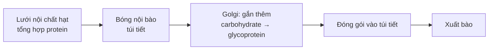

Chép từ sổ viết tay cấp 3 (trang 007–013). Nội dung có thể chưa chính xác; <code>(?)</code> là chỗ chữ chưa đọc rõ.

Đã sửa so với sổ gốc

- Tên các chất đổi từ phiên âm tiếng Việt sang tiếng Anh (ADN → DNA, riboxom → ribosome, lizoxom → lysosome, Gongi → Golgi, enzym → enzyme, glicogen → glycogen, miozin → myosin...).
- Ti thể: "⇒ Độc lập với tế bào" → **bán tự chủ** (độc lập tương đối): phần lớn protein của ti thể vẫn do gen trong nhân mã hoá.
- Nguồn gốc ti thể: ribosome **70S** (bỏ (?)), rRNA giống vi khuẩn.
- Lưới nội chất hạt: "Không chứa enzym" → không chứa các enzyme tổng hợp lipid, khử độc như lưới nội chất trơn (lưới nội chất hạt vẫn có enzyme).
- Bộ máy Golgi: "Tổng hợp enzym cho lizoxom" → **hoàn thiện, đóng gói** enzyme thuỷ phân tạo lysosome (enzyme được tổng hợp ở lưới nội chất hạt).
- Trung tử: mỗi vi ống gồm 13 **tiền sợi (protofilament)**, không phải "13 vi sợi" (vi sợi là sợi actin).
- Tế bào không nhân: ghi rõ là hồng cầu **ở động vật có vú**.

## II. Tế bào chất và bào quan
- Xem thêm: [Mô hình tế bào tương tác](/blog/sinh-hoc/kien-thuc-chung/mo-hinh-te-bao-tuong-tac/) – bấm vào từng bào quan để xem mặt cắt và chú thích

### 1. Tế bào chất
- Khối chất, dạng keo, nằm phía trong màng tế bào, chứa bào quan, ..., khối chất nguyên sinh (**bào tương**)
	- → Xảy ra chuỗi (?) phản ứng

### 2. Ti thể

#### Cấu trúc
- **Màng kép**: protein (63 – 70%), lipid (25 – 30%), DNA, RNA
	- **Màng ngoài**: trơn, chứa protein xuyên màng (60% (?))
		- Nhiều kênh ion, protein mang vận chuyển ion
		- Enzyme: transferase, cytochrome b, phosphatase, phospholipase
	- **Màng trong**:
		- Gấp khúc → **mào**, ↑ S (diện tích) 3 lần so với màng ngoài
			- → Chuỗi truyền electron.
			- S ↑ → chuỗi truyền electron ↑ → ↑ hô hấp.
		- Nhiều protein hơn màng ngoài (80%) → vận chuyển chủ động:
			- Xoang gian màng —(H⁺, Na⁺, K⁺, PO₄³⁻, pyruvate...)→ chất nền
		- **ATP synthase**: tổng hợp ATP
- **Xoang gian màng**:
	- Chứa nhiều H⁺
	- Protein tham gia quá trình tự chết của tế bào.
	- Trung chuyển (?) các chất giữa 2 màng.
- **Chất nền**:
	- Chứa nhiều enzyme:
		- Pyruvic acid —(oxi hoá)→ Acetyl-CoA
		- Chu trình Krebs
		- Tổng hợp chất béo
		- Phiên mã
		- Nhân đôi DNA
	- Ribosome, DNA (5 – 10) (kép, trần, vòng – giống vi khuẩn), RNA, ion, chất vô cơ, hữu cơ

#### Chức năng
- Nhà máy sinh ATP qua **hô hấp hiếu khí**.
- Tham gia quá trình trao đổi chất của tế bào:
	- Phối hợp các bào quan tổng hợp chất.
	- Diễn ra Krebs, tạo sản phẩm trung gian như keto acid → tổng hợp amino acid
- Tham gia điều hoà [Ca²⁺] trong tế bào
- Tham gia quá trình **tự chết theo chương trình** của tế bào:
	- Giải phóng Ca²⁺ vào tế bào chất
	- Cytochrome c hoạt hoá enzyme caspase và enzyme endonuclease → gây tự chết theo chương trình của tế bào (**Apoptosis**)
- Tự tổng hợp protein: có DNA, RNA, ribosome, enzyme
	- → Nhân đôi, phiên mã, dịch mã
	- ⇒ **Bán tự chủ** (độc lập tương đối) với tế bào: phần lớn protein của ti thể vẫn do gen trong nhân mã hoá. (→ [Bài viết The Origin of Mitochondria](/blog/tieng-anh/02-scientific-english-in-biology/))

#### Nguồn gốc
- **Nội cộng sinh** của 1 vi khuẩn hiếu khí với tế bào. (→ [Phát sinh sự sống](/blog/sinh-hoc/kien-thuc-chung/e-tien-hoa/18-su-phat-sinh-va-phat-trien-cua-su-song/))
- Bằng chứng:
	- Ribosome: 70S, rRNA giống vi khuẩn
	- DNA kép, vòng, trần. (→ [Di truyền ngoài nhân](/blog/sinh-hoc/kien-thuc-chung/c-quy-luat-di-truyen/13-di-truyen-ngoai-nhan-moi-truong-va-bien-di/))
	- Tổng hợp protein:
		- Amino acid mở đầu: f-Met.
		- Bị ức chế bởi chloramphenicol.

### 3. Lục lạp

#### Cấu trúc
- **Màng kép**: trơn nhẵn.
- **Chất nền (Stroma)**:
	- Khối chất bên trong lục lạp.
	- Có: ribosome, hạt tinh bột, grana.
	- **Grana**: hệ thống túi dẹp thylakoid xếp chồng.
	- **Thylakoid**:
		- ATP synthase
		- Sắc tố quang hợp (chlorophyll a, b, carotenoid).
		- Nhiều chlorophyll → phức hệ thu nhận photon ánh sáng
			- → Tập trung năng lượng vào 2 phân tử chlorophyll a → **trung tâm phản ứng**:
				- PSII: chlorophyll a P680
				- PSI: chlorophyll a P700
	- DNA kép vòng trần, RNA, ribosome, enzyme tổng hợp glucose của chu trình Calvin.

#### Chức năng
- Thực hiện **quang hợp** (→ [Quang hợp và hô hấp ở thực vật](/blog/sinh-hoc/kien-thuc-chung/g-chuyen-hoa-vat-chat-va-nang-luong/23-quang-hop-va-ho-hap-o-thuc-vat/))

#### Nguồn gốc
- Nội cộng sinh của 1 **vi khuẩn lam** vào trong tế bào
- Bằng chứng:
	- Ribosome 70S, rRNA giống vi khuẩn
	- DNA kép, vòng, trần

### 4. Lưới nội chất
- Hệ thống màng bên trong tế bào nhân thực → hệ thống xoang dẹp, ống thông với nhau.
- Ngăn cách với phần còn lại của tế bào chất.

#### Cấu trúc
| Lưới nội chất hạt | Lưới nội chất trơn |
|---|---|
| Gần nhân, nối với màng nhân và lưới nội chất trơn | Xa nhân, nối với lưới nội chất hạt |
| Kích thước xoang dẹp lớn hơn | Kích thước xoang dẹp bé hơn |
| Đính ribosome nhờ protein ribophorin | Không đính ribosome → trơn nhẵn |
| Không chứa enzyme tổng hợp lipid, khử độc (vẫn có enzyme khác) | Chứa enzyme (tổng hợp lipid, khử độc...) |

#### Chức năng
- **Vận chuyển nội bào**:
	- Vận chuyển các chất từ ngoài môi trường → tế bào chất
	- Giữa các cấu trúc nội bào (bào quan → bào quan)
- **Tổng hợp các chất**:

| Lưới nội chất hạt | Lưới nội chất trơn |
|---|---|
| Tổng hợp protein → bào quan, cấu trúc nên màng sinh chất hoặc tiết ra ngoài tế bào | Tổng hợp lipid |
| | Tổng hợp và phân giải glycogen |
| | Khử độc: tập trung, chuyển hoá độc tố xâm nhập tế bào |
| | Tập trung Ca²⁺ → vai trò trong hoạt động sống của tế bào |

### 5. Ribosome

#### Cấu trúc
- Không có màng.
- Vị trí:
	- Đính trên lưới nội chất hạt
	- Nằm tự do trong tế bào chất, lục lạp, ti thể
- Ribosome: **80S**, gồm 2 tiểu đơn vị 60S và 40S
	- (vi khuẩn, ti thể, lục lạp: **70S** gồm 50S, 30S)
- Thành phần hoá học:
	- rRNA
	- protein
	- (hàm lượng ≈ nhau)
- **Vùng P**: cố định tRNA khi lắp ráp amino acid vào polypeptide
- **Vùng A**: cố định tRNA đang mang amino acid chuyển (?) vào ribosome

#### Chức năng: tổng hợp protein
- Ribosome đính trên lưới nội chất hạt → thể hiện vai trò (?) tổng hợp protein nhiều hơn so với ribosome tự do.
	- Protein, enzyme → tiết ra khỏi tế bào.

#### Nguồn gốc
- rRNA tổng hợp và tích luỹ trong **hạch nhân**.
- rRNA + protein ribosome → tiểu đơn vị → tế bào chất → ribosome (khi tổng hợp protein)
	- [liên kết hydrogen, Mg²⁺]

#### Đặc tính
- Cơ chế "**hoạt – nghỉ**" → hoạt động liên tục trong thời gian dài.
- Hoạt động theo nhóm (**polyribosome**) (→ [Nhân đôi, phiên mã, dịch mã](/blog/sinh-hoc/kien-thuc-chung/b-co-che-di-truyen-va-bien-di/04-nhan-doi-dna-phien-ma-va-dich-ma/))
- Không có tính đặc trưng cho tế bào.
	- (Virus sử dụng ribosome của tế bào chủ → tổng hợp protein cho mình)

### 6. Phức hệ Golgi (Bộ máy Golgi)

#### Cấu trúc
- Màng lipoprotein giới hạn các xoang, khe, bể chứa hình vòng cung
	- → Đặc biệt: 3 dạng:
		- Hệ thống bể chứa xếp thành bó (3 – 8 bể) kề sát.
		- Nhiều không bào bé nằm cuối bể chứa.
		- Không bào lớn:
			- nằm cạnh bể chứa
			- nằm xen kẽ giữa các bể trong bó

#### Chức năng
- Tham gia **dây chuyền sản xuất nội bào**:
	- Phân xưởng tập trung, đóng gói:
		- Đưa sản phẩm ra ngoài tế bào
		- Phân phối đến bào quan, bộ phận khác
	- VD: Protein tổng hợp trên lưới nội chất hạt → bóng nội bào (túi tiết) → Golgi: gắn thêm carbohydrate → glycoprotein → đóng gói vào túi tiết → xuất bào (→ [Màng tế bào](/blog/sinh-hoc/kien-thuc-chung/a-sinh-hoc-te-bao/02-mang-te-bao-va-trao-doi-chat-qua-mang/))
- Tham gia tổng hợp polysaccharide, glycoprotein.
- Hoàn thiện, đóng gói enzyme thuỷ phân (tổng hợp ở lưới nội chất hạt) → tạo lysosome; tạo ra glycoprotein.
- ⇒ Tế bào nào (?) có chức năng tiết protein (tuyến nội tiết, tế bào bạch cầu) có bộ máy Golgi phát triển.

#### Nguồn gốc
- Từ lưới nội chất trơn.

### 7. Lysosome

#### Cấu trúc
- **Cấp 1**: túi (bóng), màng đơn; chứa enzyme thuỷ phân hoạt tính ở pH = 5
	- ⇒ Chưa tham gia phân huỷ các chất
- **Cấp 2**: lysosome đang tham gia hoạt động phân giải các chất:
	- **Heterolysosome**: lysosome cấp 1 + bóng nhập bào
	- **Autolysosome**: lysosome cấp 1 + bóng tự tiêu

#### Chức năng
- Lysosome cấp 1: tích enzyme thuỷ phân, cần thiết + bóng
	- → Lysosome cấp 2:
		- Heterolysosome: tiêu hoá nội bào, bảo vệ chống lại tác nhân gây bệnh bên ngoài vào (vi khuẩn, virus, độc tố, dược phẩm). (→ [Tiêu hoá và hô hấp ở động vật](/blog/sinh-hoc/kien-thuc-chung/g-chuyen-hoa-vat-chat-va-nang-luong/24-tieu-hoa-va-ho-hap-o-dong-vat/))
		- Autolysosome: tự tiêu của tế bào (phân huỷ tế bào già, bị tổn thương).
- Quá trình:
	- Phân huỷ cấu trúc nhờ hệ thống enzyme thuỷ phân được giải phóng từ lysosome
	- Phân huỷ nhờ quá trình tự tiêu trong lysosome
	- Phân huỷ do enzyme thuỷ phân trong dịch (?) hoặc tế bào chất
- Sự tự tiêu → giải độc tế bào, dọn sạch những gì không cần thiết trong tế bào.
- Khi có tác động của các yếu tố: co giật, ngạt O₂, nội độc tố, virus, kim loại nặng... → màng lysosome bị hư hỏng, giải phóng enzyme của lysosome vào tế bào chất → tiêu huỷ tế bào.

### 8. Peroxisome
- Có ở tế bào gan, thận của động vật có vú; nấm men, động vật nguyên sinh; lá, hạt của 1 số thực vật.

#### Cấu trúc
- Màng đơn.
- Chất nền:
	- Hạt nhỏ hoặc sợi phân nhánh (?)
	- Enzyme oxi hoá:
		- **Catalase**: H₂O₂ → H₂O + O₂ (tất cả peroxisome)
		- **D-amino acid oxidase**: D-amino acid → α-keto acid, H₂O₂, NH₃ (tác động đặc trưng)
		- **Urate oxidase**: uric acid → allantoin (tế bào động vật; trừ người, linh trưởng)
			- ((?) có → tan trong nước tiểu)

#### Chức năng
- Phân giải H₂O₂
- Tham gia điều chỉnh sự chuyển hoá glucose
- Tham gia quá trình chuyển hoá nucleic acid ở khâu oxi hoá uric acid (sản phẩm chuyển hoá của purine)
- Tham gia **hô hấp sáng** (tế bào thực vật C₃)

#### Nguồn gốc
- Enzyme: từ ribosome tự do
- Màng: lưới nội chất trơn

### 9. Glyoxysome
- Ở tế bào thực vật của hạt cây có dầu đang nảy mầm, tế bào 1 số động vật bậc thấp.
- Thực hiện **chu trình glyoxylate**: lipid → carbohydrate

### 10. Khung xương tế bào

#### Vi sợi actin
- Từ protein actin.
- Tham gia sự vận động tế bào (chuyển động tế bào chất, chân giả, bào quan)
- Tế bào cơ → cấu trúc tơ cơ
- Tăng cường mối liên kết giữa các tế bào cạnh nhau, tạo liên kết, cầu nối tế bào.
- Trùng hợp, giải trùng hợp → tế bào chất chuyển từ gel ⇆ sol.

#### Vi sợi myosin
- Từ protein myosin.
- Liên kết với vi sợi actin → hoạt tính vận động tế bào.
- Tạo sợi dày của tơ cơ

#### Vi sợi trung gian
- Độ dày: actin < trung gian < myosin
	- Nhiều loại protein khác nhau.
- Giữ cho tế bào có độ vững chắc nhất định.
	- → Phát triển ở tế bào động vật (?), nhất là tế bào làm nhiệm vụ cơ học

#### Vi ống
- Hình trụ rỗng: d = 25 nm
- Vai trò:
	- Chuyển động nhiễm sắc thể về 2 cực (của thoi phân bào)
	- Vận tải nội bào
	- Duy trì hình dạng tế bào.
	- Tham gia sự hình thành vỏ bóng nhập bào, xuất bào
	- Duy trì tính ổn định của màng sinh chất
	- Tạo tính phân cực cho tế bào
- Nguồn gốc: trung tử.

### 11. Trung thể
- Gồm:
	- Trung tử
	- Chất quanh trung tử:
		- protein (96%)
		- RNA (2%)
		- Carbohydrate (2%)

#### Trung tử
- Chỉ có ở tế bào động vật.
- 1 hoặc 2 (trung tử) xếp thẳng góc.
- Cấu tạo hình trụ: 9 nhóm bộ 3 vi ống (A, B, C) → mỗi vi ống: 13 tiền sợi (protofilament)

#### Chất quanh trung tử
- Gồm thể kèm: hình cầu có cuống đính với vi ống → (?) hệ thống vi ống đi ra xếp phóng xạ xung quanh

#### Vai trò
- Tế bào động vật: vai trò quan trọng trong phân bào (**có sao**). (→ [Nguyên phân, giảm phân](/blog/sinh-hoc/kien-thuc-chung/b-co-che-di-truyen-va-bien-di/08-nguyen-phan-giam-phan-va-bai-tap-giao-tu/))
- Tế bào thực vật: không có trung thể (phân bào **không sao**), thoi phân bào hình thành từ tế bào chất đặc biệt tương ứng với chất quanh trung thể.
	- → Nguyên phân không hình thành thoi phân bào → đột biến đa bội thể. (→ [Đột biến NST](/blog/sinh-hoc/kien-thuc-chung/b-co-che-di-truyen-va-bien-di/07-dot-bien-nhiem-sac-the/))
- Tạo **thể nền**: cấu trúc nằm ở gốc lông, roi.

### 12. Không bào
- Từ lưới nội chất và bộ máy Golgi.
- Nhiều ở tế bào thực vật. Tế bào thực vật trưởng thành: không bào lớn ở trung tâm.
- Màng đơn; — nước hoà tan chất hữu cơ, ion khoáng
	- → áp suất thẩm thấu cao cho tế bào thực vật.
- Vai trò:
	- Vai trò (?) quan trọng (?) cho (?) hoạt động sinh lý (?): sinh trưởng, hấp thụ, vận chuyển nước, muối khoáng.
	- Tế bào thực vật: đa năng:
		- chứa chất độc.
		- [chất tan] cao → áp suất thẩm thấu → lông hút. (→ [Trao đổi nước và khoáng](/blog/sinh-hoc/kien-thuc-chung/g-chuyen-hoa-vat-chat-va-nang-luong/22-trao-doi-nuoc-va-khoang-o-thuc-vat/))
		- sắc tố (tế bào cánh hoa).
	- Động vật nguyên sinh:
		- tích nước, bơm nước ra ngoài cơ thể
			- → cân bằng áp suất thẩm thấu cho cơ thể
			- → chống sự trương nước làm vỡ tế bào.
		- tiêu hoá nội bào.

## III. Nhân tế bào
- Phần lớn có 1 nhân, hoặc (?):
	- **đa nhân** (gan, tuyến nước bọt (?) động vật có vú)
	- **không nhân** (tế bào hồng cầu ở động vật có vú).
- Hình dạng: cầu, khối, phân thuỳ.

### 1. Cấu trúc

#### a. Màng nhân
- **Màng kép**: dày ~10 nm (?). Xoang giữa màng: 10–20 nm.
- Khi bị phá vỡ, màng nhân không có khả năng hàn gắn lại như màng sinh chất.
- Màng ngoài: nối với lưới nội chất bởi các khe, bể chứa.
- Trên màng nhân có **lỗ** phân bố tương đối đồng đều.
- Chức năng:
	- Phân tách với tế bào chất.
	- Trao đổi chất giữa nhân với tế bào chất (vận chuyển chủ động, qua lỗ ↔ mRNA, protein, ribosome).
	- Tham gia tổng hợp, chuyên chở các chất.

#### b. Chất nhiễm sắc và NST
- **Chất nhiễm sắc**: DNA (vật chất di truyền) + protein histone (bảo vệ).
- Kì đầu phân bào, chất nhiễm sắc xoắn, co ngắn, tách thành các thể có kích thước vài – chục micro → **NST** (chromatid).
- Xem thêm: [Ứng dụng di truyền vào chọn giống](/blog/sinh-hoc/kien-thuc-chung/d-di-truyen-hoc-quan-the-va-nguoi/16-ung-dung-di-truyen-hoc-vao-chon-giong/) – thành tế bào, nhân tế bào là nền cho kĩ thuật tế bào trần, nhân bản vô tính

Phần cuối mục Nhân tế bào có thể dở dang: ảnh IMG_3355 (giữa trang 013 và 014) bị thiếu, nên phần tiếp theo của "b. Chất nhiễm sắc và NST" (và có thể các mục nhân con, chức năng của nhân) không có trong bản chép. Trang 014 đã chuyển sang Quy luật Mendel.

- Xem thêm: [Tổng ôn – 4. Cấu trúc nhiễm sắc thể](/blog/sinh-hoc/kien-thuc-chung/h-tong-on/26-tong-on-va-meo-lam-bai/#4-cấu-trúc-nhiễm-sắc-thể) – mẹo làm bài, ghi chú ôn tập
