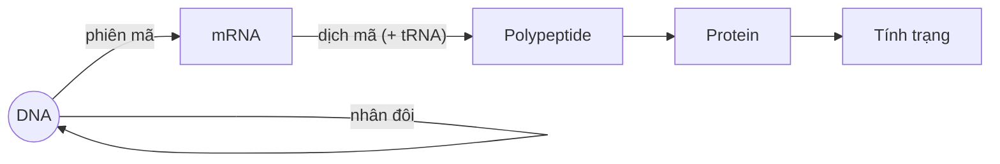

Chép từ sổ viết tay cấp 3 (trang 032 phải, 033, 034 trái, 069). Nội dung có thể chưa chính xác; <code>(?)</code> là chỗ chữ chưa đọc rõ.

Đã sửa so với sổ gốc

- Tên các chất đổi từ phiên âm tiếng Việt sang tiếng Anh (ADN → DNA, mARN → mRNA, ADN-polimeraza → DNA polymerase, ligaza → ligase, polipeptit → polypeptide, axit amin → amino acid, plasmit → plasmid...); nucleotide X → **C** (cytosine), kể cả trong bảng mã di truyền.
- Phiên mã – enzyme: sổ ghi "ARN-polimeraza; tháo xoắn" như 2 enzyme → **RNA polymerase** vừa làm gen tháo xoắn vừa tổng hợp RNA.
- Công thức phiên mã: "T(m) = T₁ = A₂" → **U(m) = T₁ = A₂** (mRNA không có T; mạch 2 là mạch gốc).
- "Nhiều đơn vị tái bản" ghi rõ là ở **nhân thực** (nhân sơ: 1 đơn vị tái bản).
- Hoạt hoá amino acid: "AM(?)" → **AMP**.
- Dịch mã: thông tin di truyền chứa trong **mRNA** (bỏ (?)); phiên mã "dựa (?) trên" → "dựa trên".
- Điền các chỗ "___" (dấu nhắc lại từ dòng trên của sổ): DNA polymerase "**tổng hợp** chuỗi polynucleotide", "**Số phân tử DNA có** nguyên liệu hoàn toàn mới", "Codon: **bộ 3 mã** sao", "Anticodon: **bộ 3** đối mã"; Ligase "h(?)" → "hoàn thiện".

## Sơ đồ tổng quát
> Sơ đồ đầu trang 069 (nhân đôi – mũi tên vòng quanh DNA).

- DNA: **Triplet** (mã gốc); mRNA: **Codon** (mã sao) ↔ **anticodon** (đối mã) (ở tRNA). (→ [Di truyền ngoài nhân](/blog/di-truyen-ngoai-nhan-moi-truong-va-bien-di/))
- Xem thêm: [Nhập môn Bioinformatics](/blog/nhap-mon-bioinformatics/) – mỗi bước DNA → RNA → protein tương ứng một tầng dữ liệu omics (genomics, transcriptomics, proteomics)

## Nhân đôi DNA

### I. Nơi xảy ra và nguyên liệu
- **Nơi xảy ra**:
	- Tế bào nhân sơ: nơi có DNA, plasmid (→ [Ứng dụng di truyền vào chọn giống](/blog/ung-dung-di-truyen-hoc-vao-chon-giong/))
	- Tế bào nhân thực:
		- Trong nhân: chủ yếu
		- Ti thể, lục lạp (nguồn gốc plasmid)
- **Nguyên liệu**:
	- 4 loại nucleotide: A, T, G, C / A, U, G, C.
	- DNA khuôn mẫu.
	- Enzyme:
		- **Helicase**: tháo xoắn → Replication fork (**chạc sao chép**) – 2 chạc.
		- **RNA polymerase**: tổng hợp đoạn mồi → cả 2 mạch → khởi đầu
		- **DNA polymerase**: tổng hợp chuỗi polynucleotide (→ [Taq polymerase trong PCR](/blog/cac-van-de-co-ban-polymerase-chain-reaction/))
		- **Ligase**: Nối các đoạn polynucleotide (**Okazaki**) → hoàn thiện 2 mạch (→ [Thực hành Sinh học phân tử](/blog/bao-cao-tong-ket-thuc-hanh-sinh-hoc-phan-tu-phan-tich-ket-qua/))
	- ATP.

### II. Diễn biến

- DNA polymerase tổng hợp **5' → 3'** của mạch mới (**NTBS** – nguyên tắc bổ sung) (→ [Đột biến gen](/blog/dot-bien-gen/))
- Nhiều đơn vị tái bản (ở nhân thực)
- → **Nguyên tắc bán bảo tồn**
- 1 DNA mẹ → 2 DNA con: (→ [Phát sinh sự sống](/blog/su-phat-sinh-va-phat-trien-cua-su-song/))
	- giống nhau
	- giống mẹ

#### Nhân sơ

- 1 chuỗi polynucleotide hình thành cần 1 đoạn mồi.
	- 1 đơn vị tái bản, k đoạn Okazaki:
		- Đoạn mồi = $k + 2$.

#### Công thức
- Sau k lần nhân đôi: $2^k$ (DNA)
	- $N_{môi\ trường} = 2^k \cdot N - N = (2^k - 1) \cdot N$.
	- $A_{môi\ trường} = (2^k - 1) \cdot A$ → tương tự: T, G, C.
- Số phân tử DNA có cả nguyên liệu cũ và mới = 2.
- Số phân tử DNA có nguyên liệu hoàn toàn mới = $2^k - 2$.
- Mạch DNA:
	- cũ: 2
	- mới: $2^k \cdot 2 - 2$.

### Gen
- **Gen**: 1 đoạn phân tử DNA mang thông tin mã hoá cho 1 phân tử RNA hoặc 1 chuỗi polypeptide.

| Vùng điều hoà | Vùng mã hoá | Vùng kết thúc |
|---|---|---|
| RNA polymerase → khởi động phiên mã | thông tin mã hoá amino acid | → Tín hiệu kết thúc phiên mã |

## Phiên mã
- Tổng hợp RNA dựa trên khuôn mẫu của gen (→ [Điều hoà hoạt động gen](/blog/dieu-hoa-hoat-dong-gen/))
- **Có ở**:
	- Virus có vật chất di truyền: DNA.
	- Tế bào nhân sơ, tế bào nhân thực
		- ↓ trong nhân tế bào (tất cả loại RNA)
		- Ti thể, lục lạp / Kì trung gian: G1, S, G2.
- **Nguyên liệu**:
	- A, U, G, C → RNA
	- Khuôn mẫu: DNA (1 đoạn)
	- Enzyme:
		- RNA polymerase: vừa làm gen tháo xoắn, vừa tổng hợp RNA.
	- ATP.
- **Diễn biến**:

### Công thức
- $L_{gen} = L_{RNA}$ ; $N_{gen} = N_{RNA} \times 2$. (→ [Thành phần hoá học của tế bào](/blog/thanh-phan-hoa-hoc-cua-te-bao/))
- Gen: mạch 1 (m₁), mạch 2 (m₂) – mạch 2 là mạch gốc
	- A(m) = A₁ = T₂
	- U(m) = T₁ = A₂
	- G(m) = G₁ = C₂
	- C(m) = C₁ = G₂
- $A = T = A_1 + A_2 = T_1 + T_2$
- $G = C = G_1 + G_2 = C_1 + C_2$
- $\%A = \%T = \dfrac{\%A_1 + \%A_2}{2}$
- $\%G = \%C = \dfrac{\%G_1 + \%G_2}{2}$

## Dịch mã
- Là quá trình thông tin di truyền chứa trong mRNA được chuyển thành trình tự sắp xếp amino acid ở chuỗi polypeptide của protein. (→ [Tương tác gen](/blog/tuong-tac-gen/))
- **Diễn ra ở**: tế bào chất (lưới nội chất hạt).
- **Nguyên liệu**:
	- 20 loại amino acid
	- mRNA: khuôn mẫu.
	- tRNA: vận chuyển amino acid, đối mã
	- Ribosome: nơi diễn ra
	- Enzyme + ATP.
- **Thời điểm**: kì trung gian
- **Diễn biến**:
	- **Giai đoạn 1: Hoạt hoá amino acid**: aa + tRNA + ATP —enzyme→ aa–tRNA + AMP
	- **Giai đoạn 2: Tổng hợp chuỗi polypeptide**:

- aa mở đầu:
	- Met (nhân thực)
	- f-Met (nhân sơ)
- aa(mở đầu) – aa₁ – aa₂ … aaₙ (Bước 1, 2)
	- ↓ hoàn chỉnh (9)
	- aa₁ – aa₂ … aaₙ (Bước 3, 4)
- (Polysome) – **Polyribosome**: nhiều ribosome cùng trượt → dịch mã (→ [Tế bào chất và bào quan](/blog/te-bao-chat-bao-quan-va-nhan-te-bao/))
	- Tăng hiệu quả tổng hợp protein.
	- Các chuỗi polypeptide được tổng hợp từ 1 mRNA → cấu trúc giống nhau.
- **Triplet**: bộ 3 mã gốc (mã hoá) (DNA)
- **Codon**: bộ 3 mã sao (mRNA)
- **Anticodon**: bộ 3 đối mã (tRNA)

## Mã di truyền
- **Mã di truyền**: trình tự nucleotide trong gen sẽ quy định trình tự các amino acid trong chuỗi polypeptide.
	- Mã di truyền được đọc từ 1 điểm xác định theo từng bộ 3, không gối lên nhau.
	- **Tính phổ biến** (tất cả các loài). (→ [Bằng chứng và cơ chế tiến hoá](/blog/bang-chung-va-co-che-tien-hoa/))
	- **Tính đặc hiệu** (1 bộ ba → 1 amino acid).
	- **Tính thoái hoá** (− AUG, UGG) (nhiều bộ ba → 1 amino acid).

### Bảng mã di truyền
| Chữ 1 \ Chữ 2 | U | C | A | G |
|---|---|---|---|---|
| **U** | UUU, UUC → Phe UUA, UUG → Leu | UCU, UCC, UCA, UCG → Ser | UAU, UAC → Tyr UAA, UAG → KT (kết thúc) | UGU, UGC → Cys UGA → KT (kết thúc) UGG → Trp |
| **C** | CUU, CUC, CUA, CUG → Leu | CCU, CCC, CCA, CCG → Pro | CAU, CAC → His CAA, CAG → Gln | CGU, CGC, CGA, CGG → Arg |
| **A** | AUU, AUC, AUA → Ile AUG → Met (MĐ – mở đầu) | ACU, ACC, ACA, ACG → Thr | AAU, AAC → Asn AAA, AAG → Lys | AGU, AGC → Ser AGA, AGG → Arg |
| **G** | GUU, GUC, GUA, GUG → Val | GCU, GCC, GCA, GCG → Ala | GAU, GAC → Asp GAA, GAG → Glu | GGU, GGC, GGA, GGG → Gly |

- Xem thêm: [Tổng ôn – 3. Nhân đôi DNA, phiên mã, dịch mã, mã di truyền](/blog/tong-on-va-meo-lam-bai/#3-nhân-đôi-dna-phiên-mã-dịch-mã-mã-di-truyền) – mẹo làm bài, ghi chú ôn tập
