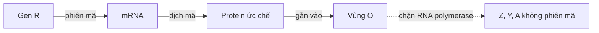
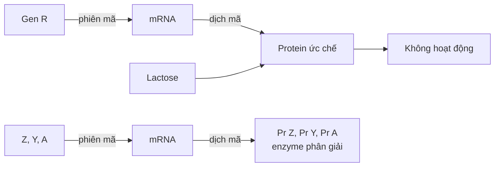

Chép từ sổ viết tay cấp 3 (trang 035). Nội dung có thể chưa chính xác; <code>(?)</code> là chỗ chữ chưa đọc rõ.

Đã sửa so với sổ gốc

- Tên các chất đổi từ phiên âm tiếng Việt sang tiếng Anh (ADN → DNA, ARN → RNA, mARN → mRNA, enzim → enzyme, lac → lactose).
- Enzyme nhận biết, gắn vào vùng khởi động (P) và bị protein ức chế chặn: sổ ghi "ADN-poli" → **RNA polymerase** (sửa cả trong mô tả hình và sơ đồ).
- Khi không có lactose: chỉ **mRNA và protein (enzyme) của Z, Y, A** không được tổng hợp (gen R vẫn phiên mã, dịch mã tạo protein ức chế).
- Tên nhà khoa học: "Mono – Jacob" → **Monod – Jacob**; điền chỗ "___ vận hành" → "**Vùng** vận hành".

## Khái quát
- Mỗi tế bào trên cơ thể đều mang tất cả các gen quy định tất cả tính trạng của cơ thể
- Tại 1 thời điểm xác định:
	- 1 số ít gen hoạt động.
	- Đa phần: ức chế hoặc không hoạt động.
- Sự hoạt động của gen phụ thuộc:
	- Loại tế bào, mô.
	- Giai đoạn phát triển của cơ thể
	- Điều kiện môi trường sống. (→ [Di truyền ngoài nhân](/blog/di-truyen-ngoai-nhan-moi-truong-va-bien-di/))

## Mức độ điều hoà
- Nhiễm sắc thể
- **Phiên mã** (chủ yếu)
- Sau phiên mã
- Dịch mã
- Sau dịch mã
- → **Nhân thực**: tất cả các cấp độ, phức tạp — (các cấp độ) cơ bản giống (nhau) (→ [Histone, methyl hoá DNA, splicing](/blog/cell-commitment-and-differential-gene-expression/))
- → **Nhân sơ**: chủ yếu ở mức phiên mã

## Nhân sơ: Operon-Lac
> Ghi bằng bút chì trong sổ: "\* Operon-Lac".

- **Operon-Lac**: (Monod – Jacob), trên DNA
- **Gen cấu trúc**: Z, Y, A → mang thông tin cấu trúc protein → tính trạng (→ [Đột biến gen](/blog/dot-bien-gen/))
- **Gen điều hoà (R)**: mang thông tin → protein ức chế → điều hoà hoạt động operon
- **Vùng khởi động (P)**: RNA polymerase nhận biết, gắn vào → khởi đầu phiên mã (→ [Nhân đôi, phiên mã, dịch mã](/blog/nhan-doi-dna-phien-ma-va-dich-ma/))
- **Vùng vận hành (O)**: tương tác với protein ức chế.

### Không có lactose

- Z, Y, A không phiên mã
- mRNA của Z, Y, A không được tổng hợp
- Không dịch mã
- Protein (enzyme) Z, Y, A không được tổng hợp
- Không có lactose → ✗ enzyme phân giải

### Có lactose

- Gen R —phiên mã→ mRNA —dịch mã→ Protein ức chế ⊄ hoạt động (không hoạt động) ← có lactose
- Z, Y, A —phiên mã→ mRNA —dịch mã→ Pr Z, Pr Y, Pr A → enzyme phân giải (← có lactose)
- Các gen Z, Y, A có số lần nhân đôi bằng nhau và số lần phiên mã bằng nhau
- Gen điều hoà và gen cấu trúc Z, Y, A có số lần nhân đôi bằng nhau
