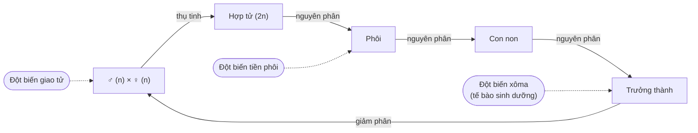

Chép từ sổ viết tay cấp 3 (trang 036, 037 trái). Nội dung có thể chưa chính xác; <code>(?)</code> là chỗ chữ chưa đọc rõ.

Đã sửa so với sổ gốc

- Tên các chất đổi từ phiên âm tiếng Việt sang tiếng Anh (5-Brom Uraxin → 5-bromouracil, purin → purine, pyrimidin → pyrimidine); nucleotide X → **C** (G–X → G–C...).
- Bảng các dạng đột biến: sổ ghi "↓ 2 [A–T ; G–X]" / "↑ 2 [A–T ; G–X]" → số **liên kết hydrogen** giảm/tăng **2** (cặp A–T) hoặc **3** (cặp G–C). Thay 1 cặp: chiều dài **không thay đổi** (bỏ (?)).
- Đột biến gen → tạo **alen mới** (bỏ (?)); "[A = T] (?)" → A = T (bỏ (?)).
- Điền các chỗ "___" (dấu nhắc lại từ dòng trên của sổ): "**Đột biến** lặn", "**Cấp độ** cơ thể: **đa phần** có hại".

## I. Khái niệm
- Gen ═══ biến đổi về:
	- Số lượng
	- Thành phần
	- Trình tự sắp xếp
	- } các nucleotide → biến đổi ↓ **Đột biến gen**
- 1 hoặc nhiều cặp nucleotide
- 1 cặp nucleotide: **Đột biến điểm**
- **Tần số đột biến**: $10^{-6} \to 10^{-4}$, phụ thuộc:
	- Tác nhân: loại, cường độ
	- Đặc điểm cấu trúc của gen.
- Đột biến gen xảy ra → Cấu trúc gen biến đổi → Tạo alen mới (→ [Điều hoà hoạt động gen](/blog/dieu-hoa-hoat-dong-gen/))
- **Các dạng**:

| Dạng | Chiều dài | Ghi chú trong sổ |
|---|---|---|
| Mất 1 cặp | ↓ 3,4 Å | Liên kết hydrogen ↓ 2 (mất A–T) hoặc ↓ 3 (mất G–C) |
| Thay 1 cặp | không thay đổi | [A–T → G–C, A–T → T–A ; G–C → A–T, G–C → C–G] |
| Thêm 1 cặp | ↑ 3,4 Å | Liên kết hydrogen ↑ 2 (thêm A–T) hoặc ↑ 3 (thêm G–C) |

- **Thể đột biến**: cơ thể mang đột biến gen đã biểu hiện ra kiểu hình
- Xem thêm: [Đột biến NST](/blog/dot-bien-nhiem-sac-the/) – so sánh đột biến gen (cấp phân tử) với đột biến cấu trúc, số lượng NST (cấp tế bào)
- Xem thêm: [Di truyền ngoài nhân, biến dị](/blog/di-truyen-ngoai-nhan-moi-truong-va-bien-di/) – vị trí của đột biến gen trong hệ thống phân loại biến dị di truyền

## II. Nguyên nhân – cơ chế phát sinh

### 1. Nguyên nhân
- **Trong**: rối loạn sinh lí, sinh hoá
- **Ngoài**: vật lí, hoá học, sinh học.

### 2. Cơ chế

#### a. Không có tác nhân đột biến
- [A = T] ↔ A* = T —nhân đôi 1→
	- A* – C —nhân đôi 2→ [C – G] (và A*)
	- T – A
- G ≡ C ↔ G* – C —nhân đôi→ G* – T —nhân đôi 2→ [A – T].
- Purine (lớn) } Pyrimidine (nhỏ)
- A*, G*: **dạng hiếm**.
- Tiền đột biến | Đột biến phát sinh

#### b. Có tác nhân đột biến
- **Tác nhân vật lí**: tia tử ngoại (UV)
	- ↓ 2 T cạnh nhau
	- ↓ dính lại
	- 1T.
- **Tác nhân hoá học**: 5-bromouracil <5-BU> ~ T, C.
	- [A – T] —nhân đôi 1 (5-BU)→ A – 5-BU ; A – T
	- A – 5-BU —nhân đôi 2→ G – 5-BU —nhân đôi 3→ [G – C]
- ⟹
	- Đột biến gen phát sinh trong quá trình **nhân đôi**. (→ [Nhân đôi DNA, phiên mã, dịch mã](/blog/nhan-doi-dna-phien-ma-va-dich-ma/))
	- Phát sinh qua ít nhất **2 lần nhân đôi**.
	- Dễ xảy ra nhất: **thay thế 1 cặp** phổ biến nhất

## III. Cơ chế biểu hiện và hậu quả

### 1. ___ (cơ chế biểu hiện)

Tiêu đề mục 1 bị bỏ trống trong sổ (chỉ có "1. ___").

> [Sơ đồ trong sổ:]
> - ♂ (n) × ♀ (n) ←giảm phân— Trưởng thành ← (đột biến giao tử)
> - ↓ Thụ tinh
> - Hợp tử (2n) —nguyên phân→ Phôi —nguyên phân→ Con non
> - ↑ Đột biến tiền phôi (ở giai đoạn hợp tử → phôi)
> - Trưởng thành ←nguyên phân— … ← Đột biến xoma <tế bào sinh dưỡng>

- **Đột biến trội**: a → A
- **Đột biến lặn**: A → a (→ [Di truyền học người](/blog/di-truyen-hoc-nguoi-va-di-truyen-y-hoc/))
- **Đột biến tiền phôi**: AA —đột biến lặn (A → a)→ Aa
	- → Không biểu hiện kiểu hình ngay.
	- 2 alen đột biến tổ hợp lại → Biểu hiện ra kiểu hình
		- → Thể đột biến.
	- aa —(đột biến trội a → A)→ Aa
		- → biểu hiện ra kiểu hình ngay.
	- ⟹ Đột biến tiền phôi di truyền qua **sinh sản hữu tính**.
- **Đột biến giao tử**:
	- Di truyền qua sinh sản hữu tính.
	- Biểu hiện: tương tự đột biến tiền phôi.
- **Đột biến xôma**:
	- → Đột biến trội: biểu hiện 1 phần cơ thể → **thể khảm**.
	- ↓ Đột biến lặn: không biểu hiện → mất đi.
	- Di truyền qua **sinh sản vô tính**.

### 2. Hậu quả
- Có thể có lợi, hại, trung tính.
- Cấp độ phân tử: đa phần đột biến gen là **trung tính**.
- Cấp độ cơ thể: đa phần **có hại** (phá vỡ cân bằng kiểu gen – môi trường (?)).
- **Thay thế**: ít gây hậu quả nghiêm trọng.
	- (ghi chú lề, mũi tên chỉ vào "Thay thế"):
		- (thoái hoá) **đồng nghĩa**
		- (dấu hiệu (?)) **sai nghĩa**
		- (xuất hiện mã kết thúc) **vô nghĩa**
- **Mất, thêm**: **dịch khung** → hậu quả nghiêm trọng.
- Xem thêm: [NGS và genomics](/blog/giai-trinh-tu-the-he-moi-ngs-va-genomics/) – khi chú giải biến thể, sai nghĩa = missense, vô nghĩa = nonsense; phân loại ý nghĩa lâm sàng theo ACMG

- **Ý nghĩa**:
	- Nguồn nguyên liệu sơ cấp, chủ yếu cho tiến hoá, chọn giống. (→ [Tiến hoá](/blog/bang-chung-va-co-che-tien-hoa/), [Chọn giống](/blog/ung-dung-di-truyen-hoc-vao-chon-giong/))
	- Giá trị của đột biến gen:
		- ∈ môi trường sống
		- ∈ tổ hợp gen

Trang 037 phải (Di truyền học người – phương pháp nghiên cứu phả hệ) thuộc note "15 - Di truyền học người và di truyền y học".

- Xem thêm: [Tổng ôn – 5. Đột biến và biến dị](/blog/tong-on-va-meo-lam-bai/#5-đột-biến-và-biến-dị) – mẹo làm bài, ghi chú ôn tập
