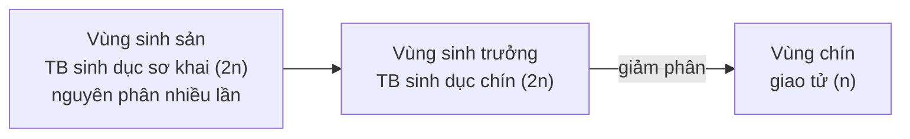

Chép từ sổ viết tay cấp 3 (trang 058 phải, 059, 060, 061 trái, 069 trái, 070). Nội dung có thể chưa chính xác; <code>(?)</code> là chỗ chữ chưa đọc rõ.

Đã sửa so với sổ gốc

- Tên các chất đổi từ phiên âm tiếng Việt sang tiếng Anh (cromatit → chromatid...).
- Bảng biến đổi NST: kì giữa nguyên phân sổ ghi "2n đơn" → sửa thành **2n kép**.
- Bảng số kiểu giao tử: cột thành phần sổ ghi "$2^k$ không TĐC, $2^k$ TĐC..." (tổng không bằng $4^k$, $6^k$, $8^k$) → sửa thành thành phần **mỗi cặp NST** (2 + 2; 2 + 2 + 2; 2 + 2 + 2 + 2).
- Công thức giao tử max $(n+1) \cdot 2^n$: ghi rõ n là số cặp NST (bộ đơn bội n), áp dụng khi mỗi tế bào chỉ TĐC 1 điểm ở 1 cặp (khớp với Bài tập 2).
- Dạng 7: ghi rõ y là số tế bào có cách sắp xếp NST cho giao tử Ab, aB (sổ không định nghĩa y).
- Tỉ lệ hợp tử đột biến: số mũ $\left(\frac{1}{4}\right)^n$ → $\left(\frac{1}{4}\right)^m$ cho khớp với công thức hợp tử đột biến ở x cặp.

## Cơ chế di truyền – biến dị cấp tế bào

### Nhiễm sắc thể

- Tế bào → **cặp NST tương đồng**:
	- 
	- PP: **đồng hợp trội**.
	- aa: **đồng hợp lặn**; Bb: **dị hợp**.

### 1. Nguyên phân

- **Kì trung gian**: lúc đầu nhiễm sắc thể tồn tại ở dạng sợi đơn và duỗi xoắn. Nhiễm sắc thể tự nhân đôi ở pha S → nhiễm sắc thể kép. Trung thể tự nhân đôi → di chuyển về 2 cực tế bào. (→ [Tế bào chất, bào quan](/blog/sinh-hoc/kien-thuc-chung/a-sinh-hoc-te-bao/03-te-bao-chat-bao-quan-va-nhan-te-bao/))
- **Kì đầu**:
	- Nhiễm sắc thể kép đóng xoắn, co ngắn, dày lên. Trung thể di chuyển → 2 cực, nằm đó (?); 1 thoi tơ vô sắc được hình thành giữa 2 trung thể.
	- Màng nhân, nhân con tiêu biến.
- **Kì giữa**: nhiễm sắc thể đóng xoắn cực đại, có hình dạng đặc trưng → 1 hàng trên mặt phẳng xích đạo. Dính với dây tơ vô sắc ở tâm động.
- **Kì sau**: nhiễm sắc thể kép tách nhau ở tâm động → 2 nhiễm sắc thể đơn → phân li đều về 2 cực tế bào.
- **Kì cuối**: nhiễm sắc thể đơn duỗi xoắn → sợi mảnh. Màng nhân, nhân con xuất hiện. Thoi vô sắc biến mất. Phân chia tế bào chất.

### Bảng biến đổi NST trong phân bào
| Phân bào | Kì | Số NST | Số tâm động | Số chromatid |
|---|---|---|---|---|
| Nguyên phân | Đầu | 2n kép | 2n | 4n |
| | Giữa | 2n kép | 2n | 4n |
| | Sau | 4n đơn | 4n | 0 |
| | Cuối | 2n đơn | 2n | 0 |
| Giảm phân I | Đầu | 2n kép | 2n | 4n |
| | Giữa | 2n kép | 2n | 4n |
| | Sau | 2n kép | 2n | 4n |
| | Cuối | n kép | n | 2n |
| Giảm phân II | Đầu | n kép | n | 2n |
| | Giữa | n kép | n | 2n |
| | Sau | 2n đơn | 2n | 0 |
| | Cuối | n đơn | n | 0 |

## Công thức nguyên phân – giảm phân

### 1. Từ a tế bào (2n) nguyên phân k lần
- Số tế bào con được tạo ra: $a \cdot 2^k$ (→ [Phôi sớm ở chim](/blog/sinh-hoc/biology-project-and-lab-report/developmental-biology/01-su-phat-trien-phoi-som-o-chim/))
- Số NST trong tế bào con: $a \cdot 2n \cdot 2^k$
- Số NST môi trường cung cấp: $a \cdot 2n(2^k - 1)$
- Thoi vô sắc hình thành: $a(2^k - 1)$

### 2. Nguyên phân – giảm phân trong tạo giao tử ở động vật

- **Vùng sinh sản**: tế bào sinh dục sơ khai (2n) —nguyên phân nhiều lần→ ↑ số lượng tế bào.
- **Vùng sinh trưởng**: tế bào sinh dục sơ khai (2n) → tế bào sinh dục chín (2n).
- **Vùng chín**: tế bào sinh dục chín (2n) —giảm phân→ (n) giao tử
	- Tế bào sinh tinh —giảm phân→ 4 tinh trùng (n)
	- Tế bào sinh trứng —giảm phân→ 1 trứng + 3 thể cực.
- Xem thêm: [Vòng đời xen kẽ thế hệ ở tảo](/blog/sinh-hoc/biology-project-and-lab-report/botany/02-tao-va-vong-doi-xen-ke-the-he/) – ở thực vật, giảm phân tạo bào tử (n) chứ không tạo trực tiếp giao tử.

#### a) Tính số giao tử được tạo thành
- Vùng sinh sản: a tế bào sinh dục sơ khai (2n) —nguyên phân k lần→ $a \cdot 2^k$ tế bào (2n)
	- → Tế bào sinh dục chín —giảm phân→ $4a \cdot 2^k$ tế bào con (n)
		- Tế bào sinh tinh: $4 \cdot a \cdot 2^k$ tinh trùng (n)
		- Tế bào sinh trứng: $a \cdot 2^k$ trứng; $3 \cdot a \cdot 2^k$ thể cực (n)

#### b) NST môi trường cung cấp
- Vùng sinh sản: a tế bào sinh dục sơ khai (2n) —nguyên phân k lần→ $a \cdot 2^k$ tế bào (2n)
	- → NST môi trường cung cấp: $a \cdot 2n(2^k - 1)$
	- → Tế bào sinh dục chín —giảm phân→ NST môi trường cung cấp: $a \cdot 2n \cdot 2^k$
	- → Σ NST môi trường cung cấp: $a \cdot 2n(2^{k+1} - 1)$

### 3. Số lượng hợp tử, số loại hợp tử
- Số lượng hợp tử tạo thành = số tinh trùng thụ tinh = số trứng thụ tinh.
- Số loại hợp tử = số loại giao tử đực × cái. (→ [Quy luật Mendel](/blog/sinh-hoc/kien-thuc-chung/c-quy-luat-di-truyen/09-quy-luat-mendel/), [Chọn giống](/blog/sinh-hoc/kien-thuc-chung/d-di-truyen-hoc-quan-the-va-nguoi/16-ung-dung-di-truyen-hoc-vao-chon-giong/))

### 4. Số kiểu giao tử tạo thành trong giảm phân
| Trường hợp (k cặp NST) | Số giao tử | Thành phần (mỗi cặp NST) |
|---|---|---|
| Không trao đổi chéo | $2^k$ | – |
| Trao đổi chéo 1 điểm | $4^k$ | 2 không TĐC, 2 TĐC |
| TĐC 2 điểm không cùng lúc | $6^k$ | 2 không TĐC, 2 TĐC tại điểm 1, 2 TĐC tại điểm 2 |
| TĐC 2 điểm cùng lúc | $8^k$ | 2 không TĐC, 2 tại điểm 1, 2 tại điểm 2, 2 tại 2 điểm – **kép** |

- (Công thức tính giao tử max = $(n+1) \cdot 2^n$ khi mỗi tế bào chỉ TĐC 1 điểm ở 1 cặp; n: số cặp NST (bộ đơn bội n).)

## Bài tập giao tử

### Dạng 1: Xác định số lượng giao tử
- 1 tế bào sinh tinh:
	- n cặp gen dị hợp → 2 loại giao tử
	- Giảm phân (có ?) hoán vị gen (?)
- 1 loài:
	- bộ nhiễm sắc thể 2n
	- 1 gen có k alen
	- → Giao tử max = $k^n$

### Dạng 2: Xác định tỉ lệ giao tử có m alen trội trong n cặp gen
- 1 cặp gen dị hợp → 2 loại giao tử; alen trội = 1/2
- Trong tổng số n alen trội, chỉ có m alen trội: $C_n^m$
- m alen trội: $(1/2)^m$
- Có n cặp dị hợp → có n alen → có n − m alen lặn
	- → Tỉ lệ: $(1/2)^{n-m}$
- → Giao tử có m alen trội = $C_n^m \cdot (1/2)^m \cdot (1/2)^{n-m}$ (→ [Probability](/blog/sinh-hoc/bioinformatics/a-statistics-and-biostatistics/i-probability/01-probability/))
	- = $C_n^m \cdot (1/2)^n$

### Dạng 3: Xác định tỉ lệ giao tử
- Có x tế bào sinh tinh $\frac{AB}{ab}$ giảm phân, có y tế bào xảy ra hoán vị gen
	- → Tỉ lệ = (2x − y) : (2x − y) : y : y

### Dạng 4: Xác định số loại kiểu gen tạo ra (hoán vị gen)
- Trên 1 cặp (nhiễm sắc thể) có n gen dị hợp tự thụ:
	- Kiểu gen đồng hợp = $2^n$
	- Giao tử: $2^n$
	- Kiểu gen dị hợp m cặp gen: $C_n^m \cdot 2^{n-1}$

### Dạng 5: Xác định kiểu gen trong trường hợp hoán vị gen + tương tác gen
- P tự thụ →
	- F1: A-B-D- = 9/16 → P: $\frac{AB}{ab}$Dd hoặc $\frac{AD}{ad}$Bb
	- F1: A-B-D- = 3/8 → P: $\frac{Ab}{aB}$Dd hoặc $\frac{Ad}{aD}$Bb
	- (Aa: tính trạng 1; Bb và Dd tương tác: tính trạng 2) (→ [Tương tác gen](/blog/sinh-hoc/kien-thuc-chung/c-quy-luat-di-truyen/10-tuong-tac-gen/))

### Dạng 6: Xác định tần số hoán vị
- x tế bào sinh tinh giảm phân, y tế bào xảy ra hoán vị:
	- (2x − y : 2x − y : y : y) → $f = \frac{2y}{2(2x-y)+2y} = \frac{y}{2x}$
- Có x% tế bào xảy ra hoán vị → f = x/2 %. (→ [Liên kết gen, hoán vị gen](/blog/sinh-hoc/kien-thuc-chung/c-quy-luat-di-truyen/12-lien-ket-gen-va-hoan-vi-gen/))

### Dạng 7: Xác định tỉ lệ giao tử
- Có x tế bào sinh (tinh) có kiểu gen AaBb giảm phân bình thường
	- y tế bào sắp xếp NST theo cách cho giao tử Ab, aB; x − y tế bào theo cách cho giao tử AB, ab
	- → Tỉ lệ AB : ab : Ab : aB = 2(x − y) : 2(x − y) : 2y : 2y

### Dạng 8: Số loại giao tử tối đa khi có trao đổi chéo
- Sinh vật: 2n, giảm phân bình thường, xảy ra trao đổi chéo đơn ở x cặp nhiễm sắc thể
	- → Σ số kiểu tổ hợp nhiễm sắc thể trong giao tử = $4^x \cdot 2^{n-x}$

### Quy tắc

- **1 tế bào sinh tinh $\frac{AB}{ab}$**:
	- Có hoán vị → 4 loại giao tử:
		- AB, ab: **giao tử liên kết**
		- aB, Ab: **giao tử hoán vị**
		- AB : ab : Ab : aB = 1 : 1 : 1 : 1 (25%)
	- Không hoán vị → 2 loại giao tử (liên kết): AB, ab
		- 2 : 2 ← 4 tinh trùng ← 1 : 1 (50%)
- **Số loại kiểu gen đột biến lệch bội**: (→ [Đột biến NST](/blog/sinh-hoc/kien-thuc-chung/b-co-che-di-truyen-va-bien-di/07-dot-bien-nhiem-sac-the/))
	- Thể 1: $3^{n-1} \times 2n$
	- Thể 3: $3^{n-1} \times 4n$
	- Thể không: $3^{n-1} \cdot n$
	- Thể 4: $3^{n-1} \cdot 5n$
- **Đột biến cấu trúc nhiễm sắc thể**:
	- Giao tử không đột biến = $(1/2)^m$ | Giao tử đột biến = $1 - (1/2)^m$
	- Tỉ lệ giao tử bị đột biến ở x nhiễm sắc thể = $C_m^x \cdot (1/2)^m$

## Bài tập (trang 061)

### 1. Xác định tỉ lệ % của kiểu gen có k alen trội
- **Bước 1**: Xác định ở đời con **đã có sẵn** những alen trội nào.
- **Bước 2**: Công thức: $\dfrac{C_m^k}{2^{n_1} \cdot 2^{n_2}}$
	- k: số alen trội còn lại cần tính.
	- m: Σ alen của kiểu gen con − alen có sẵn. (mũi tên nối từ "đã có sẵn" ở bước 1 xuống "alen có sẵn")
	- n₁: số cặp gen dị hợp của mẹ.
	- n₂: số cặp gen dị hợp của bố.
		- → $2^{n_1} \cdot 2^{n_2}$ = tổ hợp giao tử.

### 2. Cơ thể có 2n NST, xảy ra hoán vị gen ở tất cả các cặp nhiễm sắc thể. Mỗi tế bào xảy ra hoán vị gen ở 1 cặp
- → Giao tử max = $2^n$ giao tử liên kết
	- \+ $2^{n-1} \cdot 2$ giao tử hoán vị
		- └ n trường hợp.
- → Giao tử max = $2^n + 2^{n-1} \cdot 2n$

### 3. Tỉ lệ hợp tử đột biến
- Không đột biến: $\left(\frac{1}{4}\right)^m$
- Đột biến: $1 - \left(\frac{1}{4}\right)^m$
- Hợp tử đột biến ở x cặp nhiễm sắc thể: $C_m^x \cdot \left(\frac{3}{4}\right)^x \cdot \left(\frac{1}{4}\right)^{m-x}$

## Ghi chú khác (trang 060)
- ~~Ma trận đề~~ – ~~NB: C81 (thực vật), C82 (hô hấp)~~ (tiêu đề và dòng này bị gạch trong sổ (?))
- 1 mm = 10³ µm = 10⁶ nm = 10⁷ Å

Trang 058 trái (kính hiển vi: thị kính, vật kính, độ phóng đại) thuộc note "26 - Tổng ôn và mẹo làm bài"; trang 061 phải là trang tiêu đề chương "Chuyển hoá vật chất và năng lượng"; trang 069 phải (bảng mã di truyền) nằm ở note "04 - Nhân đôi DNA, phiên mã và dịch mã". (→ [Tổng ôn và mẹo làm bài](/blog/sinh-hoc/kien-thuc-chung/h-tong-on/26-tong-on-va-meo-lam-bai/))

