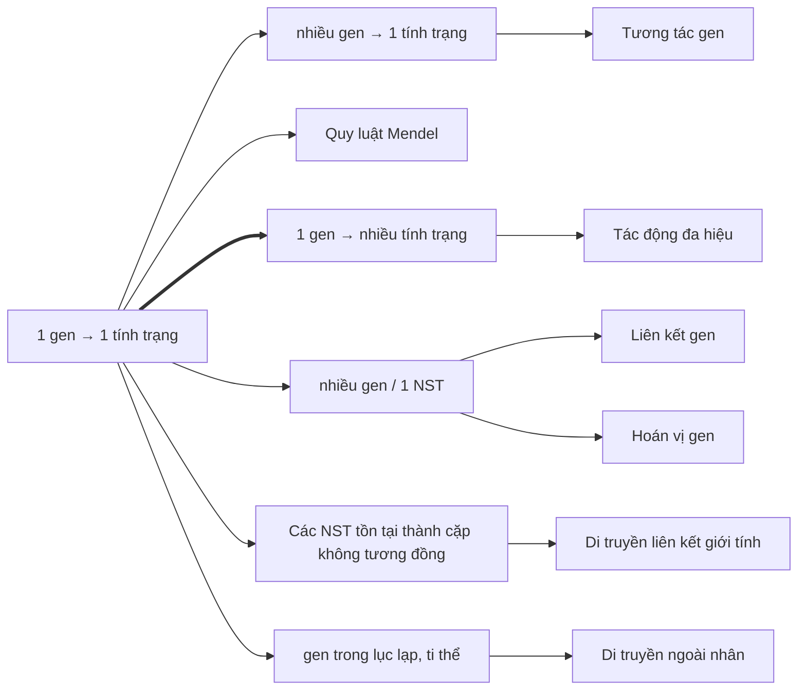

Chép từ sổ viết tay cấp 3 (trang 014–017). Nội dung có thể chưa chính xác; <code>(?)</code> là chỗ chữ chưa đọc rõ.

Đã sửa so với sổ gốc

- Tên riêng/thuật ngữ phiên âm đổi sang tiếng Anh (Menđen → Mendel).
- Sơ đồ tự thụ F2 → F3: sổ ghi "đỏ F3 (AA)", "đỏ F3 (Aa)", "trắng F3 (aa)" → sửa thành cây đỏ/trắng **F2** (cây đem tự thụ phấn là F2, đời con là F3).

Thiếu phần mở đầu

Ảnh chụp trang đứng trước trang 014 (IMG_3355) bị thiếu, nên phần mở đầu chương Quy luật Mendel **không có** trong note: tiêu đề chương, các mục 1–2 của Quy luật phân li và phần đầu thí nghiệm lai một cặp tính trạng (P hoa đỏ × hoa trắng). Trang 014 bắt đầu giữa phần giải thích kết quả thí nghiệm.

## Quy luật phân li

### (Giải thích kết quả thí nghiệm lai một cặp tính trạng)
- P thuần chủng tương phản mà F1 chỉ tạo ra hoa đỏ
	- → **Hoa đỏ trội** so với hoa trắng.
- F2: 3 : 1 = 4 tổ hợp = 2 × 2 (2 loại giao tử của F1 × 2 loại giao tử của F1) (→ [Mô phỏng lai đậu Hà Lan – Virtual Lab](/projects/virtual-lab/danh-muc-thi-nghiem-ao/), [Protocol Mendel – Virtual Lab](/projects/virtual-lab/bo-khung-phong-thi-nghiem-3d/), [Khu trồng trọt, khí hậu và bao hoa – Virtual Lab](/projects/virtual-lab/cac-khu-cua-phong-thi-nghiem/))
	- → F1 phải tạo ra 2 loại giao tử.

### 3. Giả thuyết về quy luật phân li
- Theo Mendel:
	- Tính trạng do cặp **nhân tố di truyền** quy định.
	- Trong tế bào, các nhân tố di truyền tồn tại thành từng cặp riêng rẽ, không hoà trộn vào nhau.
	- Khi hình thành giao tử, 2 nhân tố di truyền phân li đồng đều về các giao tử
		- → Tạo ra:
			- 50% giao tử mang nhân tố di truyền này
			- 50% giao tử mang nhân tố di truyền kia.

### 4. Cơ sở tế bào học của quy luật phân li
- Tính trạng do **gen** quy định.
- Gen phân bố theo chiều dọc trên NST.
- Các NST tồn tại thành cặp tương đồng
	- → các gen tồn tại thành cặp tương đồng.

(khung đỏ trong sổ)

→ Các gen nằm trên NST khác nhau → sự phân li và tổ hợp của NST → sự phân li và tổ hợp của gen trên NST.

### Nội dung quy luật Mendel
- Tính trạng do **cặp alen** quy định:
	- 1 có nguồn gốc từ bố
	- 1 có nguồn gốc từ mẹ
	- → cùng tồn tại trong tế bào, riêng rẽ, không hoà trộn vào nhau.
- Khi giảm phân: các alen phân li đồng đều về các giao tử
	- → Tạo ra:
		- 50% giao tử mang alen này
		- 50% giao tử mang alen kia.

### Sơ đồ lai
- Quy ước: A: hoa đỏ; a: hoa trắng.

| | | |
|---|---|---|
| Pt/c: | ♀ (♂) AA (đỏ) | × ♂ (♀) aa (trắng) |
| GP: | A | a |
| F1: | 100% Aa (đỏ) | |
| F1 × F1: | Aa (đỏ) | × Aa (đỏ) |
| GF1: | 1/2 A, 1/2 a | 1/2 A ; 1/2 a |

- F2: 1/4 AA (đỏ) : 2/4 Aa (đỏ) : 1/4 aa (trắng)
	- = **3 đỏ : 1 trắng**. (→ [Kiểm định giả thiết thống kê](/blog/kiem-dinh-gia-thiet-thong-ke-trong-nghien-cuu-sinh-hoc/))
- Tự thụ (F2 → F3):
	- F3: 1/3 đỏ F2 (AA) → 100% AA (đỏ) (→ [Di truyền học người](/blog/di-truyen-hoc-nguoi-va-di-truyen-y-hoc/))
	- 2/3 đỏ F2 (Aa) → 3 A– : 1 aa (3 đỏ : 1 trắng)
	- Trắng F2 (aa) → 100% aa (trắng)

### 5. Điều kiện nghiệm đúng
- **Lai phân tích (Fa)**: là phép lai giữa cơ thể có kiểu hình trội, chưa biết kiểu gen với cơ thể có kiểu hình lặn để kiểm tra kiểu gen:
	- P thuần chủng: F1 đồng nhất (P: kiểu gen đồng hợp).
	- P: F1 phân tính (P: kiểu gen dị hợp).
- **Hiện tượng trội không hoàn toàn**:
	- Pt/c: Đỏ (AA) × trắng (aa) → 100% hồng (Aa) → F2: 1 đỏ (AA) : 2 hồng (Aa) : 1 trắng (aa)
		- hồng = **tính trạng trung gian**.
- → **Điều kiện nghiệm đúng quy luật phân li**:
	- P thuần chủng.
	- Trội hoàn toàn.
	- Các giao tử có sức sống như nhau.
	- Sức sống ngang nhau giữa các kiểu gen.
	- Số lượng nghiên cứu lớn.

### 6. Ý nghĩa quy luật phân li
- Pt/c: trội × lặn → 100% trội
	- → giải thích có những tính trạng có ở P nhưng không có ở F.
- F1 × F1: Trội × Trội → F2: trội : lặn
	- → giải thích có những tính trạng không có ở P nhưng lại có ở F.
- **Bổ sung:** **Locus**: vị trí của gen trên NST.

### Một số công thức, bài toán
- **n alen**: số kiểu gen = $\dfrac{n(n+1)}{2} = n + C^2_n$ (→ [Di truyền liên kết giới tính](/blog/di-truyen-lien-ket-voi-gioi-tinh/))
	- Đồng hợp: $n$
	- Dị hợp: $\dfrac{n(n-1)}{2}$ ($C^2_n$).
- **Lai ngẫu nhiên**: Tổ hợp giao tử. (→ [Di truyền học quần thể](/blog/di-truyen-hoc-quan-the/))
	- Ví dụ: P: Hoa đỏ × hoa đỏ (F2).

| | Hoa đỏ (F2) | × Hoa đỏ (F2) |
|---|---|---|
| | 1AA → 1A | 1AA → 1A |
| | 2Aa → 1A : 1a | 2Aa → 1A : 1a |
| GP: | 2A : 1a | 2A : 1a |
| F: | 4AA : 4Aa : 1aa | |

- **Thể đa bội**: (→ [Đột biến NST](/blog/dot-bien-nhiem-sac-the/))
	- Dùng sơ đồ hình chữ nhật có 2 đường chéo (tứ bội) hoặc tam giác Δ (tam bội) để liệt kê giao tử.
	- Tổ hợp. Ví dụ: 6n → 3n
		- AAAAaa → 4 AAA : 12 AAa : 4 Aaa
		- ($C^3_4$ ; $C^2_4 \cdot C^1_2$ ; $C^1_4 \cdot C^2_2$)

## Quy luật phân li độc lập

### 7. Quy luật phân li độc lập

#### a. Thí nghiệm: Phép lai 2 cặp tính trạng (lai thuận nghịch)

| | | | |
|---|---|---|---|
| Pt/c: | ♂ (♀) Hạt vàng, trơn | × | ♀ (♂) Hạt xanh, nhăn |
| F1: | 100% Hạt vàng, trơn | | |
| F1 × F1: | Vàng, trơn | × | Vàng, trơn |

- F2:
	- 9 vàng, trơn
	- 3 vàng, nhăn
	- 3 xanh, trơn
	- 1 xanh, nhăn

#### Phân tích thí nghiệm
- Xét sự di truyền riêng rẽ:
	- Cặp tính trạng màu sắc:
		- Pt/c: Vàng × xanh
		- F1: 100% vàng.
		- → tính trạng màu sắc di truyền theo quy luật phân li → vàng > xanh.
	- Cặp tính trạng hình dạng: tương tự ↑.
		- → tính trạng hình dạng di truyền theo quy luật phân li → trơn > nhăn.
- Xét sự di truyền đồng thời 2 cặp tính trạng:
	- Tính trạng màu sắc F2: (3 vàng : 1 xanh) × tính trạng hình dạng F2: (3 trơn : 1 nhăn)
	- F2: 9 V,T : 3 V,N : 3 X,T : 1 X,N
	- → **Tỉ lệ phân li chung = tích tỉ lệ phân li riêng** (→ [Probability](/blog/probability-biology/))
- → **Kết luận:** Sự di truyền của các cặp tính trạng không phụ thuộc vào nhau.

### 8. Cơ sở tế bào học của quy luật phân li độc lập
- Các gen quy định tính trạng nằm trên NST khác nhau. (→ [Liên kết gen, hoán vị gen](/blog/lien-ket-gen-va-hoan-vi-gen/))
- Khi giảm phân, sự phân li độc lập của các NST (→ [Nguyên phân, giảm phân](/blog/nguyen-phan-giam-phan-va-bai-tap-giao-tu/))
	- → sự phân li độc lập của các gen trên đó
	- → tạo ra 4 loại giao tử với tỉ lệ ngang nhau.
- Khi thụ tinh: các giao tử kết hợp lại với nhau
	- → Các tổ hợp gen.

#### Sơ đồ lai
- Quy ước: A: hạt vàng; a: hạt xanh | B: hạt trơn; b: hạt nhăn.

| | | | |
|---|---|---|---|
| Pt/c: | ♂ (♀) AABB (V,T) | × | ♀ (♂) aabb (X,N) |
| GP: | AB | | ab |
| F1: | 100% AaBb (V,T) | | |
| F1 × F1: | AaBb (V,T) | × | AaBb (V,T) |
| GF1: | 1AB, 1Ab, 1aB, 1ab | | 1AB, 1Ab, 1aB, 1ab |

| ♀ \ ♂ | AB | Ab | aB | ab |
|---|---|---|---|---|
| **AB** | AABB | AABb | AaBB | AaBb |
| **Ab** | AABb | AAbb | AaBb | Aabb |
| **aB** | AaBB | AaBb | aaBB | aaBb |
| **ab** | AaBb | Aabb | aaBb | aabb |

> (Trong sổ, các ô AaBb trên đường chéo phụ được tô chữ đỏ. Chữ B/b viết tay khó phân biệt; bảng ghi theo đúng tổ hợp giao tử hàng × cột.)

- = (1AA : 2Aa : 1aa)(1BB : 2Bb : 1bb)
- = (3A– : 1aa) × (3B– : 1bb)
- = 9 A–B– (V,T) : 3 A–bb (V,N) : 3 aaB– (X,T) : 1 aabb (X,N) (→ [Tương tác gen](/blog/tuong-tac-gen/))
- Tỉ lệ phân li chung = tích tỉ lệ phân li riêng
	- ⟺ các gen phân li độc lập với nhau.

### 9. Ý nghĩa của quy luật phân li độc lập
- **Một số công thức** (kiểu gen dị hợp) → n cặp dị hợp:
	- Số loại giao tử: $2^n$
	- Số tổ hợp: $4^n$
	- Số kiểu gen: $3^n$
	- Tỉ lệ phân li kiểu gen: $(1 : 2 : 1)^n$
	- Số kiểu hình: $2^n$
	- Tỉ lệ phân li kiểu hình: $(3 : 1)^n$
- → **Ý nghĩa**:
	- Ta có thể xác định được tỉ lệ phân li kiểu gen, kiểu hình ở đời con khi biết quy luật di truyền chi phối.
	- Tạo ra nguồn **biến dị tổ hợp**.

### Các phép lai (1 cặp gen)
1. AA × AA → 100% AA (100% trội)
2. aa × aa → 100% aa (100% lặn)
3. AA × Aa → 1/2 AA : 1/2 Aa (100% trội)
4. aa × Aa → 1/2 Aa : 1/2 aa (1 trội : 1 lặn)
5. Aa × Aa → 1/4 AA : 2/4 Aa : 1/4 aa (3 trội : 1 lặn)
6. AA × aa → 100% Aa (100% trội)

### Số kiểu gen có thể có của cơ thể
- $A = C_n^{\,n-k} \cdot 2^{\,n-k} = C_n^{\,m} \cdot 2^{\,m}$
	- $A$: số kiểu gen có thể có của cơ thể
	- $n$: số cặp gen
	- $k$: số cặp gen dị hợp
	- $m$: số cặp gen đồng hợp.

### Lai phân tích
- **Lai phân tích**: Phép lai giữa cá thể có kiểu hình trội (A–) với 1 cá thể có kiểu hình lặn (aa).
	- Mục đích: Kiểm tra kiểu gen của kiểu hình trội là thuần chủng hay không thuần chủng.
	- Ứng dụng: chọn giống và nghiên cứu khoa học để kiểm tra độ thuần chủng của giống.

## Sơ đồ tổng hợp các quy luật di truyền
- → **1 gen quy định 1 tính trạng.** (chữ đỏ)

> (Sơ đồ khung đỏ trong sổ: [nhiều gen → 1 tính trạng] ← [1 gen → 1 tính trạng] ⇒ [1 gen → nhiều tính trạng]; mỗi khung có mũi tên xuống tên quy luật tương ứng.)

- Xem thêm: [Tổng ôn – 1. Kiểu gen – kiểu hình (bảng số kiểu gen, kiểu hình F1)](/blog/tong-on-va-meo-lam-bai/#1-kiểu-gen--kiểu-hình-bảng-số-kiểu-gen-kiểu-hình-f1) – mẹo làm bài, ghi chú ôn tập
