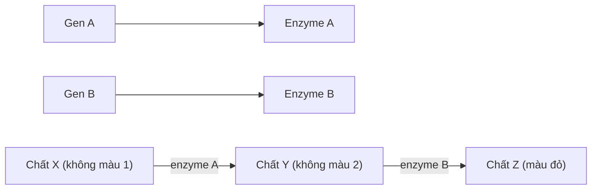

Chép từ sổ viết tay cấp 3 (trang 018–019). Nội dung có thể chưa chính xác; <code>(?)</code> là chỗ chữ chưa đọc rõ.

Đã sửa so với sổ gốc

- Tên các chất/thuật ngữ đổi từ phiên âm tiếng Việt sang tiếng Anh (enzim → enzyme, Menđen → Mendel).
- Tương tác cộng gộp: sổ ghi "Số tổ hợp có m alen trội = $\dfrac{C_n^m}{2^n}$" → đây là **tỉ lệ** (số tổ hợp là $C_n^m$); ghi rõ n là tổng số alen của các cặp gen dị hợp.

> Trong sổ: **II. Tương tác gen** (sau phần Quy luật Mendel). Các dạng bài kết hợp tương tác gen với liên kết gen / hoán vị gen nằm ở [12 - Liên kết gen và hoán vị gen](/blog/sinh-hoc/kien-thuc-chung/c-quy-luat-di-truyen/12-lien-ket-gen-va-hoan-vi-gen/). (→ [Nguyên phân, giảm phân](/blog/sinh-hoc/kien-thuc-chung/b-co-che-di-truyen-va-bien-di/08-nguyen-phan-giam-phan-va-bai-tap-giao-tu/))

## 1. Tương tác bổ trợ

### a. Thí nghiệm

| | | | |
|---|---|---|---|
| Pt/c: | Hoa đỏ (AABB) | × | Hoa trắng (aabb) |
| F1: | 100% Hoa đỏ (AaBb) | | |
| F1 × F1: | (AaBb) Hoa đỏ | × | Hoa đỏ (AaBb) |
| F2: | 9 Hoa đỏ : 7 hoa trắng | | |

- **Nhận xét:**
	- F2: 9 hoa đỏ = 9 A–B– / 7 hoa trắng = 3 A–bb : 3 aaB– : 1 aabb
	- Đây là phép lai 1 cặp tính trạng.
	- Pt/c tương phản → F1: dị hợp các cặp gen
	- F2: 9 : 7 = 16 tổ hợp = 4 (F1) × 4 (F1)
		- → F1 phải tạo ra 4 loại giao tử.
		- → F1 dị hợp 2 cặp gen
	- ⇒ 2 cặp gen → 1 tính trạng → Có hiện tượng **tương tác gen**.
	- Giả sử: Kiểu gen F1: AaBb.
	- **Kết luận:**
		- A–B–: đỏ
		- A–bb + aaB– + aabb: trắng.

### b. Cơ sở tế bào học của tương tác bổ trợ

- A–B–: màu đỏ.
- A–bb, aaB–, aabb: màu trắng.
- **Tương tác bổ trợ** là kiểu tương tác mà các gen không alen cùng tương tác để hình thành kiểu hình mới so với khi chúng đứng độc lập.
- **Bản chất**: sự tương tác giữa các sản phẩm do gen tạo ra. (→ [Nhân đôi DNA, phiên mã, dịch mã](/blog/sinh-hoc/kien-thuc-chung/b-co-che-di-truyen-va-bien-di/04-nhan-doi-dna-phien-ma-va-dich-ma/), [Tính đặc hiệu của enzyme](/blog/sinh-hoc/biology-project-and-lab-report/biochemistry-and-molecular-biology/10-do-ben-va-tinh-dac-hieu-cua-enzyme/))

### c. Các kiểu tương tác bổ trợ
- P: AaBb × AaBb.
- F1: 9 A–B– : 3 A–bb : 3 aaB– : 1 aabb (→ [Quy luật Mendel](/blog/sinh-hoc/kien-thuc-chung/c-quy-luat-di-truyen/09-quy-luat-mendel/))

| 9 A–B– | 3 A–bb | 3 aaB– | 1 aabb |
|---|---|---|---|
| 9 | 7 (gộp 3 + 3 + 1) | | |
| 9 | 6 (gộp 3 + 3) | | 1 |
| 9 | 3 | 3 | 1 |

## 2. Tương tác cộng gộp

### a. Khái niệm
- Là kiểu tương tác gen mà 2 hay nhiều **alen trội** thuộc các locus gen khác nhau cùng tương tác để hình thành tính trạng.
- Trong đó, mỗi alen trội có vai trò như nhau trong biểu hiện tính trạng.
- Tỉ lệ tổ hợp (có) m alen trội: $\dfrac{C_n^m}{2^n}$ (n: tổng số alen của các cặp gen dị hợp, vd AaBb × AaBb → n = 4; số tổ hợp = $C_n^m$). (→ [Probability](/blog/sinh-hoc/bioinformatics/a-statistics-and-biostatistics/i-probability/01-probability/))

### b. Các kiểu tương tác cộng gộp
- Tính trạng di truyền theo tương tác cộng gộp
- Cứ mỗi alen trội thì cường độ biểu hiện của tính trạng tăng thêm 1 ít.

| P: AaBb × AaBb | | P: AaBbDd × AaBbDd | |
|---|---|---|---|
| F1: 4 alen trội | = 1 | F1: 6 alen trội | = 1 |
| 3 alen trội | = 4 | 5 alen trội | = 6 |
| 2 alen trội | = 6 | 4 alen trội | = $C^4_6$ = 15 |
| 1 alen trội | = 4 | 3 alen trội | = $C^3_6$ = 20 |
| 0 alen trội | = 1 | 2 alen trội | = $C^2_6$ = 15 |
| → 5 kiểu hình | | 1 alen trội | = 6 |
| | | 0 alen trội | = 1 |

### Kết luận
- Khi tính trạng di truyền theo tương tác cộng gộp:
	- Tính trạng do càng nhiều gen chi phối
		- → Số kiểu hình tạo ra càng nhiều
		- → Sự sai khác giữa các kiểu hình càng ít.
	- **Tính trạng số lượng** thường do nhiều gen quy định, phụ thuộc nhiều vào điều kiện môi trường sống. (→ [Di truyền ngoài nhân, biến dị](/blog/sinh-hoc/kien-thuc-chung/c-quy-luat-di-truyen/13-di-truyen-ngoai-nhan-moi-truong-va-bien-di/))
- Tương tác cộng gộp mở ra khả năng tìm kiếm những trạng thái tính trạng mới → Có ý nghĩa cho chọn giống. (→ [Chọn giống](/blog/sinh-hoc/kien-thuc-chung/d-di-truyen-hoc-quan-the-va-nguoi/16-ung-dung-di-truyen-hoc-vao-chon-giong/))

## Bảng tổng hợp tỉ lệ tương tác gen

| Kiểu | AaBb × AaBb | AaBb × aabb | Quy ước |
|---|---|---|---|
| Bổ trợ | 9 : 3 : 3 : 1 | 1 : 1 : 1 : 1 | A–B– ≠ A–bb ≠ aaB– ≠ aabb |
| Bổ trợ | 9 : 6 : 1 | 1 : 2 : 1 | A–B– ≠ A–bb = aaB– ≠ aabb |
| Bổ trợ | 9 : 3 : 4 | 1 : 1 : 2 | A–B– ≠ A–bb ≠ aaB– = aabb (hoặc A–B– ≠ aaB– ≠ A–bb = aabb) |
| Bổ trợ | 9 : 7 | 1 : 3 | A–B– ≠ A–bb = aaB– = aabb |
| Cộng gộp | 15 : 1 | 3 : 1 | A–B– = A–bb = aaB– ≠ aabb |
| Cộng gộp | 1 : 4 : 6 : 4 : 1 | 1 : 2 : 1 | AABB ≠ AaBB = AABb ≠ aaBB = AAbb = AaBb ≠ aaBb = Aabb ≠ aabb |

