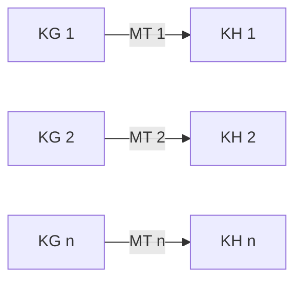

Chép từ sổ viết tay cấp 3 (trang 028 mục IV – trang 030). Nội dung có thể chưa chính xác; <code>(?)</code> là chỗ chữ chưa đọc rõ.

Đã sửa so với sổ gốc

- Tên các chất đổi từ phiên âm tiếng Việt sang tiếng Anh (ADN → DNA, ARN → RNA, histon → histone, enzim → enzyme, phenylalanin → phenylalanine, tyrozin → tyrosine, axit amin → amino acid).
- Bệnh phenylketonuria: chú thích "(amino acid không thay thế)" sổ đặt sau tyrosine → chuyển sang **phenylalanine** (phenylalanine mới là amino acid không thay thế, phải lấy từ thức ăn).

## IV. Di truyền ngoài nhân

### Lai thuận nghịch

| | Phép lai 1 | Phép lai 2 |
|---|---|---|
| P | ♀ Lá xanh × ♂ Lá đốm | ♀ Lá đốm × ♂ Lá xanh |
| F1 | 100% Lá xanh | 100% Lá đốm |
| F1 × F1 | ♀ Lá xanh × ♂ Lá xanh | ♀ Lá đốm × ♂ Lá đốm |
| F2 | 100% Lá xanh | 100% Lá đốm |

- **Phân tích thí nghiệm:**
	- Lai thuận nghịch → kết quả khác nhau (→ [Di truyền liên kết giới tính](/blog/di-truyen-lien-ket-voi-gioi-tinh/))
	- Con lai luôn giống mẹ.
	- Tính trạng biểu hiện đều ở cả 2 giới
	- → **Di truyền theo dòng mẹ**.

### Cơ sở khoa học

- → Gen tế bào chất có nguồn gốc từ mẹ.

### Đặc điểm của di truyền ngoài nhân (trang 030)
- **Gen ngoài nhân**:
	- Gen ở ty thể, lục lạp: DNA kép vòng tròn, không liên kết protein histone (→ [Bào quan](/blog/te-bao-chat-bao-quan-va-nhan-te-bao/), [Thuyết nội cộng sinh](/blog/scientific-english-in-biology-homework/))
	- Nhân đôi độc lập với gen ở nhân.
- Kết quả lai thuận, nghịch khác nhau nhưng con sinh ra luôn giống mẹ.
	- 2n: ♀, ♂ đóng góp ½ bộ nhiễm sắc thể cho con.
	- Tế bào chất trứng >> tế bào chất tinh trùng
- Gen ở tế bào chất nhân đôi độc lập gen trong nhân
	- → Thay thế nhân tế bào này = nhân tế bào khác thì đặc điểm di truyền gen ở tế bào chất vẫn giữ nguyên

## V. Ảnh hưởng của môi trường đến sự biểu hiện của gen
- Mối quan hệ gen và tính trạng:
	- Gen —phiên mã→ RNA —dịch mã→ Protein → Tính trạng. (→ [Phiên mã và dịch mã](/blog/nhan-doi-dna-phien-ma-va-dich-ma/))
- Ví dụ:
	- **Thỏ Himalaya**: lông trắng, vùng đầu mút cơ thể có màu đen (vùng đầu mút: t° < thân).
	- **Hoa cẩm tú cầu**: thay đổi màu sắc phụ thuộc pH đất
	- **Người**: bệnh **phenylketonuria** (phenylketo niệu) do đột biến gen lặn (→ [Di truyền y học](/blog/di-truyen-hoc-nguoi-va-di-truyen-y-hoc/))
		- Gen —đột biến→ ✗ enzyme
		- Phenylalanine (amino acid không thay thế) —✗→ tyrosine
- → Giải thích:
	- Thỏ: t° vùng đầu mút < t° vùng thân (→ [Nhiệt độ, pH và amylase](/blog/xac-dinh-mot-so-tinh-chat-cua-enzyme/))
		- ↓ gen tổng hợp sắc tố Melanin hoạt động
		- ↓ Sắc tố Melanin → Đen
- → **Kết luận:** Sự biểu hiện của kiểu gen phụ thuộc môi trường sống. (→ [Điều hoà hoạt động gen](/blog/dieu-hoa-hoat-dong-gen/))

## VI. Mức phản ứng

> (Trong sổ có thêm dấu "…" giữa KG 2 và KG n, và mũi tên hai chiều bên cạnh bao toàn bộ dãy.)

- → **Mức phản ứng**: Tập hợp tất cả các kiểu hình của cùng 1 kiểu gen trước các điều kiện môi trường sống khác nhau
- Mức phản ứng do kiểu gen quy định
- Môi trường quy định 1 kiểu hình cụ thể trong giới hạn (lim) mức phản ứng
- Tính trạng khác nhau có mức phản ứng khác nhau
	- **Tính trạng số lượng** thường có mức phản ứng rộng, do nhiều gen quy định và phụ thuộc nhiều vào điều kiện môi trường sống. (→ [Tương tác gen](/blog/tuong-tac-gen/))
	- **Tính trạng chất lượng** thường có mức phản ứng hẹp, do ít gen quy định, ít ảnh hưởng bởi điều kiện môi trường sống

### Sự mềm dẻo của kiểu hình (Thường biến)
- Là sự biến đổi kiểu hình của cùng 1 kiểu gen trước các điều kiện môi trường khác nhau
- Thường biến: Không di truyền.
- Biến đổi đồng loạt, theo 1 hướng xác định.
- Không là nguyên liệu cho tiến hoá, chọn giống.
- Ý nghĩa: giúp sinh vật thích nghi với môi trường

## Tổng kết: Quy luật di truyền
> (Sơ đồ tổng kết chia 2 cột, trang 030)

- **Gen trong nhân**: DNA kép, thẳng, liên kết protein histone → nhiễm sắc thể.
	- Nhiễm sắc thể thường:
		- Quy luật phân li
		- Quy luật phân li độc lập
		- Tương tác gen
		- Liên kết gen
		- Hoán vị gen.
	- Nhiễm sắc thể giới tính:
		- X:
			- Di truyền chéo
			- Gián đoạn
			- Tính trạng lặn thường gặp ở XY.
		- Y:
			- Di truyền thẳng
- **Gen ngoài nhân**: gen ở ty thể, lục lạp (đặc điểm: xem mục IV ở trên).
- **Note:** Ruồi giấm: hoán vị chỉ xảy ra ở giới cái XX, ___ đực không hoán vị (xem [12 - Liên kết gen và hoán vị gen](/blog/lien-ket-gen-va-hoan-vi-gen/)).

## Biến dị
(đặc điểm sai khác con so với ♀♂)

> [Ghi chú người chép: sổ dùng ký hiệu "↗" cho "biến đổi" (VD: "không làm ↗ VCDT", "↗ đồng loạt").]

### Biến dị không di truyền
(không làm biến đổi vật chất di truyền)

- **Thường biến**:
	- KG —MT 1→ KH 1 ; —MT 2→ KH 2 ; —MT 3→ KH 3 } **Mức phản ứng** (của kiểu gen)
	- → Biến đổi kiểu hình của 1 kiểu gen.
- Đặc điểm thường biến:
	- Biến đổi đồng loạt
	- Không di truyền.
	- → Sinh vật thích nghi môi trường
- Mức phản ứng:
	- Rộng: số lượng
	- Hẹp: chất lượng

### Biến dị di truyền
(biến đổi vật chất di truyền)

- **Biến dị tổ hợp** (sắp xếp lại đặc điểm ♀♂):
	- Phương pháp: lai hữu tính
	- Phép lai: phân li độc lập, hoán vị gen
- **Đột biến**:
	- Đột biến gen: (→ [Đột biến gen](/blog/dot-bien-gen/))
		- Mất 1 cặp
		- Thêm ___
		- Thay ___
	- Đột biến nhiễm sắc thể: (→ [Đột biến NST](/blog/dot-bien-nhiem-sac-the/))
		- Cấu trúc
		- Số lượng
- Đột biến riêng lẻ
- Di truyền → Nguyên liệu chọn giống, tiến hoá. (→ [Chọn giống](/blog/ung-dung-di-truyen-hoc-vao-chon-giong/), [Cơ chế tiến hoá](/blog/bang-chung-va-co-che-tien-hoa/), [Chim sẻ Darwin](/blog/chon-loc-tu-nhien-va-tien-hoa-loai-chim-se-darwin/))
