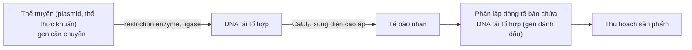

Chép từ sổ viết tay cấp 3 (trang 040 – trang phải, 041–043). Nội dung có thể chưa chính xác; <code>(?)</code> là chỗ chữ chưa đọc rõ.

Đã sửa so với sổ gốc

- Tên các chất đổi từ phiên âm tiếng Việt sang tiếng Anh (ADN → DNA, plasmit → plasmid, virut → virus, restrictaza → restriction enzyme, ligaza → ligase, enzim → enzyme, consixin → colchicine, hoocmon → hormone).
- Nuôi cấy tế bào (mô) thực vật: "tách các tế bào từ cơ thể động vật – thực vật" → tách tế bào từ cơ thể **thực vật** (mô sẹo tái sinh thành cây hoàn chỉnh nhờ tính toàn năng của tế bào thực vật).

# Ứng dụng di truyền

## I. Giống và các phương pháp tạo giống mới
- **Giống**:
	- Tập hợp cá thể sinh vật do con người tạo ra.
	- Phản ứng như nhau trước 1 điều kiện môi trường, có nhiều đặc điểm di truyền đặc trưng. (→ [Di truyền ngoài nhân, biến dị](/blog/di-truyen-ngoai-nhan-moi-truong-va-bien-di/))
	- Chất lượng tốt, năng suất cao và ổn định. (→ [Tương tác gen](/blog/tuong-tac-gen/))
	- Thích hợp với điều kiện khí hậu, đất đai, kĩ thuật sản xuất nhất định.
- **Quy trình**:
	- Tạo nguồn nguyên liệu: biến dị di truyền (biến dị tổ hợp, đột biến, DNA tái tổ hợp).
	- Đánh giá kiểu hình → chọn kiểu gen mong muốn.
	- Tạo và duy trì dòng thuần có tổ hợp gen mong muốn.
	- Đưa giống tốt ra sản xuất đại trà.
- **Phương pháp tạo nguồn nguyên liệu**:
	- Lai hữu tính: tạo ra vô số biến dị tổ hợp.
	- Gây đột biến: tạo ra các đột biến di truyền. (→ [Đột biến gen](/blog/dot-bien-gen/))
	- Công nghệ gen: tạo ra DNA tái tổ hợp.
- **Nguồn nguyên liệu**:
	- **Nguồn gen tự nhiên**:
		- Nguồn gốc: động thực vật hoang dã.
		- Nhóm sinh vật được hình thành ở 1 địa phương bất kì có khả năng thích nghi cao với điều kiện môi trường ở địa phương.
		- Lợi ích:
			- Có sẵn trong tự nhiên.
			- Không mất tiền của và công sức để tạo ra.
			- Thích nghi tốt với môi trường sống của chúng.
	- **Nguồn gen nhân tạo**:
		- Nguồn gốc: con người chủ động tạo ra để phục vụ nhu cầu sản xuất và sinh hoạt của con người.
		- Tạo ra thông qua: đột biến, lai tạo.
		- Lợi ích:
			- Nguồn gen phong phú.
			- Đa dạng, phù hợp với nhu cầu của con người.

### 1. Chọn giống dựa vào nguồn biến dị tổ hợp

#### a. Biến dị tổ hợp: nguồn nguyên liệu phong phú cho chọn giống, tiến hoá
- Là biến dị xuất hiện do sự tổ hợp vật chất di truyền của bố mẹ trong sinh sản hữu tính. (→ [Bằng chứng và cơ chế tiến hoá](/blog/bang-chung-va-co-che-tien-hoa/))
- Nguyên nhân: quá trình giao phối.
- Cơ sở tế bào học: (→ [Nguyên phân, giảm phân](/blog/nguyen-phan-giam-phan-va-bai-tap-giao-tu/))
	- **Phát sinh giao tử**: phân li và tổ hợp của các cặp nhiễm sắc thể tương đồng trong giảm phân → nhiều giao tử với tổ hợp gen ≠ nhau. (→ [Liên kết gen, hoán vị gen](/blog/lien-ket-gen-va-hoan-vi-gen/))
	- **Quá trình thụ tinh**: sự kết hợp ngẫu nhiên của giao tử ♂, ♀ trong thụ tinh → tổ hợp gen ≠ nhau ở con cái.

#### b. Tạo giống thuần
- B1: Tạo các dòng thuần chủng ≠ nhau → lai giống.
- B2: Chọn lọc cá thể có tổ hợp gen mong muốn.
- B3: Cho các cá thể trên tự thụ hoặc giao phối gần qua nhiều thế hệ + chọn lọc → giống thuần. (→ [Di truyền học quần thể](/blog/di-truyen-hoc-quan-the/))

#### c. Ưu thế lai
- Con lai có năng suất, phẩm chất, sức chống chịu, khả năng sinh trưởng – phát triển cao vượt trội so với bố mẹ.
	- **Siêu trội**: AA < Aa > aa.
	- → Thể hiện rõ nhất ở F1 → ↓ qua các thế hệ.
		- ↘ Không sử dụng làm giống, sử dụng làm sản phẩm.
- Phương pháp:
	- B1: Tạo ra các dòng thuần chủng ≠ nhau.
	- B2: **Lai khác dòng**: lai các dòng thuần chủng → tìm tổ hợp lai có ưu thế lai cao nhất.

### 2. Tạo giống bằng phương pháp gây đột biến

#### a. Khái niệm
- Sử dụng các tác nhân vật lí, hoá học → thay đổi vật liệu di truyền của sinh vật để phục vụ cho lợi ích của con người.

#### b. Quy trình
- B1: Xử lí mẫu vật = tác nhân đột biến (liều lượng phù hợp, thời gian xử lí tối ưu).
- B2: Chọn lọc các cá thể đột biến có kiểu hình mong muốn.
	- (dựa vào đặc điểm có thể nhận biết (?), phát triển tốt → cần tìm)
- B3: Tạo dòng thuần chủng: (tự thụ hoặc giao phối cận huyết, vi khuẩn sinh sản (?) lên (?))

#### c. Thành tựu
- **Vi sinh vật**: tia phóng xạ, hoá chất, ...
- **Thực vật**: Colchicine: đa bội hoá thân, lá, lấy gỗ, sợi, ... (→ [Đột biến nhiễm sắc thể](/blog/dot-bien-nhiem-sac-the/))
- **Vật nuôi**: hạn chế, nguyên liệu để chọn lọc (chủ yếu: lai).

### 3. Tạo giống bằng công nghệ tế bào

#### a. Thực vật
- **Nuôi cấy tế bào (mô) in-vitro** (trong ống nghiệm):
	- Phương pháp:
		- B1: Tách các tế bào từ cơ thể thực vật.
		- B2: Nuôi cấy tế bào trong môi trường nhân tạo → mô sẹo.
		- B3: Mô sẹo —(hormone sinh trưởng)→ cơ quan, cơ thể hoàn chỉnh.
	- Cơ sở sinh lí: **tính toàn năng** của tế bào thực vật (độ chuyên hoá thấp).
	- Ý nghĩa:
		- Nhân nhanh giống cây trồng.
		- Bảo tồn nguồn gen quý.
		- Tạo giống cây trồng đồng nhất về kiểu gen.
- **Nuôi cấy hạt phấn hoặc noãn (n) chưa thụ tinh**:
	- B1: Cho cơ thể dị hợp —(giảm phân)→ nhiều loại hạt phấn (noãn).
	- B2: Sử dụng môi trường thử, chọn lọc mô hoặc cây đơn bội.
	- B3: Gây đa bội → lưỡng bội (n → 2n) (colchicine).
	- → Ý nghĩa:
		- Tạo giống cây thuần chủng về tất cả các cặp gen.
		- Cây có khả năng sinh sản bình thường.
- **Lai tế bào sinh dưỡng xôma / Dung hợp tế bào trần**:
	- B1: Loại bỏ thành tế bào → tế bào trần. (→ [Tế bào chất, bào quan](/blog/te-bao-chat-bao-quan-va-nhan-te-bao/))
	- B2: Cho tế bào trần của 2 loài vào môi trường đặc biệt —(dung hợp)→ tế bào lai.
	- B3: Nuôi cấy tế bào lai trong môi trường đặc biệt để chúng tái sinh thành cây lai khác loài.
	- → Ý nghĩa: Tạo giống mới mang đặc điểm của cả hai loài mà các cách tạo giống thông thường không thể tạo ra.

#### b. Động vật

- **Nhân bản vô tính động vật**:
	- B1:
		- Tách lấy nhân tế bào tuyến vú của cừu cho nhân.
		- (Tách lấy) tế bào trứng của cừu cho trứng, loại bỏ nhân.
	- B2: Cấy nhân của tế bào tuyến vú vào tế bào trứng (đã loại bỏ nhân).
	- B3: Nuôi cấy trong môi trường nhân tạo → trứng phát triển thành phôi.
	- B4: Cấy phôi vào tử cung của cừu mẹ để nó mang thai
		- → cừu con giống hệt cừu cho nhân tế bào.
	- → Ý nghĩa:
		- Nhân nhanh giống vật nuôi quý hiếm, tăng năng suất trong chăn nuôi, nhân bản động vật biến đổi gen.
		- Tạo ra các mô, cơ quan có ý nghĩa đối với y học (cơ quan nội tạng).
- **Cấy truyền phôi**:
	- B1: Chia cắt phôi thành 2 hay nhiều phần nhỏ.
	- B2: Kích thích các phần nhỏ ↑ phát triển thành phôi.
	- B3: Cấy phôi vào cơ thể cái để mang thai và sinh con.
	- → Ý nghĩa:
		- Tạo được nhiều con có kiểu gen giống nhau (áp dụng với loài vật quý hiếm sinh sản chậm).
		- Cung cấp nguyên liệu cho chọn giống.

### 4. Tạo giống bằng công nghệ gen
- Tạo ra nhiều tế bào hoặc sinh vật có gen bị biến đổi hoặc thêm gen mới → cơ thể với nhiều đặc điểm mới. (→ [Di truyền học người](/blog/di-truyen-hoc-nguoi-va-di-truyen-y-hoc/))
- **Kĩ thuật chuyển gen**: DNA (tế bào cho) → tế bào nhận, nhờ cái thể truyền (thường có ở tế bào chất (?)).
	- **Thể truyền**: plasmid, virus, nhiễm sắc thể nhân tạo, ... (chữ bị cắt ở mép trang (?)).
		- **Plasmid**: DNA nhỏ, vòng, nhân đôi độc lập, gắn ... (?) tế bào. (→ [Nhân đôi DNA, phiên mã, dịch mã](/blog/nhan-doi-dna-phien-ma-va-dich-ma/))
- **Quy trình**:
	- Tạo **DNA tái tổ hợp** (sử dụng **restriction enzyme** (enzyme cắt giới hạn), **ligase**) (→ [Thực hành Sinh học phân tử](/blog/bao-cao-tong-ket-thuc-hanh-sinh-hoc-phan-tu-phan-tich-ket-qua/))
		- ↳ Thể truyền (plasmid, thể thực khuẩn) + gen cần chuyển.
	- —(dẫn nhập (?); CaCl₂, xung điện cao áp)→ tế bào nhận
	- → phân lập dòng tế bào chứa DNA tái tổ hợp (có gen đánh dấu)
	- ↓ thu hoạch sản phẩm.

## Ứng dụng (bảng tổng kết)
| Phương pháp | Ứng dụng |
|---|---|
| 1) Gây đột biến | – Dâu tằm tứ bội × lưỡng bội → tam bội. – Táo Gia Lộc —(NMU)→ táo má hồng. |
| 2) Tạo giống từ nguồn biến dị tổ hợp | Các giống lúa lai, ngô lai, con lai F1 của bò, lợn, gà, ngan, dê, ... |
| 3) Tạo giống bằng công nghệ gen | – Động vật: năng suất, chất lượng sản phẩm cao hơn; động vật có gen sản xuất thuốc chữa bệnh. – Thực vật: + Cà chua: gen làm chín quả bị bất hoạt, gen kháng virus. + Cây bông: gen trừ sâu. – Vi sinh vật: + Vi khuẩn E. coli: + sản xuất insulin của người; + sản xuất somatostatin. + Làm sạch môi trường; phân huỷ rác thải, dầu loang. |
| 4) Tạo giống bằng công nghệ tế bào | – Nuôi cấy hạt phấn: có hiệu quả cao với các đặc tính: kháng thuốc diệt cỏ, chịu lạnh, chịu hạn, ... |

- **Lai xa**: lai khác loài.
- **Lai khác dòng**: lai 2 dòng thuần chủng có kiểu gen ≠ nhau.
- **Song nhị bội**:
	- Lai xa + đa bội hoá.
	- Lai tế bào sinh dưỡng.

- Xem thêm: [Tổng ôn – 7. Chọn giống](/blog/tong-on-va-meo-lam-bai/#7-chọn-giống) – mẹo làm bài, ghi chú ôn tập
