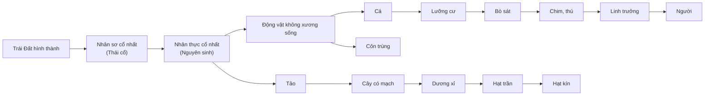

Chép từ sổ viết tay cấp 3 (trang 044–047, 071 – trang phải, phần cơ quan tương đồng – tương tự). Nội dung có thể chưa chính xác; <code>(?)</code> là chỗ chữ chưa đọc rõ.

Đã sửa so với sổ gốc

- Tên các chất đổi từ phiên âm tiếng Việt sang tiếng Anh (ADN → DNA, histon → histone, aa → amino acid...); tên người: Lamac → Lamarck, Đacuyn → Darwin, Hacđi – Vanbec → Hardy–Weinberg, Mayơ → Mayr.
- Hoá thạch: "thời gian rã C, U" → **thời gian bán rã** của đồng vị phóng xạ C, U.
- Cơ quan thoái hoá: "không có vai trò gì" → không còn chức năng hoặc chức năng bị tiêu giảm.
- Cơ quan tương tự: "chức năng ≠ nhau" → khác nguồn gốc nhưng **cùng chức năng** (nên hình thái tương tự).
- Công thức tỉ lệ nhập cư: mẫu số "P cho − P hỗn" → **P cho − P nhận**.
- Tiến hoá nhỏ: "quy mô tương đối" → quy mô nhỏ (quần thể), thời gian lịch sử tương đối ngắn.

# Tiến hoá

## Bằng chứng

### Trực tiếp
- **Hoá thạch**:
	- Di tích của sinh vật chết đi để lại trong lớp đất đá.
	- Cách xác định tuổi:
		- Tuổi lớp đất đá.
		- Thời gian bán rã của các đồng vị phóng xạ C (carbon), U (uranium).
	- Ý nghĩa: lịch sử phát sinh, phát triển, diệt vong.

### Gián tiếp

#### Giải phẫu so sánh
- **Cơ quan tương đồng**: (cùng nguồn) – vị trí tương ứng, cấu tạo giống nhau. (→ [Sơ đồ chi năm ngón](/blog/sinh-hoc/biology-project-and-lab-report/vertebrate-zoology/03-bo-xuong-ech-va-nguon-goc-luong-cu/))
	- Ví dụ: Tay người ← chi trước → cánh dơi: bay
		- Vây cá voi: bơi
		- Chuột chũi: chân trước đào bới
		- Ngựa: chạy
	- Đai vai → Cánh tay → Cẳng tay → Cổ tay → Bàn tay.
	- → Nguồn gốc chung các loài → phản ánh sự **tiến hoá phân li**. (kèm hình nhỏ dạng cây phân nhánh minh hoạ tiến hoá phân li)
- **Cơ quan thoái hoá**: 1 loại cơ quan tương đồng nhưng không phát triển đầy đủ ở cơ thể trưởng thành; không còn chức năng hoặc chức năng bị tiêu giảm; nếu biểu hiện ra gọi là **lại tổ**.
	- (ghi chú lề) Xương cụt; Răng khôn (8); Ruột thừa.
- **Cơ quan tương tự**: (≠ nguồn) – **cùng chức năng** → hình thái tương tự.
	- Ví dụ: Dơi: chi trước ← cánh bay → Bướm: đốt ngực.
	- → **Tiến hoá đồng quy**.

- Bảng ví dụ (trang 071):

| Cặp cơ quan | Loại | Ghi chú |
|---|---|---|
| Gai xương rồng – tua cuốn đậu Hà Lan | Tương đồng | Từ lá |
| Cánh dơi – tay người | Tương đồng | |
| Ruột thừa (người) – manh tràng (thú ăn cỏ) | Thoái hoá – tương đồng | |
| Gai xương rồng – gai hoa hồng | Tương tự | |
| Cánh chuồn chuồn – cánh chim | Tương tự | |

#### Tế bào học
- ∀ cơ thể cấu tạo từ tế bào.
	- Tế bào nhân sơ: vi khuẩn: DNA kép vòng trần.
	- Tế bào nhân thực: nhiễm sắc thể = DNA thẳng + protein histone.
	- Gồm:
		- Cơ thể đơn bào.
		- Cơ thể đa bào.
	- **Virchow**: tế bào được sinh ra từ tế bào trước đó.
	- → Các loài có chung nguồn gốc.

#### Sinh học phân tử
- ∀ sinh vật cấu tạo từ ~20 amino acid (→ protein), 4 loại nucleotide (→ DNA) (→ [Nhân đôi DNA, phiên mã, dịch mã](/blog/sinh-hoc/kien-thuc-chung/b-co-che-di-truyen-va-bien-di/04-nhan-doi-dna-phien-ma-va-dich-ma/))
	- → các loài có chung nguồn gốc.
- Sự ≠ nhau của phân tử protein và DNA phản ánh mối quan hệ họ hàng giữa các loài.
- Các loài có càng nhiều điểm giống nhau về cấu trúc (protein, DNA) thì quan hệ họ hàng càng gần.

## Học thuyết tiến hoá
- **Lamarck → Darwin → Tổng hợp hiện đại → Trung tính Kimura.**
- (Ghi chú nhỏ trên đầu cột "Cổ điển": "cá thể" nối với Darwin, "đồng loạt" (thường biến) nối với Lamarck; chữ "Lamarck" bị gạch ngang.)

| | Cổ điển (Darwin) | Hiện đại |
|---|---|---|
| Đơn vị | Cá thể | Quần thể |
| Nguyên liệu | Biến dị cá thể ↔ | Biến dị di truyền: biến dị đột biến, biến dị tổ hợp |
| Hình thành loài | Áp lực chọn lọc tự nhiên: kiểu hình | Chọn lọc tự nhiên: kiểu hình → kiểu gen, tần số alen |

## Các nhân tố tiến hoá
- **Định nghĩa**: nhân tố làm thay đổi cấu trúc di truyền của quần thể.
- **Đặc trưng** (của quần thể):
	- Vốn gen
	- d, h, r
	- p, q
- **5 nhân tố tiến hoá**.

### Sơ đồ các nhân tố tác động lên quần thể
- Ô giữa (tô đỏ): **Quần thể** – 1. Vốn gen; 2. d, h, r; 3. p, q. Các mũi tên chỉ vào ô:

| Nhân tố | Hướng | Tác động lên | Dấu |
|---|---|---|---|
| Đột biến (gen – nguyên liệu chủ yếu; nhiễm sắc thể) → nguồn sơ cấp; giao phối → biến dị tổ hợp: thứ cấp | Vô hướng | 3, 2 | (+) |
| Chọn lọc tự nhiên: Định hướng | Có hướng | 2, 3 | (−) |
| Giao phối không ngẫu nhiên | Có hướng | 2 | (−) |
| Yếu tố ngẫu nhiên | Vô hướng | 1, 2, 3 | (−) |
| Di – nhập gen | Vô / Có | 1, 2, 3 | (+) / (−) |

- Ghi chú bên cạnh "Chọn lọc tự nhiên":
	- Áp lực lớn → (tác động lên) kiểu hình → tần số alen, kiểu gen.
	- Giữ tốt, bỏ xấu, thích đáng (?) ... loài (?).

### 1) Đột biến
- **Đột biến gen**: nguyên liệu chủ yếu ($10^{-6} \to 10^{-4}$). (→ [Đột biến gen](/blog/sinh-hoc/kien-thuc-chung/b-co-che-di-truyen-va-bien-di/06-dot-bien-gen/))
- Nhiễm sắc thể.
- → Chậm.
	- ↳ Thường xuyên.
- Tạo nguyên liệu (+) → chủ yếu, phổ biến (?) ... đột biến (?). (→ [Di truyền ngoài nhân, biến dị](/blog/sinh-hoc/kien-thuc-chung/c-quy-luat-di-truyen/13-di-truyen-ngoai-nhan-moi-truong-va-bien-di/))
- Vô hướng.
- Kiểu gen ⟷ môi trường.
- Đột biến lặn không biểu hiện ngay ra kiểu hình (ở trạng thái dị hợp).

### 2) Chọn lọc tự nhiên
- Phân hoá khả năng sống sót và khả năng sinh sản của các cá thể với các kiểu gen khác nhau trong quần thể (Darwin: sống sót).
- Nhân tố tiến hoá **định hướng**, áp lực lớn, thường xuyên.
- Giữ lại biến dị có lợi, đào thải có hại cho sinh vật
	- → nghèo vốn gen.
- (Động lực) Áp lực: **đấu tranh sinh tồn**:
	- Thức ăn
	- Nơi ở
	- Sinh sản
- Trực tiếp: kiểu hình; gián tiếp: kiểu gen.

### 3) Di – nhập gen
- Giao tử, cá thể quần thể này —(+ tính (?))→ cá thể ∈ quần thể khác.
- Có thể vô – có hướng → chậm.
- Nghèo – giàu:
	- Thực vật: hạt phấn, bào tử phát tán.
	- Động vật: di cư.
	- ↳ $m = \dfrac{P_{hỗn} - P_{nhận}}{P_{cho} - P_{nhận}}$
		- $P_{hỗn}$: sau nhập cư; $P_{cho}$; $P_{nhận}$.

### 4) Yếu tố ngẫu nhiên
- Dịch bệnh, núi lửa, sóng thần, ... → giảm vốn gen của quần thể 1 cách đột ngột → biến động di truyền (**phiêu bạt**).
- 1 alen hại – lợi bị loại bỏ hoặc phổ biến.
- Kích thước nhỏ → chịu ảnh hưởng mạnh. (→ [Cá thể và quần thể](/blog/sinh-hoc/kien-thuc-chung/f-sinh-thai-hoc/19-ca-the-va-quan-the-sinh-vat/))
- Vô hướng.

### 5) Tự phối – giao phối gần, cận huyết → giao phối không ngẫu nhiên
- Thay đổi tần số kiểu gen: tăng đồng hợp – giảm dị hợp, nhưng tần số alen không thay đổi.
	- → Tạo dòng thuần nhưng chọn lọc tự nhiên đào thải đồng hợp có hại → nghèo vốn gen.
	- (không phải vô hướng) → **Có hướng**: tăng dần đồng hợp, giảm dần dị hợp.

### Giao phối ngẫu nhiên
- **Không là nhân tố tiến hoá** vì ở trạng thái cân bằng: $p^2 + 2pq + q^2 = 1$
	- → tần số kiểu gen, alen không đổi.
	- Tạo biến dị tổ hợp → nguyên liệu thứ cấp / nguồn biến dị tiềm tàng.
- Vai trò:
	- Phát tán các đột biến.
	- Trung hoà tính có hại của đột biến.
	- Tạo ra vô số các biến dị tổ hợp
		- → nguyên liệu thứ cấp cho tiến hoá.

## Chọn lọc nhân tạo
- Các quần thể vật nuôi – cây trồng thường xuyên phát sinh biến dị:
	- Có lợi cho con người → giữ lại, sinh sản, ↑.
	- Có hại, không có lợi cho con người → đào thải.
- Qua thời gian —(chọn lọc nhân tạo)→ giống vật nuôi, cây trồng. (→ [Ứng dụng di truyền vào chọn giống](/blog/sinh-hoc/kien-thuc-chung/d-di-truyen-hoc-quan-the-va-nguoi/16-ung-dung-di-truyen-hoc-vao-chon-giong/))
- Động lực: nhu cầu thị hiếu của con người.

## Tiến hoá nhỏ
- Quá trình biến đổi p, q; d, h, r của quần thể → hình thành loài mới.
- Đơn vị: quần thể.
- Xuất phát: quần thể; kết quả: loài mới.
- Chịu sự chi phối của nhân tố tiến hoá: ngược với điều kiện nghiệm đúng của định luật Hardy–Weinberg: (→ [Di truyền học quần thể](/blog/sinh-hoc/kien-thuc-chung/d-di-truyen-hoc-quan-the-va-nguoi/14-di-truyen-hoc-quan-the/))

| 5 điều kiện nghiệm đúng Hardy–Weinberg | → Nhân tố tiến hoá |
|---|---|
| Quần thể có kích thước lớn | Yếu tố ngẫu nhiên |
| Giao phối ngẫu nhiên | Giao phối không ngẫu nhiên |
| Sức sống, khả năng sinh sản như nhau | Chọn lọc tự nhiên |
| Không có đột biến | Đột biến |
| Không có di – nhập gen | Di – nhập gen |

- Quy mô nhỏ (quần thể), thời gian lịch sử tương đối ngắn → có thể nghiên cứu bằng thực nghiệm.

## Tiến hoá lớn
- Trục thời gian vẽ dọc mép trang, chia các đại: **Thái cổ | Nguyên sinh | Cổ sinh | Trung sinh | Tân sinh (Đệ tam, Đệ tứ)**. Chuỗi tiến hoá dọc trục: (→ [Sự phát sinh và phát triển sự sống](/blog/sinh-hoc/kien-thuc-chung/e-tien-hoa/18-su-phat-sinh-va-phat-trien-cua-su-song/))

- Hình thành các nhóm phân loại trên loài: chi, họ, bộ, lớp, ngành.
- Quy mô lớn, thời gian dài → nghiên cứu gián tiếp.
- **Chọn lọc tự nhiên theo Darwin**:
	- → Sự bảo tồn nhiều sai dị cá thể và nhiều biến đổi có lợi, sự đào thải nhiều cá thể sai dị và nhiều biến đổi có hại được gọi là chọn lọc tự nhiên hay là sự sống sót của những dạng thích nghi nhất.
- **Thực chất chọn lọc tự nhiên**:
	- Tự phát, không có mục đích định trước, không do 1 cái điều khiển.
	- Nhưng → kết quả: làm cho loài thích nghi với điều kiện sống.

## Loài
- **Mayr**: 1 hoặc 1 nhóm các quần thể: giống đặc điểm hình thái, sinh lí, cấu tạo.
	- Có khả năng giao phối với nhau.
	- Sinh ra con có sức sống, có khả năng sinh sản.
	- Cách li sinh sản với các nhóm quần thể khác.
- **Nhược điểm**: chưa đề cập đến loài sinh sản vô tính.

### Tiêu chuẩn phân biệt 2 loài thân thuộc
- **Hình thái**:
	- Các cá thể cùng loài giống nhau, thường có dạng trung gian (sinh vật bậc cao).
	- Khác loài: không có dạng trung gian.
- **Địa lí – Sinh thái**:
	- Khác loài: phân bố ở khu vực ≠ nhau.
	- Sống cùng khu vực: thích nghi với điều kiện sinh thái ≠ nhau.
- **Sinh lí – Hoá sinh**:
	- Khác loài: chỉ tiêu sinh lí – hoá sinh ≠ nhau: pH, t°, độ ... (?) ...
		- → đánh giá vi sinh vật.
- **Cách li sinh sản**: quan trọng nhất → phân biệt 2 loài → 1 loài 1 bộ nhiễm sắc thể đặc trưng.
	- (ghi chú bên: ↓ hình thái, số lượng, cấu trúc gen (?); lai khác loài thường không có kết quả.)
	- **Trước hợp tử**: không tạo hợp tử.
		- Nơi ở (cách li địa (?)): cùng khu vực, ≠ sinh cảnh → không giao phối.
		- Tập tính: giao phối riêng.
		- Thời gian mùa sinh sản (mùa vụ).
		- Cơ học: cấu tạo cơ quan sinh sản ≠ nhau → không giao phối.
		- Giao tử chết.
	- **Sau hợp tử**: ngăn cản việc tạo ra con lai hoặc ngăn cản tạo ra con lai có sức sống, có khả năng sinh sản.
		- Hợp tử bị chết, không phát triển: 2 loài ≠ nhau giao phối, thụ tinh → hợp tử chết.
		- Con lai có sức sống kém.
		- Con trưởng thành không có khả năng sinh sản: con lai bất thụ.

### Quá trình hình thành loài
- Biến đổi thành phần kiểu gen, thích nghi, cách li sinh sản với quần thể ban đầu.
- **Khác khu**: chọn lọc tự nhiên tích luỹ biến dị di truyền theo hướng ≠ nhau → nòi địa lí —(cách li sinh sản)→ loài mới.
	- → Chậm, qua nhiều dạng trung gian.
	- ↳ Thực vật, động vật phát tán mạnh.

- **Cùng khu**:
	- Sinh thái: ít di cư ↳ đặc điểm thích nghi.
	- Tập tính.
	- Đột biến lớn: (→ [Đột biến nhiễm sắc thể](/blog/sinh-hoc/kien-thuc-chung/b-co-che-di-truyen-va-bien-di/07-dot-bien-nhiem-sac-the/))
		- → **Tự đa bội**: 3n, 4n, ... → cách li sinh sản với 2n.
		- → **Dị đa bội**: lai xa + đa bội hoá.
		- → Nhanh → thực vật: chủ yếu (có hoa).
	- → Thể (?) ngoài trên cơ thể sinh vật → không gặp gỡ và giao phối.
- **Quần đảo**: các đảo ≠ nhau → ... (?) điển hình có sự hình thành loài = con đường địa lí. (→ [Chim sẻ Darwin](/blog/sinh-hoc/biology-project-and-lab-report/evolutionary-biology/03-chon-loc-tu-nhien-o-chim-se-darwin/))
	- → Vai trò: tăng cường sự phân hoá vốn gen.

### Quá trình hình thành quần thể thích nghi
- Nhanh hay chậm phụ thuộc:
	1. Quá trình phát sinh và tích luỹ gen đột biến ở mỗi loài.
	2. Áp lực chọn lọc tự nhiên.
	3. Tốc độ sinh sản của loài.

- Xem thêm: [Tổng ôn – 6. Di truyền quần thể, chọn lọc tự nhiên](/blog/sinh-hoc/kien-thuc-chung/h-tong-on/26-tong-on-va-meo-lam-bai/#6-di-truyền-quần-thể-chọn-lọc-tự-nhiên) – mẹo làm bài, ghi chú ôn tập
