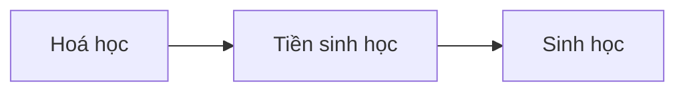
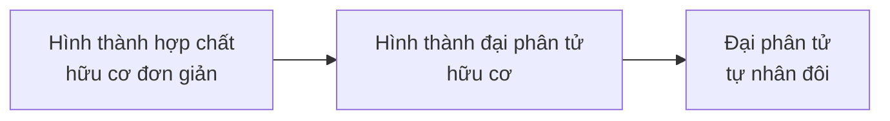

Chép từ sổ viết tay cấp 3 (trang 048). Nội dung có thể chưa chính xác; <code>(?)</code> là chỗ chữ chưa đọc rõ.

Đã sửa so với sổ gốc

- Tên các chất đổi từ phiên âm tiếng Việt sang tiếng Anh (aa → amino acid, nucleotit → nucleotide, axit nucleic → nucleic acid, ARN → RNA, lipit → lipid, coaxecva → coacervate...).
- Kỉ Đêvôn: "lục địa khô, lạnh; biển ấm, ướt" → **khí hậu lục địa khô hanh, ven biển ẩm ướt**.
- Đánh lại số mục lớn (sổ dùng "1." rồi "II.") → I, II.

# Sự phát sinh và phát triển sự sống trên Trái Đất

## I. Sự phát sinh sự sống

### a) Hoá học

- Chất vô cơ (CO₂, NH₃, H₂O, H₂) —(năng lượng tự nhiên)→ hợp chất hữu cơ đơn giản (amino acid, nucleotide) —(trùng hợp)→ protein, nucleic acid → vật chất di truyền (đầu tiên: RNA). (→ [Thành phần hoá học của tế bào](/blog/thanh-phan-hoa-hoc-cua-te-bao/), [Nhân đôi DNA, phiên mã, dịch mã](/blog/nhan-doi-dna-phien-ma-va-dich-ma/))
	- (thông qua carbohydrate, lipid, saccharide)

### b) Tiền sinh học: hình thành tế bào sơ khai
- Đại phân tử hữu cơ —(H₂O)→ giọt keo (**coacervate**) → trao đổi chất.
- Lipid → màng (kị nước) (bao lấy đại phân tử hữu cơ) → trao đổi chất. (→ [Màng tế bào](/blog/mang-te-bao-va-trao-doi-chat-qua-mang/))
- —(chọn lọc tự nhiên)→ hoàn thiện
	- ↓ **Tế bào sơ khai** nguyên thuỷ.

### c) Sinh học
- Tế bào sơ khai —(nhân tố tiến hoá)→ cơ thể đơn bào – tế bào nhân sơ
	- ↓ Đơn bào nhân thực, đa bào nhân thực. (→ [Tế bào chất, bào quan](/blog/te-bao-chat-bao-quan-va-nhan-te-bao/))
	- → Ngày nay.

## II. Sự phát triển sự sống qua các đại địa chất

- Bảng trong sổ (đọc từ dưới lên theo thời gian; chép theo thứ tự trên → dưới như sổ): (→ [Bằng chứng và cơ chế tiến hoá](/blog/bang-chung-va-co-che-tien-hoa/), [Hệ sinh thái và sinh quyển](/blog/he-sinh-thai-va-sinh-quyen/))

| Đại | Kỉ | Đặc điểm địa chất | Sinh vật điển hình |
|---|---|---|---|
| Tân sinh | Đệ tứ | Băng hà, lạnh, khô. | Xuất hiện loài người. |
| Tân sinh | Đệ tam | Lục địa giống hiện nay, đầu ấm cuối lạnh. | Phát sinh linh trưởng. Cây có hoa ngự trị, phân hoá thú, chim, côn trùng. |
| Trung sinh | Phấn trắng (Kreta) | Lục địa bắc liên kết với nhau, biển thu hẹp, khô. | Xuất hiện thực vật có hoa. Tiến hoá động vật có vú. Cuối: tuyệt diệt nhiều sinh vật, kể cả bò sát cổ. |
| Trung sinh | Jura | Hình thành lục địa Bắc – Nam. Biển tiến vào lục địa. Ấm áp. | Hạt trần, bò sát cổ ngự trị, phân hoá chim. |
| Trung sinh | Tam điệp (Triat) | Lục địa chiếm ưu thế. Khô. | Hạt trần ngự trị, phân hoá bò sát cổ. Cá xương phát triển. Phát sinh thú, chim. |
| Cổ sinh | Pecmi | Lục địa liên kết. Băng hà, khô, lạnh. | Phân hoá: bò sát, côn trùng. Tuyệt diệt nhiều động vật biển. |
| Cổ sinh | Than đá (Cacbon) | Đầu: ấm, nóng. Sau: khô lạnh. | Dương xỉ phát triển mạnh. Thực vật có hạt xuất hiện. Lưỡng cư ngự trị. Phát sinh bò sát. |
| Cổ sinh | Đêvôn | Lục địa: khô hanh. Ven biển: ẩm ướt. Hình thành sa mạc. | Phân hoá cá xương. Phát sinh lưỡng cư, côn trùng. |
| Cổ sinh | Silua | Hình thành lục địa. Mực nước biển dâng cao. Nóng ẩm. | Cây có mạch, động vật → (lên) cạn. |
| Cổ sinh | Ocđôvic | Di chuyển lục địa. Băng hà. Biển ↓. Khô. | Phát sinh thực vật. Tảo biển ngự trị. (một chữ bị gạch xoá) |
| Cổ sinh | Cambri | Phân bố lục địa, đại dương khác xa hiện nay. Nhiều CO₂. | Phát sinh ngành động vật. Phân hoá tảo. |
| Nguyên sinh | | Tích luỹ O₂ trong khí quyển. | Động vật không xương sống xuất hiện. Tảo xuất hiện. Sinh vật nhân thực cổ nhất. |
| Thái cổ | | | Sinh vật nhân sơ xuất hiện. |
| | | Trái Đất hình thành. | |

- Xem thêm: [Bộ xương ếch và nguồn gốc lưỡng cư](/blog/bo-xuong-ech-va-nguon-goc-luong-cu/) – kỉ Đêvôn: cá vây tay lên cạn thành lưỡng cư
