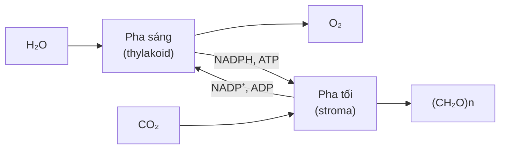

Chép từ sổ viết tay cấp 3 (trang 068, 072). Nội dung có thể chưa chính xác; <code>(?)</code> là chỗ chữ chưa đọc rõ.

Đã sửa so với sổ gốc

- Tên các chất đổi từ phiên âm tiếng Việt sang tiếng Anh (glucôzơ → glucose, carôtenôit → carotenoid, peroxixôm → peroxisome, tilacôit → thylakoid, ribulôzơ-1,5-điphotphat → ribulose-1,5-bisphosphate...).
- Quang phân li nước: sổ ghi "H₂O → 4H⁺ + 4e + O₂" → cân bằng thành **2H₂O** → 4H⁺ + 4e⁻ + O₂. Sơ đồ pha sáng – pha tối: "ATD" → ADP.
- CO₂ là **sản phẩm cuối** của hô hấp (sổ ghi "sản phẩm trung gian").
- Hô hấp kị khí (lên men): sổ ghi "2 – 3 ATP" → **2 ATP** / 1 glucose.
- Hô hấp sáng: RuBP bị oxi hoá thành APG và **glycolic acid** (sổ ghi "AG (?)").
- Bảng C₃ – C₄ – CAM: lục lạp ở C₄ có ở tế bào mô giậu và **bao bó mạch** (sổ ghi "bó mạch").
- Điền các chỗ `(?)`: rễ cây bị ngập úng; 90 – 95% tổng chất khô; hệ số kinh tế; nhiệt độ thích hợp C₃ 20 – 30 °C.

## 1. Hô hấp

$$C_6H_{12}O_6 + 6O_2 + 6H_2O \longrightarrow 6CO_2 + 12H_2O + Q\ (t^\circ + ATP)$$

- **C₆H₁₂O₆**: phân giải. (→ [Thành phần hoá học](/blog/thanh-phan-hoa-hoc-cua-te-bao/))
- **6CO₂**: sản phẩm cuối, thải ra ngoài. (→ [Tiêu hoá và hô hấp](/blog/tieu-hoa-va-ho-hap-o-dong-vat/))
- **12H₂O**: dung môi, môi trường phản ứng hoá sinh. (→ [Tổng ôn](/blog/tong-on-va-meo-lam-bai/))
- **Q (t° + ATP)**:
	- Trao đổi chất cơ thể.
	- Duy trì thân nhiệt (t°).

Dòng CO₂ trong sổ ghi "sản phẩm trung gian → quan trọng nhất với cây (?)" – chưa rõ ý người viết (có thể muốn nói hô hấp tạo nhiều sản phẩm trung gian cho tổng hợp các chất hữu cơ khác). Đã sửa CO₂ thành sản phẩm cuối; phần "quan trọng nhất với cây" chưa xác định được.

| Điểm so sánh | Hiếu khí | Kị khí | (Hô hấp sáng) |
|---|---|---|---|
| Điều kiện | Có O₂ | Thiếu O₂ (rễ cây bị ngập úng) | Cường độ ánh sáng, [O₂] cao |
| Vị trí | Tế bào chất, ti thể | Tế bào chất | Lục lạp → peroxisome → ti thể |
| Cơ chế | Đường phân → Krebs → chuỗi chuyền e └ giải phóng nhiều năng lượng nhất | Đường phân → lên men | 3 giai đoạn RuBP (ribulose-1,5-bisphosphate) —oxi hoá→ APG + glycolic acid |
| Hiệu quả năng lượng | 36 – 38 ATP / 1 glucose | 2 ATP / 1 glucose | Không có |
| Vai trò | – Cung cấp năng lượng cho hoạt động sống của tế bào và cơ thể – Tham gia điều hoà thân nhiệt | – Duy trì hoạt động sống của rễ khi gặp điều kiện thiếu O₂ (tạm thời) | – Tiêu hao sản phẩm quang hợp, ↓ năng suất quang hợp → hại (Có 1 số amino acid cho cây) |

- Xem thêm: [Thí nghiệm vi sinh vật học](/blog/thi-nghiem-vi-sinh-vat-hoc-microbiology-laboratory-methods/) – thực hành lên men ethanol, lactic, acetic ở vi sinh vật

## 2. Quang hợp

$$6CO_2 + 12H_2O \xrightarrow{\text{ánh sáng, diệp lục}} C_6H_{12}O_6 + 6O_2 + 6H_2O$$

- **Quang năng** (ánh sáng) → **hoá năng** → năng lượng sự sống. (→ [Hệ sinh thái](/blog/he-sinh-thai-va-sinh-quyen/))
- **Ánh sáng**: mạnh: **đỏ** (khoanh tròn trong sổ), xanh tím.
- C₆H₁₂O₆ → (90 – 95% tổng chất khô / năng suất thực vật).
- → Diễn ra ở chất nền lục lạp. (→ [Bào quan](/blog/te-bao-chat-bao-quan-va-nhan-te-bao/))
- → Quá trình đồng hoá CO₂ (khử C).

### Pha sáng – pha tối

- **O₂ ← quang phân li nước**: $2H_2O \xrightarrow{\text{ánh sáng, diệp lục}} 4H^+ + 4e^- + O_2$ (O₂ có nguồn gốc từ H₂O). (→ [Trao đổi nước và khoáng](/blog/trao-doi-nuoc-va-khoang-o-thuc-vat/))
- **Sắc tố**: carotenoid → diệp lục b → diệp lục a → diệp lục a ở trung tâm phản ứng.
	- → Tất cả bộ phận chứa sắc tố lục đều có khả năng quang hợp. Lá – chủ yếu.
- **↑ Năng suất**:
	- ↑ S lá
	- ↑ cường độ quang hợp
	- ↑ hệ số kinh tế

### Quang hợp ở các nhóm thực vật C₃ – C₄ – CAM

| Tiêu chí | C₃ | C₄ | CAM |
|---|---|---|---|
| 1) Đối tượng | Rêu, cây gỗ trong rừng | Nhiệt đới, cận nhiệt đới | Hoang mạc |
| Ví dụ (bảng tổng hợp trang 072) | Rêu → cây gỗ lớn trong rừng | Mía, rau dền, ngô, cao lương, kê | Xương rồng, dứa, thanh long |
| 2) Chất nhận CO₂ | Ribulose-1,5-bisphosphate (RuBP) | PEP | PEP |
| 3) Sản phẩm hữu cơ đầu | APG | AOA (4C) | AOA (4C) |
| 4) Chu trình | Calvin | C₄, Calvin (ngày) | C₄ (đêm), Calvin (ngày) |
| 5) Lục lạp | Mô giậu | Mô giậu, bao bó mạch | Mô giậu |
| 6) Hô hấp sáng | Có | Không | Không |
| 7) Điều kiện môi trường: t° | 20 – 30 °C | 25 – 35 °C | 30 – 40 °C |
| H₂O | Cao | Thấp | Thấp |
| 8) Năng suất | Bình thường | Cao | Thấp – bình thường |

- Xem thêm: [Giải phẫu lá Ngô, Lúa, Trúc Đào](/blog/giai-phau-la-than-re-cay-mot-la-mam-va-hai-la-mam/) – tiêu bản lá cây C₄ (Ngô) có bao bó mạch.

- **Điểm bù CO₂**: C₃ > C₄. (→ [Kiểm định giả thiết thống kê](/blog/kiem-dinh-gia-thiet-thong-ke-trong-nghien-cuu-sinh-hoc/))

