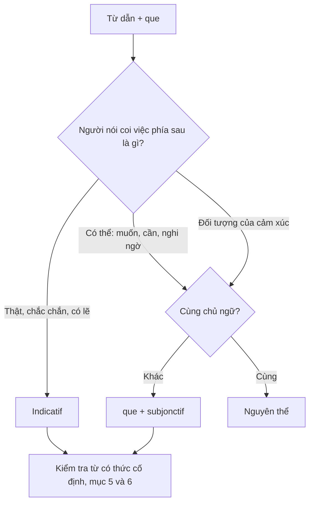
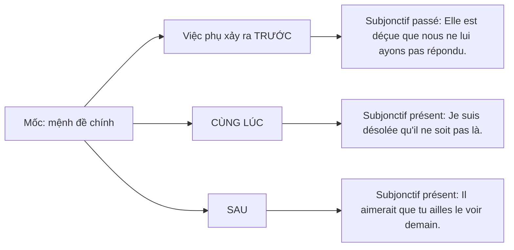

Subjonctif (thức giả định) là phần mà nhiều người học tiếng Pháp vẫn chọn theo cảm giác. Bài này đưa ra một câu hỏi để chọn thức (người nói coi sự việc là thật, hay mới là điều có thể?), rồi trình bày cách chia theo một quy tắc và ba lớp ngoại lệ, các nhóm từ dẫn, mười cặp hay nhầm và cách tránh subjonctif khi cần. Nội dung dựa trên từ điển của Viện Hàn lâm Pháp và Larousse, Banque de dépannage linguistique của OQLF, sách ngữ pháp và nghiên cứu về người học; cuối bài có 12 câu tự kiểm tra.

## 1. Một lỗi có quy luật sau *il faut que*

Câu *il faut que j'écris* (tôi phải viết) nghe khá tự nhiên với người mới học: người nói đã biết sau *il faut* cần *que*, chỉ có động từ phía sau vẫn ở indicatif. Câu đúng là *il faut que j'écrive*. Đây không phải lỗi ngẫu nhiên. Bartning và Schlyter (2004) mô tả sáu giai đoạn phát triển tiếng Pháp nói của người lớn nói tiếng Thuỵ Điển, và ghi nhận rằng *il faut que* là ngữ cảnh bắt buộc subjonctif đầu tiên mà người học gặp, nhưng lúc đầu họ đặt sau nó một động từ chưa chia hoặc chia ở indicatif, đúng kiểu *il faut que j'écris* (tr. 287–288).

Lỗi này khó tự phát hiện vì một lý do hình thái. Với phần lớn động từ -er, subjonctif présent trùng với indicatif ở bốn ngôi: *il faut qu'il parle* dùng đúng dạng *parle* mà người học đã biết, nên câu đúng mà người viết chưa chắc đã chọn thức. Lựa chọn chỉ lộ ra ở các động từ có dạng riêng: *il écrit / qu'il écrive*, *il agit / qu'il agisse*, *il fait / qu'il fasse* (mục 3).

Vậy vì sao sau *il faut que* phải là *écrive*, và làm sao biết lúc nào cần subjonctif? Bài này lấy một nguyên tắc làm trục (mục 4), rồi đối chiếu từng nhóm từ dẫn với từ điển của Viện Hàn lâm Pháp (Académie française), Banque de dépannage linguistique của Office québécois de la langue française (OQLF), từ điển Larousse, sách ngữ pháp của Boularès và Frérot (1997), *Tex's French Grammar* của Đại học Texas tại Austin (Blyth et al., n.d.) và các nghiên cứu về người học.

## 2. Subjonctif là gì và không là gì

Viện Hàn lâm Pháp định nghĩa subjonctif là một thức có ngôi (*mode personnel*), thường dùng trong mệnh đề phụ và luôn có *que* đứng trước, trừ vài cách dùng cố định như *Ainsi soit-il* (Académie française, n.d.-a). OQLF gọi nó là "le mode de la possibilité, de l'hypothèse", còn indicatif (thức chỉ định) trình bày sự việc như điều chắc chắn hoặc có lẽ sẽ xảy ra (Office québécois de la langue française [OQLF], n.d.-a).

Cần tách **thức** khỏi **thì**. Thì cho biết sự việc xảy ra khi nào; thức cho biết người nói trình bày sự việc như thế nào: như sự thật, mệnh lệnh, điều kiện hay khả năng (xem thêm thì, thể, thức). Định nghĩa thuật ngữ của OQLF nói cùng ý: thức đặt hành động hay trạng thái của động từ trong quan hệ với ý định giao tiếp của câu, và có thể diễn đạt nghi ngờ, mong muốn, khả năng, thực tại hay mệnh lệnh (OQLF, 2025a). Còn tiếng Pháp có bao nhiêu thức thì tuỳ cách đếm:

| Nguồn                                        | Số thức       | Cách đếm                                                                                              |
| -------------------------------------------- | ------------- | ----------------------------------------------------------------------------------------------------- |
| *Tex's French Grammar* (Blyth et al., n.d.)  | 4             | indicatif, subjonctif, conditionnel, impératif                                                        |
| OQLF (2025a)                                 | 5             | 3 thức có ngôi (indicatif, subjonctif, impératif), 2 thức không ngôi (infinitif, participe); conditionnel là một thì của indicatif |
| Viện Hàn lâm Pháp (Académie française, 2015) | tuỳ quan điểm | conditionnel là thức theo ngữ pháp truyền thống, là thì của indicatif hoặc subjonctif theo nhiều nhà ngữ pháp hiện nay |

Bảng 1. Ba cách đếm thức (xem thêm sơ đồ các thức và conditionnel). Dù đếm theo cách nào, subjonctif vẫn là một thức có ngôi.

Trong tiếng Pháp thông dụng, subjonctif chỉ còn dùng hai thì: présent và passé. Về hệ thống có bốn thì, nhưng imparfait và plus-que-parfait "pratiquement sortis de l'usage" (OQLF, n.d.-a); chỉ cần nhận ra khi đọc, như *Qu'il mourût* của Corneille (Académie française, n.d.-a). Subjonctif tự nó không chỉ thời gian: *J'insiste pour qu'il vienne* và *J'insistais pour qu'il vienne* dùng cùng dạng *vienne* (OQLF, n.d.-a). Nó cũng có thể đứng một mình để ra lệnh hay cầu mong: *Qu'il parte !* (Académie française, n.d.-a), *Pourvu qu'il fasse beau pendant mes vacances* (OQLF, n.d.-d), *Vive la France !* (động từ -er).

Bài này gọi subjonctif là **thức giả định**, không dùng "thức cầu khẩn" vì dễ lẫn với thức mệnh lệnh, cũng không dùng "thể giả định" vì "thể" nên dành cho *aspect*. Thêm một nhận xét của người viết: tiếng Việt không chia động từ theo thức. Ý "mong", "phải", "sợ", "dù" nằm ở từ ngữ, nên người Việt phải tập nhận ra chúng trong từ dẫn rồi đổi hình thái động từ phía sau.

## 3. Chia động từ: một quy tắc, ba lớp ngoại lệ

Quy tắc gốc: lấy ngôi *ils* của hiện tại indicatif, bỏ *-ent*, thêm *-e, -es, -e, -ions, -iez, -ent*: *ils partent → que je parte* (Boularès & Frérot, 1997, tr. 56; Blyth et al., n.d.). Với động từ -er, kết quả trùng gần hết với dạng đã biết:

| Ngôi | Indicatif présent | Subjonctif présent | Imparfait |
| ---- | ----------------- | ------------------ | --------- |
| je   | parle             | que je parle       | parlais   |
| nous | parlons           | que nous parlions  | parlions  |
| vous | parlez            | que vous parliez   | parliez   |
| ils  | parlent           | qu'ils parlent     | parlaient |

Bốn ngôi *je, tu, il, ils* (dạng "boot") giống hệt indicatif, *nous, vous* giống imparfait (Wiktionnaire, n.d.); *acheter* cũng vậy (*que j'achète, que nous achetions*). Hệ quả: với động từ -er, người đọc **không thể biết** người viết có chọn subjonctif hay không (*il faut qu'il parle* trùng dạng với *il parle*). Chỉ động từ có dạng riêng mới cho thấy rõ: *il agit* nhưng *qu'il agisse* (Wiktionnaire, n.d.). Đó cũng là lý do lỗi chọn thức thường chỉ lộ ra ở những động từ như *agir, écrire, faire, être*.

| Lớp | Động từ | Dạng subjonctif |
| --- | --- | --- |
| 0. Theo quy tắc, kể cả nhiều động từ bất quy tắc ở indicatif | dormir, partir, lire, dire, écrire, mettre, connaître, agir | *que je dise, qu'il agisse*; ngôi *ils* giống indicatif |
| 1. Hai gốc: *ils* cho dạng "boot", *nous* cho *nous, vous* | venir, prendre, boire, croire, devoir, recevoir, voir, acheter | *que je vienne, que nous venions*; ngôi *ils* giống indicatif |
| 2. Gốc "boot" riêng | aller, vouloir, valoir | *que j'aille, que je veuille, que je vaille*; **khác**: *qu'ils aillent, veuillent, vaillent* |
| 3. Gốc hoàn toàn riêng | être, avoir, faire, pouvoir, savoir | **khác**: *qu'ils soient, aient, fassent, puissent, sachent* |

Bảng 2. Một quy tắc và ba lớp ngoại lệ (Blyth et al., n.d.; Larousse, n.d.-b; Wiktionnaire, n.d.).

Hai điểm trong bảng cần chú ý. Thứ nhất, *aller* và *vouloir* cũng có hai gốc, nhưng gốc "boot" *aill-, veuill-* không lấy từ *ils vont, ils veulent*, nên phải học thuộc riêng (Larousse, n.d.-b); *valoir* cũng vậy, và đáng nhớ vì *il vaut mieux que* là một từ dẫn subjonctif. Thứ hai, câu "ngôi *ils* của subjonctif giống indicatif" chỉ đúng với **mọi động từ lấy gốc subjonctif từ ngôi *ils*** (lớp 0 và 1). Ở lớp 2 và 3, hai dạng khác nhau: *ils ont / qu'ils aient, ils vont / qu'ils aillent, ils font / qu'ils fassent*.

*Avoir, être* viết *nous, vous* bằng chữ *y* (*ayons, soyez*), và mệnh lệnh của *avoir, être, savoir* dựa trên gốc subjonctif (*aie, sois, sache*; Blyth et al., n.d.; xem thức mệnh lệnh). Các động từ phi ngôi cũng có dạng subjonctif riêng: *falloir → qu'il faille*, *valoir → qu'il vaille* (Larousse, n.d.-b), *pleuvoir → qu'il pleuve* (*il se peut qu'il pleuve demain*; Boularès & Frérot, 1997, tr. 66). Vì gốc subjonctif đi từ hiện tại indicatif, nắm chắc động từ có quy tắc và bất quy tắc ở hiện tại là đã đi được nửa đường.

## 4. Nguyên tắc chọn thức: thực tại hay khả năng

Theo Boularès và Frérot (1997, tr. 62), thức ở mệnh đề phụ do **động từ dẫn** quyết định, tuỳ cách người nói nhìn sự việc phía sau *que*: "Lorsque le locuteur envisage une réalisation possible, le subjonctif est utilisé" (khi người nói hình dung một việc **có thể** xảy ra thì dùng subjonctif). Sách minh hoạ bằng một thang (tr. 56, 62): *il est certain qu'il viendra* (chắc chắn) và *il est probable qu'il viendra* (có lẽ) dùng indicatif; *il est possible qu'il vienne* (có thể) dùng subjonctif.

Ranh giới nằm giữa "có lẽ" và "có thể", không phải giữa "chắc" và "không chắc"; đây là chỗ dễ đoán sai. OQLF nói cùng ý: indicatif trình bày sự việc như sẽ xảy ra "de façon certaine ou probable" (OQLF, n.d.-a).

Phủ định hoặc đảo ngữ nghi vấn đẩy động từ ý kiến sang phía "có thể": *Je crois qu'il est prêt*, nhưng *Croyez-vous qu'il soit prêt ?* và *Je ne crois pas qu'il le sache* (Boularès & Frérot, 1997, tr. 56; xem phủ định và câu hỏi). OQLF xếp động từ kéo theo subjonctif thành ba nhóm: ý kiến hoặc đánh giá, ý muốn, cảm xúc; riêng với ý muốn, OQLF giải thích điều ta muốn "demeure de l'ordre du possible" (OQLF, n.d.-c). Điều kiện thứ hai là **hai chủ ngữ khác nhau**: *J'aimerais qu'il vienne*, nhưng *J'aimerais venir* khi người muốn và người đến là một (Boularès & Frérot, 1997, tr. 56).

Hình 1. Câu hỏi chọn thức, vẽ lại theo ý của Boularès và Frérot (1997, tr. 56, 62).

Nguyên tắc này không giải thích được mọi trường hợp. *Je regrette qu'elle soit fâchée* (tôi tiếc là cô ấy giận) nói về việc có thật mà vẫn dùng subjonctif (Boularès & Frérot, 1997), *bien que* cũng vậy. Ở những chỗ này, thức là **quy ước gắn với từng từ** (Poplack et al., 2013; mục 10). Người học cần cả hai: nguyên tắc để hiểu, và một danh sách ngắn đã kiểm chứng để dùng.

## 5. Các nhóm từ kéo theo subjonctif

Sách ngữ pháp thường chia từ dẫn theo nhóm nghĩa: bắt buộc, ý muốn, cảm xúc, nghi ngờ, mệnh đề quan hệ, so sánh nhất (Blyth et al., n.d.); OQLF gom thành ba nhóm ý kiến hoặc đánh giá, ý muốn, cảm xúc (OQLF, n.d.-c). Mỗi nhóm dưới đây đi kèm các ngoại lệ dễ chọn nhầm.

**Bắt buộc.** *Il faut que, il est nécessaire / important que, il vaut mieux que* (Boularès & Frérot, 1997, tr. 58). *Il faut que* nhấn mạnh hơn *devoir* + nguyên thể (Blyth et al., n.d.; xem động từ khuyết thiếu). Người học thường nhận ra nhóm này tốt hơn liên từ và câu phủ định (McManus & Mitchell, 2015; mục 10).

**Ý muốn.** *Vouloir, désirer, souhaiter, exiger, préférer que* (OQLF, n.d.-c). *Souhaiter que* nghĩa là "mong rằng" (tiếng Anh *to wish that*): *Je souhaite que tu guérisses rapidement* (OQLF, n.d.-c); còn "hy vọng" (*to hope*) là *espérer*, và động từ này đi với thức khác (xem đoạn sau). *Attendre que* chủ yếu là "đợi đến khi" (*J'attends qu'il ait fini pour partir*), Larousse cũng ghi nghĩa "trông chờ"; còn nghĩa "đoán trước, chờ sẵn một điều gì" thì dùng *s'attendre à ce que*: *je m'attends à ce qu'il m'écrive* (Larousse, n.d.-a).

**Hy vọng: *espérer* đi với indicatif.** Subjonctif hay được giới thiệu là thức của mong muốn và hy vọng, nhưng theo Larousse, *espérer que* ở câu khẳng định đi với indicatif hoặc conditionnel (*nous espérons qu'il viendra*); chỉ ở câu phủ định, nghi vấn mới có thể dùng subjonctif (*je n'espère plus qu'elle vienne*) (Larousse, n.d.-d). "Hy vọng" là ý nghĩa, còn thức do **từ** quyết định.

**Cảm xúc.** *Regretter, craindre, avoir peur, être content / désolé que, il est dommage que* (OQLF, n.d.-c); cùng nhóm có *redouter que, avoir peur que* (sợ rằng), *être heureux que* (vui vì), *être malheureux que* (buồn vì) (Blyth et al., n.d.). Sau *craindre que* thường có *ne* explétif, không mang nghĩa phủ định: *Je crains qu'il ne veuille partir malgré tout* (OQLF, n.d.-c).

**Nghi ngờ.** *Douter que, il est possible / douteux que, il se peut que* (Boularès & Frérot, 1997, tr. 62). Khi phủ định, *ne pas douter que* thông thường vẫn đi với subjonctif (*je ne doute pas qu'il vienne*); indicatif chỉ dùng để nhấn mạnh sự thật (*je ne doute pas qu'il sera présent à l'heure dite*) (Larousse, n.d.-c). Ngược lại, *se douter que* (đoán là) đi với indicatif (Larousse, n.d.-c).

**Chắc chắn → indicatif.** Từ dẫn trình bày việc phía sau như điều chắc chắn hoặc có lẽ đi với indicatif: *croire, penser que* ở câu khẳng định, *il est certain / probable que* (Boularès & Frérot, 1997, tr. 56, 62). Hai cụm trong nhóm này đổi thức theo nghĩa:

- *Il me semble que* + indicatif vì là ý kiến (*il me semble que tu as grandi*), nhưng *il semble que* + subjonctif khi không chắc (*il semble qu'il se soit perdu*), + indicatif khi thấy rõ (*il semble qu'il s'est perdu*) (Larousse, n.d.-e).
- *Supposer que* (cho rằng) + indicatif: *Nous supposons qu'il sera là*; nhưng *supposons que* (giả sử) + subjonctif: *Supposons qu'il ne vienne pas* (Boularès & Frérot, 1997, tr. 64). OQLF cũng xếp *à supposer que* vào nhóm luôn đi với subjonctif (OQLF, 2025b).

**Mệnh đề quan hệ.** Tiền ngữ chưa chắc tồn tại thì dùng subjonctif: *Je cherche un traducteur qui connaisse l'anglais, le français et le japonais* (Boularès & Frérot, 1997, tr. 58). So sánh *Connaissez-vous quelqu'un qui puisse m'aider ?* với *Je connais quelqu'un qui peut vous aider* (Académie française, n.d.-b; xem đại từ quan hệ).

**So sánh nhất, *le seul, le premier*.** Sau so sánh nhất và *le seul, le premier, le dernier*, dùng subjonctif khi là đánh giá chủ quan, indicatif khi nêu sự thật (Blyth et al., n.d.); subjonctif ở đây thường gặp nhưng không bắt buộc (OQLF, 2016): *Voici le meilleur vin que l'on puisse trouver dans la région*, nhưng *Ce soir, c'est le meilleur qui a gagné* (Académie française, n.d.-b). Các cụm phi ngôi chỉ đánh giá như *il est bon / juste / urgent que* cũng kéo theo subjonctif (Blyth et al., n.d.).

| Từ dẫn                                 | Thức                               | Lưu ý                                               | Nguồn                            |
| -------------------------------------- | ---------------------------------- | --------------------------------------------------- | -------------------------------- |
| *souhaiter que*                        | subjonctif                         | "mong rằng" (*to wish*), khác *espérer*             | OQLF (n.d.-c)                    |
| *espérer que* (khẳng định)             | indicatif hoặc conditionnel        | subjonctif chỉ có thể ở câu phủ định, nghi vấn      | Larousse (n.d.-d)                |
| *ne pas douter que*                    | subjonctif; indicatif để nhấn mạnh | *se douter que* (đoán là) + indicatif               | Larousse (n.d.-c)                |
| *il semble que*                        | subjonctif hoặc indicatif          | *il me semble que* + indicatif                      | Larousse (n.d.-e)                |
| *supposons que, à supposer que*        | subjonctif                         | *supposer que* (cho rằng) + indicatif               | Boularès & Frérot (1997); OQLF (2025b) |
| *le meilleur… que*                     | subjonctif thường gặp              | không bắt buộc; indicatif khi nêu sự thật           | OQLF (2016)                      |

Bảng 3. Sáu từ dẫn có thức dễ chọn nhầm.

## 6. Mười cặp hay nhầm

Khi ôn thi, có ích nhất là những cặp chỉ khác một chữ mà đổi thức:

| #   | Indicatif                                                  | Subjonctif                                          | Đổi vì                  | Nguồn                          |
| --- | ---------------------------------------------------------- | --------------------------------------------------- | ----------------------- | ------------------------------ |
| 1   | *Je pense qu'il viendra.*                                  | *Je ne pense pas qu'il vienne.*                     | Phủ định ý kiến         | Boularès & Frérot (1997)       |
| 2   | *Il est probable qu'il viendra.*                           | *Il est possible qu'il vienne.*                     | Có lẽ / có thể          | Boularès & Frérot (1997)       |
| 3   | *Il me semble que tu as grandi.*                           | *Il semble qu'il se soit perdu.*                    | Ý kiến / không chắc     | Larousse (n.d.-e)              |
| 4   | *Nous espérons qu'il viendra.*                             | *Je souhaite que tu guérisses rapidement.*          | Quy ước theo từ         | Larousse (n.d.-d); OQLF (n.d.-c) |
| 5   | *Nous supposons qu'il sera là.*                            | *Supposons qu'il ne vienne pas.*                    | Cho rằng / giả sử       | Boularès & Frérot (1997)       |
| 6   | *Il dit qu'il viendra demain.*                             | *Dites-lui qu'il vienne tout de suite.*             | Thuật lại / ra lệnh     | Boularès & Frérot (1997)       |
| 7   | *Je comprends qu'il est fatigué.*                          | *Je comprends qu'il soit fatigué.*                  | Nhận ra / thông cảm     | Boularès & Frérot (1997)       |
| 8   | *Il a parlé fort, de sorte que tout le monde l'a entendu.* | *Parle fort, de sorte que tout le monde t'entende.* | Kết quả / mục đích      | OQLF (2025b)                   |
| 9   | *Après qu'ils seront arrivés, ils iront saluer ma tante.*  | *Avant qu'il ait commencé, j'aurai fini.*           | *Après que / avant que* | OQLF (n.d.-b)                  |
| 10  | *Même s'il pleut, je sortirai.*                            | *Bien qu'il pleuve, je sortirai.*                   | *Même si / bien que*    | Boularès & Frérot (1997)       |

Bảng 4. Mười cặp indicatif / subjonctif. Ví dụ ở dòng 6, 7, 8, 10 do người viết đặt theo quy tắc của nguồn (Boularès & Frérot, 1997, tr. 56–64, 152).

Ở cặp 6, mệnh lệnh trong câu tường thuật thường chuyển thành *dire de* + nguyên thể (*Dites-lui de venir*; xem câu tường thuật). *Admettre* đổi thức giống *comprendre* ở cặp 7: *J'admets que j'ai eu tort* (thừa nhận sự thật), *J'admets qu'on puisse ne pas être d'accord* (thấy chấp nhận được). Cặp 9 là bẫy loại suy: *avant que* + subjonctif vì việc chưa xảy ra, *après que* + indicatif vì việc đã hoặc chắc chắn sẽ xảy ra (Académie française, n.d.-a). Cặp 10 là quy ước, không phải nghĩa: cùng một cơn mưa có thật mà hai liên từ đòi hai thức.

## 7. Liên từ: phần tóm tắt

Liên từ có bài riêng; ở đây chỉ bàn phần thuộc về subjonctif. OQLF liệt kê các liên từ luôn đi với subjonctif, trong đó có *à condition que, afin que, à moins que, avant que, de peur que, en attendant que, jusqu'à ce que, pour que, pourvu que, sans que*; *bien que* thường đi với subjonctif, còn với *quoique* và *le fait que* thì subjonctif "fréquent mais non obligatoire" (OQLF, 2025b). Bốn điểm dễ bỏ sót:

- ***Sans que*** mang nghĩa phủ định; Boularès và Frérot (1997, tr. 152) xếp nó vào phần nhượng bộ: *Elles sont venues sans que je les aie invitées*.
- ***Ne* explétif** có thể đứng sau *de crainte que, de peur que*, và cả sau *avant que, à moins que* (Boularès & Frérot, 1997, tr. 58–60): *à moins que tu (ne) viennes me chercher*. *Ne* này không phủ định động từ.
- ***Après que* + indicatif.** *Après que* đi với passé antérieur hoặc thì khác của indicatif (*Après qu'ils furent arrivés, ils allèrent saluer ma tante*); dùng subjonctif sau *après que* bị phê phán vì mệnh đề nói về điều chắc chắn (OQLF, n.d.-b; xem passé antérieur).
- ***De sorte que*** chỉ đi với subjonctif khi chỉ mục đích; khi chỉ kết quả đã xảy ra thì dùng indicatif (OQLF, 2025b; cặp 8).

Bốn liên từ vẫn giữ *que* + subjonctif dù hai mệnh đề cùng chủ ngữ: *bien que, quoique, pourvu que, jusqu'à ce que* (*Tex veut attendre jusqu'à ce qu'il se sente prêt*; Blyth et al., n.d.). Cả bốn đều không nằm trong danh sách liên từ phải đổi sang nguyên thể ở mục 9 (Boularès & Frérot, 1997, tr. 76).

## 8. Subjonctif passé và quan hệ thời gian

Subjonctif passé tạo giống passé composé: *avoir* hoặc *être* ở subjonctif présent cộng phân từ quá khứ (Boularès & Frérot, 1997, tr. 60; Blyth et al., n.d.), cùng quy tắc chọn trợ động từ và hợp giống số như ở bài về passé composé: *que j'aie fini, qu'elle soit partie*. Hai thì phân biệt theo quan hệ thời gian giữa hai việc:

Hình 2. Chọn subjonctif présent hay passé (ví dụ của Boularès & Frérot, 1997, tr. 60).

Subjonctif passé còn dùng cho việc sẽ xong trước một mốc tương lai: *Il faut que vous soyez rentrés avant minuit* (Boularès & Frérot, 1997, tr. 60). Nói gọn: subjonctif présent chỉ việc xảy ra đồng thời hoặc sau mốc của mệnh đề chính, kể cả trong tương lai; subjonctif passé chỉ việc xảy ra trước, hoặc hoàn tất trước một mốc.

Thì của mệnh đề chính **không** quyết định thì của subjonctif (OQLF, n.d.-a): *J'insiste / J'insistais pour qu'il vienne* ở mục 2 dùng cùng một dạng. Vì vậy, khi chuyển câu sang quá khứ, subjonctif présent vẫn giữ nguyên (xem bảng hoà hợp thì ở bài về câu tường thuật).

Hai thì văn chương

*Imparfait* và *plus-que-parfait du subjonctif* gần như không còn dùng (OQLF, n.d.-a); chỉ cần nhận ra khi đọc. Đừng nhầm *qu'il fût* (có dấu mũ, subjonctif) với *il fut* (passé simple); *après qu'ils furent arrivés* là passé antérieur của indicatif.

## 9. Khi nào tránh subjonctif

Tránh subjonctif không chỉ là lựa chọn văn phong: có chỗ nguyên thể là **bắt buộc**. Theo Boularès và Frérot (1997, tr. 76), khi hai mệnh đề cùng chủ ngữ, *pour que, afin que, avant que, sans que, de peur que, de crainte que, en attendant que* phải đổi thành *pour, afin de, avant de, sans, de peur de, de crainte de, en attendant de* + nguyên thể. Ví dụ do người viết đặt theo quy tắc này: *Je t'appelle avant que tu partes* (hai người khác nhau), nhưng *Je t'appelle avant de partir* (người gọi cũng là người đi). Động từ ý muốn cũng vậy: *Je voudrais sortir*, không viết *je voudrais que je sorte*; với *espérer*, nguyên thể cho giọng trang trọng: *J'espère recevoir bientôt de vos nouvelles* (Boularès & Frérot, 1997, tr. 56, 76).

Khi nói chung chung, không nhắm vào chủ ngữ nào, cụm phi ngôi đi với *de* + nguyên thể thay cho *que* + subjonctif: *Il est essentiel que tu lises les journaux → Il est essentiel de lire les journaux* (Blyth et al., n.d.; xem động từ phi ngôi và nguyên thể). Cũng có thể đổi liên từ thành giới từ + danh từ: *bien qu'il ait des soucis → malgré ses soucis* (Blyth et al., n.d.), *jusqu'à ce que* + mệnh đề → *jusqu'à* + danh từ (giới từ). Tránh subjonctif là kỹ năng tốt, nhưng lúc nào cũng tránh thì sẽ không luyện được dạng chia (mục 10).

## 10. Người bản ngữ và người học thật sự dùng subjonctif thế nào

Sách ngữ pháp cho biết **nên** dùng subjonctif ở đâu; nghiên cứu cho biết người ta **thật sự** dùng nó ở đâu, và người học vấp ở chỗ nào.

**Lời nói tự nhiên.** Poplack, Lealess và Dion (2013) so sánh tiếng Pháp Québec nói hằng ngày với lời khuyên của sách ngữ pháp suốt năm thế kỷ. Từ thế kỷ 16, sách đã gắn subjonctif với hàng trăm từ dẫn và sắc thái nghĩa, nhưng trong lời nói tự phát, subjonctif gần như chỉ xuất hiện quanh một nhóm nhỏ động từ. Yếu tố quyết định mạnh nhất không phải nghĩa mà là **chính từ dẫn**; subjonctif cũng được ưa dùng hơn khi động từ có dạng riêng dễ nhận ra, khi có *que*, và khi hai mệnh đề đứng sát nhau. Bài này chỉ dựa trên phần tóm tắt của nghiên cứu nên không nêu danh sách động từ cụ thể, nhưng kết quả này giải thích vì sao *agisse, fasse, soit* "nổi" hơn *parle* (mục 3).

**Chín tháng ở Pháp.** McManus và Mitchell (2015) theo dõi 29 sinh viên tiếng Pháp của một trường đại học ở Anh trước và sau chín tháng sống ở Pháp. Tất cả đã dùng subjonctif ít nhiều trước khi đi, nhưng thời gian ở Pháp chỉ mang lại tiến bộ hạn chế. Subjonctif xuất hiện trong bài viết nhiều hơn bài nói, khớp với nghiên cứu ngữ liệu trước đó (O'Connor Di Vito, 1997, như được dẫn trong McManus & Mitchell, 2015). Người học nhận ra từ dẫn khẳng định kiểu *il faut que* tốt hơn liên từ và câu phủ định.

**Biết luật chưa chắc dùng được.** Dudley và Slabakova (2021) cho người Anh học tiếng Pháp làm bài đánh giá câu và theo dõi chuyển động mắt khi đọc. Họ nhận ra subjonctif khi chấm câu, nhưng không dùng được kiến thức đó lúc đọc để hiểu; kiến thức này chủ yếu là tường minh, chưa thành phản xạ.

**Subjonctif đến muộn.** Trong sáu giai đoạn của Bartning và Schlyter (2004), subjonctif xuất hiện từ giai đoạn 4 nhưng chưa ổn định, đến giai đoạn 5 mới dùng nhiều hơn. Như mục 1 đã nêu, ngữ cảnh bắt buộc đầu tiên là *il faut que*; ngữ cảnh đến muộn nhất là động từ ý kiến bị phủ định kiểu *je ne crois pas que* (tr. 287–288). Kết quả này cùng hướng với McManus và Mitchell (2015): người học xử lý từ dẫn khẳng định tốt hơn câu phủ định và liên từ.

**Hàm ý cho người Việt.** Chưa có nghiên cứu nào về người Việt học subjonctif mà bài này kiểm chứng được, nên các gợi ý sau là nhận định của người viết:

1. Học trước các từ dẫn hay gặp (*il faut que*, ý muốn, cảm xúc) cùng các dạng bất quy tắc dùng nhiều: *être, avoir, faire, pouvoir, aller, savoir, vouloir*.
2. Luyện riêng câu phủ định và liên từ, chỗ yếu đã được ghi nhận ở người học khác (McManus & Mitchell, 2015; Bartning & Schlyter, 2004).
3. Khi luyện viết, chủ động dùng vài cấu trúc có dạng subjonctif riêng, như *il faut que* + *faire, pouvoir, être*, thay vì chỉ dùng động từ -er có dạng trùng với indicatif; lỗi chọn thức chỉ được phát hiện và sửa khi nó lộ ra trên mặt chữ (mục 3).
4. Dùng subjonctif khi nói và đọc thật, không chỉ trong bài điền từ (Dudley & Slabakova, 2021).

## 11. Tự kiểm tra và kết luận

Chia động từ trong ngoặc ở thức đúng:

1. *Je pense qu'il … (venir).*
2. *Je ne pense pas qu'il … (venir).*
3. *Il est probable qu'il … (venir).*
4. *Il est possible qu'il … (venir).*
5. *Nous espérons qu'il … (venir).*
6. *Il me semble que tu … (grandir).*
7. *Je cherche un traducteur qui … (connaître) le japonais.*
8. *On attendra jusqu'à ce que tu … (revenir).*
9. *Après qu'ils … (arriver), ils iront saluer ma tante.*
10. *Elle est déçue que nous ne lui … pas … (répondre).*
11. *Supposons qu'il ne … pas (venir).*
12. *Il faut qu'ils … (faire) attention.*

Đáp án

**1–4.** *viendra* (hoặc *vient*), *vienne*, *viendra*, *vienne* (Boularès & Frérot, 1997).

**5–6.** *viendra* (Larousse, n.d.-d); *as grandi* (Larousse, n.d.-e).

**7.** *connaisse*: tiền ngữ chưa chắc tồn tại (Boularès & Frérot, 1997).

**8–9.** *reviennes* (OQLF, 2025b); *seront arrivés*: *après que* + indicatif (OQLF, n.d.-b).

**10–11.** *ayons … répondu*: việc xảy ra trước; *vienne*: giả sử (Boularès & Frérot, 1997).

**12.** *fassent*: ngôi *ils* của *faire* ở subjonctif khác indicatif (*ils font*) (Blyth et al., n.d.).

Subjonctif không phải "thì của cảm xúc", cũng không chỉ là một danh sách để thuộc. Phần lớn trường hợp trả lời được bằng một câu hỏi: người nói coi việc phía sau *que* là thật (kể cả "có lẽ"), hay mới là điều có thể? Phần còn lại là quy ước theo từng từ (*espérer, après que* + indicatif; *regretter, bien que* + subjonctif dù nói về sự thật), và lời nói tự nhiên cũng cho thấy chính từ dẫn là yếu tố mạnh nhất (Poplack et al., 2013). Những chỗ dễ sai nhất là các ngoại lệ và các từ đổi thức theo nghĩa: ngôi *ils* của *être, avoir, aller, faire*; *souhaiter* và *espérer*; *il semble que*; *supposer que*; *ne pas douter que*; *sans que, de sorte que, après que*. Về cách học: luyện câu phủ định, liên từ, dạng bất quy tắc thường dùng, và dùng subjonctif khi nói, đọc thật.

Ghi công

Cách trình bày phần chia động từ và một phần danh sách từ dẫn trong bài dựa trên *Tex's French Grammar* (Blyth et al., n.d.), Français interactif, COERLL, The University of Texas at Austin, cấp phép CC BY 3.0. Bài này diễn đạt lại và sửa đổi, không dịch nguyên văn.

## Tài liệu tham khảo

Académie française. (n.d.-a). Subjonctif. In *Dictionnaire de l'Académie française* (9e éd.). https://www.dictionnaire-academie.fr/article/A9S3147

Académie française. (n.d.-b). Subordonnée relative : indicatif ou subjonctif ? In *Questions de langue*. https://www.dictionnaire-academie.fr/article/QDL083

Académie française. (2015, novembre). Le conditionnel est-il un mode ou un temps qui fait partie de l'indicatif ? In *Courrier des internautes*. https://www.dictionnaire-academie.fr/article/QR_0169

Bartning, I., & Schlyter, S. (2004). Itinéraires acquisitionnels et stades de développement en français L2. *Journal of French Language Studies, 14*(3), 281–299. https://doi.org/10.1017/S0959269504001802

Blyth, C., Kelton, K., Myers, L., Delyfer, C., Munn, Y., & Lippmann, J. (n.d.). *Tex's French grammar* [Các trang về subjonctif]. Français interactif, COERLL, The University of Texas at Austin. https://www.laits.utexas.edu/tex/gr/index.html

Boularès, M., & Frérot, J.-L. (1997). *Grammaire progressive du français avec 400 exercices: Niveau avancé*. CLE International.

Dudley, A., & Slabakova, R. (2021). L2 knowledge of the obligatory French subjunctive: Offline measures and eye tracking compared. *Languages, 6*(1), Article 31. https://doi.org/10.3390/languages6010031

Larousse. (n.d.-a). Attendre. In *Dictionnaire de français Larousse*. https://www.larousse.fr/dictionnaires/francais/attendre

Larousse. (n.d.-b). *Conjugaison* [Bảng chia aller, falloir, valoir, vouloir]. https://www.larousse.fr/conjugaison/francais

Larousse. (n.d.-c). Douter. In *Dictionnaire de français Larousse*. https://www.larousse.fr/dictionnaires/francais/douter

Larousse. (n.d.-d). Espérer. In *Dictionnaire de français Larousse*. https://www.larousse.fr/dictionnaires/francais/espérer

Larousse. (n.d.-e). Sembler. In *Dictionnaire de français Larousse*. https://www.larousse.fr/dictionnaires/francais/sembler

McManus, K., & Mitchell, R. (2015). Subjunctive use and development in L2 French: A longitudinal study. *Language, Interaction and Acquisition, 6*(1), 42–73. https://doi.org/10.1075/lia.6.1.02mcm

Office québécois de la langue française. (n.d.-a). Généralités sur le subjonctif. In *Banque de dépannage linguistique*. https://vitrinelinguistique.oqlf.gouv.qc.ca/24236/la-grammaire/le-verbe/modes/subjonctif/generalites-sur-le-subjonctif

Office québécois de la langue française. (n.d.-b). Mode verbal avec après que et avant que. In *Banque de dépannage linguistique*. https://vitrinelinguistique.oqlf.gouv.qc.ca/21132/la-grammaire/le-verbe/modes/concordance-des-temps/mode-verbal-avec-apres-que-et-avant-que

Office québécois de la langue française. (n.d.-c). Subjonctif après certains verbes. In *Banque de dépannage linguistique*. https://vitrinelinguistique.oqlf.gouv.qc.ca/24253/la-grammaire/le-verbe/modes/subjonctif/subjonctif-apres-certains-verbes

Office québécois de la langue française. (n.d.-d). Valeurs particulières du subjonctif. In *Banque de dépannage linguistique*. https://vitrinelinguistique.oqlf.gouv.qc.ca/24248/la-grammaire/le-verbe/modes/subjonctif/valeurs-particulieres-du-subjonctif

Office québécois de la langue française. (2016). Subjonctif et subordonnée relative. In *Banque de dépannage linguistique*. https://vitrinelinguistique.oqlf.gouv.qc.ca/25168/la-grammaire/le-verbe/modes/subjonctif/subjonctif-et-subordonnee-relative

Office québécois de la langue française. (2025a). Mode. In *Grand dictionnaire terminologique*. https://vitrinelinguistique.oqlf.gouv.qc.ca/fiche-gdt/fiche/26559707/mode

Office québécois de la langue française. (2025b). Subjonctif ou indicatif après les subordonnants composés. In *Banque de dépannage linguistique*. https://vitrinelinguistique.oqlf.gouv.qc.ca/24238/la-grammaire/le-verbe/modes/subjonctif/subjonctif-ou-indicatif-apres-les-subordonnants-composes

Poplack, S., Lealess, A., & Dion, N. (2013). The evolving grammar of the French subjunctive. *Probus, 25*(1), 139–195. https://doi.org/10.1515/probus-2013-0005

Wiktionnaire. (n.d.). *Conjugaison:français* [Bảng chia acheter, agir, parler, pouvoir, savoir]. https://fr.wiktionary.org/wiki/Conjugaison:français
