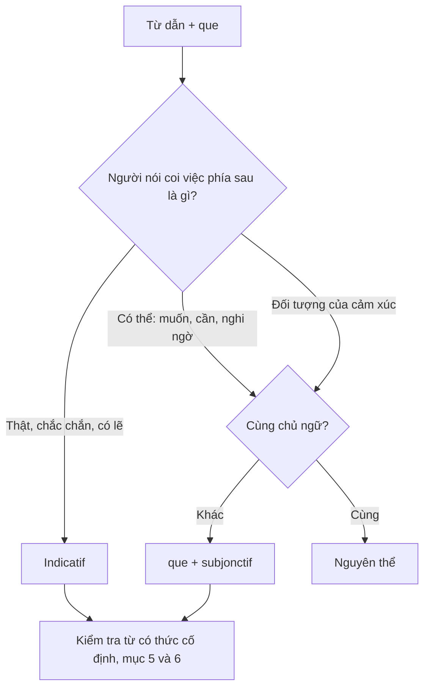
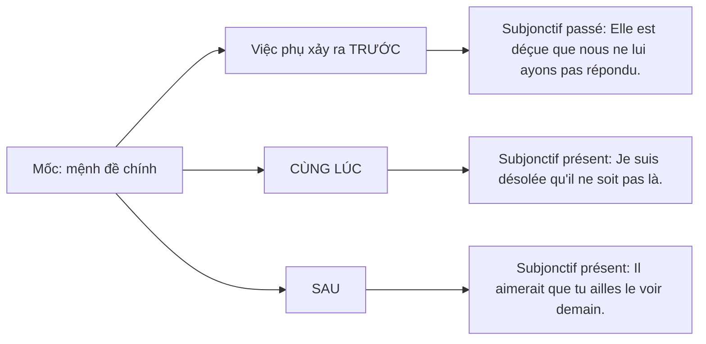

Subjonctif (thức giả định) là chỗ nhiều người Việt học tiếng Pháp vẫn chọn theo cảm giác. Bài này bắt đầu từ một lỗi thật trong bài kiểm tra của tôi, đưa ra một câu hỏi để chọn thức (người nói coi sự việc là thật, hay mới là điều có thể?), rồi soát lại sổ tay ngữ pháp của tôi bằng từ điển, sách ngữ pháp và nghiên cứu về người học. Kết quả: khoảng mười chỗ cần sửa, mười cặp hay nhầm và vài gợi ý nên học gì trước.

## 1. Một chữ giáo viên sửa

Trong bài kiểm tra viết *Test 2* ở Institut Français (lớp Niveau avancé 2/4), tôi viết: *Pour résoudre ces problèmes, il faut que la ville sciait agir.* Giáo viên gạch *sciait agir* và viết lên trên dạng subjonctif của *agir*. Câu đúng là *il faut que la ville agisse* (để giải quyết các vấn đề này, thành phố phải hành động). Bài được 7,5/10, riêng mục hình thái – cú pháp chỉ được 1/2 ([bài Test 2](/blog/test-2-proposer-un-projet-pour-ameliorer-la-vie-des-habitants-a-hanoi/)).

Trên ảnh bản gốc, ngay trước đó có một cụm tôi tự gạch, đọc ra giống *il faudrait que la ville*. Tôi biết sau *il faut* cần *que*, nhưng không chắc động từ phải ở dạng nào; *sciait* không phải dạng chia của động từ nào (mục 11). Vậy vì sao phải là *agisse*, và làm sao biết lúc nào cần subjonctif?

Khi soạn bài, tôi nhận ra phần subjonctif trong sổ tay viết tay của mình (Memo 179–190) trùng gần như hoàn toàn với *Tex's French Grammar* của Đại học Texas tại Austin, từ thứ tự mục, danh sách động từ đến các nhãn nhóm (Blyth et al., n.d.). Sổ thực chất là bản dịch của nguồn này, mang theo vài chỗ khái quát quá rộng. Vì vậy bài viết soát lại sổ bằng từ điển của Viện Hàn lâm Pháp (Académie française), Banque de dépannage linguistique của Office québécois de la langue française (OQLF), từ điển Larousse, sách ngữ pháp của Boularès và Frérot (1997) và nghiên cứu về người học.

## 2. Subjonctif là gì và không là gì

Viện Hàn lâm Pháp định nghĩa subjonctif là một thức có ngôi (*mode personnel*), thường dùng trong mệnh đề phụ và luôn có *que* đứng trước, trừ vài cách dùng cố định như *Ainsi soit-il* (Académie française, n.d.-a). OQLF gọi nó là "le mode de la possibilité, de l'hypothèse", còn indicatif (thức chỉ định) trình bày sự việc như điều chắc chắn hoặc có lẽ sẽ xảy ra (Office québécois de la langue française [OQLF], n.d.-a).

Sổ của tôi viết "thức là thuật ngữ giúp phân loại thì của động từ", và bài [thì, thể, thức](/blog/temps-aspect-mode-et-voix-thi-the-thuc-va-dang/) cũng viết vậy. Cách nói này chưa đúng: **thì** cho biết sự việc xảy ra khi nào, còn **thức** cho biết người nói trình bày nó như sự thật, mệnh lệnh, điều kiện hay khả năng. Câu "một trong 4 thức" cũng tuỳ cách đếm:

| Cách đếm                                     | Số thức  | Ghi chú                                                                     |
| -------------------------------------------- | -------- | --------------------------------------------------------------------------- |
| *Tex's French Grammar*, sổ chép theo          | 4        | indicatif, subjonctif, conditionnel, impératif                              |
| Sơ đồ "French Moods" cuối sổ                 | 6        | thêm infinitif, gérondif (không chia theo ngôi)                             |
| Viện Hàn lâm Pháp (Académie française, 2015) | 3 hoặc 4 | conditionnel là thức theo ngữ pháp truyền thống, là thì theo nhiều nhà ngữ pháp hiện nay |

Bảng 1. Ba cách đếm thức (xem thêm [sơ đồ các thức](/blog/les-modes-et-la-ligne-du-temps-cac-thuc-va-truc-thoi-gian/) và [conditionnel](/blog/les-phrases-avec-si-et-le-conditionnel-cau-dieu-kien-si-va-thuc-dieu-kien/)).

Sổ ghi subjonctif "có 2 thì", đủ dùng cho tiếng Pháp thông dụng. Thật ra có 4 thì, nhưng imparfait và plus-que-parfait "pratiquement sortis de l'usage" (OQLF, n.d.-a); chỉ cần nhận ra khi đọc, như *Qu'il mourût* của Corneille (Académie française, n.d.-a). Sổ ghi đúng rằng subjonctif tự nó không chỉ thời gian: *J'insiste pour qu'il vienne* và *J'insistais pour qu'il vienne* dùng cùng dạng *vienne* (OQLF, n.d.-a). Nó cũng có thể đứng một mình để ra lệnh hay cầu mong: *Qu'il parte !* (Académie française, n.d.-a), *Pourvu qu'il fasse beau pendant mes vacances* (OQLF, n.d.-d), *Vive la France !* ([động từ -er](/blog/les-verbes-introduction-et-verbes-reguliers-au-present-dong-tu-gioi-thieu-va-chi/)).

Sổ dùng lẫn "thức cầu khẩn" và "thể giả định"; loạt bài này thống nhất gọi là **thức giả định**, vì "cầu khẩn" dễ lẫn với thức mệnh lệnh, còn "thể" dành cho *aspect*. Thêm một nhận xét của người viết: tiếng Việt không chia động từ theo thức. Ý "mong", "phải", "sợ", "dù" nằm ở từ ngữ, nên người Việt phải tập nhận ra chúng trong từ dẫn rồi đổi hình thái động từ phía sau.

## 3. Chia động từ: một quy tắc, ba lớp ngoại lệ

Quy tắc gốc: lấy ngôi *ils* của hiện tại indicatif, bỏ *-ent*, thêm *-e, -es, -e, -ions, -iez, -ent*: *ils partent → que je parte* (Boularès & Frérot, 1997, tr. 56; Blyth et al., n.d.). Với động từ -er, kết quả trùng gần hết với dạng đã biết:

| Ngôi | Indicatif présent | Subjonctif présent | Imparfait |
| ---- | ----------------- | ------------------ | --------- |
| je   | parle             | que je parle       | parlais   |
| nous | parlons           | que nous parlions  | parlions  |
| vous | parlez            | que vous parliez   | parliez   |
| ils  | parlent           | qu'ils parlent     | parlaient |

Bốn ngôi *je, tu, il, ils* (dạng "boot") giống hệt indicatif, *nous, vous* giống imparfait (Wiktionnaire, n.d.), nên ghi chú lề Memo 180 của sổ là đúng; *acheter* cũng vậy (*que j'achète, que nous achetions*). Hệ quả: với động từ -er, người đọc **không thể biết** người viết có chọn subjonctif hay không (*que la mairie vérifie* trùng với indicatif). Chỉ động từ có dạng riêng mới cho thấy rõ: *il agit* nhưng *qu'il agisse* (Wiktionnaire, n.d.). Đó là lý do lỗi của tôi lộ ra.

| Lớp | Động từ | Dạng subjonctif |
| --- | --- | --- |
| 0. Theo quy tắc, kể cả nhiều động từ bất quy tắc ở indicatif | dormir, partir, lire, dire, écrire, mettre, connaître, agir | *que je dise, qu'il agisse*; ngôi *ils* giống indicatif |
| 1. Hai gốc: *ils* cho dạng "boot", *nous* cho *nous, vous* | venir, prendre, boire, croire, devoir, recevoir, voir, acheter | *que je vienne, que nous venions*; ngôi *ils* giống indicatif |
| 2. Gốc "boot" riêng | aller, vouloir, valoir | *que j'aille, que je veuille, que je vaille*; **khác**: *qu'ils aillent, veuillent, vaillent* |
| 3. Gốc hoàn toàn riêng | être, avoir, faire, pouvoir, savoir | **khác**: *qu'ils soient, aient, fassent, puissent, sachent* |

Bảng 2. Một quy tắc và ba lớp ngoại lệ (Blyth et al., n.d.; Larousse, n.d.-b; Wiktionnaire, n.d.).

Bảng này sửa hai chỗ trong sổ. Thứ nhất, sổ (theo Tex) xếp *aller, vouloir* vào nhóm hai gốc, nhưng *aill-, veuill-* không lấy từ *ils vont, ils veulent* (Larousse, n.d.-b); *valoir* cũng vậy, và đáng nhớ vì *il vaut mieux que* là một từ dẫn subjonctif. Thứ hai, Memo 181 viết "đối với tất cả các cách chia động từ, ngôi thứ 3 số nhiều của subjonctif luôn giống indicatif". Câu gốc của Tex nằm trong phần về động từ có quy tắc; chép thành "tất cả" thì sai với lớp 2 và 3 (chính bảng *avoir* trong sổ có *ils ont / qu'ils aient*). Viết lại: ngôi *ils* giống indicatif **ở mọi động từ lấy gốc subjonctif từ ngôi *ils***.

Sổ ghi đúng rằng *avoir, être* viết *nous, vous* bằng chữ *y* (*ayons, soyez*) và mệnh lệnh của *avoir, être, savoir* dựa trên gốc subjonctif (*aie, sois, sache*; xem [thức mệnh lệnh](/blog/l-imperatif-thuc-menh-lenh/)), nhưng còn thiếu các động từ phi ngôi: *falloir → qu'il faille*, *valoir → qu'il vaille* (Larousse, n.d.-b), *pleuvoir → qu'il pleuve* (*il se peut qu'il pleuve demain*; Boularès & Frérot, 1997, tr. 66). Vì gốc subjonctif đi từ hiện tại indicatif, nắm chắc [động từ có quy tắc](/blog/les-verbes-introduction-et-verbes-reguliers-au-present-dong-tu-gioi-thieu-va-chi/) và [bất quy tắc](/blog/les-verbes-irreguliers-au-present-dong-tu-bat-quy-tac-o-thi-hien-tai/) ở hiện tại là đã đi được nửa đường.

## 4. Nguyên tắc chọn thức: thực tại hay khả năng

Theo Boularès và Frérot (1997, tr. 62), thức ở mệnh đề phụ do **động từ dẫn** quyết định, tuỳ cách người nói nhìn sự việc phía sau *que*: "Lorsque le locuteur envisage une réalisation possible, le subjonctif est utilisé" (khi người nói hình dung một việc **có thể** xảy ra thì dùng subjonctif). Sách minh hoạ bằng một thang (tr. 56, 62): *il est certain qu'il viendra* (chắc chắn) và *il est probable qu'il viendra* (có lẽ) dùng indicatif; *il est possible qu'il vienne* (có thể) dùng subjonctif.

Ranh giới nằm giữa "có lẽ" và "có thể", không phải giữa "chắc" và "không chắc"; người học hay đoán sai ở đây. OQLF nói cùng ý: indicatif trình bày sự việc như sẽ xảy ra "de façon certaine ou probable" (OQLF, n.d.-a).

Phủ định hoặc đảo ngữ nghi vấn đẩy động từ ý kiến sang phía "có thể": *Je crois qu'il est prêt*, nhưng *Croyez-vous qu'il soit prêt ?* và *Je ne crois pas qu'il le sache* (Boularès & Frérot, 1997, tr. 56; xem [phủ định](/blog/la-negation-phu-dinh/) và [câu hỏi](/blog/l-interrogation-cau-hoi/)). OQLF xếp động từ kéo theo subjonctif thành ba nhóm: ý kiến hoặc đánh giá, ý muốn, cảm xúc; riêng với ý muốn, OQLF giải thích điều ta muốn "demeure de l'ordre du possible" (OQLF, n.d.-c). Điều kiện thứ hai là **hai chủ ngữ khác nhau**: *J'aimerais qu'il vienne*, nhưng *J'aimerais venir* khi người muốn và người đến là một (Boularès & Frérot, 1997, tr. 56).

Hình 1. Câu hỏi chọn thức, vẽ lại theo ý của Boularès và Frérot (1997, tr. 56, 62).

Nguyên tắc này không giải thích được mọi trường hợp. *Je regrette qu'elle soit fâchée* (tôi tiếc là cô ấy giận) nói về việc có thật mà vẫn dùng subjonctif (Boularès & Frérot, 1997), *bien que* cũng vậy. Ở những chỗ này, thức là **quy ước gắn với từng từ** (Poplack et al., 2013; mục 10). Người học cần cả hai: nguyên tắc để hiểu, và một danh sách ngắn đã kiểm chứng để dùng.

## 5. Các nhóm từ kéo theo subjonctif, đã soát lại

Sổ chia từ dẫn theo nhóm như Tex. Tôi giữ cách chia này và soát lại từng nhóm.

**Bắt buộc.** *Il faut que, il est nécessaire / important que, il vaut mieux que* (Boularès & Frérot, 1997, tr. 58); sổ ghi thêm, theo Tex, rằng *il faut que* nhấn mạnh hơn *devoir* + nguyên thể ([động từ khuyết thiếu](/blog/verbes-pronominaux-modaux-impersonnels-et-infinitif-dong-tu-phan-than-khuyet-thi/)). Bản nháp viết lại bài Test 2 của tôi dùng đúng: *Il serait nécessaire que la mairie vérifie la faisabilité technique.*

**Ý muốn.** *Vouloir, désirer, souhaiter, exiger, préférer que* (OQLF, n.d.-c). Sổ dịch *souhaiter que* là "to hope that"; nên là "to wish that": *Je souhaite que tu guérisses rapidement* (OQLF, n.d.-c). *Attendre que* chủ yếu là "đợi đến khi" (*J'attends qu'il ait fini pour partir*), nhưng Larousse cũng ghi nghĩa "trông chờ" nên chữ "expect" của sổ không sai; nghĩa "đoán trước" thì dùng *s'attendre à ce que*: *je m'attends à ce qu'il m'écrive* (Larousse, n.d.-a).

**Mâu thuẫn "hope" và *espérer*.** Memo 179 viết subjonctif diễn đạt "hy vọng", Memo 187 lại ghi *espérer* đi với indicatif; cả hai đều có trong Tex. Theo Larousse, *espérer que* ở câu khẳng định đi với indicatif hoặc conditionnel (*nous espérons qu'il viendra*); chỉ ở câu phủ định, nghi vấn mới có thể dùng subjonctif (*je n'espère plus qu'elle vienne*) (Larousse, n.d.-d). "Hy vọng" là ý nghĩa, còn thức do **từ** quyết định.

**Cảm xúc.** *Regretter, craindre, avoir peur, être content / désolé que, il est dommage que* (OQLF, n.d.-c). Các dòng sổ để trống nghĩa có thể điền: *redouter que, avoir peur que* (sợ rằng), *être heureux que* (vui vì), *être malheureux que* (buồn vì). Sau *craindre que* thường có *ne* explétif, không mang nghĩa phủ định: *Je crains qu'il ne veuille partir malgré tout* (OQLF, n.d.-c).

**Nghi ngờ.** *Douter que, il est possible / douteux que, il se peut que* (Boularès & Frérot, 1997, tr. 62). Sổ (theo Tex) viết nghi ngờ bị phủ định thì dùng indicatif. Thật ra *ne pas douter que* thông thường đi với subjonctif (*je ne doute pas qu'il vienne*), indicatif chỉ để nhấn mạnh sự thật (*je ne doute pas qu'il sera présent à l'heure dite*) (Larousse, n.d.-c).

**Danh sách "chắc chắn → indicatif"** trên giấy note dán ở Memo 184–185 đúng với hầu hết các dòng (*croire, penser, être sûr, il est certain / probable que*), trừ hai dòng:

- *Il me semble que* + indicatif vì là ý kiến (*il me semble que tu as grandi*), nhưng *il semble que* + subjonctif khi không chắc (*il semble qu'il se soit perdu*), + indicatif khi thấy rõ (*il semble qu'il s'est perdu*) (Larousse, n.d.-e).
- *Supposer que* (cho rằng) + indicatif: *Nous supposons qu'il sera là*; nhưng *supposons que* (giả sử) + subjonctif: *Supposons qu'il ne vienne pas* (Boularès & Frérot, 1997, tr. 64). OQLF cũng xếp *à supposer que* vào nhóm luôn đi với subjonctif (OQLF, 2025).

Dòng *se douter que* (đoán là) + indicatif thì đúng (Larousse, n.d.-c).

**Mệnh đề quan hệ.** Tiền ngữ chưa chắc tồn tại thì dùng subjonctif: *Je cherche un traducteur qui connaisse l'anglais, le français et le japonais* (Boularès & Frérot, 1997, tr. 58). So sánh *Connaissez-vous quelqu'un qui puisse m'aider ?* với *Je connais quelqu'un qui peut vous aider* (Académie française, n.d.-b; xem [đại từ quan hệ](/blog/pronoms-indefinis-demonstratifs-possessifs-et-relatifs-dai-tu-bat-dinh-chi-dinh/)).

**So sánh nhất, *le seul, le premier*.** Sổ nói subjonctif khi là ý kiến chủ quan, indicatif khi là sự thật. Nguồn chuẩn xác nhận, thêm rằng subjonctif thường gặp nhưng không bắt buộc (OQLF, 2016): *Voici le meilleur vin que l'on puisse trouver dans la région*, nhưng *Ce soir, c'est le meilleur qui a gagné* (Académie française, n.d.-b). Nhóm ý kiến phi ngôi (*il est bon / juste / urgent que*) giữ như sổ.

| Từ dẫn                     | Thức                                 | Sổ ghi → sửa                     |
| -------------------------- | ------------------------------------ | -------------------------------- |
| *souhaiter que*            | subjonctif                           | "to hope" → "to wish"            |
| *espérer que* (khẳng định) | indicatif hoặc conditionnel          | Giải mâu thuẫn Memo 179/187      |
| *ne pas douter que*        | subjonctif; indicatif để nhấn mạnh   | "luôn indicatif" → cả hai        |
| *il semble que*            | subjonctif hoặc indicatif            | Tách khỏi *il me semble que*     |
| *supposons que*            | subjonctif                           | "luôn indicatif" → tuỳ nghĩa     |
| *le meilleur… que*         | subjonctif thường gặp                | Thêm "không bắt buộc"            |

Bảng 3. Các từ dẫn cần sửa so với sổ.

## 6. Mười cặp hay nhầm

Khi ôn thi, có ích nhất là những cặp chỉ khác một chữ mà đổi thức:

| #   | Indicatif                                                  | Subjonctif                                          | Đổi vì                  | Nguồn                          |
| --- | ---------------------------------------------------------- | --------------------------------------------------- | ----------------------- | ------------------------------ |
| 1   | *Je pense qu'il viendra.*                                  | *Je ne pense pas qu'il vienne.*                     | Phủ định ý kiến         | Boularès & Frérot (1997)       |
| 2   | *Il est probable qu'il viendra.*                           | *Il est possible qu'il vienne.*                     | Có lẽ / có thể          | Boularès & Frérot (1997)       |
| 3   | *Il me semble que tu as grandi.*                           | *Il semble qu'il se soit perdu.*                    | Ý kiến / không chắc     | Larousse (n.d.-e)              |
| 4   | *Nous espérons qu'il viendra.*                             | *Je souhaite que tu guérisses rapidement.*          | Quy ước theo từ         | Larousse (n.d.-d); OQLF (n.d.-c) |
| 5   | *Nous supposons qu'il sera là.*                            | *Supposons qu'il ne vienne pas.*                    | Cho rằng / giả sử       | Boularès & Frérot (1997)       |
| 6   | *Il dit qu'il viendra demain.*                             | *Dites-lui qu'il vienne tout de suite.*             | Thuật lại / ra lệnh     | Boularès & Frérot (1997)       |
| 7   | *Je comprends qu'il est fatigué.*                          | *Je comprends qu'il soit fatigué.*                  | Nhận ra / thông cảm     | Boularès & Frérot (1997)       |
| 8   | *Il a parlé fort, de sorte que tout le monde l'a entendu.* | *Parle fort, de sorte que tout le monde t'entende.* | Kết quả / mục đích      | OQLF (2025)                    |
| 9   | *Après qu'ils seront arrivés, ils iront saluer ma tante.*  | *Avant qu'il ait commencé, j'aurai fini.*           | *Après que / avant que* | OQLF (n.d.-b)                  |
| 10  | *Même s'il pleut, je sortirai.*                            | *Bien qu'il pleuve, je sortirai.*                   | *Même si / bien que*    | Boularès & Frérot (1997)       |

Bảng 4. Mười cặp indicatif / subjonctif. Ví dụ ở dòng 6, 7, 8, 10 do tôi đặt theo quy tắc của nguồn (Boularès & Frérot, 1997, tr. 56–64, 152).

Ở cặp 6, mệnh lệnh trong câu tường thuật thường chuyển thành *dire de* + nguyên thể (*Dites-lui de venir*; xem [câu tường thuật](/blog/le-discours-rapporte-cau-tuong-thuat/)). *Admettre* đổi thức giống *comprendre* ở cặp 7: *J'admets que j'ai eu tort* (thừa nhận sự thật), *J'admets qu'on puisse ne pas être d'accord* (thấy chấp nhận được). Cặp 9 là bẫy loại suy: *avant que* + subjonctif vì việc chưa xảy ra, *après que* + indicatif vì việc đã hoặc chắc chắn sẽ xảy ra (Académie française, n.d.-a). Cặp 10 là quy ước, không phải nghĩa: cùng một cơn mưa có thật mà hai liên từ đòi hai thức.

## 7. Liên từ: phần tóm tắt

Liên từ có [bài riêng](/blog/les-conjonctions-lien-tu/); ở đây chỉ bàn phần thuộc về subjonctif. OQLF liệt kê các liên từ luôn đi với subjonctif, trong đó có *à condition que, afin que, à moins que, avant que, de peur que, en attendant que, jusqu'à ce que, pour que, pourvu que, sans que*; *bien que* thường đi với subjonctif, còn với *quoique* và *le fait que* thì subjonctif "fréquent mais non obligatoire" (OQLF, 2025). Có bốn chỗ cần sửa so với sổ:

- **Nhóm của *sans que*.** Sổ (theo Tex) xếp *sans que* vào nhóm điều kiện. Boularès và Frérot (1997, tr. 152) xếp nó vào phần nhượng bộ, mang nghĩa phủ định: *Elles sont venues sans que je les aie invitées*.
- ***Ne* explétif.** Sổ chỉ ghi *ne* sau *de crainte que, de peur que*. Boularès và Frérot (1997, tr. 58–60) thêm *avant que, à moins que*: *à moins que tu (ne) viennes me chercher*.
- ***Après que* + indicatif.** Sổ chưa có. *Après que* đi với passé antérieur hoặc thì khác của indicatif (*Après qu'ils furent arrivés, ils allèrent saluer ma tante*); dùng subjonctif sau *après que* bị phê phán vì mệnh đề nói về điều chắc chắn (OQLF, n.d.-b; xem [passé antérieur](/blog/le-passe-simple-et-le-passe-anterieur-qua-khu-don-va-qua-khu-truoc/)).
- ***De sorte que*** chỉ đi với subjonctif khi chỉ mục đích; khi chỉ kết quả đã xảy ra thì dùng indicatif (OQLF, 2025; cặp 8).

Sổ (theo Tex) còn ghi bốn liên từ giữ subjonctif dù hai mệnh đề cùng chủ ngữ: *bien que, quoique, pourvu que, jusqu'à ce que* (*Tex veut attendre jusqu'à ce qu'il se sente prêt*; Blyth et al., n.d.). Cả bốn đều không nằm trong danh sách phải đổi sang nguyên thể ở mục 9, nên không mâu thuẫn với Boularès và Frérot (1997, tr. 76).

## 8. Subjonctif passé và quan hệ thời gian

Subjonctif passé tạo giống passé composé: *avoir* hoặc *être* ở subjonctif présent cộng phân từ quá khứ (Boularès & Frérot, 1997, tr. 60; Blyth et al., n.d.), cùng quy tắc chọn trợ động từ và hợp giống số như ở [bài về passé composé](/blog/present-passe-recent-et-passe-compose-hien-tai-qua-khu-gan-va-passe-compose/): *que j'aie fini, qu'elle soit partie*. Hai thì phân biệt theo quan hệ thời gian giữa hai việc:

Hình 2. Chọn subjonctif présent hay passé (ví dụ của Boularès & Frérot, 1997, tr. 60).

Subjonctif passé còn dùng cho việc sẽ xong trước một mốc tương lai: *Il faut que vous soyez rentrés avant minuit* (Boularès & Frérot, 1997, tr. 60). Hình này giúp đọc lại Memo 190, nơi sổ ghi "HT giả định biểu thị một hành động đồng thời hoặc hơt (?) trong tương lai": đối chiếu với sách, "hơt" nhiều khả năng là "hoặc sau", nhưng tôi sẽ kiểm tra lại trang sổ.

Sổ ghi đúng rằng thì của mệnh đề chính **không** quyết định thì của subjonctif (ví dụ *J'insiste / J'insistais pour qu'il vienne* ở mục 2); bảng hoà hợp thì ở [bài về câu tường thuật](/blog/le-discours-rapporte-cau-tuong-thuat/) cũng giữ subjonctif présent ở cả hai cột.

Hai thì văn chương

*Imparfait* và *plus-que-parfait du subjonctif* gần như không còn dùng (OQLF, n.d.-a); chỉ cần nhận ra khi đọc. Đừng nhầm *qu'il fût* (có dấu mũ, subjonctif) với *il fut* (passé simple); *après qu'ils furent arrivés* là passé antérieur của indicatif.

## 9. Khi nào tránh subjonctif

Sổ coi việc tránh subjonctif là lựa chọn văn phong. Boularès và Frérot (1997, tr. 76) cho thấy có chỗ nó **bắt buộc**: khi hai mệnh đề cùng chủ ngữ, *pour que, afin que, avant que, sans que, de peur que, de crainte que, en attendant que* phải đổi thành *pour, afin de, avant de, sans, de peur de, de crainte de, en attendant de* + nguyên thể. Bài Test 2 của tôi viết đúng: *elle devrait vérifier la faisabilité technique avant de commencer la construction*. Động từ ý muốn cũng vậy: *Je voudrais sortir*, không viết *je voudrais que je sorte*; với *espérer*, nguyên thể cho giọng trang trọng: *J'espère recevoir bientôt de vos nouvelles* (Boularès & Frérot, 1997, tr. 56, 76).

Khi nói chung chung, cụm phi ngôi đi với nguyên thể: *il est nécessaire de réduire le nombre de véhicules*, *il vaut mieux vérifier les conditions du logement* (bản gốc của tôi là *il veut mieux de vérifier*, giáo viên sửa thành *vaut* và bỏ *de*; xem [động từ phi ngôi và nguyên thể](/blog/verbes-pronominaux-modaux-impersonnels-et-infinitif-dong-tu-phan-than-khuyet-thi/)). Cũng có thể đổi liên từ thành giới từ + danh từ: *bien qu'il ait des soucis → malgré ses soucis* (Blyth et al., n.d.), *jusqu'à ce que* + mệnh đề → *jusqu'à* + danh từ ([giới từ](/blog/les-prepositions-gioi-tu/)). Tránh subjonctif là kỹ năng tốt, nhưng lúc nào cũng tránh thì sẽ không luyện được dạng chia (mục 11).

## 10. Người bản ngữ và người học thật sự dùng subjonctif thế nào

Sách ngữ pháp cho biết **nên** dùng subjonctif ở đâu; nghiên cứu cho biết người ta **thật sự** dùng nó ở đâu, và người học vấp ở chỗ nào.

**Lời nói tự nhiên.** Poplack, Lealess và Dion (2013) so sánh tiếng Pháp Québec nói hằng ngày với lời khuyên của sách ngữ pháp suốt năm thế kỷ. Từ thế kỷ 16, sách đã gắn subjonctif với hàng trăm từ dẫn và sắc thái nghĩa, nhưng trong lời nói tự phát, subjonctif gần như chỉ xuất hiện quanh một nhóm nhỏ động từ. Yếu tố quyết định mạnh nhất không phải nghĩa mà là **chính từ dẫn**; subjonctif cũng được ưa dùng hơn khi động từ có dạng riêng dễ nhận ra, khi có *que*, và khi hai mệnh đề đứng sát nhau. Tôi mới đọc phần tóm tắt nên không nêu danh sách động từ cụ thể, nhưng kết quả này giải thích vì sao *agisse, fasse, soit* "nổi" hơn *vérifie*.

**Chín tháng ở Pháp.** McManus và Mitchell (2015) theo dõi 29 sinh viên tiếng Pháp của một trường đại học ở Anh trước và sau chín tháng sống ở Pháp. Tất cả đã dùng subjonctif ít nhiều trước khi đi, nhưng thời gian ở Pháp chỉ mang lại tiến bộ hạn chế. Subjonctif xuất hiện trong bài viết nhiều hơn bài nói, khớp với nghiên cứu ngữ liệu trước đó (O'Connor Di Vito, 1997, như được dẫn trong McManus & Mitchell, 2015). Người học nhận ra từ dẫn khẳng định kiểu *il faut que* tốt hơn liên từ và câu phủ định.

**Biết luật chưa chắc dùng được.** Dudley và Slabakova (2021) cho người Anh học tiếng Pháp làm bài đánh giá câu và theo dõi chuyển động mắt khi đọc. Họ nhận ra subjonctif khi chấm câu, nhưng không dùng được kiến thức đó lúc đọc để hiểu; kiến thức này chủ yếu là tường minh, chưa thành phản xạ.

**Subjonctif đến muộn.** Bartning và Schlyter (2004) đề xuất sáu giai đoạn phát triển tiếng Pháp nói của người lớn nói tiếng Thuỵ Điển. Ngữ cảnh bắt buộc đầu tiên là *il faut que*, nhưng lúc đầu người học đặt sau đó động từ chưa chia hoặc chia ở indicatif (như *il faut que j'écris*); ngữ cảnh đến muộn nhất là động từ ý kiến bị phủ định kiểu *je ne crois pas que* (tr. 287–288). Subjonctif xuất hiện từ giai đoạn 4 nhưng chưa ổn định, đến giai đoạn 5 mới dùng nhiều hơn.

**Hàm ý cho người Việt.** Tôi chưa tìm được nghiên cứu nào về người Việt học subjonctif, nên đây là nhận định của tôi:

1. Học trước các từ dẫn hay gặp (*il faut que*, ý muốn, cảm xúc) cùng các dạng bất quy tắc dùng nhiều: *être, avoir, faire, pouvoir, aller, savoir, vouloir*.
2. Luyện riêng câu phủ định và liên từ, chỗ yếu đã được ghi nhận ở người học khác (McManus & Mitchell, 2015; Bartning & Schlyter, 2004).
3. Dùng subjonctif khi nói và đọc thật, không chỉ trong bài điền từ (Dudley & Slabakova, 2021).

## 11. Soi lại bài viết của chính tôi

Rà ba bài viết có giáo viên chữa, tôi thấy năm chỗ phải chọn thức sau *que*. Đây chỉ là ví dụ minh hoạ, không phải thống kê; câu ở hai bài sau lấy từ bản chép đã sửa lỗi, còn phải đối chiếu với ảnh gốc.

| Bài | Câu | Thức cần | Đã viết | Subjonctif có dạng riêng? |
| --- | --- | --- | --- | --- |
| Test 2, bản gốc | *il faut que la ville sciait agir* | subjonctif | *sciait agir* (sai) | Có: *agisse / agit* |
| Test 2, bản nháp | *Il serait nécessaire que la mairie vérifie…* | subjonctif | *vérifie* (đúng) | Không |
| Trúng xổ số | *je crois que cette cause peut améliorer…* | indicatif | *peut* (đúng) | Có: *puisse / peut* |
| Cấm xe máy | *je pense que l'interdiction… serait…* | indicatif, conditionnel | *serait* (đúng) | Có: *soit / serait* |
| Cấm xe máy | *il est nécessaire de réduire…* | nguyên thể | *de réduire* (đúng) | Không áp dụng |

Bảng 5. Các ngữ cảnh chọn thức trong bài [Test 2](/blog/test-2-proposer-un-projet-pour-ameliorer-la-vie-des-habitants-a-hanoi/), bài [trúng xổ số](/blog/si-vous-gagniez-au-loto-que-feriez-vous-de-cet-argent/) và bài [cấm xe máy](/blog/etes-vous-pour-ou-contre-l-interdiction-des-motos-et-des-voitures-a-hanoi/).

Bốn đúng, một sai, nhưng **chỗ** sai mới đáng chú ý: đó là chỗ duy nhất mà subjonctif có dạng khác indicatif. Chỗ subjonctif "đúng" (*vérifie*) trùng dạng với indicatif nên không chứng minh được tôi đã chọn subjonctif; hai lần chọn đúng có dạng riêng (*peut, serait*) đều là indicatif sau động từ ý kiến khẳng định. Nghĩa là dữ liệu nhỏ này **chưa có câu nào cho thấy tôi tự tạo được một dạng subjonctif riêng**, và kiểu lỗi *il faut que* + dạng không phải subjonctif chính là kiểu Bartning và Schlyter (2004) mô tả. Ngoài ra có ba chỗ tôi chọn đúng nguyên thể: *avant de commencer* (Test 2), *avant de signer le contrat* và *il vaut mieux vérifier* (bài [tìm nhà](/blog/conseils-pour-trouver-un-logement-au-vietnam/)).

Về chữ *sciait*, tôi có hai giả thuyết nhưng chưa kết luận: định viết *sache agir* (subjonctif của *savoir*; câu vẫn đúng ngữ pháp), hoặc lẫn với *serait*, *savait*. Bài học cho lần sau: chủ động dùng vài cấu trúc có dạng subjonctif riêng, như *il faut que* + *faire, pouvoir, être*, để giáo viên có cơ hội sửa.

## 12. Tự kiểm tra và kết luận

Chia động từ trong ngoặc ở thức đúng:

1. *Je pense qu'il … (venir).*
2. *Je ne pense pas qu'il … (venir).*
3. *Il est probable qu'il … (venir).*
4. *Il est possible qu'il … (venir).*
5. *Nous espérons qu'il … (venir).*
6. *Il me semble que tu … (grandir).*
7. *Je cherche un traducteur qui … (connaître) le japonais.*
8. *On attendra jusqu'à ce que tu … (revenir).*
9. *Après qu'ils … (arriver), ils iront saluer ma tante.*
10. *Elle est déçue que nous ne lui … pas … (répondre).*
11. *Supposons qu'il ne … pas (venir).*
12. *Pour résoudre ces problèmes, il faut que la ville … (agir).*

Đáp án

**1–4.** *viendra* (hoặc *vient*), *vienne*, *viendra*, *vienne* (Boularès & Frérot, 1997).

**5–6.** *viendra* (Larousse, n.d.-d); *as grandi* (Larousse, n.d.-e).

**7.** *connaisse*: tiền ngữ chưa chắc tồn tại (Boularès & Frérot, 1997).

**8–9.** *reviennes* (OQLF, 2025); *seront arrivés*: *après que* + indicatif (OQLF, n.d.-b).

**10–11.** *ayons … répondu*: việc xảy ra trước; *vienne*: giả sử (Boularès & Frérot, 1997).

**12.** *agisse*.

Subjonctif không phải "thì của cảm xúc", cũng không chỉ là một danh sách để thuộc. Phần lớn trường hợp trả lời được bằng một câu hỏi: người nói coi việc phía sau *que* là thật (kể cả "có lẽ"), hay mới là điều có thể? Phần còn lại là quy ước theo từng từ (*espérer, après que* + indicatif; *regretter, bien que* + subjonctif dù nói về sự thật), và lời nói tự nhiên cũng cho thấy chính từ dẫn là yếu tố mạnh nhất (Poplack et al., 2013). Soát lại sổ, tôi sửa khoảng mười chỗ, từ định nghĩa thức và câu "ngôi *ils* luôn giống indicatif" đến *souhaiter, espérer, il semble que, supposer que, ne pas douter que, sans que, de sorte que, après que*. Về cách học: luyện câu phủ định, liên từ, dạng bất quy tắc thường dùng, và dùng subjonctif khi nói, đọc thật.

Ghi công

Cấu trúc và một phần danh sách trong sổ tay gốc dựa trên *Tex's French Grammar* (Blyth et al., n.d.), Français interactif, COERLL, The University of Texas at Austin, cấp phép CC BY 3.0. Bài này diễn đạt lại và sửa đổi, không dịch nguyên văn.

## Tài liệu tham khảo

Académie française. (n.d.-a). Subjonctif. In *Dictionnaire de l'Académie française* (9e éd.). https://www.dictionnaire-academie.fr/article/A9S3147

Académie française. (n.d.-b). Subordonnée relative : indicatif ou subjonctif ? In *Questions de langue*. https://www.dictionnaire-academie.fr/article/QDL083

Académie française. (2015, novembre). Le conditionnel est-il un mode ou un temps qui fait partie de l'indicatif ? In *Courrier des internautes*. https://www.dictionnaire-academie.fr/article/QR_0169

Bartning, I., & Schlyter, S. (2004). Itinéraires acquisitionnels et stades de développement en français L2. *Journal of French Language Studies, 14*(3), 281–299. https://doi.org/10.1017/S0959269504001802

Blyth, C., Kelton, K., Myers, L., Delyfer, C., Munn, Y., & Lippmann, J. (n.d.). *Tex's French grammar* [Các trang về subjonctif]. Français interactif, COERLL, The University of Texas at Austin. https://www.laits.utexas.edu/tex/gr/index.html

Boularès, M., & Frérot, J.-L. (1997). *Grammaire progressive du français avec 400 exercices: Niveau avancé*. CLE International.

Dudley, A., & Slabakova, R. (2021). L2 knowledge of the obligatory French subjunctive: Offline measures and eye tracking compared. *Languages, 6*(1), Article 31. https://doi.org/10.3390/languages6010031

Larousse. (n.d.-a). Attendre. In *Dictionnaire de français Larousse*. https://www.larousse.fr/dictionnaires/francais/attendre

Larousse. (n.d.-b). *Conjugaison* [Bảng chia aller, falloir, valoir, vouloir]. https://www.larousse.fr/conjugaison/francais

Larousse. (n.d.-c). Douter. In *Dictionnaire de français Larousse*. https://www.larousse.fr/dictionnaires/francais/douter

Larousse. (n.d.-d). Espérer. In *Dictionnaire de français Larousse*. https://www.larousse.fr/dictionnaires/francais/espérer

Larousse. (n.d.-e). Sembler. In *Dictionnaire de français Larousse*. https://www.larousse.fr/dictionnaires/francais/sembler

McManus, K., & Mitchell, R. (2015). Subjunctive use and development in L2 French: A longitudinal study. *Language, Interaction and Acquisition, 6*(1), 42–73. https://doi.org/10.1075/lia.6.1.02mcm

Office québécois de la langue française. (n.d.-a). Généralités sur le subjonctif. In *Banque de dépannage linguistique*. https://vitrinelinguistique.oqlf.gouv.qc.ca/24236/la-grammaire/le-verbe/modes/subjonctif/generalites-sur-le-subjonctif

Office québécois de la langue française. (n.d.-b). Mode verbal avec après que et avant que. In *Banque de dépannage linguistique*. https://vitrinelinguistique.oqlf.gouv.qc.ca/21132/la-grammaire/le-verbe/modes/concordance-des-temps/mode-verbal-avec-apres-que-et-avant-que

Office québécois de la langue française. (n.d.-c). Subjonctif après certains verbes. In *Banque de dépannage linguistique*. https://vitrinelinguistique.oqlf.gouv.qc.ca/24253/la-grammaire/le-verbe/modes/subjonctif/subjonctif-apres-certains-verbes

Office québécois de la langue française. (n.d.-d). Valeurs particulières du subjonctif. In *Banque de dépannage linguistique*. https://vitrinelinguistique.oqlf.gouv.qc.ca/24248/la-grammaire/le-verbe/modes/subjonctif/valeurs-particulieres-du-subjonctif

Office québécois de la langue française. (2016). Subjonctif et subordonnée relative. In *Banque de dépannage linguistique*. https://vitrinelinguistique.oqlf.gouv.qc.ca/25168/la-grammaire/le-verbe/modes/subjonctif/subjonctif-et-subordonnee-relative

Office québécois de la langue française. (2025). Subjonctif ou indicatif après les subordonnants composés. In *Banque de dépannage linguistique*. https://vitrinelinguistique.oqlf.gouv.qc.ca/24238/la-grammaire/le-verbe/modes/subjonctif/subjonctif-ou-indicatif-apres-les-subordonnants-composes

Poplack, S., Lealess, A., & Dion, N. (2013). The evolving grammar of the French subjunctive. *Probus, 25*(1), 139–195. https://doi.org/10.1515/probus-2013-0005

Wiktionnaire. (n.d.). *Conjugaison:français* [Bảng chia acheter, agir, parler, pouvoir, savoir]. https://fr.wiktionary.org/wiki/Conjugaison:français
