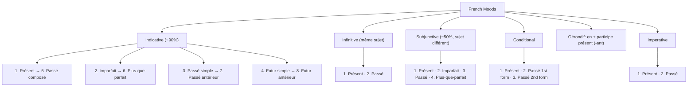

Chép từ sổ viết tay ngữ pháp tiếng Pháp (trang sơ đồ gấp cuối sổ, ảnh 3543; không có số Memo). Nội dung đã sửa lỗi; <code>(?)</code> là chỗ chưa đọc rõ.

Đã sửa so với sổ gốc

- Ảnh 3543: "to decribe" → "to describe"; "an advice" → "advice" (danh từ không đếm được); "Gérondif: en + pp" → "en + participe présent (-ant)" (pp trong sơ đồ dùng cho past participle); "Plus-que-parfat" → "Plus-que-parfait"; "présent progresif" → "présent progressif".

Cần kiểm tra

- Ảnh 3543: phần Infinitive ghi "après + aux + pp" với chữ "inf" bị gạch hoặc viết đè, không rõ.
- Ảnh 3543: dòng "Quand: cùng thì: mốc gần quand xảy ra trước" chép nguyên văn, chưa rõ ý.

<!-- Ảnh 3543 (trang sơ đồ gấp, chụp ngang) -->
## French Moods
*(Sơ đồ trong sổ: hộp "French Moods" ở giữa, nối xuống 6 hộp Indicative, Infinitive, Subjunctive, Conditional, Gérondif, Imperative; dưới cùng là trục thời gian các thì.)*

- **Indicative** (~90%): to relate facts and objective statements
	- 1\. Présent\* → 5. Passé composé\* (1) (→ [Présent et passé composé](/blog/tieng-phap/grammar/e-thi-thuc-the/17-present-passe-recent-et-passe-compose/))
	- 2\. Imparfait\* → 6. Plus-que-parfait\*\* (2) (→ [Imparfait et plus-que-parfait](/blog/tieng-phap/grammar/e-thi-thuc-the/18-l-imparfait-et-le-plus-que-parfait/))
	- 3\. Passé simple\*\* → 7. Passé antérieur (→ [Passé simple et passé antérieur](/blog/tieng-phap/grammar/e-thi-thuc-the/19-le-passe-simple-et-le-passe-anterieur/))
	- 4\. Futur simple\* → 8. Futur antérieur (→ [Futur simple](/blog/tieng-phap/grammar/e-thi-thuc-the/20-le-futur-proche-et-le-futur-simple/))
	- *(Trong sổ có ngoặc nối Passé composé (1) và Plus-que-parfait (2).)*
- **Infinitive** (même sujet): 1. Présent 2. Passé (→ [Infinitive constructions](/blog/tieng-phap/grammar/c-dong-tu/09-verbes-pronominaux-modaux-impersonnels-et-infinitif/))
	- avant de + to V
	- après + aux + pp (inf) (?)
- **Subjunctive** (~50%, sujet différent): to express opinions, feelings, doubt, unlikelihood. (→ [Subjonctif](/blog/tieng-phap/grammar/e-thi-thuc-the/22-le-subjonctif/))
	- 1\. Présent\* 2. Imparfait 3. Passé 4. Plus-que-parfait
- **Conditional**: to describe a condition, possibility, or contrary-to-fact statements (→ [Conditionnel](/blog/tieng-phap/grammar/e-thi-thuc-the/23-les-phrases-avec-si-et-le-conditionnel/))
	- 1\. Présent\* 2. Passé 1st form 3. Passé 2nd form
- **Gérondif**: en + participe présent (-ant) (→ [Present participle](/blog/tieng-phap/grammar/c-dong-tu/09-verbes-pronominaux-modaux-impersonnels-et-infinitif/); cách dùng: [Fiches de synthèse](/blog/tieng-phap/grammar/f-trang-tong-hop-cuoi-so/27-fiches-de-synthese-pour-l-expression/))
- **Imperative**: to give a command, advice (→ [Impératif](/blog/tieng-phap/grammar/e-thi-thuc-the/21-l-imperatif/))
	- 1\. Présent\* 2. Passé
- **Infinitive (To V)**
- **Les temps**: simples — composés (→ [Temps, aspect, mode et voix](/blog/tieng-phap/grammar/e-thi-thuc-the/16-temps-aspect-mode-et-voix/))
- Xem thêm: [Thức – les Modes](/blog/tieng-phap/grammar/g-tu-spreadsheet/29-modes-et-structure-de-la-phrase/) – mô tả indicatif, subjonctif, conditionnel, impératif theo sheet.

## Le passé – Le présent – Le futur
- **Quand**:
	- cùng thì: mốc gần quand xảy ra trước (?)
	- quand + simples, composés
- **Le présent**: présent, impératif, présent progressif

*(Trục thời gian trong sổ, từ trái sang phải; có đường lượn sóng nối từ Imparfait đến Passé récent.)*

| Thì (TP)         | Tương đương TA                        |
| ---------------- | ------------------------------------- |
| Plus-que-parfait | had + PII                             |
| Imparfait        | used to V; was/were Ving              |
| Passé composé    | Ved; have PII                         |
| Passé récent     | just + Ved; have just PII             |
| (Le présent)     | V(es/s) / Ving; V!; be currently Ving |
| Futur proche     | be going to V                         |
| Futur antérieur  | will have + PII                       |
| Futur simple     | will + V                              |

- Xem thêm: [Tableau récapitulatif des temps](/blog/tieng-phap/grammar/g-tu-spreadsheet/28-tableau-recapitulatif-des-temps/) – bảng tổng hợp đầy đủ các thì; [Discours rapporté](/blog/tieng-phap/grammar/e-thi-thuc-the/24-le-discours-rapporte/) – cách các thì này chuyển đổi khi tường thuật (concordance des temps).
