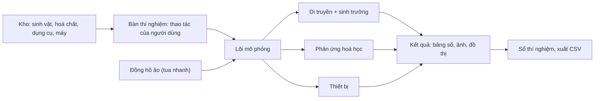

## Nguyên tắc
- **Tách lõi mô phỏng khỏi giao diện**: phần tính toán khoa học không phụ thuộc vào cách hiển thị, nên đổi từ 2D sang 3D hay từ web sang điện thoại không phải viết lại lõi.
- **Mô hình đơn giản nhưng đúng**: mỗi thí nghiệm dùng mô hình khoa học vừa đủ để ra kết quả đúng xu hướng, có tham số để chỉnh dần cho sát thực tế.
- **Ngẫu nhiên có kiểm soát**: kết quả có nhiễu như thí nghiệm thật, nhưng dùng seed để chạy lại ra đúng kết quả cũ khi cần.
- **Dữ liệu tách khỏi code**: sinh vật, hoá chất, phản ứng, máy mô tả bằng file dữ liệu (JSON hoặc YAML), để thêm thí nghiệm mới không cần sửa code.

## Các khối chính

| Khối | Mô hình | Dữ liệu cần |
| --- | --- | --- |
| **Di truyền** | Kiểu gen → giao tử (giảm phân, hoán vị theo khoảng cách trên NST) → tổ hợp → kiểu hình (trội – lặn, tương tác gen) | Gen, alen, vị trí gen trên NST, quan hệ trội – lặn |
| **Sinh trưởng** | Chuỗi giai đoạn theo thời gian: hạt → cây → hoa → quả; trứng → ấu trùng → nhộng → ruồi; phôi theo hpf | Thời gian mỗi giai đoạn, ảnh hưởng của nhiệt độ |
| **Phản ứng** | Bảng luật phản ứng + tỉ lượng + hiện tượng; về sau thêm cân bằng và tốc độ phản ứng | Chất (công thức, trạng thái, màu, độ tan), phản ứng, điều kiện |
| **Thiết bị** | Hàm "mẫu + thông số máy → tín hiệu": số bản sao theo chu kỳ (PCR), vị trí băng (điện di), sắc ký đồ (HPLC), độ hấp thụ (UV-Vis) | Thông số máy, tính chất của chất cần phân tích |
| **Đồng hồ ảo** | Thời gian chạy theo bước, có tua nhanh; các sự kiện (ra hoa, nở, hết chương trình chạy máy) được xếp lịch | Tốc độ tua của từng thí nghiệm |
| **Sổ thí nghiệm** | Ghi tự động mọi thao tác, thông số, kết quả | (không cần) |

## Công nghệ

- **Đã chọn (2026-10-15)**: bản web 3D trước, sau đó đóng gói thành phần mềm cài trên máy (ví dụ bằng Tauri hoặc Electron, dùng lại mã web).
- **Bộ khung hiện tại**: Three.js r170 tải qua CDN, JavaScript ES modules chạy thẳng trên trình duyệt, không cần build, vì máy chưa cài Node.js. Khi cài Node thì chuyển sang Vite + TypeScript, giữ nguyên cách chia `core/` (lõi mô phỏng), `scene/` (3D), `ui/` (giao diện), `data/` (JSON).
- Các hướng đã cân nhắc:

| Hướng | Ưu | Nhược |
| --- | --- | --- |
| **Web** (TypeScript + React; Canvas hoặc PixiJS cho 2D, Three.js cho 3D) | Chạy mọi nơi, dễ chia sẻ, sau này có thể đóng gói thành app | Thao tác 3D phức tạp tốn công hơn game engine |
| **Điện thoại** (React Native + Expo) | Dùng mọi lúc trên điện thoại | Màn hình nhỏ, khó thao tác bàn thí nghiệm |
| **Game engine** (Godot hoặc Unity) | Mạnh về 3D, vật lý, kéo thả | Nặng hơn, khó nhúng vào web |
